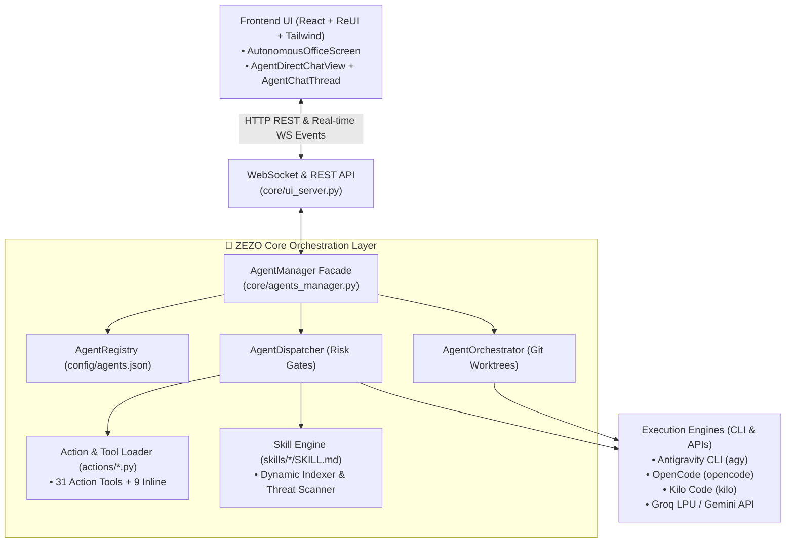
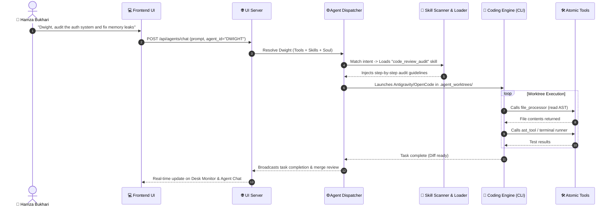

# 👥 ZEZO Autonomous Agents, Tools & Skills System — Complete Architecture & Reference

> **Project:** ZEZO  
> **Creator & Lead Architect:** Hamza Bukhari  
> **Target OS:** Windows 10/11 (Primary), macOS, Linux  
> **Key Modules:** [`core/agents_manager.py`](file:///c:/Users/Hamza%20Bukhari/Documents/antigravity/jarvis-57/core/agents_manager.py), [`core/agents/`](file:///c:/Users/Hamza%20Bukhari/Documents/antigravity/jarvis-57/core/agents/), [`core/action_loader.py`](file:///c:/Users/Hamza%20Bukhari/Documents/antigravity/jarvis-57/core/action_loader.py), [`core/skill_loader.py`](file:///c:/Users/Hamza%20Bukhari/Documents/antigravity/jarvis-57/core/skill_loader.py), [`core/ui_server.py`](file:///c:/Users/Hamza%20Bukhari/Documents/antigravity/jarvis-57/core/ui_server.py), [`frontend/src/components/office/`](file:///c:/Users/Hamza%20Bukhari/Documents/antigravity/jarvis-57/frontend/src/components/office/)

---

## 📖 1. Overview & Mental Model

ZEZO ka Autonomous Multi-Agent ecosystem **Atomic Executable Tools**, **Declarative Procedural Skills**, aur **Sandboxed Autonomous Agents** ka ek integrated framework hai:

1. **Tools (Atomic Actions):** Single-purpose executable Python functions (e.g. file write, web search, bash execution, window focus).
2. **Skills (Procedural Knowledge):** Markdown packages (`SKILL.md`) jo agent ko step-by-step master workflow, design guidelines, aur domain intelligence sikhate hain.
3. **Agents (Autonomous Operators):** Specialized digital workers jinke pas unka apna Persona (`SOUL.md`), assigned CLI Engine, allowed Tools, aur allowed Skills ka sandbox hota hai.



---

## 🛠️ 2. The Tools System (Atomic Executable Actions)

Tools ZEZO ke **hands and eyes** hain jo hardware, OS, files, aur web ke sath interact karte hain.

### A. Tool Discovery Pipeline (`core/action_loader.py`)
Application startup par `discover_actions()` trigger hota hai jo `actions/` folder ko scan karta hai:
- **Rule of Isolation:** Har tool apni alag `.py` file me hota hai (`actions/<tool_name>.py`).
- **Standardized Schema:** Har tool file export karti hai:
  1. `TOOL`: Gemini function declaration dictionary (`name`, `description`, `parameters`, `risk`).
  2. `handler(parameters: dict, **kwargs)`: Executable Python function.
- **Fail-Safe Isolation:** Agar kisi action module me syntax ya dependency error ho, to system crash nahi hota; sirf wo tool isolate hota hai aur baqi system online rehta hai.

### B. Tool Categories in ZEZO
1. **OS & Computer Control:** `computer_control.py`, `desktop.py`, `open_app.py`, `file_controller.py`, `file_processor.py`.
2. **Web & Research:** `web_search.py`, `web_reader.py`, `agent_reach.py`, `youtube_video.py`, `clone_website.py`.
3. **Coding & CLI Engines:** `antigravity_agent.py` (`antigravity_run`), `opencode_agent.py` (`opencode_run`), `kilo_agent.py` (`kilo_run`).
4. **Agent Operations:** `agents_control.py` (hire, fire, switch, peer delegation, status check).
5. **Memory & Reminders:** `memory_tool.py`, `recall_history.py`, `reminder.py`.
6. **Session Inline Tools (`main.py`):** Live mic/speaker toggle, screen OCR, neural orb, system shutdown.

### C. Risk Tier Matrix
Har tool par strict execution clearance policy enforced hoti hai:
- **`L0_READ_ONLY`:** Safe reading (e.g. `web_search`, `file_processor`, `system_status`). No state mutation.
- **`L1_MUTATION`:** Safe local generation (e.g. `opencode_run`, `open_app`, `run_skill`). Runs inside isolated worktree.
- **`L2_DESTRUCTIVE`:** High risk (e.g. delete file, git hard reset, terminate processes). Confirmation prompt triggered.

---

## 🧠 3. The Declarative Skills System (`skills/`)

Skills atomic tools nahi hain, balki **master workflows and intelligence procedures** hain jo Markdown format me package hote hain.

### A. Skill Package Structure (`skills/<skill_name>/SKILL.md`)
Har skill ek isolated directory me rehti hai:
```markdown
---
name: website_build
description: Master studio protocol for creating websites and UI adhering to Hamza Taste and anti-slop gates.
domain: ui
author: Hamza Bukhari
version: 1.0.0
triggers:
  - "create website"
  - "build landing page"
  - "frontend component"
allowed_tools:
  - file_processor
  - opencode_run
  - web_search
---

# Procedural Directives
1. Phase 1: Requirement Analysis & Design Tokens
2. Phase 2: Component Scaffolding
3. Phase 3: Anti-Slop Verification
```

### B. Dynamic Intent Indexing & Progressive Disclosure (`core/skill_loader.py`)
LLM ke context window ko clean rakhne ke liye ZEZO **Progressive Disclosure** use karta hai:
1. **Trigger Indexing:** Startup par sabhi skills ke triggers aur summaries index hote hain (low token overhead).
2. **Intent Matching:** Jab user directive deta hai, system triggers match karta hai.
3. **Dynamic Injection:** Sirf relevant skill ka step-by-step content runtime context me inject hota hai.

### C. Multi-Stage Threat Scanner (`core/skill_scanner.py`)
Har skill execute hone se pehle security scan se guzarti hai:
- Prompt injection aur jailbreak patterns block hote hain.
- Malicious shell commands ya obfuscated scripts sanitize hoti hain.
- Sensitive environment keys (`GEMINI_API_KEY`, passwords) leak hone se roki jati hain.

### D. Runtime Self-Learning Engine
Agar execution ke dauran ZEZO koi naya successful workflow discover karta hai, to model `save_learned_skill()` call karke ek naya `SKILL.md` autonomously synthesize aur save kar sakta hai.

---

## 👥 4. The Autonomous Agents Architecture (`core/agents/`)

Agents wo autonomous personas hain jinhein specific **Tools** aur **Skills** assign kiye jaate hain.

### A. Three Subsystems via Facade (`core/agents_manager.py`)
1. **`AgentRegistry` (`core/agents/registry.py`):**
   - Single source of truth: [`config/agents.json`](file:///c:/Users/Hamza%20Bukhari/Documents/antigravity/jarvis-57/config/agents.json).
   - Core protected agents (`MICHAEL`, `DWIGHT`, `JIM`, `PAM`) + Hamza ke custom agents.
   - Persona definitions (`SOUL.md`), model mappings, and desk status.
   - Episodic SQLite memory integration (`memory/sqlite_memory.py`).
2. **`AgentDispatcher` (`core/agents/dispatcher.py`):**
   - Keyword-based role inference (e.g. agar agent "QA" hai to test tools auto-assign hote hain).
   - Prompt assembly: `SOUL.md` + Assigned Skills + System rules + Project context.
3. **`AgentOrchestrator` (`core/agents/orchestrator.py`):**
   - **Git Worktree Isolation:** Har background task ke liye isolated `.agent_worktrees/<agent_name>_<hash>` directory banti hai.
   - Auto-merge conflict check and safe teardown.

---

## ⚡ 5. Interaction Matrix: How Tools, Skills & Agents Interact

Yeh matrix dikhati hai ke jab aap koi request dete hain to teeno systems kaise co-operate karte hain:



---

## 💬 6. Two Interaction Modes: Chat vs. Task Dispatch

Agent ke sath do mukhtalif tareeqon se interact kiya ja sakta hai:

| Feature | Direct 1-on-1 Chat Mode | Autonomous Task Dispatch Mode |
| :--- | :--- | :--- |
| **Trigger** | Normal text input (e.g., *"hi"*, *"explain this bug"*) | Explicit commands (`/task`, `/build`, `/dispatch`) ya voice action tools |
| **Execution** | Real-time direct LLM inference with agent's soul/persona | Launches background CLI process (`agy`, `opencode`, `kilo`) |
| **Tools/Skills Role** | Provides conversational domain intelligence | Executes file mutations, bash scripts, and skills in sandbox |
| **Workspace** | Reads current context in-place | Creates isolated `.agent_worktrees/` sandbox branch |
| **Response** | Natural, colleague-like spoken dialogue from agent | Background task ID assigned; progress streamed to Desk Monitor |

---

## 🖥️ 7. Frontend UI Integration (`frontend/src/components/office/`)

Frontend **ReUI design system** aur Tailwind CSS par mabni hai:

1. **`AutonomousOfficeScreen.tsx`:** Master container jahan left rail par agents unke dynamic **Blobatars** aur status badges (`IDLE`, `WORKING`) ke sath nazar aate hain.
2. **`AgentDirectChatView.tsx` & `AgentChatThread.tsx`:** Dedicated 1-on-1 direct chat thread with custom typewriter streaming, engine/model switcher dropdowns, and file attachment drawer.
3. **`AgentConfigModal.tsx`:** Modal jahan se aap agent ka name, role, assigned engine, model, **allowed tools**, aur **allowed skills** visually toggle kar sakte hain.
4. **`SkillsSettingsTab.tsx`:** Settings modal ke andar skills catalog jahan sabhi declarative packages ko view aur enable/disable kiya ja sakta hai.

---

## 📋 8. Complete API Endpoints Reference

| Endpoint | Method | Subsystem | Description |
| :--- | :---: | :---: | :--- |
| `/api/agents` | `GET` | Agents | Live state aur telemetry saare agents ki return karta hai |
| `/api/agents/chat` | `POST` | Agents | Direct 1-on-1 persona conversation ya task dispatch karta hai |
| `/api/agents/save` | `POST` | Agents | Agent profile, assigned tools, skills, aur model update karta hai |
| `/api/agents/hire` | `POST` | Agents | Naya custom autonomous agent register karta hai |
| `/api/agents/soul` | `POST` | Agents | Agent ka `SOUL.md` persona instruction update karta hai |
| `/api/agents/delete` | `POST` | Agents | Custom agent ko fire / remove karta hai (core agents protected hain) |
| `/api/skills` | `GET` | Skills | System me discovered declarative skills ki list aur frontmatter return karta hai |
| `/api/skills/toggle` | `POST` | Skills | Specific skill ko enable ya disable karta hai |
| `/api/actions` | `GET` | Tools | Active discovered action tools aur inline tools ka registry status deta hai |
