# 📋 ZEZO Phase 2 Execution Plan: External Agent Integration

> **Document Version:** Revision 1.0 (Execution Baseline)  
> **Status:** APPROVED FOR IMPLEMENTATION PLANNING  
> **Target OS:** Windows 10/11 (Primary), macOS, Linux  
> **Creator & Lead Architect:** Hamza Bukhari  
> **Architectural Source of Truth:** [`PHASE_2_IMPLEMENTATION_BLUEPRINT.md`](PHASE_2_IMPLEMENTATION_BLUEPRINT.md) (Revision 3.0 / R2 Final Consolidated)  
> **Baseline System Dependency:** Completed ZEZO Phase 1 (`core/path_jail.py`, `core/tool_executor.py`, `core/agents/context_budget.py`, `core/agents/provider_adapter.py`, `core/agents/runtime.py`, `memory/sqlite_memory.py`, `core/task_manager.py`)

---

**MANDATORY: Incremental Codebase Cleanup**

During every implementation batch, perform cleanup of code directly affected by the changes.

- Remove confirmed unused imports, functions, classes and duplicate logic.
- Consolidate obsolete execution paths when the new implementation replaces them.
- Identify unused files and dependencies, but delete only after verifying all references and runtime usage.
- Remove compatibility wrappers only when migration is complete.
- Keep architecture modular and avoid unnecessary abstractions.
- Do not modify unrelated working modules merely for cosmetic cleanup.
- Never delete user data, configuration, memory, database or protected audio/voice files.
- Update or remove obsolete tests only when their underlying behavior is intentionally replaced.

At the end of each batch, include a separate Cleanup Report:
1. Dead code removed.
2. Duplicate logic consolidated.
3. Files deleted.
4. Legacy code retained and why.
5. Remaining cleanup opportunities.

Run the complete regression suite after cleanup. Do not create a separate documentation or audit cycle unless a critical issue is discovered.
## Executive Engineering Summary

Phase 1 established an unassailable security foundation for internal autonomous agents: SQLite single-writer WAL queues, boundary-contained `PathJail`, centralized `ToolExecutor` choke point, provider-aware context budgets, and persistent SQLite conversations.

**Phase 2 executes the integration of external autonomous coding agent engines:**
1. **Google Antigravity CLI** (`agy.exe`)
2. **OpenCode CLI** (`opencode.cmd`)
3. **Kilo Code CLI** (`kilo.cmd`)

This execution plan translates the approved Revision 3.0 blueprint into **8 practical, sequential, independently verifiable engineering steps (Steps 0 through 7)**. It establishes an exact dependency graph, file-by-file targets, concrete implementation tasks, targeted test definitions, observable acceptance criteria, and specific risk mitigations.

### Architectural Invariants Strictly Enforced
- **Process Lifecycle Containment vs Security Sandbox:** Windows Job Objects (`JOB_OBJECT_LIMIT_KILL_ON_JOB_CLOSE`) provide process tree lifecycle and orphan elimination; they do **not** provide security sandboxing. Security is enforced exclusively by `ToolExecutor`, `PathJail`, and agent permission matrices.
- **ToolExecutor Scope Boundary:** `ToolExecutor` strictly gates **external engine dispatch actions** (`antigravity_run`, `opencode_run`, `kilo_run`). Once launched, internal tools executed by the external CLI binary operate closed-box and are **not** proxied by `ToolExecutor`.
- **Direct `CreateProcessW` Spawning:** Processes are spawned in `CREATE_SUSPENDED` state directly via Win32 `CreateProcessW`, obtaining both `hProcess` and `hThread` atomically, assigning the process handle to the Job Object, and calling `kernel32.ResumeThread(hThread)` without fragile Toolhelp snapshot scans.
- **Honest Indeterminate Telemetry:** Synthetic percentage saturation formulas are eliminated. UI progress utilizes an indeterminate activity spinner with dynamic runtime counters and discrete verified filesystem milestone badges.
- **Absolute Thought Privacy:** Reasoning blocks (`<think>...</think>`, reasoning deltas, and internal cognitive tokens) are completely stripped via an **Event Allowlist Architecture** and recursive dictionary sanitization before any logging, persistence, or WebSocket streaming.
- **Safe Ephemeral Prompts:** Large prompts ($> 800$ characters) are written to `.zezo_tmp/prompt_<task_id>.md` and cleaned up in `finally:` blocks without modifying user `.gitignore` files.
- **Dual-Mode Protocol Strategy:** Mode A (Headless CLI Streaming) is the primary baseline for all three engines. Mode B (stdio JSON-RPC ACP) is implemented for `agy` and `opencode` with an automatic 5.0s handshake timeout fallback to Mode A.

---

## High-Level Dependency Graph & Step Flow

```mermaid
flowchart TD
    S0["Step 0: Pre-Flight Environment & Capability Verification<br/>- ctypes kernel32 signatures<br/>- CLI binary path discovery<br/>- Phase 1 baseline regression"] --> S1["Step 1: Direct CreateProcessW Job Object Supervisor<br/>(core/engines/process_supervisor.py)<br/>- Suspended process creation<br/>- Atomic Job Object assignment<br/>- Inheritable stdio pipe redirection"]
    
    S1 --> S2["Step 2: Unified EngineAdapter Core & Normalizer<br/>(core/engines/adapter.py, models.py)<br/>- Event Allowlist filtering (thought suppression)<br/>- Safe ephemeral .zezo_tmp/ prompt offload<br/>- Indeterminate telemetry & milestone badges"]
    
    S2 --> S3["Step 3: Concrete Engine Adapters & Runner Delegation<br/>- core/engines/antigravity.py (stream-json)<br/>- core/engines/opencode.py (json)<br/>- core/engines/kilo.py (json)<br/>- Thin delegation in antigravity_runner, opencode_runner, kilo_runner"]
    
    S3 --> S4["Step 4: ToolExecutor Choke Point Integration<br/>- Gate antigravity_run, opencode_run, kilo_run in actions/<br/>- Enforce PathJail.secure_resolve_path()<br/>- Enforce CallerContext.AGENT & risk tier rules"]
    
    S4 --> S5["Step 5: Verified ACP Client Subsystem & Auto-Fallback<br/>(core/engines/acp_client.py)<br/>- stdio JSON-RPC 2.0 client for agy & opencode<br/>- Handshake initialization (timeout: 5.0s)<br/>- Graceful fallback to Mode A"]
    
    S5 --> S6["Step 6: Frontend Telemetry & Recovery Integration<br/>- Streaming terminal log drawer<br/>- Indeterminate spinner & milestone checkpoints<br/>- Interrupted task restart confirmation modal"]
    
    S6 --> S7["Step 7: Full Test Suite, Anti-Slop Audit & Docs Sync<br/>- Integration test suite tests/test_external_engines.py<br/>- Full pytest regression (108+ tests)<br/>- Sync docs/AGENTS_MANAGEMENT.md, docs/TASK_SYSTEM.md, LEARNING_JOURNAL.md"]

    classDef step fill:#1e293b,stroke:#3b82f6,stroke-width:2px,color:#fff;
    class S0,S1,S2,S3,S4,S5,S6,S7 step;
```

---

## Detailed Step-by-Step Execution Plan

### Step 0: Pre-Flight Environment & Capability Verification

#### 1. Objective
Establish an unassailable baseline before any new code is written: verify that Windows Win32 kernel ctypes bindings execute cleanly with 64-bit handle safety, verify local availability of CLI binaries, and confirm 100% pass rate on all 108 existing Phase 1 regression tests.

#### 2. Current State & Reusable Components
- `core/code_engines.py`: Contains existing discovery routines for `agy.exe`, `opencode.cmd`, and `kilo.cmd`.
- `memory/sqlite_memory.py`: Database initialized with `internal_task_ledger`, `agent_conversations`, `agent_messages`.
- `tests/`: 108 passing tests covering Phase 1 security choke points.

#### 3. Implementation Tasks
1. Execute `python -m pytest tests/` and verify all 108 tests pass with 0 failures.
2. Verify system architecture and Win32 kernel ctypes symbols:
   - `CreateProcessW`, `CreateJobObjectW`, `SetInformationJobObject`, `AssignProcessToJobObject`, `ResumeThread`, `CloseHandle`, `CreatePipe`, `SetHandleInformation`.
3. Verify CLI binary locations via `shutil.which` and vendor discovery directories:
   - `agy.exe` (`%LOCALAPPDATA%\agy\bin\agy.exe`)
   - `opencode.cmd` (`%APPDATA%\npm\opencode.cmd`)
   - `kilo.cmd` (`%APPDATA%\npm\kilo.cmd`)
4. Verify directory structure readiness: ensure `core/engines/` package directory can be created cleanly.

#### 4. Expected Files
- No source code modified.
- Create package directory: `core/engines/__init__.py`.

#### 5. Dependencies
None.

#### 6. Testing
- Command: `python -m pytest tests/` (108 passed).
- Interactive verification script checking `kernel32` ctypes function pointers.

#### 7. Acceptance Criteria
- Full test suite passes (108/108).
- All 8 Win32 kernel symbols resolve with valid addresses in Python 3.14 on 64-bit Windows.
- At least one valid code engine binary resolves successfully on system path.

#### 8. Potential Risks & Handling
- *Risk:* Legacy Windows environments lacking Job Object permissions.  
  *Handling:* Verified: Windows 10/11 default user privileges permit `CreateJobObjectW` without administrative elevation.

---

### Step 1: Direct `CreateProcessW` Job Object ProcessSupervisor

#### 1. Objective
Implement `core/engines/process_supervisor.py` to manage external subprocess trees within Windows Job Objects. Processes must be spawned in `CREATE_SUSPENDED` state directly via `CreateProcessW`, assigned to a Job Object configured with `JOB_OBJECT_LIMIT_KILL_ON_JOB_CLOSE`, and resumed via `kernel32.ResumeThread(pi.hThread)`, guaranteeing zero orphaned child processes.

#### 2. Current State & Reusable Components
- Existing runners (`core/antigravity_runner.py`, `core/opencode_runner.py`, `core/kilo_runner.py`) currently invoke `subprocess.Popen` with unmanaged child process trees that survive parent cancellation.
- Blueprint Section 4.2 provides verified ctypes structures and function signatures.

#### 3. Implementation Tasks
1. Create `core/engines/process_supervisor.py`.
2. Define explicit 64-bit ctypes structures: `PROCESS_INFORMATION`, `STARTUPINFOW`, `SECURITY_ATTRIBUTES`, `JOBOBJECT_EXTENDED_LIMIT_INFORMATION`.
3. Define strict `argtypes` and `restype` on all `kernel32` functions to prevent 64-bit handle truncation.
4. Implement `ProcessSupervisor.spawn_contained_process(cmd, cwd, env)`:
   - Create Win32 Job Object with `JOB_OBJECT_LIMIT_KILL_ON_JOB_CLOSE`.
   - Create inheritable stdout/stderr pipes; set `HANDLE_FLAG_INHERIT=0` on the read handle.
   - Call `kernel32.CreateProcessW(..., flags=CREATE_SUSPENDED | CREATE_NO_WINDOW)`.
   - Close child write pipe in parent process.
   - Assign `pi.hProcess` to Job Object via `AssignProcessToJobObject`.
   - Call `kernel32.ResumeThread(pi.hThread)`.
   - Return `(proc_info, hJob, hStdoutRead)`.
5. Implement non-blocking asynchronous stdout reader pulling from `hStdoutRead` into an in-memory queue.
6. Implement `terminate_job(hJob)`: calling `kernel32.CloseHandle(hJob)` to vaporize the entire process tree instantly.
7. Support POSIX fallback (`os.setsid`, `os.killpg`) for macOS/Linux environments.

#### 4. Expected Files
- `core/engines/process_supervisor.py` (New component)
- `tests/test_process_supervisor.py` (New test suite)

#### 5. Dependencies
Requires Step 0.

#### 6. Testing
- Static: `python -m py_compile core/engines/process_supervisor.py`.
- Runtime Test 1: Spawn a suspended process; assert it is suspended; assign to job; resume; assert it runs to completion.
- Runtime Test 2 (Orphan Termination): Spawn a mock process that spawns child worker subprocesses; close Job Object handle; assert in Windows process table that all child workers are terminated.

#### 7. Acceptance Criteria
- `AssignProcessToJobObject` succeeds 100% of the time before main thread resumption.
- Closing the Job Object handle terminates root process and all child workers within 200ms.
- 0 orphaned processes left behind after timeout or cancellation.

#### 8. Potential Risks & Handling
- *Risk:* 64-bit handle truncation causing invalid handle crashes (`WinError 6`).  
  *Handling:* Explicitly declare `wintypes.HANDLE` on all ctypes `argtypes` and `restype`.

---

### Step 2: Unified EngineAdapter Core, Event Allowlist & Safe Prompt Handling

#### 1. Objective
Implement the abstract `EngineAdapter` base class (`core/engines/adapter.py`) with telemetry normalization, strict Event Allowlist filtering (thought suppression), safe ephemeral prompt offloading (`.zezo_tmp/prompt_<task_id>.md`), and honest indeterminate progress reporting with verified filesystem milestones.

#### 2. Current State & Reusable Components
- `core/task_manager.py`: `TaskContext.report(progress, message)` and `strip_ansi`.
- `memory/sqlite_memory.py`: `internal_task_ledger` for structured task logging.

#### 3. Implementation Tasks
1. Create `core/engines/adapter.py`.
2. Define data classes: `EngineLaunchConfig`, `EngineEvent`, `EngineProtocol`.
3. Implement `ALLOWED_EVENT_TYPES` and `DISALLOWED_PAYLOAD_KEYS` Event Allowlist:
   - Permitted: `step_start`, `step_complete`, `tool_call`, `tool_result`, `milestone`, `status_message`, `error`.
   - Dropped: `thought`, `thinking`, `reasoning`, `reasoning_content`, `internal_monologue`, `chain_of_thought`.
   - Recursive dictionary filter `sanitize_event_payload(payload)` stripping reasoning keys and embedded `<think>` tags.
4. Implement safe ephemeral prompt file management:
   - Prompts $> 800$ characters are written to `.zezo_tmp/prompt_<task_id>.md`.
   - **Do NOT modify project `.gitignore`.**
   - Ensure a `finally:` block in `execute()` removes the temporary file and cleans `.zezo_tmp/` if empty.
5. Implement dual-track honest telemetry:
   - Indeterminate runtime spinner: `progress: -1`, elapsed time string `[1m 15s]`, active step message.
   - Verified milestone detection: Polls disk every 2.0s for concrete deliverables (`DESIGN.md`, `preview.html`, `index.html`, `main.py`). Emits discrete milestone badges `[✓ Snapshot] → [✓ Design] → [✓ Code]`.
6. Implement sanitized environment constructor:
   - Inherits clean system baseline (`SYSTEMROOT`, `COMSPEC`, `PATH`, etc.).
   - Injects `PYTHONIOENCODING=utf-8`.
   - Injects API keys (`GEMINI_API_KEY`, `GROQ_API_KEY`) safely into subprocess memory without disk persistence.
   - Masks sensitive tokens in logs (`re.sub(r'(AIzaSy|gsk_)...', '[REDACTED_API_KEY]')`).

#### 4. Expected Files
- `core/engines/adapter.py` (New component)
- `tests/test_engine_adapter_core.py` (New test suite)

#### 5. Dependencies
Requires Step 1.

#### 6. Testing
- Static: `python -m py_compile core/engines/adapter.py`.
- Runtime Test 1 (Thought Suppression): Feed NDJSON with `<think>hidden</think>` and `{"reasoning": "secret"}`; verify emitted event and payload contain zero reasoning tokens.
- Runtime Test 2 (Temp File Cleanup): Execute a task with a 1,500-character prompt; verify `.zezo_tmp/prompt_<task_id>.md` is created, used, and cleaned up in `finally:` block.
- Runtime Test 3 (API Key Redaction): Feed log lines containing Gemini/Groq keys; verify output masks credentials.

#### 7. Acceptance Criteria
- Zero reasoning/thought tokens ever emitted from `parse_stream_event()`.
- Temporary prompt files are deleted 100% of the time, even when execution raises exceptions.
- Indeterminate progress reported without synthetic asymptotic percentages.

#### 8. Potential Risks & Handling
- *Risk:* Streaming chunk splits `<think>` across read buffer boundaries.  
  *Handling:* Streaming line buffer ensures complete newline-delimited lines are accumulated before JSON parsing or regex evaluation.

---

### Step 3: Concrete Engine Adapters & Legacy Runner Delegation

#### 1. Objective
Implement concrete adapters for all three coding engines (`AntigravityEngineAdapter`, `OpenCodeEngineAdapter`, `KiloEngineAdapter`), and refactor existing runner files (`core/antigravity_runner.py`, `core/opencode_runner.py`, `core/kilo_runner.py`) into clean, thin delegation wrappers preserving full backward compatibility.

#### 2. Current State & Reusable Components
- `core/antigravity_runner.py`: Contains existing CLI argument logic for `agy.exe -p --output-format stream-json`.
- `core/opencode_runner.py`: Contains argument logic for `opencode run --format json`.
- `core/kilo_runner.py`: Contains argument logic for `kilo run --format json`.
- `core/code_engines.py`: Contains binary resolution and configured model mappings.

#### 3. Implementation Tasks
1. Create `core/engines/antigravity.py`:
   - Inherits `EngineAdapter`.
   - Command vector: `[agy_bin, "-p", prompt, "--add-dir", workspace, "--output-format", "stream-json", "--input-format", "stream-json", "--dangerously-skip-permissions"]`.
   - Note: `--dangerously-skip-permissions` is passed to the internal CLI worker only because user authorization was already verified at ZEZO's `ToolExecutor` choke point.
   - Parsers: Maps `step_update`, `tool_use`, `status` into unified `EngineEvent` instances.
2. Create `core/engines/opencode.py`:
   - Inherits `EngineAdapter`.
   - Command vector: `[opencode_bin, "run", prompt, "--dir", workspace, "--format", "json", "--auto"]` (or with `--file` for prompt files).
   - Parsers: Maps OpenCode JSON event stream into unified `EngineEvent` instances.
3. Create `core/engines/kilo.py`:
   - Inherits `EngineAdapter`.
   - Command vector: `[kilo_bin, "run", prompt, "--dir", workspace, "--format", "json", "--auto"]`.
   - Parsers: Maps Kilo JSON blocks into unified `EngineEvent` instances.
4. Refactor legacy runners:
   - In `core/antigravity_runner.py`, `run_antigravity_worker()` delegates to `AntigravityEngineAdapter().execute()`.
   - In `core/opencode_runner.py`, `run_opencode_worker()` delegates to `OpenCodeEngineAdapter().execute()`.
   - In `core/kilo_runner.py`, `run_kilo_worker()` delegates to `KiloEngineAdapter().execute()`.
   - Preserve all existing public functions (`_find_antigravity_bin`, `_resolve_model`, `_is_root_dir`) to ensure zero breakage of existing callers (`actions/antigravity_agent.py`, etc.).

#### 4. Expected Files
- `core/engines/antigravity.py` (New component)
- `core/engines/opencode.py` (New component)
- `core/engines/kilo.py` (New component)
- `core/antigravity_runner.py` (Refactored delegation)
- `core/opencode_runner.py` (Refactored delegation)
- `core/kilo_runner.py` (Refactored delegation)
- `tests/test_concrete_engine_adapters.py` (New test suite)

#### 5. Dependencies
Requires Step 1 and Step 2.

#### 6. Testing
- Static: `python -m py_compile` across all created and refactored files.
- Runtime Test: Mock invocation of each engine adapter verifying command-line vectors, flag generation, and event stream parsing.
- Regression Test: Run existing test suites `tests/test_antigravity_optimizations.py` and `tests/test_natural_skill_prompt.py`.

#### 7. Acceptance Criteria
- All three concrete adapters build valid, secure command vectors.
- Legacy runner entry points remain drop-in compatible with `TaskManager.submit()`.
- Stream events normalize cleanly into `EngineEvent` instances without runtime exceptions.

#### 8. Potential Risks & Handling
- *Risk:* Differing CLI argument conventions across npm vs binary installations on Windows.  
  *Handling:* Verified in blueprint: `cmd.exe /c` list2cmdline formatting handles `.cmd` batch scripts and `.exe` binaries seamlessly.

---

### Step 4: Centralized Choke Point & Security Integration

#### 1. Objective
Route external coding engine actions (`antigravity_run`, `opencode_run`, `kilo_run`, `antigravity_action`) strictly through `ToolExecutor.execute()`. Enforce `PathJail.secure_resolve_path()` on target workspace directories, verify `CallerContext.AGENT`, and ensure `L0_READ_ONLY` agents are strictly forbidden from dispatching mutation-capable external engines.

#### 2. Current State & Reusable Components
- `core/tool_executor.py`: Choke point with caller identity verification, `CallerContext.AGENT`, and PathJail parameter validation.
- `core/agents/registry.py`: `DEFAULT_READ_ONLY_TOOLS`, `AGENT_TIER_ALLOWED_RISKS`, and `check_agent_tool_permission()`.
- `core/path_jail.py`: `secure_resolve_path()` validating path containment and symlink boundaries.
- `actions/antigravity_agent.py`, `actions/opencode_agent.py`, `actions/kilo_agent.py`: Entry points for engine actions.

#### 3. Implementation Tasks
1. Audit action declarations:
   - Ensure `actions/antigravity_agent.py` exports `TOOL` with `"risk": "local_mutation"`.
   - Ensure `actions/opencode_agent.py` exports `TOOL` with `"risk": "local_mutation"`.
   - Ensure `actions/kilo_agent.py` exports `TOOL` with `"risk": "local_mutation"`.
2. In `actions/antigravity_agent.py`, `actions/opencode_agent.py`, `actions/kilo_agent.py`:
   - Validate target directory using `core.path_jail.secure_resolve_path(target_path, workspace_root)`.
   - Reject drive roots (`C:\`), user home roots, and system directories with `SecurityAccessDenied`.
3. In `core/agents/dispatcher.py`:
   - When dispatching tasks via `w_tool in ("antigravity_run", "opencode_run", "kilo_run")`, validate caller agent permissions through `core.agents.registry.check_agent_tool_permission(agent, w_tool)`.
   - Block `L0_READ_ONLY` agents immediately with explicit security denial.
4. Gate destructive L2 actions:
   - When tasks require git force operations or directory wipes, flag task state as `NEEDS_CONFIRMATION` in `internal_task_ledger`.
5. Synchronize Action Tools Documentation:
   - Update `docs/TOOLS.md` with hardened parameter schemas, risk tiers (`local_mutation`), and PathJail pre-flight validation rules for `antigravity_agent`, `opencode_agent`, and `kilo_agent`.

#### 4. Expected Files
- `actions/antigravity_agent.py` (Hardened path validation)
- `actions/opencode_agent.py` (Hardened path validation)
- `actions/kilo_agent.py` (Hardened path validation)
- `core/agents/dispatcher.py` (Choke point permission check)
- `docs/TOOLS.md` (Docs sync)
- `tests/test_external_tool_security.py` (New test suite)

#### 5. Dependencies
Requires Step 3.

#### 6. Testing
- Static: `python -m py_compile` on modified files.
- Security Test 1: Agent with `L0_READ_ONLY` attempts `antigravity_run`; assert `SecurityAccessDenied(blocked_by="permission")`.
- Security Test 2: Attempt dispatch targeting `C:\Windows` or traversal `..\..\..`; assert `PathSecurityAccessDenied(blocked_by="path_jail")`.
- Security Test 3: Agent with `L1_MUTATION` targeting valid sandboxed worktree; assert tool execution proceeds.

#### 7. Acceptance Criteria
- `L0_READ_ONLY` agents cannot invoke external coding engines under any circumstance.
- Targets outside approved workspace boundaries are rejected before process spawn.
- Regression suite `tests/test_tool_choke_point.py` passes 100%.

#### 8. Potential Risks & Handling
- *Risk:* Caller context confusion when action is called from CLI vs UI chat.  
  *Handling:* Use immutable `CallerContext.AGENT` whenever `agent_id` is present; fallback to `CallerContext.MAIN_SESSION` with session secret verification.

---

### Step 5: Verified ACP Client Subsystem & Auto-Fallback

#### 1. Objective
Implement `core/engines/acp_client.py` providing a lightweight, robust stdio JSON-RPC 2.0 client for engines supporting stdio ACP (`agy`, `opencode`). Implement handshake initialization (`initialize`), session establishment, and prompt streaming, with an automatic 5.0-second timeout fallback to Mode A (Headless CLI Streaming).

#### 2. Current State & Reusable Components
- Blueprint Section 3.1 & 3.2 verified that `agy.exe acp` and `opencode.cmd acp` respond with `protocolVersion: 1` over stdio JSON-RPC.
- `core/engines/process_supervisor.py` manages process containment inside Windows Job Objects.

#### 3. Implementation Tasks
1. Create `core/engines/acp_client.py`.
2. Implement JSON-RPC 2.0 transport over stdio pipes:
   - Synchronous/async request-response correlation via incrementing `id`.
   - Notification listener processing server notifications.
3. Implement `AcpSessionClient`:
   - `start_server(cmd, cwd, env)`: Spawns ACP process via `ProcessSupervisor`.
   - `initialize(timeout=5.0)`: Sends `initialize` request with `protocolVersion: 1` and client metadata.
   - `prompt(session_id, prompt_text)`: Sends `session/prompt` and streams incremental updates.
   - `cancel()`: Sends `$/cancelRequest` or `session/cancel` notification, waits 3.0s, then closes Job Object.
4. Implement automatic fallback in `EngineAdapter.execute()`:
   - If `protocol == EngineProtocol.ACP_STDIO`:
     - Attempt `acp_client.initialize()`.
     - If initialization fails, raises `TimeoutError` (> 5.0s), or is unsupported:
       - Log warning: `"[EngineAdapter] ACP handshake failed/timed out, failing over to Mode A CLI streaming"`.
       - Terminate ACP job handle cleanly.
       - Re-dispatch immediately using Mode A (Headless CLI Streaming).

#### 4. Expected Files
- `core/engines/acp_client.py` (New component)
- `tests/test_acp_client.py` (New test suite)

#### 5. Dependencies
Requires Step 3 and Step 4.

#### 6. Testing
- Static: `python -m py_compile core/engines/acp_client.py`.
- Runtime Test 1: Real handshake test against `agy.exe acp` (or mock stdio server); assert `initialize` returns `protocolVersion: 1`.
- Runtime Test 2 (Fallback): Spawn a mock broken ACP server that times out; verify adapter catches timeout within 5.0s and seamlessly completes execution via Mode A.

#### 7. Acceptance Criteria
- Mode B initializes cleanly on verified ACP engines.
- Failed ACP handshakes gracefully degrade to Mode A within 5.0 seconds without failing the user task.
- Zero orphaned processes during ACP cancellation.

#### 8. Potential Risks & Handling
- *Risk:* Process deadlocks on stdio pipe read buffers.  
  *Handling:* Use non-blocking queue-based pipe reading threads with explicit read timeouts.

---

### Step 6: Frontend Telemetry & Task Recovery UI

#### 1. Objective
Connect the frontend (`AutonomousOfficeScreen.tsx` and `AgentDirectChatView.tsx`) to stream sanitized external task telemetry, display honest indeterminate spinners with elapsed time, render verified filesystem milestone badges, and surface task restart confirmation modals for interrupted tasks.

#### 2. Current State & Reusable Components
- `frontend/src/components/office/AutonomousOfficeScreen.tsx`: Agent desks, workspace cards, and task state.
- `frontend/src/components/office/AgentDirectChatView.tsx`: Direct chat view with Assistant-UI and tool execution chips.
- `frontend/src/lib/api.ts`: API helpers including `restartTask()` and `getInterruptedTasks()`.
- `core/ui_server.py`: REST endpoints `/api/agents/tasks/interrupted` and `/api/agents/tasks/restart`.

#### 3. Implementation Tasks
1. Update `frontend/src/lib/api.ts` (if needed) to ensure typed support for indeterminate progress (`progress: -1`) and milestone arrays.
2. In `frontend/src/components/office/AutonomousOfficeScreen.tsx`:
   - Replace synthetic progress bar rendering when `progress === -1` with an indeterminate pulsing progress bar and elapsed runtime display (`"[1m 15s]"`).
   - Display verified milestone checkpoints: `[✓ Snapshot] → [✓ Design] → [✓ Code]`.
   - Add engine readiness indicator badges (Ready / Login Required / Not Installed) queried from `/api/code_engines`.
3. In `frontend/src/components/office/AgentDirectChatView.tsx`:
   - Ensure streaming telemetry filters internal thoughts (verified on backend, UI enforces clean presentation).
   - Display deliverable link chip when `index.html` or `preview.html` milestone is achieved, opening the local preview server.
4. In recovery dialogs:
   - When an interrupted task is selected, display confirmation modal explaining: *"Restarting this task will rerun mutations in workspace '<path>'. Are you sure you want to proceed?"*.
   - Wire confirmation button to `api.restartTask(taskId, true)`.

#### 4. Expected Files
- `frontend/src/components/office/AutonomousOfficeScreen.tsx`
- `frontend/src/components/office/AgentDirectChatView.tsx`
- `frontend/src/lib/api.ts`

#### 5. Dependencies
Requires Step 4 and Step 5.

#### 6. Testing
- Static: `npm --prefix frontend run build` (`tsc -b && vite build`) passes with 0 TypeScript/bundler errors.
- UI Runtime Test: Verify task progress renders indeterminate spinner when `progress: -1`; verify milestone chips appear dynamically as files are created.

#### 7. Acceptance Criteria
- Zero frontend compilation or TypeScript errors.
- Existing UI layout, design tokens, and ReUI components preserved without regressions.
- Confirmation modal reliably prevents accidental rerun of interrupted mutation tasks.

#### 8. Potential Risks & Handling
- *Risk:* Excessive WebSocket message rate saturating React re-renders.  
  *Handling:* Existing 1.0s throttling in `core/agents/dispatcher.py` (`last_agents_broadcast`) prevents DOM thrashing.

---

### Step 7: End-to-End Verification, Test Suite & Documentation Synchronization

#### 1. Objective
Execute complete end-to-end integration testing, verify anti-slop code hygiene, ensure all 108 existing regression tests plus new Phase 2 test suites pass with 100% success, synchronize subsystem documentation, and append Phase 2 completion entry to `LEARNING_JOURNAL.md`.

#### 2. Current State & Reusable Components
- Complete Phase 1 test suite (108 tests).
- Subsystem documentation in `docs/AGENTS_MANAGEMENT.md`, `docs/TASK_SYSTEM.md`, `docs/CODE_ENGINES.md`.
- `LEARNING_JOURNAL.md`.

#### 3. Implementation Tasks
1. Build consolidated integration test suite `tests/test_external_engines.py`:
   - End-to-end task execution via `EngineAdapter`.
   - Process tree termination via Job Objects.
   - Thought suppression verification.
   - Large prompt temporary file offload and cleanup.
   - PathJail boundary containment.
   - Task interruption and restart confirmation.
2. Run full pytest suite across entire repository:
   - `python -m pytest tests/ -v`.
   - Verify 100% passing tests (108 existing + all new tests).
3. Anti-Slop Code Hygiene Audit:
   - Verify function cyclomatic complexity < 15 across all new modules.
   - Verify no deep `if/elif` ladders (use dictionary dispatch).
   - Verify zero unhandled exceptions or thread leaks.
4. Synchronize Subsystem Documentation:
   - Update `docs/AGENTS_MANAGEMENT.md` with external engine architecture and Job Object lifecycle containment.
   - Update `docs/TASK_SYSTEM.md` with dual-mode CLI/ACP execution and recovery.
   - Update `docs/CODE_ENGINES.md` with verified ACP capabilities and fallback behavior.
   - Update `docs/TOOLS.md` with centralized choke point routing and ToolExecutor dispatch boundaries.
5. Append clean completion entry to `LEARNING_JOURNAL.md`.

#### 4. Expected Files
- `tests/test_external_engines.py` (Consolidated integration suite)
- `docs/AGENTS_MANAGEMENT.md` (Docs sync)
- `docs/TASK_SYSTEM.md` (Docs sync)
- `docs/CODE_ENGINES.md` (Docs sync)
- `docs/TOOLS.md` (Docs sync)
- `LEARNING_JOURNAL.md` (Journal entry)

#### 5. Dependencies
Requires Steps 0 through 6.

#### 6. Testing
- Static: `python -m py_compile` on all modified Python files; `npm --prefix frontend run build` on frontend.
- Full Regression: `python -m pytest tests/` with zero failures.

#### 7. Acceptance Criteria
- All 108 existing Phase 1 tests pass with 0 regressions.
- All new Phase 2 integration tests pass with 0 failures.
- Zero source code changes in audio/voice pipeline files (`main.py`, `core/audio_devices.py`, etc.).
- Documentation and `LEARNING_JOURNAL.md` fully synchronized.

#### 8. Potential Risks & Handling
- *Risk:* Flaky tests due to subprocess timing.  
  *Handling:* Mock subprocess execution for unit tests; use bounded polling (`wait(timeout=...)`) for integration tests.

---

## 3. Practical Engineering Rules & Workstream Matrix

| Rule / Requirement | Engineering Implementation |
| :--- | :--- |
| **No Subagents** | All implementation steps must be executed directly by the primary agent without spawning subagents unless explicitly authorized by Hamza Bukhari. |
| **Audio Pipeline Hands-Off** | Core Rule 6 strictly enforced: files `main.py`, `core/audio_devices.py`, `core/wake_word.py`, and `core/hotkey.py` must **never be touched**. |
| **Process Containment vs Sandbox** | Documented accurately in docstrings and UI: Win32 Job Objects provide **process lifecycle containment and orphan prevention**, not security isolation. Security rests strictly on `ToolExecutor` and `PathJail`. |
| **No Default Permissions Skip** | External CLIs invoked in user workspaces do not bypass authorization; user approval is validated at the `ToolExecutor` choke point before launch. |
| **Thought Privacy Invariant** | Reasoning tokens (`<think>`, reasoning deltas) are dropped at the parser level via Event Allowlist; zero thought content ever reaches logs, WebSockets, or SQLite. |
| **No Synthetic Progress** | UI uses indeterminate pulsing bars with elapsed time and discrete milestone badges (`[✓ Snapshot] → [✓ Design] → [✓ Code]`). |
| **Ephemeral Prompt Offloading** | Large prompts ($> 800$ chars) written to `.zezo_tmp/prompt_<task_id>.md` and deleted in `finally:` block without dirtying project `.gitignore`. |
| **Autonomous Bug Resolution** | Routine implementation errors, ctypes type adjustments, and test assertions must be resolved independently without unnecessary user approval pauses. Stop only for critical blockers. |

---

## 4. Phase 2 Exit Criteria

Phase 2 will be certified complete when all of the following conditions are met:
1. `ProcessSupervisor` successfully spawns external engines inside Win32 Job Objects using direct `CreateProcessW` in `CREATE_SUSPENDED` state, with zero orphaned processes on cancellation or timeout.
2. `AntigravityEngineAdapter`, `OpenCodeEngineAdapter`, and `KiloEngineAdapter` execute reliably through the unified `EngineAdapter` interface.
3. External engine dispatch actions are strictly gated by `ToolExecutor` and `PathJail`, blocking `L0_READ_ONLY` agents.
4. Event Allowlist strictly suppresses all reasoning tokens from public logs, WebSockets, and database persistence.
5. Temporary prompt files are safely offloaded into `.zezo_tmp/` and cleaned up automatically without modifying `.gitignore`.
6. ACP client operates on verified engines (`agy`, `opencode`) with an automated 5.0s handshake timeout fallback to Mode A.
7. Frontend renders honest indeterminate progress, verified milestone badges, and task restart confirmation dialogs.
8. 100% of existing tests (108) and all new Phase 2 test suites pass cleanly.
9. Documentation and `LEARNING_JOURNAL.md` are synchronized.
10. Final sign-off is granted by Lead Architect **Hamza Bukhari** before Phase 3 commences.

