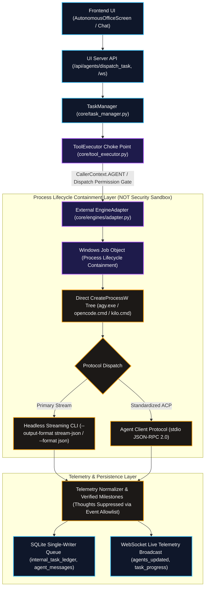
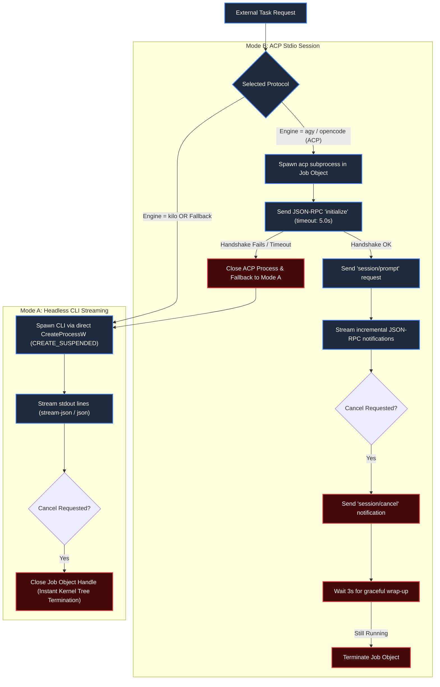
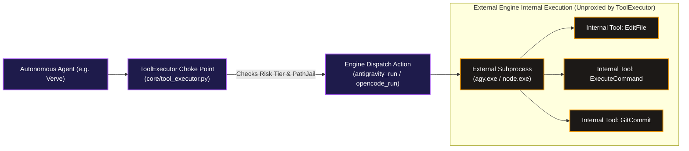
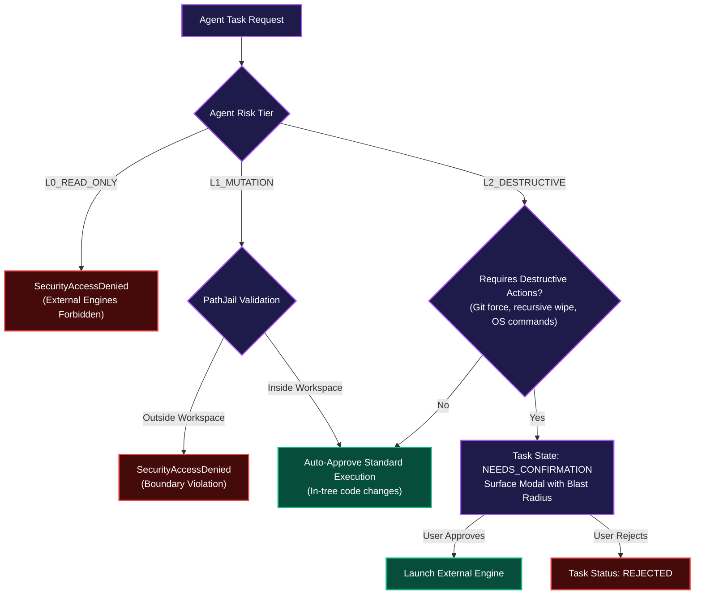
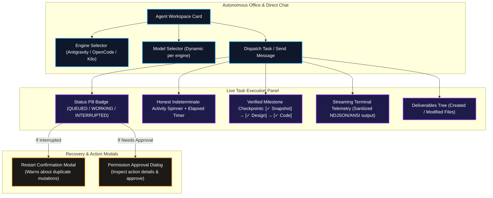

# 🏛️ ZEZO Phase 2 Implementation Blueprint: External Agent Integration

> **Document Version:** Revision 3.0 (Comprehensive Architectural Specification)  
> **Status:** APPROVED FOR PLANNING — IMPLEMENTATION PENDING AUTHORIZATION  
> **Target OS:** Windows 10/11 (Primary), macOS, Linux  
> **Creator & Lead Architect:** Hamza Bukhari  
> **Baseline Dependency:** Completed ZEZO Phase 1 (`core/path_jail.py`, `core/tool_executor.py`, `core/agents/context_budget.py`, `core/agents/provider_adapter.py`, `core/agents/runtime.py`, `memory/sqlite_memory.py`, `core/task_manager.py`)

---

## Executive Architectural Summary

Phase 1 established an unassailable security foundation for internal autonomous agents within ZEZO: single-writer SQLite WAL queues, boundary-contained PathJail, a centralized ToolExecutor choke point enforcing least privilege, provider-aware context token budgets, and persistent multi-turn conversations.

**Phase 2 integrates external coding agent engines into the ZEZO OS ecosystem.** External engines—specifically Google Antigravity CLI (`agy`), OpenCode (`opencode`), and Kilo Code (`kilo`)—differ fundamentally from internal agents:
1. They execute as **autonomous OS subprocess trees** containing their own embedded LLM loops, dependency graphs, and internal tool execution subsystems.
2. If left unmanaged, their child processes survive parent cancellation, creating orphaned background processes, memory leaks, high CPU load, and file locks on Windows.
3. They interact with codebases via diverse execution modes: native headless CLI streaming (`stream-json`, `json`), and the standardized **Agent Client Protocol (ACP)** via stdio JSON-RPC 2.0 where verified.

This blueprint establishes a hardened, unified external agent architecture grounded in live system verification, strictly maintaining Phase 1 security choke points without reopening architectural decisions or introducing fragile abstractions.



---

## 1. Existing Capabilities vs. Proposed Phase 2 Architecture

To prevent architectural drift and ensure maximum codebase reuse, all capabilities are categorized below:

| Architectural Component | Existing Baseline (Phase 1 Status) | Proposed Phase 2 Enhancement |
| :--- | :--- | :--- |
| **Agent Execution Loop** | Internal `AgentRuntime` (`core/agents/runtime.py`) executing direct provider prompts and internal tool choke point. | `EngineAdapter` abstract base class with concrete adapters: `AntigravityEngineAdapter`, `OpenCodeEngineAdapter`, `KiloEngineAdapter`. |
| **Tool Execution Gate** | `ToolExecutor` (`core/tool_executor.py`) acts as single choke point with `CallerContext.AGENT`. | Controls **external engine dispatch actions** (`antigravity_run`, `opencode_run`, `kilo_run`), verifying agent risk tier and workspace boundaries. Does **not** intercept internal CLI tool calls. |
| **Path Isolation** | `PathJail` (`core/path_jail.py`) resolves and validates symlinks/junctions within workspace root. | Enforce that `workspace_root` passed to external CLIs is strictly pre-validated by `PathJail` before process spawn. |
| **Process Containment** | Ad-hoc `subprocess.Popen` in individual runner files (`core/antigravity_runner.py`, `core/opencode_runner.py`, `core/kilo_runner.py`). | Centralized `ProcessSupervisor` utilizing **direct Win32 `CreateProcessW`** in suspended state assigned to **Win32 Job Objects** (`JOB_OBJECT_LIMIT_KILL_ON_JOB_CLOSE`) before `ResumeThread`. |
| **Protocol Support** | Heterogeneous text scraping and loose JSON parsing in runners. | Dual-mode protocol abstraction: **Mode A (Headless CLI Streaming)** as robust primary, and **Mode B (ACP stdio JSON-RPC)** where verified. |
| **Task State & Ledger** | `internal_task_ledger` table with `WORKING`, `INTERRUPTED`, `RESTARTED` reconciliation in `core/task_manager.py`. | Real-time persistence of external task PID, exit code, structured deliverable AST, and failure diagnostics to `internal_task_ledger`. |
| **Progress Reporting** | Saturation curve heuristic in existing runners. | Replaced by **honest indeterminate progression** (elapsed time, active status step) combined with **verified filesystem milestones**. |
| **Thought Privacy** | Raw thinking blocks occasionally logged to output. | Strict telemetry sanitization: **Event Allowlist Filtering** drops all reasoning blocks prior to logging, persistence, or WebSocket streaming. |
| **Large Prompt Offloading** | Unmanaged `.zezo_task_instructions.md` / `GEMINI.md` written directly to repository root. | Safe temporary file creation within workspace `.zezo_tmp/` directory with automatic `finally:` cleanup (without mutating user's `.gitignore`). |

---

## 2. External Agent Architecture & EngineAdapter Design

### 2.1 The Unified `EngineAdapter` Interface
Rather than maintaining three separate, drift-prone runner scripts (`antigravity_runner.py`, `opencode_runner.py`, `kilo_runner.py`), Phase 2 unifies external execution under `core/engines/adapter.py`.

```python
# Architecture Blueprint: core/engines/adapter.py

from abc import ABC, abstractmethod
from dataclasses import dataclass, field
from enum import Enum
from pathlib import Path
from typing import Any, Dict, List, Optional
from core.task_manager import TaskContext

class EngineProtocol(str, Enum):
    CLI_STREAM = "cli_stream"
    ACP_STDIO = "acp_stdio"

@dataclass
class EngineLaunchConfig:
    engine_id: str
    prompt: str
    workspace_path: Path
    model: Optional[str] = None
    agent_id: Optional[str] = None
    task_id: Optional[str] = None
    timeout_sec: int = 600
    risk_tier: str = "L1_MUTATION"
    extra_env: Dict[str, str] = field(default_factory=dict)
    protocol: EngineProtocol = EngineProtocol.CLI_STREAM

@dataclass
class EngineEvent:
    event_type: str  # "status", "tool_use", "milestone", "output", "error", "complete"
    message: str
    step_label: str
    verified_milestone: Optional[str] = None
    payload: Dict[str, Any] = field(default_factory=dict)

class EngineAdapter(ABC):
    """Abstract interface defining the execution contract for external coding engines."""
    
    @abstractmethod
    def resolve_binary(self) -> Optional[Path]:
        """Discovers the absolute path to the engine binary, verifying existence and permissions."""
        pass

    @abstractmethod
    def build_cli_command(self, config: EngineLaunchConfig, prompt_file: Optional[Path] = None) -> List[str]:
        """Builds the secure, argument-delimited subprocess command vector."""
        pass

    @abstractmethod
    def parse_stream_event(self, raw_line: str) -> Optional[EngineEvent]:
        """Normalizes vendor-specific stdout telemetry into unified EngineEvent instances, applying Event Allowlist."""
        pass

    @abstractmethod
    def execute(self, config: EngineLaunchConfig, ctx: TaskContext) -> Dict[str, Any]:
        """Executes the engine within the sandboxed environment and streams progress."""
        pass
```

### 2.2 Reusing Existing Machinery
1. **Binary & Model Discovery:** Reuses `core/code_engines.py` and `memory/config_manager.py` for binary resolution and configured model mappings.
2. **Workspace Containment:** Workspace paths are validated via `core.path_jail.secure_resolve_path` before invocation.
3. **Task Telemetry Pipeline:** Reuses `TaskContext.report(progress, message)` in `core/task_manager.py` to pipe unified `EngineEvent` updates to the active session and WebSockets.

---

## 3. Real Engine Capabilities & ACP Feasibility Analysis

Concrete runtime probing was conducted across all three installed CLI tools on Windows:

### 3.1 Antigravity CLI (`agy.exe`)
- **Binary Location:** `C:\Users\Hamza Bukhari\AppData\Local\agy\bin\agy.EXE`
- **Headless CLI Streaming Support (Verified):**
  - Flags: `-p <prompt>`, `--add-dir <workspace>`, `--output-format stream-json`, `--input-format stream-json`, `--dangerously-skip-permissions`.
  - Telemetry Format: Emits valid newline-delimited JSON (NDJSON) events per tool call and step.
- **ACP Support (Verified):**
  - Command: `agy.exe acp`
  - Protocol: JSON-RPC 2.0 stdio server.
  - Verification Evidence: Handshake confirmed with `protocolVersion: 1`, `agentInfo: {"name": "Antigravity ACP Server", "version": "1.4.12"}`.
  - Capabilities: `loadSession`, `resume`, `additionalDirectories`, `auth`.

### 3.2 OpenCode CLI (`opencode.cmd`)
- **Binary Location:** `C:\Users\Hamza Bukhari\AppData\Roaming\npm\opencode.CMD`
- **Headless CLI Streaming Support (Verified):**
  - Flags: `opencode run <prompt> --dir <workspace> --format json --model <model> --auto`.
  - Telemetry Format: Formatted JSON event objects streamed over stdout.
- **ACP Support (Verified):**
  - Command: `opencode.cmd acp`
  - Protocol: JSON-RPC 2.0 stdio server.
  - Verification Evidence: Handshake confirmed with `protocolVersion: 1`, `agentInfo: {"name": "opencode", "version": "1.2.14"}`.
  - Capabilities: `embeddedContext`, `mcpCapabilities: {http: true}`, `sessionCapabilities`.

### 3.3 Kilo Code CLI (`kilo.cmd`)
- **Binary Location:** `C:\Users\Hamza Bukhari\AppData\Roaming\npm\kilo.CMD`
- **Headless CLI Streaming Support (Verified):**
  - Flags: `kilo run <prompt> --dir <workspace> --format json --model <model> --auto`.
  - Telemetry Format: Emits structured event blocks with step updates and tool executions.
- **ACP Support (Investigated & Documented):**
  - Command: `kilo.cmd acp` starts an HTTP/WebSocket server (`--hostname 127.0.0.1 --port 0`) rather than pure stdio JSON-RPC.
  - **Architectural Decision:** **Do NOT force stdio ACP on Kilo.** Use **Mode A (Headless CLI Streaming)** as the stable, native execution bridge for Kilo Code.

### 3.4 ACP vs. CLI Session Lifecycle, Cancellation & Fallback Behavior



#### Lifecycle & Cancellation Matrix:
1. **Headless CLI Streaming (Mode A):**
   - **Session Model:** One-shot ephemeral process per task run.
   - **Cancellation:** User cancellation triggers immediate closure of the Windows Job Object handle. The kernel forcibly terminates the root CLI and all descendant workers instantly.
2. **ACP Stdio Session (Mode B):**
   - **Session Model:** Persistent stateful stdio JSON-RPC 2.0 connection.
   - **Cancellation:** Cancellation first issues a standard JSON-RPC `$/cancelRequest` or `session/cancel` notification. If the ACP server does not acknowledge and exit within a 3.0-second grace period, the supervisor forcibly closes the Job Object handle.
3. **Automated Fallback:**
   - If `initialize` handshake in Mode B fails or times out (> 5.0s), the supervisor logs a warning, terminates the ACP process, and immediately dispatches the task via Mode A (Headless CLI).

---

## 4. Process Lifecycle Containment & Win32 Job Objects

### 4.1 Boundary Clarification: Containment vs. Security Sandbox
> [!IMPORTANT]
> **Windows Job Objects are a Process Lifecycle Containment Mechanism, NOT a Security Sandbox.**  
> A Job Object configured with `JOB_OBJECT_LIMIT_KILL_ON_JOB_CLOSE` ensures that all child, grandchild, and descendant processes are cleanly terminated when the job handle closes. It **does not** restrict filesystem access, network sockets, token permissions, or registry access. Security boundaries are enforced exclusively by Phase 1 components: **ToolExecutor choke point**, **PathJail path validation**, and **default agent permission profiles**.

### 4.2 Robust Direct `CreateProcessW` Spawn, Assignment & Resume Implementation

To prevent fragile thread discovery and avoid 64-bit handle truncation in ctypes, Phase 2 implements process creation directly via `kernel32.CreateProcessW` with explicit argument and return types. This obtains both the process handle (`hProcess`) and primary thread handle (`hThread`) atomically from `PROCESS_INFORMATION`:

```python
# Architecture Blueprint: core/engines/process_supervisor.py

from __future__ import annotations
import ctypes
from ctypes import wintypes
import os
from pathlib import Path
from typing import Dict, List, Optional, Tuple

kernel32 = ctypes.windll.kernel32

# Win32 Constants
JOB_OBJECT_LIMIT_KILL_ON_JOB_CLOSE = 0x00002000
JobObjectExtendedLimitInformation = 9
CREATE_SUSPENDED = 0x00000004
CREATE_NO_WINDOW = 0x08000000
STARTF_USESTDHANDLES = 0x00000100
HANDLE_FLAG_INHERIT = 0x00000001

class PROCESS_INFORMATION(ctypes.Structure):
    _fields_ = [
        ("hProcess", wintypes.HANDLE),
        ("hThread", wintypes.HANDLE),
        ("dwProcessId", wintypes.DWORD),
        ("dwThreadId", wintypes.DWORD),
    ]

class STARTUPINFOW(ctypes.Structure):
    _fields_ = [
        ("cb", wintypes.DWORD),
        ("lpReserved", wintypes.LPWSTR),
        ("lpDesktop", wintypes.LPWSTR),
        ("lpTitle", wintypes.LPWSTR),
        ("dwX", wintypes.DWORD),
        ("dwY", wintypes.DWORD),
        ("dwXSize", wintypes.DWORD),
        ("dwYSize", wintypes.DWORD),
        ("dwXCountChars", wintypes.DWORD),
        ("dwYCountChars", wintypes.DWORD),
        ("dwFillAttribute", wintypes.DWORD),
        ("dwFlags", wintypes.DWORD),
        ("wShowWindow", wintypes.WORD),
        ("cbReserved2", wintypes.WORD),
        ("lpReserved2", ctypes.POINTER(ctypes.c_byte)),
        ("hStdInput", wintypes.HANDLE),
        ("hStdOutput", wintypes.HANDLE),
        ("hStdError", wintypes.HANDLE),
    ]

class SECURITY_ATTRIBUTES(ctypes.Structure):
    _fields_ = [
        ("nLength", wintypes.DWORD),
        ("lpSecurityDescriptor", ctypes.c_void_p),
        ("bInheritHandle", wintypes.BOOL),
    ]

class JOBOBJECT_BASIC_LIMIT_INFORMATION(ctypes.Structure):
    _fields_ = [
        ("PerProcessUserTimeLimit", wintypes.LARGE_INTEGER),
        ("PerJobUserTimeLimit", wintypes.LARGE_INTEGER),
        ("LimitFlags", wintypes.DWORD),
        ("MinimumWorkingSetSize", ctypes.c_size_t),
        ("MaximumWorkingSetSize", ctypes.c_size_t),
        ("ActiveProcessLimit", wintypes.DWORD),
        ("Affinity", ctypes.c_size_t),
        ("PriorityClass", wintypes.DWORD),
        ("SchedulingClass", wintypes.DWORD),
    ]

class IO_COUNTERS(ctypes.Structure):
    _fields_ = [
        ("ReadOperationCount", ctypes.c_ulonglong),
        ("WriteOperationCount", ctypes.c_ulonglong),
        ("OtherOperationCount", ctypes.c_ulonglong),
        ("ReadTransferCount", ctypes.c_ulonglong),
        ("WriteTransferCount", ctypes.c_ulonglong),
        ("OtherTransferCount", ctypes.c_ulonglong),
    ]

class JOBOBJECT_EXTENDED_LIMIT_INFORMATION(ctypes.Structure):
    _fields_ = [
        ("BasicLimitInformation", JOBOBJECT_BASIC_LIMIT_INFORMATION),
        ("IoCounters", IO_COUNTERS),
        ("ProcessMemoryLimit", ctypes.c_size_t),
        ("JobMemoryLimit", ctypes.c_size_t),
        ("PeakProcessMemoryLimit", ctypes.c_size_t),
        ("PeakJobMemoryLimit", ctypes.c_size_t),
    ]

# Explicit 64-bit Function Signatures
kernel32.CreateProcessW.argtypes = [
    wintypes.LPCWSTR, wintypes.LPWSTR, ctypes.c_void_p, ctypes.c_void_p,
    wintypes.BOOL, wintypes.DWORD, ctypes.c_void_p, wintypes.LPCWSTR,
    ctypes.POINTER(STARTUPINFOW), ctypes.POINTER(PROCESS_INFORMATION)
]
kernel32.CreateProcessW.restype = wintypes.BOOL

kernel32.ResumeThread.argtypes = [wintypes.HANDLE]
kernel32.ResumeThread.restype = wintypes.DWORD

kernel32.CreateJobObjectW.argtypes = [ctypes.c_void_p, wintypes.LPCWSTR]
kernel32.CreateJobObjectW.restype = wintypes.HANDLE

kernel32.SetInformationJobObject.argtypes = [wintypes.HANDLE, ctypes.c_int, ctypes.c_void_p, wintypes.DWORD]
kernel32.SetInformationJobObject.restype = wintypes.BOOL

kernel32.AssignProcessToJobObject.argtypes = [wintypes.HANDLE, wintypes.HANDLE]
kernel32.AssignProcessToJobObject.restype = wintypes.BOOL

kernel32.CloseHandle.argtypes = [wintypes.HANDLE]
kernel32.CloseHandle.restype = wintypes.BOOL

kernel32.CreatePipe.argtypes = [
    ctypes.POINTER(wintypes.HANDLE), ctypes.POINTER(wintypes.HANDLE),
    ctypes.POINTER(SECURITY_ATTRIBUTES), wintypes.DWORD
]
kernel32.CreatePipe.restype = wintypes.BOOL

kernel32.SetHandleInformation.argtypes = [wintypes.HANDLE, wintypes.DWORD, wintypes.DWORD]
kernel32.SetHandleInformation.restype = wintypes.BOOL


class ProcessSupervisor:
    """Manages external engine process trees inside Windows Job Objects using direct Win32 APIs."""

    @staticmethod
    def spawn_contained_process(
        cmd: List[str], cwd: Path, env: Dict[str, str]
    ) -> Tuple[PROCESS_INFORMATION, wintypes.HANDLE, wintypes.HANDLE]:
        """
        Spawns a process in CREATE_SUSPENDED state via direct CreateProcessW,
        assigns it to a Job Object (KILL_ON_JOB_CLOSE), and resumes the primary thread.
        Returns (proc_info, hJob, hStdoutRead).
        """
        # 1. Create Job Object with Kill-On-Close
        hJob = kernel32.CreateJobObjectW(None, None)
        if not hJob:
            raise OSError(f"CreateJobObjectW failed: {ctypes.GetLastError()}")

        info = JOBOBJECT_EXTENDED_LIMIT_INFORMATION()
        info.BasicLimitInformation.LimitFlags = JOB_OBJECT_LIMIT_KILL_ON_JOB_CLOSE
        if not kernel32.SetInformationJobObject(hJob, JobObjectExtendedLimitInformation, ctypes.byref(info), ctypes.sizeof(info)):
            kernel32.CloseHandle(hJob)
            raise OSError(f"SetInformationJobObject failed: {ctypes.GetLastError()}")

        # 2. Create Inheritable Stdout/Stderr Pipe
        sa = SECURITY_ATTRIBUTES()
        sa.nLength = ctypes.sizeof(SECURITY_ATTRIBUTES)
        sa.bInheritHandle = True
        sa.lpSecurityDescriptor = None

        hReadPipe = wintypes.HANDLE()
        hWritePipe = wintypes.HANDLE()
        if not kernel32.CreatePipe(ctypes.byref(hReadPipe), ctypes.byref(hWritePipe), ctypes.byref(sa), 0):
            kernel32.CloseHandle(hJob)
            raise OSError(f"CreatePipe failed: {ctypes.GetLastError()}")

        # Read end must NOT be inherited by child
        kernel32.SetHandleInformation(hReadPipe, HANDLE_FLAG_INHERIT, 0)

        # 3. Setup Startup Info with redirected stdout/stderr
        si = STARTUPINFOW()
        si.cb = ctypes.sizeof(STARTUPINFOW)
        si.dwFlags = STARTF_USESTDHANDLES
        si.hStdInput = None
        si.hStdOutput = hWritePipe
        si.hStdError = hWritePipe

        pi = PROCESS_INFORMATION()
        cmd_str = subprocess.list2cmdline(cmd)

        # Prepare environment block (null-separated strings ending with double null)
        env_block = "\0".join(f"{k}={v}" for k, v in env.items()) + "\0\0"

        # 4. CreateProcessW in CREATE_SUSPENDED | CREATE_NO_WINDOW
        flags = CREATE_SUSPENDED | CREATE_NO_WINDOW
        success = kernel32.CreateProcessW(
            None,
            cmd_str,
            None,
            None,
            True,  # Inherit handles for pipes
            flags,
            env_block,
            str(cwd),
            ctypes.byref(si),
            ctypes.byref(pi),
        )

        # Close write pipe in parent immediately so EOF is detected on child exit
        kernel32.CloseHandle(hWritePipe)

        if not success:
            kernel32.CloseHandle(hReadPipe)
            kernel32.CloseHandle(hJob)
            raise OSError(f"CreateProcessW failed: {ctypes.GetLastError()}")

        try:
            # 5. Assign process handle to Job Object BEFORE resuming thread
            if not kernel32.AssignProcessToJobObject(hJob, pi.hProcess):
                raise OSError(f"AssignProcessToJobObject failed: {ctypes.GetLastError()}")

            # 6. Resume primary thread directly via atomic pi.hThread
            res = kernel32.ResumeThread(pi.hThread)
            if res == 0xFFFFFFFF:
                raise OSError(f"ResumeThread failed: {ctypes.GetLastError()}")

            return pi, hJob, hReadPipe
        except Exception:
            kernel32.TerminateProcess(pi.hProcess, 1)
            kernel32.CloseHandle(pi.hProcess)
            kernel32.CloseHandle(pi.hThread)
            kernel32.CloseHandle(hReadPipe)
            kernel32.CloseHandle(hJob)
            raise
```

---

## 5. ToolExecutor Boundary & Permissions Scope

### 5.1 Clear Boundary Definition: Engine Dispatch vs. Internal Tool Calls
> [!IMPORTANT]
> **ToolExecutor Gating Contract:**  
> `ToolExecutor` controls whether an agent is authorized to **invoke and dispatch an external coding engine** (`antigravity_run`, `opencode_run`, `kilo_run`).  
> Once an external CLI process (`agy.exe`, `opencode`, `kilo`) is launched, that CLI executes its own internal tools (e.g., internal file editing, internal git commands, internal terminal execution) according to the CLI vendor's closed engine implementation. `ToolExecutor` does **NOT** intercept or proxy each fine-grained internal tool invocation made inside the external CLI's closed process space.



### 5.2 Pre-Launch Security Enforcement
Because `ToolExecutor` controls the dispatch gate, it enforces strict defense-in-depth prior to process launch:
1. **Agent Risk Tier Enforcement:** An agent with `L0_READ_ONLY` tier attempting to invoke `opencode_run` or `antigravity_run` is rejected immediately with `SecurityAccessDenied(blocked_by="permission")`.
2. **Workspace Containment via PathJail:** The target directory parameter (`path`, `cwd`, `repo`) must pass `PathJail.secure_resolve_path()`. Target paths pointing to `C:\Windows`, user home roots, or system directories are rejected before the subprocess can be created.
3. **Approval Boundary:** Tasks targeting sensitive branches or requiring external mutation actions require explicit user confirmation via the task manager.

---

## 6. Honest Indeterminate Progress & Verified Milestones

### 6.1 Replacement of Artificial Percentage Curves
The legacy asymptotic formula ($15.0 + 67.0 \times (1 - e^{-t/85})$) generated synthetic percentage numbers that gave users a false sense of granular completion.

Phase 2 **replaces artificial percentage numbers with an honest, dual-track progress model**:

1. **Track 1: Indeterminate Activity Telemetry (For UI Progress Spinner):**
   - Active execution status: `"running"`.
   - Dynamic elapsed time: `"[1m 15s]"` or `"[45s]"`.
   - Current engine activity summary: `"Tool: edit_file (components/Navbar.tsx)"` or `"Running build tests..."`.
   - Progress value sent to UI is explicitly marked as indeterminate (`progress: -1` or `progress: null`), rendering a smooth indeterminate pulsing bar rather than fabricated percentages.

2. **Track 2: Verified Filesystem Milestones (Concrete Step Badges):**
   - Progress milestones are updated **only when verifiable deliverables are confirmed on disk**:
     - Milestone 1: Workspace initialized & snapshot captured.
     - Milestone 2: Core deliverable detected on disk (`DESIGN.md` or `preview.html` exists and non-empty).
     - Milestone 3: Entry point created (`index.html` or `main.py` created).
     - Milestone 4: Subprocess exited with code 0.
     - Milestone 5: Repository undo snapshot registered.
   - Milestone badges are displayed as discrete verified checkpoints: `[✓ Snapshot] → [✓ Design] → [✓ Code] → [✓ Verified Complete]`.

---

## 7. Strict Telemetry Sanitization & Thought Privacy via Event Allowlist

### 7.1 Absolute Thought Suppression
External engines often emit internal chain-of-thought blocks (`<think>...</think>`, reasoning deltas, or internal cognitive tokens) when using reasoning-enabled models (e.g., Claude 4.6 Thinking, Gemini Flash Thinking, DeepSeek-R1). Regex-only filtering is insufficient because streaming chunks can split reasoning tags across line buffers, and nested JSON payloads may contain reasoning trees.

> [!CAUTION]
> **Privacy Invariant:**  
> Internal thinking tokens must **never be logged, streamed, broadcast over WebSockets, or persisted in SQLite task ledgers or conversation messages.**

### 7.2 Event Allowlist Architecture
Stream parsers strictly apply an **Event Allowlist**. Only explicitly recognized user-facing event types are permitted:

```python
# Event Allowlist Filter in core/engines/adapter.py

ALLOWED_EVENT_TYPES = {
    "step_start",
    "step_complete",
    "tool_call",
    "tool_result",
    "milestone",
    "status_message",
    "error",
}

DISALLOWED_PAYLOAD_KEYS = {
    "thought",
    "thinking",
    "reasoning",
    "reasoning_content",
    "internal_monologue",
    "chain_of_thought",
}

def sanitize_event_payload(payload: dict) -> dict:
    """Recursively removes reasoning keys from telemetry dictionaries."""
    sanitized = {}
    for k, v in payload.items():
        if k.lower() in DISALLOWED_PAYLOAD_KEYS:
            continue
        if isinstance(v, dict):
            sanitized[k] = sanitize_event_payload(v)
        elif isinstance(v, list):
            sanitized[k] = [sanitize_event_payload(i) if isinstance(i, dict) else i for i in v]
        elif isinstance(v, str):
            # Secondary regex pass for embedded tags
            clean_str = re.sub(r"<think>[\s\S]*?</think>", "", v, flags=re.IGNORECASE).strip()
            if not clean_str.startswith("<think>"):
                sanitized[k] = clean_str
        else:
            sanitized[k] = v
    return sanitized
```

All incoming stream chunks pass through `sanitize_event_payload` before any logging, WebSocket broadcasting, or persistence to `internal_task_ledger`.

---

## 8. Safe Temporary File Handling for Large Prompts

### 8.1 Windows Command Line Length Defense
On Windows, passing large prompts directly via CLI arguments (`-p <prompt>`) triggers Win32 `CreateProcessW` character limits (32,767 characters / `[WinError 206]`).

### 8.2 Safe Temporary File Specification
Legacy code wrote instructions directly into project root (`GEMINI.md`, `.zezo_task_instructions.md`), polluting user source repositories and risking accidental git commits.

Phase 2 mandates safe temporary prompt offloading:
1. **Isolated Workspace Subdirectory:** Prompts $> 800$ characters are written into `.zezo_tmp/prompt_<task_id>.md` inside the target workspace.
2. **No .gitignore Mutation:** Do **not** programmatically modify or dirty the user's project `.gitignore`. The temporary file is strictly ephemeral.
3. **Mandatory Post-Execution Cleanup:** Regardless of whether the task succeeds, fails, times out, or is cancelled, a `finally:` block in `EngineAdapter.execute()` deletes the temporary prompt file from disk. If the `.zezo_tmp` folder becomes empty, it is also removed.

---

## 9. Environment Variable Sanitization & API Key Protection

External CLIs inherit environment variables by default. To prevent credential leakage and environment poisoning:
1. **Sanitized Baseline:** Construct a clean environment dictionary inheriting essential system variables (`SYSTEMROOT`, `COMSPEC`, `PATH`, `TEMP`, `TMP`, `USERPROFILE`).
2. **Targeted Credential Injection:**
   - Resolve required provider keys (`GEMINI_API_KEY`, `GROQ_API_KEY`, `OPENAI_API_KEY`) from `memory/config_manager.py` directly into the subprocess environment dictionary.
   - **Never write API keys to disk, configuration files, or command-line arguments.**
   - Mask all sensitive tokens in task logs: `re.sub(r'(AIzaSy|gsk_)[A-Za-z0-9_-]{20,}', '[REDACTED_API_KEY]', line)`.
3. **Execution Flags:** Inject `PYTHONIOENCODING=utf-8` to ensure child Python scripts avoid Windows CP1252/ANSI decode crashes.

---

## 10. Detailed Permission & Approval Boundaries

Phase 1 established three risk tiers in [`core/agents/registry.py`](file:///c:/Users/Hamza%20Bukhari/Documents/antigravity/jarvis-57/core/agents/registry.py): `L0_READ_ONLY`, `L1_MUTATION`, `L2_DESTRUCTIVE`.



---

## 11. Error Classification & Recovery Procedures

Subprocess execution can encounter diverse failure modes. The `EngineAdapter` inspects exit codes and stderr streams to classify errors into actionable diagnostics:

| Error Category | Indicators in Output | User Guidance / Recovery Action |
| :--- | :--- | :--- |
| **Authentication / Login** | `"not logged in"`, `"auth login"`, `"invalid api key"`, `"unauthorized"` | Surface notification pill: *"Engine needs authentication. Please run login in terminal."* |
| **Binary Missing** | `FileNotFoundError`, `WinError 2` | Surface installation guide: install command and vendor path verification. |
| **Quota / Rate Limit** | `"rate limit exceeded"`, `"quota exhausted"`, `"resource_exhausted"`, `"429"` | Mark task failed with clear explanation; suggest switching model or provider. |
| **Workspace Write Error** | `EACCES`, `PermissionDenied`, `WinError 5` | Surface permission error; check if another program has locked the target directory. |
| **Application Crash** | Orphaned `WORKING` task upon ZEZO restart | Auto-reconcile to `INTERRUPTED` via `reconcile_interrupted_tasks()`. |

---

## 12. Frontend Integration & User Experience

Phase 2 preserves the existing ReUI design system, dark obsidian aesthetic, and clean layout of `AutonomousOfficeScreen.tsx` and `AgentDirectChatView.tsx`.



### 12.1 Key UI Enhancements
1. **Live Output Terminal View:** Provide an expandable, high-performance terminal log drawer in `AutonomousOfficeScreen` and `AgentDirectChatView` displaying sanitized ANSI output streams from running engines.
2. **Engine Readiness Badges:** Query `/api/code_engines` to show real-time engine health (Ready, Login Required, Not Installed) next to engine dropdowns.
3. **Interrupted Task Banner:** Display an unobtrusive recovery banner when interrupted tasks exist in `internal_task_ledger`, offering one-click review and restart.
4. **Deliverable Diff Viewer:** Automatically detect generated web artifacts (`index.html`, `preview.html`, `DESIGN.md`) and provide a one-click browser preview button via existing `website_cloner` preview server.

---

## 13. Detailed Implementation Roadmap (Steps 0–7)

Execution of Phase 2 is broken into **7 discrete, sequential, independently verifiable steps**. Each step adheres to the 3-layer verification standard (Static, Runtime, Regression).

### Step 0: Pre-Flight Environment & Dependencies
- Verify explicit 64-bit ctypes kernel32 signatures (`CreateProcessW`, `CreateJobObjectW`, `SetInformationJobObject`, `AssignProcessToJobObject`, `ResumeThread`).
- Validate presence of `agy.exe`, `opencode.cmd`, and `kilo.cmd` across configured system paths.
- Add baseline unit checks ensuring zero regression to Phase 1 components.

### Step 1: Direct CreateProcessW Job Object Supervisor (`core/engines/process_supervisor.py`)
- Implement `ProcessSupervisor` using `CreateProcessW` with `CREATE_SUSPENDED | CREATE_NO_WINDOW`.
- Assign `pi.hProcess` to Job Object (`KILL_ON_JOB_CLOSE`) before calling `kernel32.ResumeThread(pi.hThread)`.
- Redirect stdout/stderr pipes with non-inherited read handles.
- Add unit tests verifying process group termination and absence of orphaned processes upon close.

### Step 2: Unified EngineAdapter Core & Allowlist Normalizer (`core/engines/adapter.py`)
- Define `EngineAdapter` abstract base class, `EngineLaunchConfig`, and `EngineEvent`.
- Implement `ALLOWED_EVENT_TYPES` and `DISALLOWED_PAYLOAD_KEYS` filtering out reasoning blocks.
- Implement `.zezo_tmp/prompt_<task_id>.md` safe temporary file offloading with automatic post-task cleanup.

### Step 3: Concrete Engine Adapters
- Implement `AntigravityEngineAdapter` wrapping `agy.exe -p --output-format stream-json`.
- Implement `OpenCodeEngineAdapter` wrapping `opencode run --format json`.
- Implement `KiloEngineAdapter` wrapping `kilo run --format json`.
- Refactor existing runner files (`core/antigravity_runner.py`, `core/opencode_runner.py`, `core/kilo_runner.py`) to delegate cleanly to these adapters without breaking callers.

### Step 4: Centralized Choke Point & Security Integration
- Connect external engine actions (`antigravity_run`, `opencode_run`, `kilo_run`) through `ToolExecutor.execute()`.
- Validate target workspace through `PathJail.secure_resolve_path()`.
- Enforce risk tiers: `L0_READ_ONLY` agents rejected immediately; `L2_DESTRUCTIVE` gated by confirmation modal.

### Step 5: Verified ACP Client Subsystem (`core/engines/acp_client.py`)
- Implement lightweight stdio JSON-RPC 2.0 client for engines supporting stdio ACP (`agy`, `opencode`).
- Implement handshake initialization (`initialize`), session establishment, and prompt streaming.
- Implement automatic fallback: if ACP handshake fails or times out (> 5.0s), fall back immediately to Mode A (Headless CLI).

### Step 6: Frontend Streaming & Task Recovery UI
- Update `AutonomousOfficeScreen.tsx` and `AgentDirectChatView.tsx` with honest indeterminate activity indicator and verified milestone step badges.
- Wire task restart confirmation modal calling `/api/agents/tasks/restart`.
- Display live engine status indicators and deliverable preview links.

### Step 7: End-to-End Verification & Docs Sync
- Build integration test suite `tests/test_external_engines.py` verifying Job Object termination, streaming telemetry, permission blocks, and recovery.
- Run complete test suite (`python -m pytest tests/`) ensuring 100% pass rate.
- Synchronize documentation in `docs/AGENTS_MANAGEMENT.md`, `docs/TASK_SYSTEM.md`, and append entry to `LEARNING_JOURNAL.md`.

---

## 14. Testing & Verification Strategy

Following Core Operating Rule 7, all Phase 2 steps must pass the 3-Layer Verification standard before completion:

### Layer 1: Static Analysis & Compilation
- Run `python -m py_compile` across all newly created and modified Python modules.
- Run `npm --prefix frontend run build` (`tsc -b && vite build`) to confirm zero frontend compilation errors.
- Enforce cyclomatic complexity < 15 per function with no deep `if/elif` ladders.

### Layer 2: Runtime Unit & Isolation Tests
- **Job Object Process Lifecycle Test:** Spawn a mock process that spawns grandchild processes; close job handle; verify all grandchildren are immediately terminated in the OS process table.
- **Direct CreateProcessW Test:** Confirm atomic acquisition of `hProcess` and `hThread`, assignment to Job Object while suspended, and clean resume without Toolhelp snapshots.
- **Thought Suppression Test:** Feed mock NDJSON containing `<think>secret</think>` and nested JSON reasoning keys into `parse_stream_event`; assert reasoning content is completely absent from emitted events and SQLite ledger.
- **Temp File Cleanup Test:** Execute a task with a 2,000-character prompt; verify `.zezo_tmp/` file is deleted after task completion or failure without dirtying `.gitignore`.
- **ACP Fallback Test:** Simulate an ACP server handshake timeout; assert graceful fallback to Mode A (Headless CLI).

### Layer 3: Full Repository Regression
- Run full pytest test suite (`python -m pytest tests/`) to ensure all 108 existing tests continue to pass without failures.
- Verify that live bidirectional voice audio loops (`main.py`) remain untouched.

---

## 15. Risk Matrix & Mitigations

| Risk | Impact | Mitigation Strategy |
| :--- | :--- | :--- |
| **Orphaned Child Processes on Windows** | High (CPU saturation, file locks) | Enforce Win32 Job Objects with `KILL_ON_JOB_CLOSE` via atomic suspended `CreateProcessW` spawn. |
| **CLI WinError 206 (Command Line Too Long)** | Medium (Execution crash) | Detect prompts > 800 chars and automatically write instructions to `.zezo_tmp/prompt_<task_id>.md` with cleanup. |
| **ACP Protocol Incompatibilities** | Medium (Blocked communication) | Treat Headless CLI Streaming (Mode A) as primary; restrict stdio ACP (Mode B) to verified engines (`agy`, `opencode`) with auto-fallback. |
| **Internal Reasoning Privacy Leak** | High (User/API privacy violation) | Enforce strict Event Allowlist and recursive dictionary sanitization before telemetry broadcast or persistence. |
| **Unauthenticated Vendor CLI** | Medium (Task failure) | Pre-flight probe detects unauthenticated state (`"not logged in"`) and provides clear UI guidance to the user. |
| **Accidental Overwrites on Restart** | High (User data loss) | Enforce confirmation gate before restarting interrupted tasks carrying mutation risk. |
| **Frontend UI Clutter** | Low (UX degradation) | Reuse existing ReUI components, modal drawer patterns, and dark theme tokens without redesigning screen structures. |

---

## 16. Exit Criteria for Phase 2 Completion

Phase 2 will be declared complete when:
1. All three external engines (`agy`, `opencode`, `kilo`) execute reliably through the unified `EngineAdapter` architecture.
2. Every external subprocess runs inside a Win32 Job Object containment structure with zero orphaned processes on cancellation or timeout.
3. External engine dispatch actions are strictly gated by `ToolExecutor` and `PathJail`.
4. Telemetry reports honest indeterminate progress with verified milestones, and zero internal thoughts are leaked or persisted via the Event Allowlist.
5. Temporary prompt files are contained in `.zezo_tmp/` and cleaned up automatically without dirtying `.gitignore`.
6. Interrupted external tasks are automatically reconciled and require confirmation before restart.
7. All unit and integration tests pass with 0 errors, and all 108 existing regression tests pass.
8. Written authorization is obtained from Lead Architect **Hamza Bukhari** before moving to Phase 3.

