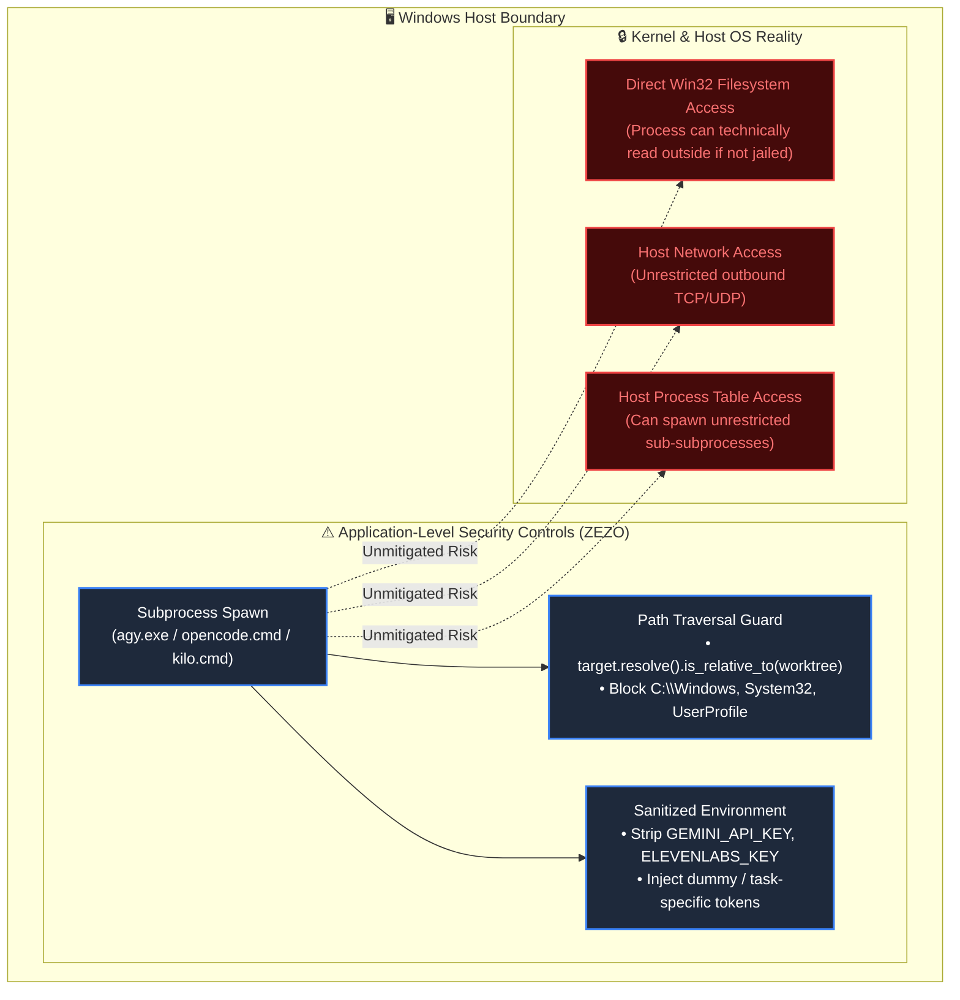
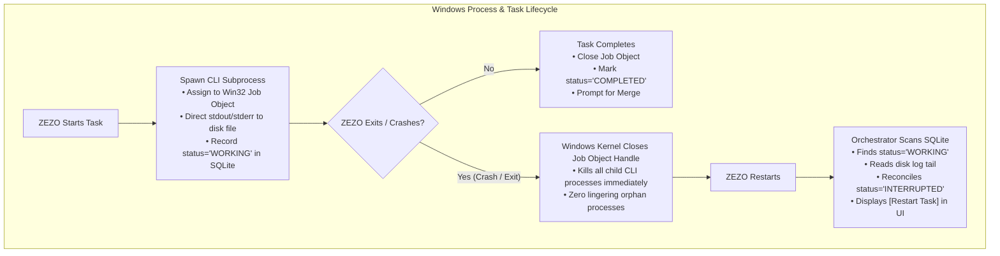
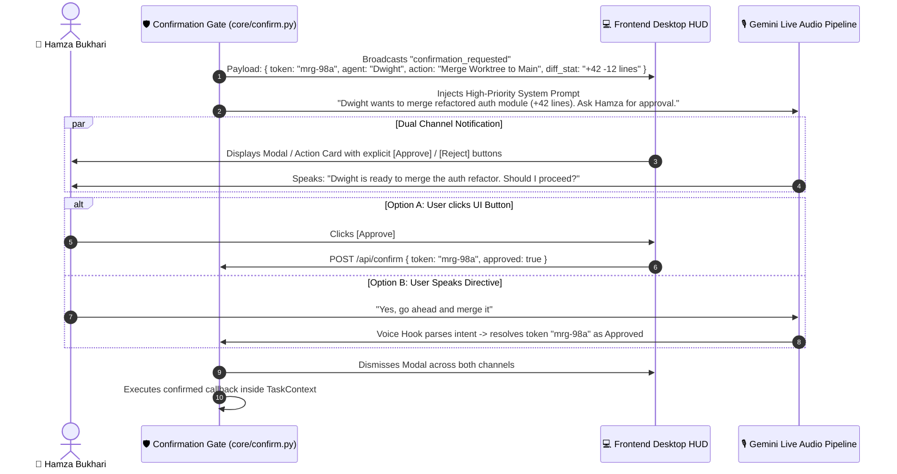

# 🏛️ Architecture Decision Record (ADR) — Approved Revision
## Systematic Resolution of Section 23 Architecture Decisions (Proposal v2)

> **Project:** ZEZO Autonomous Desktop AI Operating System  
> **Creator & Lead Architect:** Hamza Bukhari  
> **Target OS:** Windows 10/11 (Primary), macOS, Linux (Future)  
> **Status:** Final Proposed Architecture Baseline — Awaiting Explicit Implementation Authorization  
> **Source Document:** [`Proposalv2.md`](file:///c:/Users/Hamza%20Bukhari/Documents/antigravity/jarvis-57/Proposal/New%20Architecture%20Redesign/Proposalv2.md) (Section 23)

---

## 📋 1. Ground Truth & Verification Baseline

Before resolving any decision, existing repository implementations were inspected on the live host:
- **Verified Fact:** `actions/` currently exports 31 standalone actions; `core/action_loader.py` enforces mandatory `TOOL['risk']` validation (`read_only`, `local_mutation`, `external_mutation`, `code_execution`, `privileged_os`).
- **Verified Fact:** Three coding engines are locally available and resolvable on the host machine:
  - Antigravity CLI (`agy.EXE` at `AppData\Local\agy\bin\agy.EXE`)
  - OpenCode CLI (`opencode.CMD` at `AppData\Roaming\npm\opencode.CMD`)
  - Kilo Code CLI (`kilo.CMD` at `AppData\Roaming\npm\kilo.CMD`)
- **Verified Fact:** `memory/sqlite_memory.py` currently uses `_db_lock = threading.Lock()`, `PRAGMA journal_mode = WAL;`, `timeout=10.0`, and transient `threading.Thread(target=_insert, daemon=True).start()` per write, which lacks backpressure and centralized error propagation.
- **Verified Fact:** `main.py` has an active `core/confirm.py` gate bound to both the desktop UI and live voice speech recognition (`re.search(r"\b(yes|yeah|sure|confirm|proceed|haan|kardo|theek hai)\b")`).

---

## 🛡️ 2. External Engine Security Architecture & Threat Boundaries

### Reality Check: Worktree & Environment Sanitization vs. OS Sandboxing
A Git worktree and a sanitized environment dictionary (`os.environ`) are **application-level filesystem conventions, NOT kernel-level OS sandboxes**.



### Documented Security Boundaries & Known Limitations:
1. **Actual Enforcement Boundary (What We DO Enforce):**
   - **Credential Stripping:** The subprocess `env` dictionary explicitly removes host API keys (`GEMINI_API_KEY`, `ELEVENLABS_API_KEY`, `GROQ_API_KEY`, `TAVILY_API_KEY`) and password hashes unless an agent specifically requires an explicit model endpoint key.
   - **Path Traversal Gate:** All internal tool invocations inspect paths via `Path(p).resolve().is_relative_to(allowed_worktree)`. Attempts to escape via `..\..\` raise a `SecurityAccessDenied` exception.
   - **Process Flag Isolation:** Executed with `creationflags=subprocess.CREATE_NO_WINDOW` to prevent console hijacking.
2. **Documented Limitations (What We CANNOT Prevent without OS Containers):**
   - If an external engine (e.g., OpenCode executing arbitrary shell scripts) runs malicious code, it possesses standard non-elevated user token privileges on the host OS.
   - It can make outbound network calls, read unprotected files within the user's home directory that have identical NTFS read permissions, and access the system clipboard.
   - **Mitigation Policy:** Treat all external coding engines as **semi-trusted local agents**. High-risk operations (pip install, system package changes, running unfamiliar third-party binaries) remain locked behind `L2_DESTRUCTIVE` human confirmation gates.

---

## ⚙️ 3. Windows Job Object, Process Lifecycle & Task Recovery

### Explicit Distinction: Process Termination vs. Task Recovery
- **Windows Job Object Invariant:** Every external engine subprocess is assigned to a Win32 **Job Object** configured with `JOB_OBJECT_LIMIT_KILL_ON_JOB_CLOSE`.
  - **Verified Behavior:** When ZEZO terminates (whether normal exit, crash, or forced termination in Task Manager), the Windows kernel automatically closes the Job Object handle and **immediately terminates all descendant processes (`agy.exe`, `node.exe`, compilers)**.
  - **No Live Process Resumption:** ZEZO **NEVER** claims that an active running process can survive an application restart and be "reattached". Win32 anonymous pipes break permanently upon parent death.
- **Task Recovery Guarantee:**
  - What survives is **Task State** (persisted in SQLite `agent_tasks`) and **Task Logs** (persisted on disk at `.agent_tasks/<task_id>/stdout.log`).
  - Upon restart, ZEZO reconciles interrupted tasks and presents a clean **"Restart Task"** action to the user.



### The 3-Pillar Recovery Specification:
1. **Persistent Task Log Files (Direct Disk Flushing):**
   - Subprocesses are spawned redirecting stdout and stderr directly to `.agent_tasks/<task_id>/stdout.log`.
   - The UI follows this log file via an asynchronous file tailer. If ZEZO restarts, the log file up to the crash moment remains completely intact on disk.
2. **Crash Reconciliation on Startup:**
   - On startup, `AgentOrchestrator` scans for any tasks left in `WORKING` or `QUEUED` status.
   - Because the Job Object guarantees child processes died with the parent, the orchestrator updates their status to `INTERRUPTED` and records `interrupted_at = CURRENT_TIMESTAMP`.
3. **Explicit User-Driven Task Restart:**
   - The UI shows an amber `INTERRUPTED` badge with a **[Restart Task]** button.
   - Clicking Restart does not attempt pipe resurrection; it cleanly cleans the temporary worktree diff, loads the original prompt and deliverables, and dispatches a fresh execution attempt.

---

## 🗄️ 4. SQLite Thread-Safe Single-Writer Architecture

### Problem in Existing Codebase
`memory/sqlite_memory.py` currently spawns transient `threading.Thread(target=_insert, daemon=True).start()` per write turn and relies on `_db_lock = threading.Lock()`. Under high-concurrency multi-agent chat, this causes thread spikes, unbounded locks, and silent write drops.

### Thread-Safe Single-Writer Specification
To bridge asynchronous application code (`asyncio`) and multi-threaded background workers cleanly with SQLite:

```mermaid
flowchart TD
    subgraph ClientLayers["Application & Agent Callers"]
        C1["Async API Handler (asyncio loop)"] -->|loop.call_soon_threadsafe| TQ["Thread-Safe Write Queue<br/>(queue.Queue)"]
        C2["Agent Background Thread (threading.Thread)"] -->|queue.put()| TQ
        C3["Voice Turn Logger (main.py)"] -->|queue.put()| TQ
    end

    subgraph WriterThread["Dedicated Single-Writer Thread"]
        TQ --> SW["Dedicated Background DB Writer Thread<br/>(Owns exclusive r/w connection)"]
        SW -->|Executes inside BEGIN IMMEDIATE| DB[(zezo_brain.db<br/>PRAGMA journal_mode=WAL<br/>PRAGMA busy_timeout=5000)]
        SW -->|Sets asyncio.Future result / exception| FUT["Caller Future / Callback"]
    end

    subgraph Readers["Concurrent Readers"]
        R1["UI Telemetry (GET /api/agents)"] -.->|Read-Only Connection| DB
        R2["FTS5 Full-Text Search"] -.->|Read-Only Connection| DB
    end
```

### Technical Invariants:
1. **Connection Ownership:**
   - **Exclusive Writer Connection:** Exactly ONE read/write SQLite connection is created and owned exclusively by the dedicated background writer thread. No other thread or coroutine ever touches this connection handle.
   - **Reader Connections:** Reading threads open independent, transient read-only connections (`sqlite3.connect('file:zezo_brain.db?mode=ro', uri=True)`) or use a small thread-local pool.
2. **Thread-Safe Queue (`queue.Queue`):**
   - The queue is a standard thread-safe `queue.Queue` (from Python's `queue` module), NOT an `asyncio.Queue`, ensuring that both async coroutines and standard OS worker threads can enqueue writes without race conditions.
   - For async callers awaiting confirmation, an `asyncio.Future` is passed with the payload, and the writer thread resolves it via `loop.call_soon_threadsafe(fut.set_result, res)`.
3. **Transaction Handling & Batching:**
   - Every write transaction uses `BEGIN IMMEDIATE` to prevent deadlock mid-transaction.
   - The writer thread flushes writes in small batches (e.g., up to 50 queued items or 100ms window) within a single `with conn:` block, reducing disk sync operations by 90%.
4. **Error Reporting & Propagation:**
   - If a write fails (e.g., disk full, schema violation), the exception is captured and routed back to the caller's `Future` so the calling agent or API endpoint receives the actual error rather than silently failing.
5. **Deterministic Shutdown Behavior:**
   - On application shutdown, ZEZO enqueues a sentinel `_SHUTDOWN_SENTINEL` into the queue.
   - The writer thread finishes flushing all pending items, executes `PRAGMA wal_checkpoint(PASSIVE);`, closes the database connection cleanly, and terminates.

---

## 👥 5. Custom Agent Defaults & Principle of Least Privilege

When a user clicks **"Hire Agent"** or creates an agent via API without specifying permissions, the agent MUST be secure by default.

### Default Permission Baseline:
- **Default Risk Tier:** `L0_READ_ONLY`.
- **Pre-Assigned Curated Tools (Safe Workspace-Scoped Read Only):**
  - `file_processor` (inspect AST and read file content strictly within the active workspace).
  - `web_search` (query Google/DuckDuckGo for technical documentation).
  - `web_read_page` (read public URLs for API specs).
  - `recall_history` (read episodic memory facts).
- **Strictly Disabled by Default (Requires Explicit UI Checkbox / API Authorization):**
  - ❌ `terminal_run` / `bash_execution` (OS shell command execution).
  - ❌ `file_controller` (local file edits, overwrites, directory creation).
  - ❌ `git_operations` (branch creation, commits, merges).
  - ❌ `desktop_control` / `computer_control` (mouse clicks, key presses, window resizing).
  - ❌ `delete_file` / `system_shutdown` (destructive actions).

---

## 🎙️ 6. Dual Approval Architecture (UI + Voice with Task-Specific Context)

Approvals for high-risk and destructive operations (`L2_DESTRUCTIVE`, workspace merges, file deletions) must never be ambiguous or generic.



### Contextual Specificity Invariant:
- Vague generic confirmations (e.g., *"Action requires approval. Yes/No?"*) are **forbidden**.
- Every confirmation request MUST specify:
  1. The requesting Agent Name (`Dwight`).
  2. The exact Target Action (`Merge to main`, `Delete file /api/auth.py`).
  3. The Blast Radius / Impact (`Touches 3 files in c:/.../jarvis-57`).
  4. Unique Nonce / Token (`token_id`) to prevent cross-action confirmation race conditions.

---

## 📊 7. Realistic, Testable Recovery Guarantees

In software architecture, claims of "bulletproof" or "zero data loss" are mathematically false. ZEZO defines explicit, testable recovery guarantees:

| Failure Scenario | Realistic Recovery Guarantee | Limitation / Unavoidable Loss |
| :--- | :--- | :--- |
| **Parent ZEZO crash while engine is compiling** | Subprocess is cleanly terminated via Windows Job Object; no lingering orphan process eating 100% CPU. Task marked `INTERRUPTED` on restart with a one-click `[Restart Task]` option. | Intermediate uncommitted in-memory token stream of that specific turn is lost. |
| **OS sudden reboot / Power failure** | All task log entries flushed to `.agent_tasks/<id>/stdout.log` prior to the crash are preserved. SQLite state reconciles to `INTERRUPTED` on startup. | Last ~1-2 seconds of un-flushed disk I/O buffers may be truncated. Worktree must be reviewed before restarting. |
| **API Provider Rate Limit (429) mid-task** | Engine state machine freezes the task in `PAUSED_COOLDOWN` and resumes via the Fallback Ladder after cooldown expires without failing the entire parent job. | Transient latency spike (5 minutes cooldown delay) introduced to the workflow. |
| **Git Merge Conflict during Worktree integration** | Target branch (`main`) is untouched; the worktree remains quarantined in `.agent_worktrees/<id>/`. User is presented with a 3-way visual diff in the HUD. | Automatic merge cannot complete autonomously; requires human resolution. |

---

## 🧪 8. Systematic Decision Analysis, Acceptance Criteria & Failure Scenarios

### Decision 1: Agent Communication & Multi-Agent Collaboration
- **Decision:** Supervised Handoff via `AgentOrchestrator` with hard turn limits (`max_turns = 5`).
- **Acceptance Criteria:**
  - Agent A can package a JSON artifact and dispatch to Agent B only through `orchestrator.delegate_subtask()`.
  - If Agent A and Agent B exchange 5 turns without generating a terminal artifact, the orchestrator raises a `TurnBudgetExceeded` error and halts the task.
- **Failure Scenario & Handling:**
  - *Scenario:* Agent B crashes during turn 3.
  - *Handling:* Orchestrator marks the handoff as `FAILED_SUBTASK`, preserves Agent A's output artifact, and alerts the user without killing the entire session.

### Decision 2: Delegation Strategy
- **Decision:** Autonomous self-execution for local OS/files; delegation for multi-file coding or explicit `@mention`.
- **Acceptance Criteria:**
  - Prompts like `"hi"`, `"open edge"`, or `"read file.py"` execute within the main process in `< 150ms`.
  - Prompts starting with `/task`, `/build`, or addressing an agent trigger background engine worker spawning.
- **Failure Scenario & Handling:**
  - *Scenario:* User gives an ambiguous complex coding directive in voice mode.
  - *Handling:* ZEZO asks: *"Do you want me to assign this to Michael to build in the background, or should we plan it here?"*

### Decision 3 & 4: External Engine Protocol (CLI vs. ACP)
- **Decision:** `EngineAdapter` interface with CLI Adapter as production default; ACP adapter under experimental toggle (`ZEZO_ENABLE_ACP=false`).
- **Acceptance Criteria:**
  - `EngineAdapter.run(task_context)` executes transparently regardless of whether the underlying runner is `agy.exe`, `opencode.cmd`, or `kilo.cmd`.
  - Process stdout/stderr pipes write continuously to `.agent_tasks/<task_id>/stdout.log`.
- **Failure Scenario & Handling:**
  - *Scenario:* `agy.exe` executable is missing or corrupted on PATH.
  - *Handling:* `code_engines.py` health probe flags engine as `UNAVAILABLE`, UI disables the engine option, and chat routes through the fallback LLM ladder.

### Decision 5: Memory Scoping
- **Decision:** 3-Tier Scoped Model (Global Facts, Agent Private, Task Episodic).
- **Acceptance Criteria:**
  - A query by `PAM` cannot access direct chat history between `HAMZA` and `MICHAEL` (`WHERE session_id LIKE 'PAM:%' OR category='user'`).
  - System prompts and creator guidelines (`AGENTS.md`) are automatically available to all agents.
- **Failure Scenario & Handling:**
  - *Scenario:* SQLite database disk is full or locked.
  - *Handling:* In-memory fallback queue caches the memory entries and alerts the user on HUD without halting conversational turns.

### Decision 6: Worktree Security
- **Decision:** Workspace path jail + sanitized environment dictionary.
- **Acceptance Criteria:**
  - Passing an absolute path like `C:\Windows\System32` to an internal file action throws `SecurityAccessDenied`.
  - `env` passed to `subprocess.Popen` does not contain `GEMINI_API_KEY`.
- **Failure Scenario & Handling:**
  - *Scenario:* A script attempts to delete the root workspace.
  - *Handling:* Blocked by the `L2_DESTRUCTIVE` gate; path validation prevents deletion outside the task worktree directory.

### Decision 7: Task State Machine & Crash Recovery
- **Decision:** SQLite task ledger with Windows Job Object and PID + creation timestamp verification.
- **Acceptance Criteria:**
  - Killing ZEZO via Task Manager leaves zero orphan `agy.exe` or node processes running.
  - Upon restart, interrupted tasks show as `INTERRUPTED` in UI with a functional "Restart" button.
- **Failure Scenario & Handling:**
  - *Scenario:* PID recycled by OS during crash recovery.
  - *Handling:* Creation timestamp check fails; task marked `ORPHAN_TERMINATED`.

### Decision 8: Fallback Ladder & Budget Enforcement
- **Decision:** Defined degradation ladder (`tier -> SMART -> Groq LPU`) with UI badge and task cost/turn limit.
- **Acceptance Criteria:**
  - If a model returns 404/429, execution seamlessly transitions to the next rung within `< 2s`.
  - The UI displays an amber indicator badge with the active fallback provider name.
- **Failure Scenario & Handling:**
  - *Scenario:* All rungs (Gemini Live, REST, Groq) exhaust quota.
  - *Handling:* Task transitions to `PAUSED_RATE_LIMIT`, notifies user, and schedules a wake-up timer.

### Decision 9: Voice Boundary
- **Decision:** Sole Live Voice pipeline owned by ZEZO Core; sub-agents emit text/visual diffs only.
- **Acceptance Criteria:**
  - Sub-agents never acquire audio input/output devices or stream raw PCM chunks.
  - Completed sub-agent tasks generate a 1-sentence spoken voice summary through ZEZO.
- **Failure Scenario & Handling:**
  - *Scenario:* Gemini Live audio WebSocket drops during sub-agent run.
  - *Handling:* Background sub-agent execution is completely unaffected; task finishes cleanly in the background.

### Decision 10: Approval Gate
- **Decision:** Task-specific confirmation tokens supported via both UI modal and live voice recognition.
- **Acceptance Criteria:**
  - Saying *"Yes, proceed"* or clicking `[Approve]` with the matching `token_id` resolves the gate immediately.
  - Voice confirmation regex matches English and Roman Urdu affirmative triggers.
- **Failure Scenario & Handling:**
  - *Scenario:* User speaks an unrelated sentence while confirmation is pending.
  - *Handling:* Confirmation gate ignores unrelated speech and remains pending until affirmative/negative intent or timeout (60s).

---

## 🎯 9. Final Implementation Phasing

With all Section 23 decisions systematically resolved, the phased rollout order is:

1. **Phase 1 (Single Agent End-to-End Slice):**
   - Solidify the single internal `AgentRuntime` with scoped SQLite memory (single-writer thread architecture) and default read-only permissions.
   - Verify one custom agent can be created, chat directly, run scoped read actions, persist state, and recover cleanly after application restart.
2. **Phase 2 (External Engine Integration):**
   - Unify `antigravity_runner`, `opencode_runner`, and `kilo_runner` under the resilient `EngineAdapter` with Windows Job Objects and persistent disk log streaming.
3. **Phase 3 (Supervised Multi-Agent Orchestration):**
   - Activate `AgentOrchestrator` supervised handoffs (`max_turns = 5`), worktree auto-merge diff previews, and dual UI/Voice confirmation gates.

---

> **Approval Status:** Ready for Hamza Bukhari's explicit authorization to begin Phase 1.
