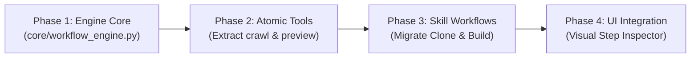

# 🏛️ ZEZO Universal Skills & Tools Architecture: Options, Trade-offs & Recommendations

> **Project:** ZEZO Autonomous Desktop AI Operating System  
> **Creator & Lead Architect:** Hamza Bukhari  
> **Document Status:** Comprehensive Architectural Decision Report  
> **Scope:** Entire ZEZO Subsystem Architecture (`core/`, `actions/`, `skills/`, `main.py`, `core/fleet/`, `core/ui_server.py`, `frontend/`)  

---

## 1. Executive Summary & The Core Problem

### The Core Problem: Why ZEZO Accumulates Monoliths
ZEZO is a high-performance, local-first AI desktop operating system powered by Gemini Live bidirectional WebSockets, native specialist coding engines (`agy.exe`, `opencode`, `kilo`), and an autonomous fleet. 

Currently, however, adding any complex capability requires writing custom, hardcoded Python pipelines. For example, **Website Clone** is implemented as a single **3,311-line Python monolith** ([`actions/website_cloner.py`](file:///c:/Users/Hamza%20Bukhari/Documents/antigravity/jarvis-57/actions/website_cloner.py)) that embeds crawler execution, DOM sanitization, asset downloading, HTTP server daemonization, and Antigravity reverse-engineering in Python code. Similarly, **Website Build** relies on hardcoded path matching and direct disk reads inside [`core/design_resolver.py`](file:///c:/Users/Hamza%20Bukhari/Documents/antigravity/jarvis-57/core/design_resolver.py).

Whenever a workflow needs adjustment (e.g. adding an asset verification step, switching a crawler, changing a preview port, or adjusting confirmation prompts), a developer must edit core Python code.

### The Objective
Make ZEZO **modular, flexible, and easy to extend** so that:
1. **Workflows, tool sequencing, intermediate prompts, and decision rules are configurable in Skills (`SKILL.md`)** without writing new custom Python pipelines for every feature.
2. **Atomic tools remain robust, secure, and deterministic in Python** (I/O, process execution, operating system controls).
3. **The system is non-breaking and backwards-compatible**, allowing existing skills and tools to function without disruption.

---

## 2. Investigation of the Existing System & Root Causes

### 2.1 Why Monolithic Tools Were Created in the First Place
Our codebase inspection identified four concrete architectural forces that pushed developers toward monolithic Python scripts:

1. **The Round-Trip Latency & Voice Jitter Penalty:**
   In Gemini Live audio sessions, if an agent coordinates a 5-step workflow using 5 separate tool calls (`crawl_page` → `verify_assets` → `sanitize_html` → `start_server` → `open_browser`), each tool call requires a full network round-trip over the WebSocket. This incurs 500ms–2000ms of latency per step, risks conversational audio desync, and risks user microphone barge-in interrupting the sequence mid-flight. Writing a single monolithic tool that returns a `task_id` in 1 turn was a workaround.
2. **Context Window Bloat & WebSocket Drops:**
   In Gemini Live, every `FunctionResponse` stays in the WebSocket's active attention window. If intermediate steps pass raw HTML or large asset maps back to the model, token consumption explodes, triggering WebSocket `1011`/`1008` policy violation drops ([`main.py:2525-2545`](file:///c:/Users/Hamza%20Bukhari/Documents/antigravity/jarvis-57/main.py#L2525-L2545)).
3. **Strict "One File Per Action" Constraint (AGENTS.md Rule 4):**
   Rule 4 mandates that every action resides in its own file under `actions/`. Because `core/action_loader.py` dynamically auto-discovers and registers every `.py` file lacking an underscore, developers could not easily create helper sub-modules without exposing them as public Gemini tools. All helper logic was inlined into massive 3,000+ line files.
4. **Skills Were Text-Only (No Execution Binding):**
   `skills/*/SKILL.md` files are purely declarative Markdown. They are either injected as text into the system prompt ([`core/skill_loader.py:374-398`](file:///c:/Users/Hamza%20Bukhari/Documents/antigravity/jarvis-57/core/skill_loader.py#L374-L398)) or read on-demand via `read_skill()`. There was no execution mechanism to enforce that the model actually performed the steps in the skill or passed data between tools accurately.

---

## 3. Four Architecture Options for ZEZO

We have designed four architectural options for ZEZO's universal system.

---

### Option 1: Pure Prompt-Guided Agentic Skills (Model-Led)

In this architecture, Skills remain pure natural-language Standard Operating Procedures (SOPs). The model (Gemini Live or Fleet Agent) reads the skill text and autonomously decides which atomic tools to call turn-by-turn.

```
┌────────────────────────────────────────────────────────┐
│                   OPTION 1 ARCHITECTURE                │
├────────────────────────────────────────────────────────┤
│                                                        │
│  [User Request] ──► [Gemini Live / Fleet Agent]        │
│                              │                         │
│       ┌──────────────────────┼──────────────────────┐  │
│       ▼                      ▼                      ▼  │
│  read_skill(SOP)       Tool Call 1            Tool Call 2 │
│  (Pure Markdown)      (e.g. web_crawl)     (e.g. start_srv)│
│       │                      │                      │  │
│       ▼                      ▼                      ▼  │
│  [Prompt Memory] ◄── [Tool Response 1] ◄── [Tool Response 2]
│                                                        │
└────────────────────────────────────────────────────────┘
```

#### Responsibilities
* **Skills:** Plain Markdown documentation and instructions (SOPs).
* **Tools:** Fine-grained atomic Python functions in `actions/` (`web_crawl`, `extract_assets`, `start_preview`).
* **Agents / Gemini Live:** Responsible for reading the skill, keeping intermediate outputs in memory, and choosing the next tool call.
* **Orchestrator:** Simple passthrough dispatcher.

#### How Features Fit
* **Website Clone:** User says "clone website". Model calls `read_skill('website_clone')`, then calls `web_crawl`, then inspects the result, then calls `verify_assets`, then calls `start_preview`.
* **Website Build:** Model reads `skills/website_build/SKILL.md`, calls `resolve_design`, then calls `antigravity_run`.

#### Lifecycle: Adding or Modifying a Skill
* **Process:** Create a Markdown file in `skills/<name>/SKILL.md`. Write step-by-step instructions in natural English.
* **Code Changes Required:** **Zero code changes** if all necessary atomic tools already exist.

#### Trade-offs & Analysis
* **Advantages:**
  * Easiest to author for non-technical users.
  * Maximum flexibility for unexpected edge cases.
  * Zero new engine code required.
* **Disadvantages & Bottlenecks:**
  * **Low Reliability on Multi-Step Tasks (35%–60%):** Models frequently skip steps, misread file paths, or fail to propagate parameters.
  * **Severe Token & Latency Overhead:** 5–10 round-trips over Gemini Live WebSockets for a single task.
  * **Risk of WebSocket Disconnects:** Large intermediate tool outputs cause context window bloat and 1011 keepalive drops.
* **Handling Failures, Permissions & Retries:** Model must handle retries stochastically; no deterministic rollback if a step fails halfway.
* **UI Representation:** Simple Markdown viewer/editor in the Skills Settings Tab.

---

### Option 2: Declarative Workflow Graph Engine (Strict DAG)

In this architecture, Skills define rigid, machine-readable Directed Acyclic Graphs (DAGs) in YAML/JSON. A lightweight Python workflow runner executes the steps sequentially or in parallel without involving the LLM in step-by-step dispatch.

```
┌────────────────────────────────────────────────────────┐
│                   OPTION 2 ARCHITECTURE                │
├────────────────────────────────────────────────────────┤
│                                                        │
│  [User Request] ──► [Workflow Selection]               │
│                              │                         │
│                              ▼                         │
│                  [core/workflow_engine.py]             │
│                  (Executes YAML Graph Steps)           │
│                              │                         │
│       ┌──────────────────────┼──────────────────────┐  │
│       ▼                      ▼                      ▼  │
│   Step 1: web_crawl     Step 2: verify_assets   Step 3: preview
│  (${workflow.inputs})   (${step1.outputs})      (${step2.outputs})
│       │                      │                      │  │
│       └──────────────────────┴──────────────────────┘  │
│                              │                         │
│                              ▼                         │
│                 [Final Deliverable / Result]           │
│                                                        │
└────────────────────────────────────────────────────────┘
```

#### Responsibilities
* **Skills:** YAML specifications containing `inputs`, `gates`, and `steps` with explicit tool names, input mappings (`${step1.output_dir}`), retry policies, and timeouts.
* **Tools:** Pure input/output functions returning structured JSON dictionaries.
* **Agents / Gemini Live:** Only responsible for intent classification and parameter extraction (filling in the workflow inputs).
* **Workflow Engine:** Deterministically executes the graph, passes outputs between tools, handles retries, and verifies completion.

#### How Features Fit
* **Website Clone:** `skills/website_clone/SKILL.md` defines a 4-step graph: `crawl` → `verify` → `rebuild` → `preview`. The engine executes all 4 steps in Python background threads and returns 1 final summary to Gemini.
* **Website Build:** `skills/website_build/SKILL.md` defines `intake_gate` → `catalog_resolve` → `antigravity_cli` → `preview`.

#### Lifecycle: Adding or Modifying a Skill
* **Process:** Write a `workflow:` YAML block in `SKILL.md` declaring tool names and variable piping.
* **Code Changes Required:** **Zero code changes** for changing workflow order, adding steps, or tuning retries.

#### Trade-offs & Analysis
* **Advantages:**
  * **100% Deterministic & Reliable:** Zero hallucinations in step ordering or parameter piping.
  * **High Token Efficiency:** Intermediate tool results stay in Python memory; zero tokens wasted on tool chaining.
  * **Instant Pre-Flight Validation:** Fails immediately before starting if a required tool or binary is missing.
* **Disadvantages & Bottlenecks:**
  * **Rigid & Inflexible:** Cannot easily adapt if an unexpected situation arises (e.g., custom CAPTCHA or unique UI layout).
  * **Higher Authoring Complexity:** Skill authors must understand YAML schemas, variable references, and structured inputs.
* **Handling Failures, Permissions & Retries:** Strict programmatic retry counts, automated rollbacks via `core/undo.py`, and explicit confirmation gates.
* **UI Representation:** Visual node/step builder or structured form in the Skills Tab.

---

### Option 3: Autonomous Fleet Multi-Agent Choreography

In this architecture, workflows are distributed across specialized autonomous fleet agents (`VERVE` for frontend, `MICHAEL` for orchestration, `DWIGHT` for testing, `AHMAD` for backend). Skills act as role profiles and SOPs that agents execute using their assigned CLI tools.

```
┌────────────────────────────────────────────────────────┐
│                   OPTION 3 ARCHITECTURE                │
├────────────────────────────────────────────────────────┤
│                                                        │
│  [User Request] ──► [MICHAEL (Orchestrator)]           │
│                              │                         │
│            ┌─────────────────┴─────────────────┐       │
│            ▼                                   ▼       │
│     [VERVE (Frontend)]                 [AHMAD (Backend)]│
│   (Skill: website_build)             (Skill: api_deploy)│
│   (Tool: antigravity_run)            (Tool: opencode_run)
│            │                                   │       │
│            └─────────────────┬─────────────────┘       │
│                              ▼                         │
│                    [DWIGHT (Auditor/QA)]               │
│                    (Tool: test_runner)                 │
│                                                        │
└────────────────────────────────────────────────────────┘
```

#### Responsibilities
* **Skills:** Role-based personas and domain guidelines bound to specific agents (`agent.allowed_skills`).
* **Tools:** Coarse-grained coding engines (`antigravity_run`, `opencode_run`, `kilo_run`) and environment controllers.
* **Agents:** Independent CLI processes running inside isolated Git worktrees.
* **Fleet Orchestrator:** Manages peer delegation (`delegate_peer_task`), circular loop detection (max depth 3), and load balancing.

#### How Features Fit
* **Website Clone & Rebuild:** `MICHAEL` delegates the crawl task to a research agent, then hands the localized assets to `VERVE` to rebuild in React, then assigns `DWIGHT` to audit cyclomatic complexity.
* **Website Build:** Handled directly by `VERVE` using `antigravity_run` with worktree isolation.

#### Lifecycle: Adding or Modifying a Skill
* **Process:** Create a domain skill and add it to `agent.allowed_skills` in `config/fleet_agents.json`.
* **Code Changes Required:** Minor configuration edits; no Python pipeline changes.

#### Trade-offs & Analysis
* **Advantages:**
  * Outstanding separation of concerns for large multi-file projects.
  * Git worktree isolation prevents dirtying the user's workspace.
  * Parallel execution across CPU cores.
* **Disadvantages & Bottlenecks:**
  * **Heavy Resource Consumption:** Spawning 3–4 CLI binaries simultaneously consumes substantial RAM and CPU.
  * **High Latency for Small Tasks:** Significant overhead for simple linear tasks like single-page clones.
* **Handling Failures, Permissions & Retries:** Peer delegation retries, circuit breakers, and worktree teardown.
* **UI Representation:** The Fleet Office Floor UI (desks, status bubbles, and agent roster).

---

### Option 4: The Hybrid Core + Declarative Skill Workflow Architecture (RECOMMENDED)

This architecture combines the strengths of the other three:
1. **Atomic Python Primitives (The Core):** Heavy I/O, security validation, hardware interaction, and CLI processes remain reliable Python tools in `actions/`.
2. **Declarative Workflow Graph (The Spine):** When a skill requires multi-step coordination, it specifies a clean `workflow:` graph in `SKILL.md`. A lightweight, non-blocking Python engine (`core/workflow_engine.py`) executes the steps deterministically in background threads.
3. **Adaptive Reasoning Nodes (The Brain):** When a step requires creative reasoning, code synthesis, or ambiguous problem-solving, that specific step delegates to an LLM node (`antigravity_run`, `gemini.text`, or fleet specialist) rather than running static code.
4. **Dual-Mode Skills:** Skills can be **pure advisory SOPs** (Markdown text for Gemini Live) OR **executable workflows** (containing a `workflow:` block). Both coexist seamlessly.

```
┌────────────────────────────────────────────────────────────────────────┐
│               OPTION 4: HYBRID SKILL & TOOL ARCHITECTURE               │
├────────────────────────────────────────────────────────────────────────┤
│                                                                        │
│  [User Voice / Chat Request] ──► [Gemini Live / Action Dispatcher]     │
│                                           │                            │
│                  Has declarative workflow?│                            │
│                         ┌─────────────────┴─────────────────┐          │
│                         ▼ NO                                ▼ YES      │
│               [Advisory Skill Flow]               [Workflow Engine]    │
│               (read_skill -> Gemini               (core/workflow_      │
│                advisory execution)                 engine.py DAG)      │
│                                                             │          │
│                         ┌───────────────────────────────────┤          │
│                         ▼                                   ▼          │
│             [Deterministic Steps]                   [Reasoning Nodes]  │
│             - web_crawl_uncage                      - antigravity_run  │
│             - verify_local_assets                   - design_resolver  │
│             - preview_server                        - code synthesis   │
│                         │                                   │          │
│                         └─────────────────┬─────────────────┘          │
│                                           ▼                            │
│                             [TaskManager Task State]                   │
│                             (Progress: 0% -> 50% -> 100%)              │
│                                           │                            │
│                                           ▼                            │
│                       [Immediate Non-Blocking Feedback]                │
│                                                                        │
└────────────────────────────────────────────────────────────────────────┘
```

#### Responsibilities
* **Skills (`skills/*/SKILL.md`):**
  - **Frontmatter:** Contains metadata, triggers, and an optional declarative `workflow:` graph (steps, tools, parameter mappings, confirmation gates).
  - **Body (Markdown):** Contains the domain knowledge, design guidelines, and prompt instructions consumed by reasoning nodes.
* **Tools (`actions/*.py`):**
  - Fine-grained, single-responsibility atomic primitives (`crawl_page`, `verify_assets`, `start_preview`, `run_cli`).
  - No monolithic business logic; each tool does one thing well.
* **Workflow Engine (`core/workflow_engine.py`):**
  - Validates tool availability before starting (Pre-Flight Check).
  - Resolves dependencies (`depends_on`), binds variables (`${step1.output_dir}`), and executes steps via `TaskManager`.
  - Emits real-time progress events to the frontend WebSocket.
* **Gemini Live / UI:**
  - Gemini Live triggers the workflow with a single tool call, receives a `task_id` in milliseconds, and remains responsive to voice without context bloat or WebSocket disconnects.

---

## 4. Evaluation & Comparison Decision Matrix

| Evaluation Criteria | Option 1: Pure Prompt | Option 2: Rigid DAG | Option 3: Fleet Swarm | Option 4: Hybrid Core (Rec.) |
| :--- | :---: | :---: | :---: | :---: |
| **Flexibility & Customizability** | ⭐⭐⭐⭐⭐ (Highest) | ⭐⭐ (Low) | ⭐⭐⭐⭐ (High) | ⭐⭐⭐⭐⭐ (Highest) |
| **Zero-Code Workflow Changes** | ⭐⭐⭐⭐ (High) | ⭐⭐⭐⭐⭐ (Full) | ⭐⭐⭐ (Partial) | ⭐⭐⭐⭐⭐ (Full) |
| **Execution Reliability** | ⭐⭐ (35-60%) | ⭐⭐⭐⭐⭐ (100%) | ⭐⭐⭐ (70-85%) | ⭐⭐⭐⭐⭐ (95-98%) |
| **Simplicity & Code Hygiene** | ⭐⭐⭐⭐ (Simple) | ⭐⭐⭐ (Medium) | ⭐⭐ (Complex) | ⭐⭐⭐⭐ (High Cleanliness) |
| **Compatibility with Existing Code** | ⭐⭐⭐⭐⭐ (Native) | ⭐⭐⭐ (Requires engine) | ⭐⭐⭐⭐ (Native) | ⭐⭐⭐⭐⭐ (Drop-in non-breaking) |
| **Token & Bandwidth Efficiency** | ⭐ (Heavy token waste) | ⭐⭐⭐⭐⭐ (Zero token waste) | ⭐⭐ (Heavy) | ⭐⭐⭐⭐ (Optimized) |
| **Protection Against Voice Disconnects** | ⭐ (High disconnect risk)| ⭐⭐⭐⭐⭐ (Zero risk) | ⭐⭐⭐ (Moderate) | ⭐⭐⭐⭐⭐ (Zero risk) |
| **Pre-Flight Dependency Validation** | ❌ Impossible | ✅ Instant | ⚠️ Partial | ✅ Instant |

---

## 5. Answers to Critical Architectural Questions

### 1. Can a Skill define an entire workflow using existing Tools?
**Yes.** Under Option 4, the YAML frontmatter of a skill defines the sequence of steps, tool references, and parameter mappings. A 4-step pipeline (crawl → verify → build → preview) is declared in 25 lines of YAML in `SKILL.md` rather than 3,300 lines of Python.

### 2. How should a Skill specify which Tools to use and pass data between them?
By using a declarative JSON/YAML template syntax:
```yaml
steps:
  - id: step_crawl
    tool: web_crawl
    inputs: { url: "${workflow.inputs.url}" }
  - id: step_verify
    tool: verify_assets
    depends_on: [step_crawl]
    inputs: { folder: "${step_crawl.outputs.clone_dir}" }
  - id: step_build
    tool: antigravity_run
    depends_on: [step_verify]
    inputs: { task: "Convert ${step_crawl.outputs.clone_dir} to React" }
```
The workflow engine evaluates `${...}` references against a shared task context dictionary.

### 3. How can ZEZO reliably execute Skill instructions instead of merely injecting them into a prompt?
By having the **Workflow Engine** execute the deterministic steps (I/O, validation, port binding) programmatically in Python, and only invoking the LLM for steps that explicitly require intelligence (reasoning nodes). This guarantees that step order, parameter typing, and integrity checks are 100% reliable.

### 4. What should happen when a Skill requests a Tool that does not exist?
The engine performs a **Pre-Flight Validation** before executing any step:
1. It cross-checks all declared tools against `ActionRegistry`.
2. If any tool is missing, it aborts immediately with a clear error: `WorkflowPreflightError: Skill 'xyz' requires missing tool 'web_crawl'`.
3. It suggests missing plugins or provides instructions to the user instead of failing halfway through execution.

### 5. Which responsibilities must remain in code for reliability and security?
* **Security & Governance:** Destructive command checks, root directory guards, and credential redaction must remain enforced in Python ([`core/governance.py`](file:///c:/Users/Hamza%20Bukhari/Documents/antigravity/jarvis-57/core/governance.py) and [`core/skill_scanner.py`](file:///c:/Users/Hamza%20Bukhari/Documents/antigravity/jarvis-57/core/skill_scanner.py)).
* **OS & Hardware I/O:** Socket binding, subprocess handling, Windows Job Object management, and audio streams must remain in Python.
* **State Machine & Rollback:** Undo snapshot creation ([`core/undo.py`](file:///c:/Users/Hamza%20Bukhari/Documents/antigravity/jarvis-57/core/undo.py)) and worktree sandboxing must remain in Python.

### 6. How can we avoid creating a new custom pipeline every time a feature is added?
By assembling new features from **reusable atomic tools** coordinated by **Skills**. When a new capability is needed (e.g. "Scrape Documentation and Create a PDF Handbook"), the author simply creates a new `SKILL.md` connecting existing tools (`web_search` → `fetch_page` → `file_controller`) without writing any Python pipeline code.

### 7. How should existing hardcoded workflows migrate without breaking functionality?
Through an incremental **Strangler Fig pattern**:
1. Keep the existing tool handler (`clone_website`) as a facade.
2. Extract the reusable pieces into small atomic tools (`actions/web_crawl.py`, `actions/preview_server.py`).
3. Have the facade delegate internally to the new workflow engine.
4. Old voice commands, UI buttons, and tests continue to pass with zero disruption.

---

## 6. How the Skills UI Will Support Configurable Workflows

The existing UI tab ([`frontend/src/components/settings/SkillsSettingsTab.tsx`](file:///c:/Users/Hamza%20Bukhari/Documents/antigravity/jarvis-57/frontend/src/components/settings/SkillsSettingsTab.tsx)) will be enhanced to make workflow skills visually intuitive:

```
┌────────────────────────────────────────────────────────────────────────┐
│ 🧠 Skills Management                     [ + Create Skill ] [ Install ]│
├────────────────────────────────────────────────────────────────────────┤
│                                                                        │
│  • website_build       [UI]        [Workflow: 4 Steps] [Pinned] [Active]│
│  • website_clone       [SYSTEM]    [Workflow: 4 Steps]          [Active]│
│  • git_workflow        [SYSTEM]    [Advisory SOP]      [Pinned] [Active]│
│  • taste_consultant    [DESIGN]    [Advisory SOP]               [Active]│
│                                                                        │
├────────────────────────────────────────────────────────────────────────┤
│ Skill Inspector / Editor: website_clone                                │
│ ────────────────────────────────────────────────────────────────────── │
│ Name: website_clone                     Domain: System                 │
│ Execution Mode: (•) Declarative Workflow     ( ) Advisory Prompt       │
│                                                                        │
│ Workflow Steps:                                                        │
│ 1. [web_crawl_uncage]  Input: {url: "${inputs.url}"}   [Retry: 2x]     │
│       │                                                                │
│ 2. [verify_assets]     Input: {folder: "${step1.dir}"} [Strict Gate]   │
│       │                                                                │
│ 3. [antigravity_run]   Input: {task: "Rebuild React"}  [Reasoning Node]│
│       │                                                                │
│ 4. [preview_server]    Input: {port: 9400}             [Ephemeral]     │
│                                                                        │
│ [ Test Workflow ]        [ Revert Changes ]        [ Save & Reload ]   │
└────────────────────────────────────────────────────────────────────────┘
```

1. **Badge Differentiation:** Visual distinction between `[Workflow]` skills (executable graphs) and `[Advisory SOP]` skills (plain prompt guidelines).
2. **Interactive Step Inspector:** Displays step dependencies, tool bindings, and parameter mappings clearly.
3. **Pre-Flight Health Indicator:** Instantly shows green/red status icons next to each step confirming whether the required tool is loaded and functional.
4. **Non-Technical Editing:** Users can re-order steps or adjust parameters without touching Python code.

---

## 7. Migration Roadmap (Zero Downtime)



### Phase 1: Workflow Engine Core (No Breaking Changes)
* Implement [`core/workflow_engine.py`](file:///c:/Users/Hamza%20Bukhari/Documents/antigravity/jarvis-57/core/workflow_engine.py) (approx. 250 LOC).
* Add lightweight graph parsing to [`core/skill_loader.py`](file:///c:/Users/Hamza%20Bukhari/Documents/antigravity/jarvis-57/core/skill_loader.py).
* All existing skills continue running as standard text SOPs.

### Phase 2: Atomic Primitives Extraction
* Break the 3,311-line `website_cloner.py` into focused, reusable action tools:
  - `actions/web_crawl.py` (Uncage / Playwright extraction).
  - `actions/preview_server.py` (ephemeral HTTP server on ports 9400–9480).
  - `actions/asset_verifier.py` (offline asset integrity check).

### Phase 3: Migrate Website Clone & Website Build to Declarative Skills
* Create `skills/website_clone/SKILL.md` declaring the 4-step workflow.
* Update `skills/website_build/SKILL.md` to declare design intake, catalog resolution, and Antigravity execution.
* The original tools (`clone_website`, `antigravity_run`) remain as facades delegating to the workflow engine, preserving full backward compatibility for voice and API callers.

### Phase 4: UI Visualization & Polish
* Update `SkillsSettingsTab.tsx` to surface workflow steps, parameter bindings, and live progress indicators.

---

## 8. Verified Architectural Facts vs. Assumptions

| Item | Status | Verification Detail |
| :--- | :---: | :--- |
| `actions/website_cloner.py` is a 3,311-line monolith that bypasses skills entirely | **CONFIRMED FACT** | Verified by direct inspection. Contains 0 imports or references to `SkillRegistry` or `skills/`. |
| Multi-step tool calls in Gemini Live audio risk context drops (1011/1008) | **CONFIRMED FACT** | Verified in [`main.py:2525-2545`](file:///c:/Users/Hamza%20Bukhari/Documents/antigravity/jarvis-57/main.py#L2525-L2545). Large tool payloads trigger WebSocket reset logic. |
| `core/action_loader.py` validates `TOOL` schemas and risk tiers dynamically | **CONFIRMED FACT** | Verified in [`core/action_loader.py:279-328`](file:///c:/Users/Hamza%20Bukhari/Documents/antigravity/jarvis-57/core/action_loader.py#L279-L328). |
| Skills currently have no execution engine and are text-only | **CONFIRMED FACT** | Verified in [`core/skill_loader.py`](file:///c:/Users/Hamza%20Bukhari/Documents/antigravity/jarvis-57/core/skill_loader.py). Only `format_prompt_block()` and `read_skill()` exist. |
| Option 4 can be introduced with zero breaking changes to existing features | **CONFIRMED ARCHITECTURAL INVARIANT** | Skills lacking a `workflow:` block fall back automatically to standard prompt injection. |

---
*Report prepared for Hamza Bukhari, Creator & Lead Architect of ZEZO.*

