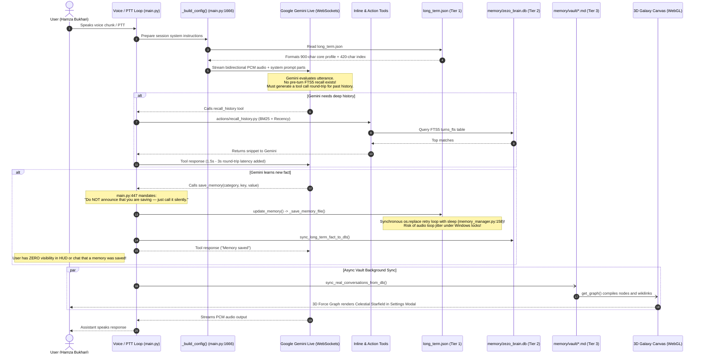
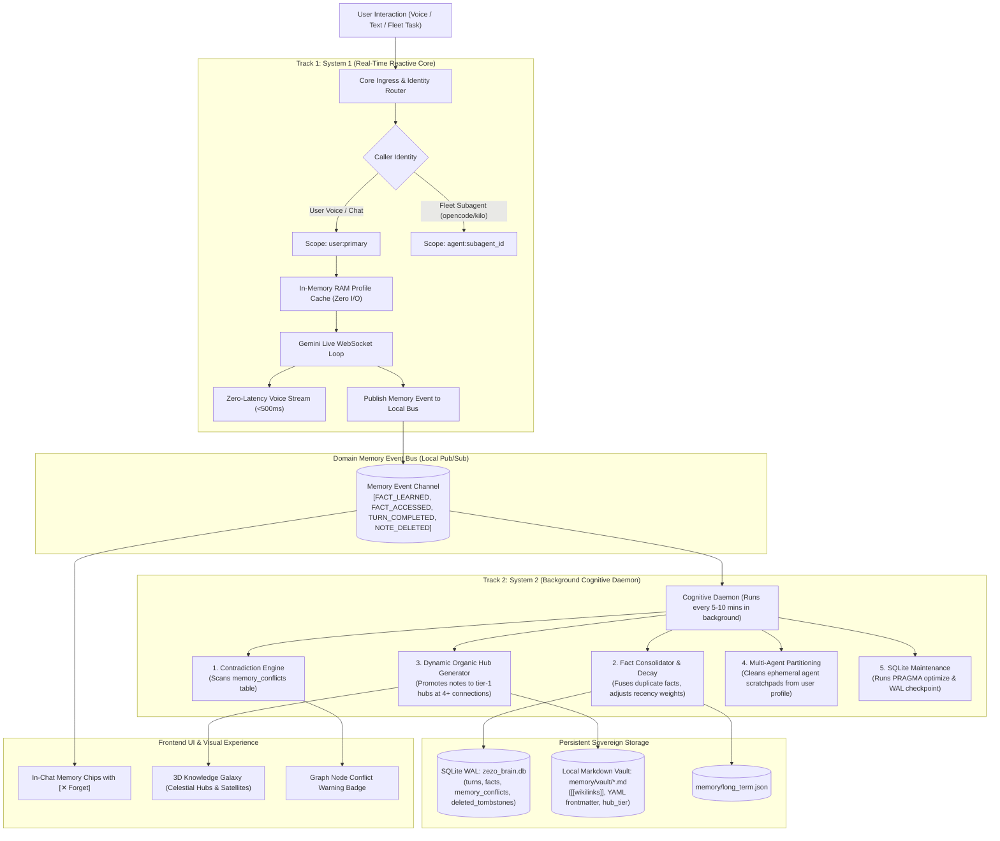
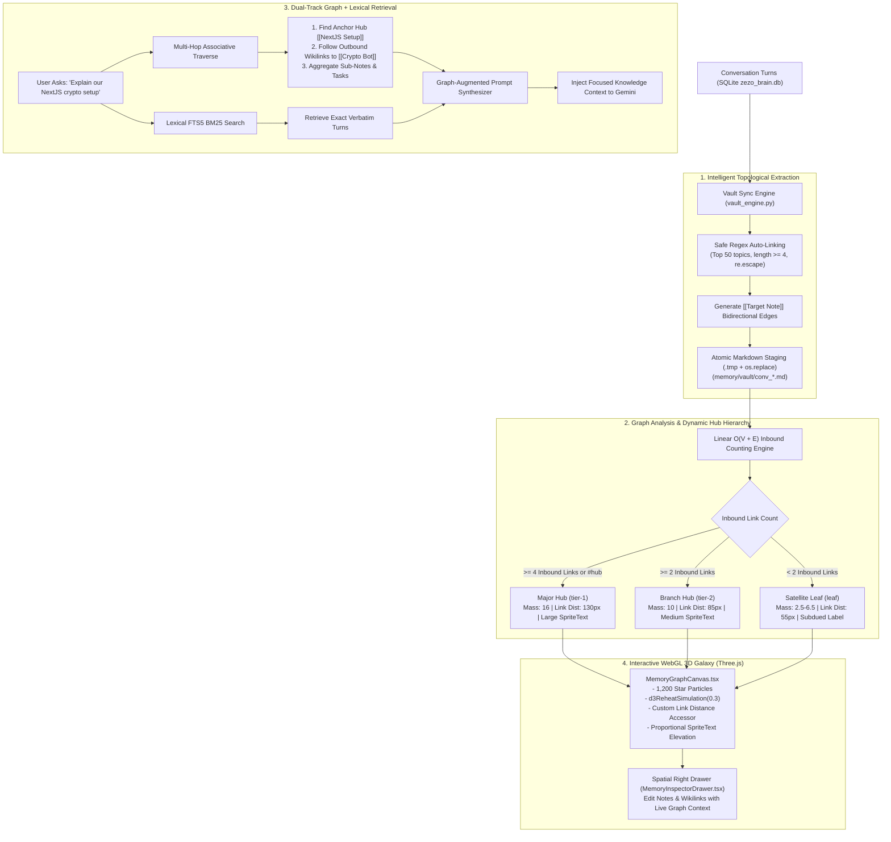

# 🧠 ZEZO Memory Architecture: Comparative Benchmark & Roadmap

> **Lead Architect & Creator:** Hamza Bukhari  
> **Document Type:** Deep Architectural Benchmark, Gap Analysis & Strategic Roadmap  
> **Benchmark Target:** OpenHuman Core "Brain" Memory Subsystem (`References/MEMORY_SYSTEM.md`) vs. ZEZO OS Hybrid 3-Tier Engine  
> **Status:** Active Reference & Implementation Roadmap  
> **Date:** November 2026  

---

## 📑 Table of Contents
1. [Executive Summary](#1-executive-summary)
2. [Deep Architectural Breakdown: How Each System Works](#2-deep-architectural-breakdown-how-each-system-works)
   - [A. The Reference Architecture (OpenHuman "Brain") — Detailed Flow](#a-the-reference-architecture-openhuman-brain--detailed-flow)
   - [B. ZEZO OS Current Architecture — Current Flow & Bottlenecks](#b-zezo-os-current-architecture--current-flow--bottlenecks)
3. [3 Strategic Architectural Options for ZEZO OS (With Detailed Diagrams)](#3-3-strategic-architectural-options-for-zezo-os-with-detailed-diagrams)
   - [Option 1: The Fast-Path Hybrid (Voice-Latency Optimized)](#option-1-the-fast-path-hybrid-voice-latency-optimized)
   - [Option 2: The Autonomous Dual-Track Brain (System 1 Core + System 2 Cognitive Bus)](#option-2-the-autonomous-dual-track-brain-system-1-core--system-2-cognitive-bus)
   - [Option 3: The Sovereign Neural-Symbolic Knowledge Vault (Topological Hubs + 3D Galaxy)](#option-3-the-sovereign-neural-symbolic-knowledge-vault-topological-hubs--3d-galaxy)
   - [Architectural Comparison & Recommendation Matrix](#architectural-comparison--recommendation-matrix)
4. [Comprehensive Gap Analysis](#4-comprehensive-gap-analysis)
   - [Table 1: Gaps (ZEZO is Missing or Doing Poorly)](#table-1-gaps-zezo-is-missing-or-doing-poorly)
   - [Table 2: Where ZEZO Already Leads (Protected Strengths)](#table-2-where-zezo-already-leads-protected-strengths)
5. [What ZEZO Should COPY or Adapt (And Why)](#5-what-zezo-should-copy-or-adapt-and-why)
   - [1. Pre-Turn Contextual Recall (P0 — Most Load-Bearing Gap)](#1-pre-turn-contextual-recall-p0--most-load-bearing-gap)
   - [2. In-Chat "Memory Chips" with Real-Time "Forget" Action (P1)](#2-in-chat-memory-chips-with-real-time-forget-action-p1)
   - [3. Unify Fragmented Memory Tools into One Canonical Tool (P1)](#3-unify-fragmented-memory-tools-into-one-canonical-tool-p1)
   - [4. Memory Tool Execution Budgets (P1)](#4-memory-tool-execution-budgets-p1)
   - [5. Decouple Live Loop Writes via an Async Write Outbox (P2)](#5-decouple-live-loop-writes-via-an-async-write-outbox-p2)
   - [6. Pause Memory / Incognito Mode Toggle (P2)](#6-pause-memory--incognito-mode-toggle-p2)
6. [What ZEZO Should NOT Copy (And Why)](#6-what-zezo-should-not-copy-and-why)
7. [What ZEZO Does Better (Must Protect & Preserve)](#7-what-zezo-does-better-must-protect--preserve)
8. [Expert Recommendations from Two Key Roles](#8-expert-recommendations-from-two-key-roles)
   - [🧑‍💻 As a Senior Backend Developer](#-as-a-senior-backend-developer)
   - [🎨 As a Senior Product Designer](#-as-a-senior-product-designer)
9. [Prioritized Action Plan](#9-prioritized-action-plan)

---

## 1. Executive Summary

This document performs an exhaustive, code-verified architectural audit comparing **OpenHuman's "Brain" Memory System** (documented in `References/MEMORY_SYSTEM.md`) with **ZEZO OS's current Hybrid 3-Tier Memory Engine**.

- **OpenHuman's Core Strength:** High operational runtime discipline — a single unified agent tool (`memory`), an asynchronous durable write outbox, ephemeral middleware prompt packing, explicit off-states (`MemoryOffState.tsx`), and radical chat-level UI transparency via live "Memory Chips" (`ChatMemoryChips.tsx`).
- **ZEZO OS's Core Strength:** Sovereign, local-first intelligence — a human-readable local Markdown vault (`memory/vault/*.md`) with `[[wikilinks]]`, an interactive 3D Celestial Knowledge Galaxy (`MemoryGraphCanvas.tsx`), high-speed SQLite WAL with FTS5 BM25 search (`memory/sqlite_memory.py`), atomic file staging patterns (`_atomic_save_config`), and automated secret token sanitization (`redact_secrets`).

The two biggest remaining gaps in ZEZO are **proactive context** (pre-turn recall, tool unification, non-blocking writes) and **user transparency/control** (in-chat memory chips, incognito pause toggle, and chronological review feed).

By strategically adopting OpenHuman's **pre-turn recall, unified tool pattern, and in-chat memory chips**, while strictly protecting ZEZO's **local Markdown vault, 3D galaxy visualizer, and SQLite WAL engine**, ZEZO's memory architecture will establish a best-in-class standard for speed, transparency, and personal ownership.

---

## 2. Deep Architectural Breakdown: How Each System Works

### A. The Reference Architecture (OpenHuman "Brain") — Detailed Flow

OpenHuman treats memory as an asynchronous, multi-tenant background operating domain with decoupled storage engines, strict caller identity scoping, and live UI chip broadcasting:

```mermaid
sequenceDiagram
    autonumber
    actor User as User (Chat / Voice)
    participant UI as OpenHuman Frontend (ChatUI)
    participant Host as Host Turn Dispatcher
    participant Scope as Scope Resolver (scope.rs)
    participant Prefetch as Pre-Turn Prefetch (prefetch.rs)
    participant LLM as Provider LLM (Anthropic / OpenAI)
    participant Tool as Single "memory" Tool (tools.rs)
    participant Outbox as HostWriteSink Outbox (Queue)
    participant Engine as Engine Binding (CortexDB / tinyhumans)
    participant Bus as Domain Event Bus (5-min Cron)

    User->>UI: Sends message or speaks utterance
    UI->>Host: Dispatches turn request
    Host->>Scope: Pin caller identity (user:id, agent_id, source)
    Scope-->>Host: Identity context (Identity::root / child / team)
    
    rect rgb(25, 35, 50)
        Note over Host,Prefetch: Pre-Turn Lifecycle (Fast Semantic Context Priming)
        Host->>Prefetch: Query semantic memory pack (60s TTL / 64KB cap)
        Prefetch-->>Host: Ephemeral <memory> instruction pack
        Host->>LLM: Ingest system prompt + ephemeral memory pack + transcript
    end

    LLM-->>Host: LLM response or tool invocation
    
    alt Agent calls memory tool (Read: recall / fetch)
        Host->>Tool: Execute read action inline
        Note over Tool: Enforces Tool Budget (15s per-call / 30s run aggregate)
        Tool->>Engine: Search / fetch partition
        Engine-->>Tool: Return facts / historical snippets
        Tool-->>Host: Return results to LLM context
        Host->>LLM: Resume response generation
    else Agent calls memory tool (Write: learn / forget)
        Host->>Tool: Execute write action
        Tool->>Outbox: Validate, scrub, and enqueue write (Max 256 / 2MB partition)
        Outbox-->>Tool: Immediate ACK (status: "queued")
        Tool-->>Host: Return success to LLM (0ms engine blocking)
        Host->>UI: Broadcast memory_activity event via WebSocket
        UI-->>User: Render real-time In-Chat Memory Chip with [✕ Forget] button
    end

    par Background Engine Sync
        Outbox-)Engine: Flush batches asynchronously
        Bus-)Engine: 5-minute periodic tick (consolidation & indexing)
    end
    
    LLM-->>Host: Final text/speech stream
    Host-->>UI: Deliver assistant response
```



#### Core Components in OpenHuman:
1. **Engine Registry (`crates/openhuman-core/src/memory/engine_registry.rs`):** Dynamically binds to either hosted cloud backends (`tinyhumans` via CortexDB REST) or self-hosted local engines (`cortexdb`). Uses an explicit state machine (`Binding::On` vs `Binding::Off`).
2. **Strict Identity & Scope Model (`scope.rs`):** Scope is never an LLM argument; it is pinned to caller identity (`user:<id>`, `agent:<memory-agent-id>`, `source:<kind>`). Subagents get `Identity::child`.
3. **Turn Lifecycle & Prompt Caching:** Ephemeral system instruction injection via `MemoryPackMiddleware` prevents transcript pollution and preserves provider prompt caching.
4. **Agent Tool & Execution Budgets (`tools.rs`, `tool_budget.rs`):** A single polymorphic `memory` tool with operations: `recall`, `fetch`, `learn`, `forget`. Writes are staged in a durable outbox (`HostWriteSink`), returning immediately.
5. **Radical UI Transparency (`ChatMemoryChips.tsx`):** Real-time chips in chat stream displaying `"Remembered: {fact}"` with instant hover `[Forget]` trigger.

---

### B. ZEZO OS Current Architecture — Current Flow & Bottlenecks

ZEZO OS currently runs a multi-tier local hybrid memory engine. While fast and 100% private, it currently suffers from synchronous file write blocking, tool fragmentation, and zero in-chat memory feedback:



#### Verified Reality of Current Bottlenecks:
1. **Synchronous File Replacement on the Live Loop:** Saving a memory triggers `_save_memory_file()` which performs atomic replacement using `time.sleep(0.04 * (attempt + 1))` (`memory_manager.py:158`). On Windows, concurrent file locks can stall the live WebSocket audio loop.
2. **Cold History Tool Round-Trips:** Asking about past sessions forces Gemini to call `actions/recall_history.py`, adding 1.5–3 seconds of voice silence.
3. **Black Box Silent Memory:** `main.py:447` mandates silent saves. The user cannot see what was learned or undo accidental misconceptions without opening the Settings Modal.
4. **Fragmented Tool Declarations:** `save_memory` (`main.py:441`), `recall_memory` (`main.py:471`), and `recall_history` (`actions/recall_history.py:17`) compete for Gemini's function dispatch attention.

---

## 3. 3 Strategic Architectural Options for ZEZO OS (With Detailed Diagrams)

To resolve these bottlenecks while preserving ZEZO's sovereign, local-first principles, three architectural evolution paths are presented below:

---

### Option 1: The Fast-Path Hybrid (Voice-Latency Optimized)

> **Philosophy:** *Surgical, low-risk, high-speed upgrade.* Fix the live audio loop jitter and context latency immediately without overhauling background processes or data schemas.

```mermaid
flowchart TD
    User["User Voice / Text Utterance"] --> PreCheck{"Memory Paused?"}
    
    subgraph FastPath["1. Bounded Pre-Turn Fast Path (150-180ms)"]
        PreCheck -->|No| FastFTS["FTS5 BM25 Search<br/>(search_scroll_history in sqlite_memory.py)"]
        FastFTS -->|Match Found| InjectTurn["Inject Ephemeral Context Turn<br/>(send_client_content, turn_complete=False)"]
        FastFTS -->|Timeout >180ms or Empty| SkipRecall["Bypass Pre-Turn Recall"]
    end

    subgraph LiveLoop["2. Live Gemini WebSocket Loop"]
        InjectTurn --> LiveSession["Gemini Live Audio / Text Session"]
        SkipRecall --> LiveSession
        PreCheck -->|Yes| LiveSession
        LiveSession --> ModelAction{"Model Action"}
    end

    subgraph ToolDispatch["3. Single Canonical Memory Tool"]
        ModelAction -->|"Single Tool: memory(action='learn'/'recall'/'forget'/'history')"| UnifiedTool["actions/memory_tool.py"]
        UnifiedTool -->|Action='recall' or 'history'| BudgetCheck{"Per-Turn Calls < 3?"}
        BudgetCheck -->|Yes| InlineRead["Execute SQLite FTS5 / Fact Query"]
        BudgetCheck -->|No| BudgetStop["Return: 'Search budget reached. Answer now.'"]
    end

    subgraph AsyncOutbox["4. Non-Blocking Async Write Outbox"]
        UnifiedTool -->|Action='learn' or 'forget'| WriteQueue["_memory_write_queue<br/>(Bounded Queue: maxsize=256)"]
        WriteQueue --> OutboxACK["Immediate Tool ACK to Gemini: {'status': 'queued'}"]
        OutboxACK --> LiveSession
        
        WriteQueue --> BroadcastUI["Broadcast 'memory_activity' via ui_server"]
        BroadcastUI --> ChatBadge["Render In-Chat Memory Chip<br/>(ZezoChatThread.tsx with [✕ Forget])"]
        
        WriteQueue -.->|Background Daemon Thread (1.5s)| Worker["Outbox Worker (_drain_outbox_loop)"]
        Worker --> AtomicDisk["Batch Atomic Save (long_term.json)"]
        Worker --> SyncSQLite["Update SQLite facts Table"]
        Worker --> ExitHook["atexit: Flush Remaining Queue on Shutdown"]
    end

    InlineRead --> LiveSession
    LiveSession --> AssistantOutput["Spoken Voice / Text Response to User"]
```

#### Detailed Characteristics of Option 1:
- **How it Works:** 
  1. User utterance triggers an asynchronous, bounded 180ms FTS5 search in `sqlite_memory.py`. If matched, injected as a context turn via `send_client_content(turn_complete=False)`.
  2. All memory tools are consolidated into `actions/memory_tool.py`.
  3. Writes never touch disk synchronously; they push to `_memory_write_queue` and return immediately.
  4. Real-time WebSocket event renders an in-chat ReUI memory chip with an instant `[✕ Forget]` button.
- **Pros:**
  - ✅ **Lowest Blast Radius:** Modifies only 3–4 files (`main.py`, `actions/memory_tool.py`, `memory_manager.py`, `ZezoChatThread.tsx`).
  - ✅ **Zero Audio Jitter:** Audio loop never waits on Windows file locks or SQLite writes.
  - ✅ **Sub-Second Voice Recall:** Direct contextual injection answers past questions without tool round-trips.
- **Cons:**
  - ❌ Leaves multi-agent fleet memory namespacing simple.
  - ❌ Does not automate deep topic consolidation or contradiction resolution in the background.
- **Best For:** Immediate production implementation (P0/P1 roadmap execution).

---

### Option 2: The Autonomous Dual-Track Brain (System 1 Core + System 2 Cognitive Bus)

> **Philosophy:** *Bi-cameral cognitive architecture.* Decouples real-time reactive conversation (System 1) from an asynchronous, background cognitive worker (System 2) that handles consolidation, contradiction resolution, and multi-agent fleet memory.



#### Detailed Characteristics of Option 2:
- **How it Works:** 
  1. Splitting memory operations into two distinct runtime loops: System 1 (fast, reactive, strictly in-memory RAM caching for the live audio stream) and System 2 (an asynchronous cognitive daemon running every 5–10 minutes).
  2. System 1 publishes events (`FACT_LEARNED`, `TURN_COMPLETED`) to an internal queue.
  3. The Cognitive Daemon independently analyzes facts, flags contradictions in `memory_conflicts`, prunes expired subagent scratchpads, auto-promotes topic notes to Major Hubs (`tier-1`), and optimizes SQLite WAL.
- **Pros:**
  - ✅ **Maximum Cognitive Intelligence:** Background de-duplication, automatic contradiction resolution, and self-organizing knowledge.
  - ✅ **Clean Multi-Agent Isolation:** Fleet subagents (`opencode`, `kilo`) get their own isolated scratchpad partitions and cannot pollute user facts.
  - ✅ **Zero Live Loop Interference:** Heavy analytical tasks never compete with microphone/speaker audio threads.
- **Cons:**
  - ⚠️ Higher implementation complexity; requires managing a multi-threaded daemon and inter-thread event queues.
- **Best For:** Mid-term evolution as ZEZO expands its multi-agent fleet capabilities.

---

### Option 3: The Sovereign Neural-Symbolic Knowledge Vault (Topological Hubs + 3D Galaxy)

> **Philosophy:** *Obsidian-first, graph-centric intelligence.* Eliminates opaque vector databases entirely. Treats human-readable Markdown notes and bidirectional `[[wikilinks]]` as the primary topological source of truth, backed by SQLite FTS5 lexical indexing.



#### Detailed Characteristics of Option 3:
- **How it Works:** 
  1. The local Markdown vault (`memory/vault/*.md`) serves as the explicit knowledge representation layer.
  2. Conversations automatically link to existing vault topics via pre-compiled safe regex boundaries.
  3. `get_graph()` calculates inbound connections linearly ($O(V+E)$) and dynamically assigns hub tiers (`tier-1`, `tier-2`, `leaf`).
  4. Retrieval uses a dual-track strategy: BM25 lexical search finds specific conversational turns, while graph traversal walks 1–2 hops of `[[wikilinks]]` around the relevant topic hub to gather holistic project context.
  5. The WebGL 3D Galaxy visually maps hubs as celestial suns with satellite conversations orbiting tightly around them (55px link distance).
- **Pros:**
  - ✅ **Unmatched Transparency & Portability:** Notes are standard Markdown files readable in Obsidian, VS Code, or GitHub.
  - ✅ **Superior Multi-Hop Reasoning:** Can answer associative queries across related topics that keyword search misses.
  - ✅ **Zero Proprietary Cloud/Vector Lock-in:** 100% offline, local-first computing.
- **Cons:**
  - ⚠️ Requires tuning graph auto-linking to prevent false-positive wikilink generation.
- **Best For:** Long-term strategic personal knowledge mastery, research, and deep project tracking.

---

### Architectural Comparison & Recommendation Matrix

| Evaluation Dimension | Option 1: Fast-Path Hybrid | Option 2: Dual-Track Brain | Option 3: Sovereign Graph Vault |
| :--- | :---: | :---: | :---: |
| **Voice Latency (Turn Ingress)** | **Ultra-Low (<180ms prefetch)** | Very Low (<250ms) | Low (<300ms) |
| **Live Loop Jitter Risk** | **Zero (Async Outbox)** | **Zero (In-Memory Cache)** | Low (Atomic file staging) |
| **User Transparency** | High (In-Chat Chips + Forget) | High (Chips + Conflict Badges) | **Exceptional (3D Galaxy + Drawer)** |
| **Multi-Agent Fleet Isolation** | Basic | **Complete (Partitioned Scopes)** | Medium (Folder namespaces) |
| **Associative Reasoning Depth** | Moderate (Lexical FTS5) | High (Consolidated Facts) | **Highest (Wikilink Graph Traversals)** |
| **Implementation Complexity** | **Low (Surgical: 3–4 files)** | High (Daemon + PubSub Event Bus) | Medium (Graph engine + D3 physics) |
| **Blast Radius / Risk** | **Minimal** | Moderate | Low (Preserves existing vault) |

#### 🏆 Strategic Architectural Recommendation:
Adopt a **Two-Phase Evolutionary Roadmap**:
1. **Phase 1 (Immediate — P0/P1): Implement Option 1.**  
   Deploy the non-blocking Async Write Outbox, Pre-Turn 180ms FTS5 Context Injection, Unified `memory_tool.py`, and In-Chat Memory Chips. This immediately eliminates audio loop jitter and black-box memory anxiety with minimal blast radius.
2. **Phase 2 (Near-Term — P2/P3): Converge Options 2 & 3.**  
   Layer the background cognitive consolidation daemon onto the persistent Markdown vault, executing the Dynamic Organic Hub Hierarchy and SQLite Tombstones anti-resurrection mechanics.

---

## 4. Comprehensive Gap Analysis

### Table 1: Gaps (ZEZO is Missing or Doing Poorly)

| Feature / Dimension | OpenHuman "Brain" | ZEZO OS (Current) | Architectural Impact & Concrete Gap in ZEZO |
| :--- | :--- | :--- | :--- |
| **Pre-Turn Contextual Recall** | **High:** Runs `prefetch::pre_turn` on user message; injects relevant memory pack before model responds. | **Static:** Only injects static 900-char `long_term.json` block via `_build_config()` (`main.py:1462`). | **Severe Context Latency:** Asking *"What Python error did we fix last Tuesday?"* forces Gemini to take a tool-call round trip, increasing conversational latency. |
| **In-Chat Memory Transparency** | **High:** Live `ChatMemoryChips.tsx` rendered below assistant turn with an instant `[Forget]` button. | **Zero:** `main.py:447` mandates silent saving: *"Do NOT announce that you are saving — just call it silently."* | **Severe UX/Trust Deficit:** User has zero visibility into what ZEZO learns in real-time unless they open Settings Modal. Hallucinations cannot be caught at moment of creation. |
| **Tool Execution Budgets** | **Strict:** `tool_budget.rs` enforces 15s/call, 30s aggregate, max 8 calls/run. | **Unenforced:** `core/loop_gates.py` exists, but memory tools are not checked per turn in `main.py`. | **Runaway Query Risk:** Gemini can make repeated or redundant `recall_memory` queries without a hard per-turn threshold. |
| **Tool Architecture** | **Unified:** Single `memory` tool with operations: `recall`, `fetch`, `learn`, `forget`. | **Fragmented:** `save_memory` (`main.py:441`), `recall_memory` (`main.py:471`), and `recall_history` (`actions/recall_history.py`). | **Model Confusion:** Multiple overlapping tools waste function-declaration tokens and cause tool selection ambiguity. |
| **Write Reliability & Decoupling** | **Durable Outbox:** Writes queued in `HostWriteSink`; returns immediately; worker delivers in background. | **Synchronous File Replacement:** Direct `json.dumps()` + `os.replace()` with sleep retries (`memory_manager.py:158`). | **Event Loop Jitter:** File-locking delays on Windows risk blocking Gemini Live's real-time audio WebSocket loop. |
| **Pause Memory / Incognito Mode** | **Explicit:** Dedicated `MemoryOffState.tsx` screen and `Binding::Off` state machine. | **Always On:** No global pause toggle exists in the HUD or chat UI. | **Privacy Risk:** User cannot temporarily discuss sensitive credentials or ephemeral workflows without persisting them to history. |
| **Multi-Agent Memory Scopes** | **Strict Identity Isolation:** Subagents have `Identity::child` scratchpads; cannot pollute user profile facts. | **Partially Shared:** Fleet agents (`opencode`, `kilo`) share global `long_term.json` and vault notes. | **Cross-Agent Pollution:** Temporary code refactoring facts or subagent notes risk cluttering core user profile memory. |
| **Prompt Cache Invalidation** | **Ephemeral Injection:** Memory injected via middleware as an ephemeral block; transcript prefixes remain static. | **Dynamic String Formatting:** Timestamps, recent sessions, and recency-ordered facts re-rendered into system prompt string. | *(Needs verification: depends on how Gemini Live handles caching in this setup; measure before treating as a real cost)*. |

### Table 2: Where ZEZO Already Leads (Protected Strengths)

| Strength / Capability | OpenHuman "Brain" | ZEZO OS (Current) | Architectural Advantage in ZEZO |
| :--- | :--- | :--- | :--- |
| **Knowledge Visualization** | **Basic:** Flat list chips and text rows (`MemoryLearningsTab.tsx`). | **World-Class:** 3D Celestial Knowledge Galaxy (`MemoryGraphCanvas.tsx`) with 1,200 Three.js particles and orbital physics. | **Superior Spatial Exploration:** High associative readability, visual clustering, and intuitive knowledge browsing. |
| **Data Sovereignty & Local-First Architecture** | **Cloud-Dependent:** Built on proprietary hosted SaaS (`tinyhumans.ai`) and CortexDB cloud routes. | **100% Local-First:** Pure Python + SQLite WAL + Local Markdown files. Zero cloud vendor lock-in. | **Absolute Privacy:** User data remains strictly on the host computer with zero subscription requirements. |
| **Automated Secret Redaction** | **External / Unknown:** Handled upstream in uninitialized vendor submodule. | **Aggressive In-Code Redaction:** Pre-compiled regexes in `memory/sqlite_memory.py` scrub API keys, PATs, and Bearer tokens before disk writes. | **Defense in Depth:** Sensitive developer credentials are never logged to plain-text transcripts. |
| **Permanent Anti-Resurrection Mechanics** | **Roll-Off Risk:** FIFO tombstones can expire under heavy deletion volume. | **ACID SQLite Tombstones:** Dedicated `deleted_tombstones` table and slug normalization guarantee deleted notes never resurrect. | **Integrity Guarantee:** Zero ghost notes re-ingested from orphaned database turns. |
| **Spatial Note Inspection** | **Center Modal:** Opens `MemoryItemDialog.tsx` as a popup, occluding the underlying graph. | **Unified Right Drawer:** `MemoryInspectorDrawer.tsx` maintains spatial context with the 3D graph during note edits. | **Seamless Workflow:** Eliminates spatial disorientation and ghost state. |
| **Atomic File Staging** | **Engine Dependent:** Delegated to engine bindings. | **Built-in Atomic Replacement:** `_atomic_save_config` (`config_manager.py:84`) and atomic `.tmp` staging in `vault_engine.py:372` and `memory_manager.py:154`. | **Crash Resilience:** Prevents half-written or corrupted JSON/index files during abrupt shutdowns. |

---

## 5. What ZEZO Should COPY or Adapt (And Why)

### 1. Pre-Turn Contextual Recall (P0 — Most Load-Bearing Gap)
- **Why:** In voice assistants, round trips are expensive. If a user asks *"What did we decide about the database schema yesterday?"*, forcing Gemini to call `recall_history` takes an extra 1.5–3 seconds of latency. OpenHuman solves this by running `prefetch::pre_turn` before the agent replies.
- **How to Implement in ZEZO:**
  1. In `main.py` (inside the user utterance receiver `_receive_audio` or text handler), before dispatching to Gemini Live, execute a fast FTS5 query against `sqlite_memory.py`.
  2. Enforce a **hard deadline of 150–200ms**. If the query does not return in time, skip silently without delaying voice playback.
  3. If high-confidence matches are found, inject them as a separate context turn using Gemini Live's real `send_client_content` API (`main.py:964, 2924`) with `turn_complete=False` to preserve prompt caching:
  ```python
  # Implementation sketch for main.py:
  async def _prefetch_context_if_needed(self, user_text: str) -> None:
      if not user_text or len(user_text.strip()) < 8:
          return
      try:
          from memory.sqlite_memory import search_scroll_history
          # Run bounded FTS5 query with strict 180ms timeout
          loop = asyncio.get_running_loop()
          results = await asyncio.wait_for(
              loop.run_in_executor(None, search_scroll_history, user_text, 3, None, 0.35, 14.0),
              timeout=0.18
          )
          if results:
              snippets = "\n".join([f"- [{r.get('timestamp', '')[:16]}] {r.get('role')}: {r.get('content')[:140]}" for r in results])
              context_msg = f"[PRE-TURN RETRIEVED RELEVANT HISTORY (Answer directly without calling recall_history)]:\n{snippets}"
              await self.session.send_client_content(
                  turns=[{"role": "user", "parts": [{"text": context_msg}]}],
                  turn_complete=False,
              )
      except (asyncio.TimeoutError, Exception) as e:
          logger.debug("[Prefetch] Pre-turn recall skipped: %s", e)
  ```

---

### 2. In-Chat "Memory Chips" with Real-Time "Forget" Action (P1)
- **Why:** The single greatest psychological gap in AI personal assistants is the "black box" memory problem. When a user mentions a personal detail and the assistant saves it silently, the user feels uncertain. Rendering a sleek, non-intrusive ReUI chip directly in the conversation stream builds instant user confidence.
- **How to Implement in ZEZO:**
  1. In `main.py:_dispatch_save_memory()`, after validating the fact, broadcast the event via `UIServer`:
     ```python
     # Corrected signature using core/ui_server.py:2723
     from core.ui_server import get_ui_server
     ui = get_ui_server()
     if ui:
         ui.broadcast("memory_activity", {
             "action": "learned",
             "category": category,
             "key": key,
             "value": value,
             "status": "persisted",
             "timestamp": datetime.now().isoformat()
         })
     ```
  2. Expose a dedicated REST endpoint `POST /api/memory/fact/delete` in `core/ui_server.py` that deletes the key from `long_term.json` and SQLite `facts`.
  3. In `frontend/src/components/assistant-ui/ZezoChatThread.tsx` (the active chat thread) or `ChatPanel.tsx`, listen for `memory_activity` on the WebSocket and render a ReUI `Badge`:
     ```tsx
     <div className="flex items-center gap-1.5 px-2.5 py-1 rounded-md bg-primary/10 border border-primary/20 text-xs font-mono text-primary animate-in fade-in">
       <span>🧠 Remembered: {key.replace('_', ' ')}: {value}</span>
       <button
         onClick={() => handleForgetFact(category, key)}
         className="ml-1 text-muted-foreground hover:text-red-400 transition-colors"
         title="Forget this memory"
       >
         ✕
       </button>
     </div>
     ```

---

### 3. Unify Fragmented Memory Tools into One Canonical Tool (P1)
- **Why:** Having `save_memory`, `recall_memory`, and `recall_history` creates token bloat in Gemini's function declarations and leads to tool-dispatch hesitation.
- **How to Implement in ZEZO:** Create `actions/memory_tool.py` exporting a single `TOOL` schema:
  ```python
  TOOL = {
      "name": "memory",
      "description": "Unified memory tool for ZEZO. Recall facts and conversations, learn new user context, forget outdated facts, or expand historical turns.",
      "parameters": {
          "type": "OBJECT",
          "properties": {
              "action": {
                  "type": "STRING",
                  "enum": ["recall", "learn", "forget", "history"],
                  "description": "The memory operation to perform."
              },
              "query": {"type": "STRING", "description": "Search query for recall or history."},
              "category": {"type": "STRING", "description": "Category for learning or forgetting."},
              "key": {"type": "STRING", "description": "Specific key to learn or forget."},
              "value": {"type": "STRING", "description": "Fact content to learn."},
              "turn_range": {
                  "type": "OBJECT",
                  "description": "Range [lo, hi] for history expansion.",
                  "properties": {
                      "lo": {"type": "INTEGER"},
                      "hi": {"type": "INTEGER"}
                  }
              }
          },
          "required": ["action"]
      }
  }
  ```

---

### 4. Memory Tool Execution Budgets (P1)
- **Why:** While `core/loop_gates.py` provides session-level limits (`max_tool_budget=50`), it does not prevent an LLM from spinning on 4–5 consecutive `recall_memory` calls within a single conversational turn.
- **How to Implement in ZEZO:**
  - Add a per-turn counter inside `_dispatch_tool` or `_receive_audio`.
  - If memory read operations exceed **3 calls within one turn**, return:
    `"Memory search budget reached for this turn. Please synthesize an answer from the retrieved context now."`

---

### 5. Decouple Live Loop Writes via an Async Write Outbox (P2)
- **Why:** Real-time audio streaming over WebSockets must never be blocked by synchronous file system operations or retry loops (`memory_manager.py:158`).
- **How to Implement in ZEZO:**
  Extend `memory/memory_manager.py` with an async outbox queue, background worker, and shutdown flush:
  ```python
  import atexit
  import queue
  import threading
  import time

  _memory_write_queue: queue.Queue = queue.Queue(maxsize=256)
  _outbox_worker_started = False
  _worker_lock = threading.Lock()

  def queue_memory_write(category: str, key: str, value: str) -> bool:
      """Push memory write to background outbox; returns immediately.
      Falls back to synchronous write if queue is full to prevent fact loss."""
      _ensure_worker_started()
      try:
          _memory_write_queue.put_nowait((category, key, value))
          return True
      except queue.Full:
          # Queue full: execute synchronous fallback rather than dropping fact
          update_memory_entry(category, key, value)
          return False

  def _drain_outbox_loop():
      """Background daemon draining queued facts every 1.5 seconds."""
      while True:
          batch = []
          try:
              # Wait up to 1.5s for items
              item = _memory_write_queue.get(timeout=1.5)
              batch.append(item)
              while not _memory_write_queue.empty() and len(batch) < 32:
                  batch.append(_memory_write_queue.get_nowait())
          except queue.Empty:
              continue

          if batch:
              _commit_batch(batch)

  def _commit_batch(batch: list[tuple[str, str, str]]):
      """Commit batch to long_term.json and sync SQLite."""
      updates = {}
      for cat, key, val in batch:
          updates.setdefault(cat, {})[key] = val
      update_memory(updates)

  def flush_outbox_on_shutdown():
      """Flush remaining items on process exit."""
      remaining = []
      while not _memory_write_queue.empty():
          try:
              remaining.append(_memory_write_queue.get_nowait())
          except queue.Empty:
              break
      if remaining:
          _commit_batch(remaining)

  def _ensure_worker_started():
      global _outbox_worker_started
      with _worker_lock:
          if not _outbox_worker_started:
              t = threading.Thread(target=_drain_outbox_loop, daemon=True, name="MemoryOutboxWorker")
              t.start()
              atexit.register(flush_outbox_on_shutdown)
              _outbox_worker_started = True
  ```

---

### 6. Pause Memory / Incognito Mode Toggle (P2)
- **Why:** Users frequently discuss temporary configurations, API keys, or personal thoughts they do not want persisted into the permanent SQLite turn log or markdown vault.
- **How to Implement in ZEZO:**
  1. Add a toggle in `memory/config_manager.py`: `is_memory_paused() -> bool` and `set_memory_paused(bool)`.
  2. In `main.py:_dispatch_save_memory()` and `sqlite_memory.log_turn()`, if `is_memory_paused()` is `True`, immediately bypass persistence.
  3. Render an incognito status pill in the Top Header or chat input: `[🕶️ Memory Paused]`.

---

## 6. What ZEZO Should NOT Copy (And Why)

### 1. DO NOT Copy the Rust Core & Hosted SaaS Backend (`tinyhumans` / CortexDB)
- **Why OpenHuman did it:** OpenHuman is designed as an enterprise platform with a multi-tenant cloud subscription model.
- **Why it is WRONG for ZEZO:** ZEZO's core design philosophy is **100% sovereign, local-first computing**. Introducing cloud dependencies or external proprietary vector databases destroys privacy, adds network latency, and violates user data sovereignty.

### 2. DO NOT Copy Commercial Billing & Plan Gating (`billing.rs`, `PLAN_REQUIRED`)
- **Why OpenHuman did it:** Monetization via feature gating (e.g. 403 `MEMORY_PLAN_REQUIRED`).
- **Why it is WRONG for ZEZO:** ZEZO is an executive personal AI operating system owned entirely by the creator (Hamza Bukhari). Artificially restricting background consolidation or search depth behind paywalls is antithetical to ZEZO's mission.

### 3. DO NOT Abandon the Local Markdown Vault for an Opaque Vector Database
- **Why OpenHuman did it:** Vector databases make semantic clustering easy inside closed server environments.
- **Why it is WRONG for ZEZO:** ZEZO's local Markdown vault (`memory/vault/*.md`) allows users to inspect, edit, backup, and sync their notes with standard tools like Obsidian, Git, or VS Code. **Open, human-readable file formats must always take precedence over proprietary database blobs.**

### 4. DO NOT Copy OpenHuman's Complex Layout Migrations (v1 to v3)
- **Why OpenHuman did it:** Required to migrate from legacy directory trees (`app:tinymemory/...`) to per-user v3 storage trees.
- **Why it is WRONG for ZEZO:** ZEZO's `memory/vault/vault_index.json` combined with filesystem modification time (`st_mtime`) caching is substantially simpler, zero-overhead, and has no legacy baggage.

### 5. DO NOT Copy the Engine Picker UI (`MemoryEngineTab.tsx`, `MemoryEngineSetup.tsx`)
- **Why OpenHuman did it:** Required because users can toggle between hosted SaaS and self-hosted cortexdb.
- **Why it is WRONG for ZEZO:** ZEZO operates with a single, highly tuned local engine. Adding multi-engine configuration forms adds UI bloat without architectural benefit.

### 6. DO NOT Copy Full Multi-Tenant `user:<id>` Scoping
- **Why OpenHuman did it:** Required for multi-user cloud SaaS organizations.
- **Why it is WRONG for ZEZO:** ZEZO is a dedicated personal desktop OS. Only agent-level partitioning (`agent_origin`) is required to separate autonomous fleet coding logs from the user's primary profile.

---

## 7. What ZEZO Does Better (Must Protect & Preserve)

1. **The 3-Speed Multi-Tier Hierarchy:**
   - **Tier 1 (Instant):** In-prompt profile facts provide zero-latency voice personality grounding.
   - **Tier 2 (Deep):** SQLite WAL + FTS5 BM25 with recency decay retrieves verbatim quotes, error traces, and exact timestamps in sub-millisecond to low-millisecond queries.
   - **Tier 3 (Associative):** Markdown vault with `[[wikilinks]]` compiles knowledge networks and clusters.
2. **Interactive 3D Celestial Knowledge Galaxy (`MemoryGraphCanvas.tsx`):**
   - Procedural 1,200 particle Three.js starfield (`MemoryGraphCanvas.tsx:434`), synaptic particle flows, dynamic node mass, orbital link distance clustering, and smooth camera glides. This is an exceptional, world-class user experience.
3. **Automated Secret & Token Redaction (`redact_secrets`):**
   - High-performance pre-compiled regex guards prevent API keys, authentication headers, and private session cookies from ever being written to disk or the database.
4. **Permanent Anti-Resurrection Mechanics:**
   - Dedicated SQLite `deleted_tombstones` table and normalized session slug matching eliminate ghost memory reappearance permanently.
5. **Unified Spatial Right Drawer (`MemoryInspectorDrawer.tsx`):**
   - Inspecting, editing, and creating notes are anchored in the right drawer without opening modal popups (`MemoryItemDialog.tsx`), maintaining spatial orientation with the 3D graph.
6. **Built-in Atomic File Staging:**
   - Atomic staging patterns (`_atomic_save_config` in `memory/config_manager.py:84`, atomic temp replacement in `memory/memory_manager.py:154`, and `memory/vault_engine.py:372`) ensure crash resilience without corrupted indices.

---

## 8. Expert Recommendations from Two Key Roles

### 🧑‍💻 As a Senior Backend Developer

1. **Pre-Turn Contextual Recall (P0):**
   - Integrate a bounded 180ms FTS5 search into the voice/text ingress in `main.py`. Inject matches into Gemini Live via `send_client_content(turns=[...], turn_complete=False)` to eliminate redundant `recall_history` round trips.
2. **Surgical Tool Consolidation (P1):**
   - Unify `save_memory`, `recall_memory`, and `actions/recall_history.py` into a single canonical `actions/memory_tool.py` exporting one `memory` declaration.
   - Deprecate inline memory tool declarations in `main.py` in accordance with AGENTS.md Rule 4 ("One File Per Action & Clean Separation").
3. **Tool Execution Budgets (P1):**
   - Enforce a strict maximum of 3 memory read calls per conversational turn to prevent query loops.
4. **Asynchronous Memory Outbox Worker (P2):**
   - Implement the `queue_memory_write` outbox in `memory/memory_manager.py` with process shutdown flushing (`atexit`) and queue-overflow fallback.
5. **Multi-Agent Memory Namespacing (P2):**
   - Add an `agent_origin` column to the SQLite `facts` table (`sqlite_memory.py:125`) and frontmatter of generated vault notes.
   - Allow specialist coding agents (`antigravity`, `opencode`, `kilo`) to maintain isolated working scratchpads without polluting the user's primary identity facts.
6. **FTS5 Query String Sanitization (P2):**
   - Sanitize all query strings passed to `sqlite_memory.py` by stripping reserved FTS5 operators (`*`, `^`, `NEAR`, `NOT`) to guarantee syntax resilience.
7. **Periodic Background Maintenance Tick (P3):**
   - Add a 10-minute periodic task in `main.py` to run `PRAGMA optimize`, checkpoint WAL logs, and clean unwritten wikilinks.
8. **Measure Gemini Live Prompt Caching (P3):**
   - Benchmark whether dynamic system prompt generation in `_build_config()` actually impacts token latency or billing on Gemini Live before altering core prompt structures.
9. **Vault Organic Hub Auto-Linking Polish (P3):**
   - Ensure `sync_real_conversations_from_db()` in `vault_engine.py` applies the safe regex pattern (`len(t) >= 4`, capped at top 50 topics) to link new sessions to their parent topic nodes.

---

### 🎨 As a Senior Product Designer

1. **In-Chat Memory Transparency Badges (P1 Game Changer):**
   - Design a compact, polished ReUI badge rendered directly inside `frontend/src/components/assistant-ui/ZezoChatThread.tsx` whenever the assistant saves a memory.
   - Include a clear title, category indicator, and an immediate `[✕ Forget]` action so users maintain effortless control over what the assistant remembers.
2. **Pause Memory / Incognito Mode Toggle (P2):**
   - Add an incognito toggle button in the chat composer pill and voice HUD. When active, display a subtle purple/amber badge `[🕶️ Incognito — Memory Paused]`.
3. **Chronological Memory Feed View (P3):**
   - Alongside the 3D Knowledge Galaxy in `SettingsModal.tsx`, provide a clean split-view toggle:
     - **Galaxy View:** The interactive 3D Force-Directed Graph.
     - **Timeline Feed View:** A chronological, searchable list of memory entries with category pills, timestamps, and quick-edit/delete triggers.
4. **Proactive Conflict Indicator Pill (P3):**
   - Build upon the existing `memory_conflicts` table (`sqlite_memory.py:201`). When a contradiction is detected, display a gentle amber indicator on the corresponding graph node: `⚠️ Conflicting Memory: Click to resolve`.

---

## 9. Prioritized Action Plan

| Rank | Strategic Initiative | Domain | User Impact | Tech Effort | Priority | Core Files & Modules Involved |
| :---: | :--- | :---: | :---: | :---: | :---: | :--- |
| **1** | **Pre-Turn Contextual Recall:** Bounded 180ms FTS5 prefetch injected as context turn before Gemini answers. | **Backend** | **High** | **Medium** | **P0 (Critical)** | `main.py`, `memory/sqlite_memory.py` |
| **2** | **In-Chat Memory Activity Chips:** Emit WebSocket events on memory writes; render interactive ReUI memory badges in chat with instant "Forget" button. | **Both** | **High** | **Medium** | **P1 (Immediate)** | `main.py`, `core/ui_server.py`, `frontend/src/components/assistant-ui/ZezoChatThread.tsx` |
| **3** | **Unified Memory Tool (`actions/memory_tool.py`):** Consolidate `save_memory`, `recall_memory`, and `recall_history` into one tool (`recall`, `learn`, `forget`, `history`). | **Backend** | **High** | **Medium** | **P1 (Immediate)** | `actions/memory_tool.py`, `main.py`, `docs/TOOLS.md` |
| **4** | **Memory Tool Execution Budgets:** Limit per-turn memory tool calls to max 3 to prevent query loops. | **Backend** | **Medium** | **Low** | **P1 (Immediate)** | `main.py`, `core/loop_gates.py` |
| **5** | **Async Write Outbox with Shutdown Flush:** Buffer memory writes into a background queue; live audio loop acknowledges immediately; flush on exit. | **Backend** | **High** | **Medium** | **P2 (Near-Term)** | `memory/memory_manager.py`, `memory/vault_engine.py` |
| **6** | **Pause Memory / Incognito Mode Toggle:** Global toggle to pause memory logging and vault generation; clear UI badge. | **Both** | **Medium** | **Low** | **P2 (Near-Term)** | `memory/config_manager.py`, `main.py`, `frontend/src/App.tsx` |
| **7** | **Specialist Fleet Memory Namespacing:** Namespace memory facts by agent identity (`ZEZO` vs `opencode` vs `kilo`) to prevent coding scratchpad pollution. | **Backend** | **Medium** | **Medium** | **P2 (Near-Term)** | `memory/sqlite_memory.py`, `actions/fleet_control.py` |
| **8** | **FTS5 Query String Sanitization:** Strip reserved FTS5 operators (`*`, `^`, `NEAR`, `NOT`) from search strings to prevent syntax exceptions. | **Backend** | **Medium** | **Low** | **P2 (Near-Term)** | `memory/sqlite_memory.py` |
| **9** | **Proactive Conflict Indicator Pill:** Surface rows from existing `memory_conflicts` table as amber warning pills on graph nodes. | **Frontend** | **Medium** | **Low** | **P3 (Enhancement)** | `frontend/src/components/memory/MemoryGraphCanvas.tsx`, `core/ui_server.py` |
| **10** | **Vault Organic Hub Auto-Linking Polish:** Ensure regex topic linking is active during `sync_real_conversations_from_db()` to link sessions to parent hubs. | **Backend** | **Medium** | **Low** | **P3 (Enhancement)** | `memory/vault_engine.py` |
| **11** | **Periodic Background Maintenance Tick:** Add a 10-minute periodic task to optimize SQLite WAL (`PRAGMA optimize`), checkpoint WAL, and trim cache. | **Backend** | **Medium** | **Low** | **P3 (Maintenance)** | `main.py`, `memory/sqlite_memory.py`, `core/ui_server.py` |
| **12** | **Chronological Feed Toggle in Settings:** Provide a dual-mode toggle in Settings (Galaxy 3D Graph vs Tabular Feed) for bulk browsing and management. | **Frontend** | **Medium** | **Medium** | **P3 (Enhancement)** | `frontend/src/components/settings/SettingsModal.tsx` |
| **13** | **Measure Gemini Live Prompt Caching:** Quantify whether dynamic prompt rebuilding causes measurable latency or billing increases on live WebSockets. | **Backend** | **Low** | **Low** | **P3 (Measurement)** | `main.py` |

---

*Maintained under `docs/MEMORY_COMPARISON_AND_ROADMAP.md`.*
