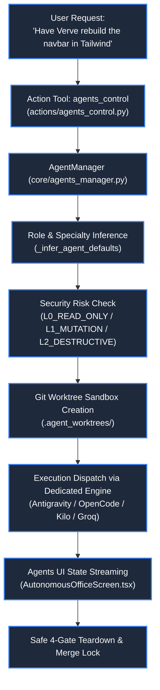
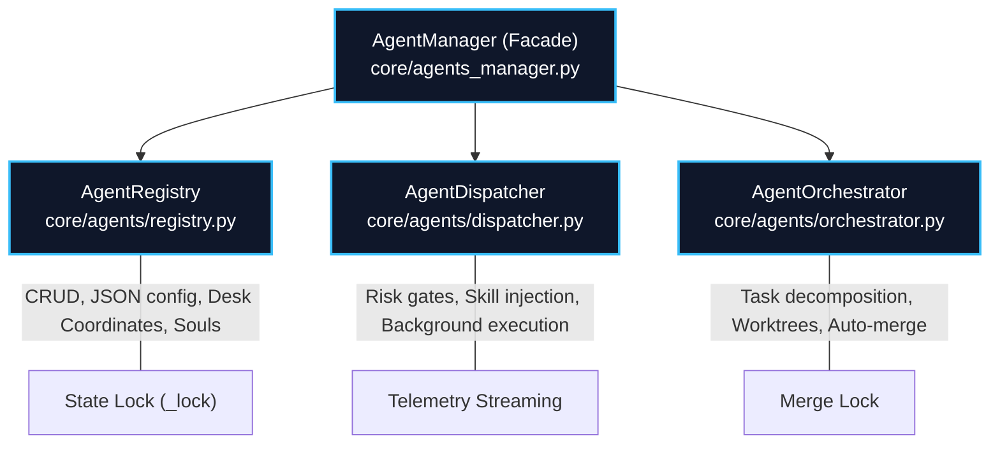
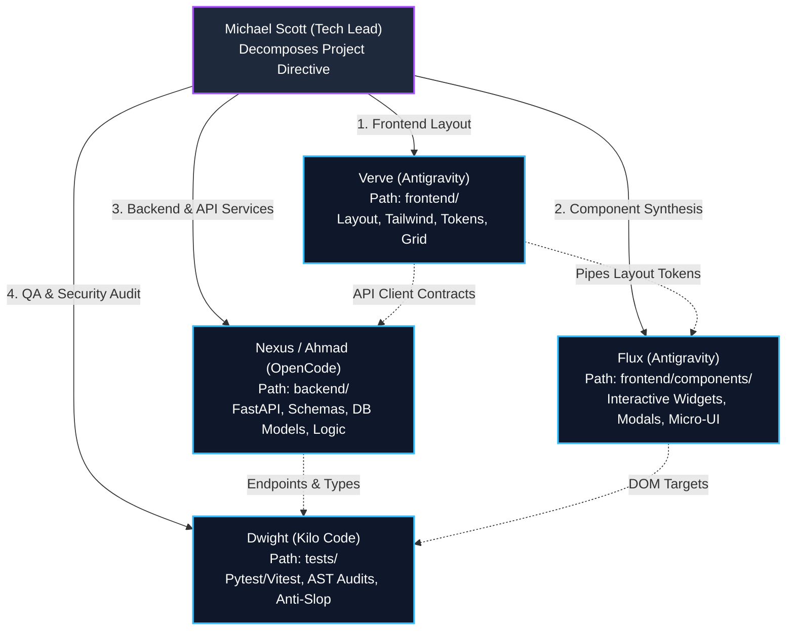

# 👥 Agent Management

> **Project:** ZEZO  
> **Creator & Lead Architect:** Hamza Bukhari  
> **Source Modules:** [`core/agents_manager.py`](file:///d:/anitgravity/zezo%20work/jarvis-57/core/agents_manager.py) (Facade), [`core/agents/`](file:///d:/anitgravity/zezo%20work/jarvis-57/core/agents/) (`registry.py`, `dispatcher.py`, `orchestrator.py`), [`actions/agents_control.py`](file:///d:/anitgravity/zezo%20work/jarvis-57/actions/agents_control.py), [`frontend/src/components/office/AutonomousOfficeScreen.tsx`](file:///d:/anitgravity/zezo%20work/jarvis-57/frontend/src/components/office/AutonomousOfficeScreen.tsx), [`frontend/src/components/office/AgentDirectChatView.tsx`](file:///d:/anitgravity/zezo%20work/jarvis-57/frontend/src/components/office/AgentDirectChatView.tsx)  
> **Configuration:** [`config/agents.json`](file:///d:/anitgravity/zezo%20work/jarvis-57/config/agents.json)  
> **Target OS:** Windows 10/11 (Primary), macOS, Linux  

---

## 📖 Overview

The **Autonomous Agent Management System** enables ZEZO to orchestrate a distributed team of specialized, autonomous sub-agents. The frontend presents the agents through a compact Agents roster and dedicated agent workspaces for Edit, Chat, and Files, with a separate Logs view. The former Floor and Tasks visualizations have been removed.

Agent execution supports **Git worktree sandboxing**, **3-tier risk gates**, **keyword-driven role inference**, and direct 1-on-1 chat through Assistant-UI.



---

## 🏗️ Modular Subsystem Architecture (`core/agents/`)

To keep storage, dispatch, and live agent telemetry separate, the agent subsystem is partitioned into three modules unified by a shared manager facade:



1. **`core/agents/registry.py` (`AgentRegistry`):**
   - Manages agent models (`AgentProfile`), desk allocations (`OFFICE_DESK_COORDINATES`), and configuration persistence (`config/agents.json`).
   - Guarded by its own dedicated re-entrant lock (`_lock`) ensuring thread-safe reads and writes.
2. **`core/agents/dispatcher.py` (`AgentDispatcher`):**
   - Validates risk tiers (`L0_READ_ONLY`, `L1_MUTATION`, `L2_DESTRUCTIVE`) and circuit breaker status.
   - Dynamically injects declarative skills (`agent.allowed_skills`) and spawns background tasks via `TaskManager`.
   - **Universal Skill Prompt Engineer Integration:** Automatically intercepts coding engine dispatches (`antigravity_run`, `opencode_run`, `kilo_run`), detects task mode (Mode 1: Live URL with Scrapling pre-flight ingestion vs Mode 2: Local Codebase direct inspection), and synthesizes dynamic execution directives via Groq LPU / Gemini Flash (`core/skill_prompt_engineer.py`) adhering directly to `SKILL.md` blueprints with zero forced schemas and strictly optional subagents.
   - Wraps progress callbacks with rate-limited (`>= 1.0s` or completion) `agents_updated` deck broadcasts for UI synchronization.
3. **`core/agents/orchestrator.py` (`AgentOrchestrator`):**
   - Handles multi-agent workflow decomposition (`decompose_and_dispatch`) and peer-to-peer delegation (`delegate_peer_task`).
   - Manages Git worktree quarantine lifecycle and merges results safely upon task completion.
4. **`core/agents_manager.py` (Facade):**
   - Implements the Facade Pattern, composing `registry`, `dispatcher`, and `orchestrator` while exposing all historical methods, properties, and module-level helpers.
   - Exposes the common agent operations used by `main.py`, `agents_control.py`, and `ui_server.py`.

---

## 🧭 Agent Assignment Coordinates

Agent profiles retain desk coordinates for assignment and configuration in [`core/agents_manager.py`](file:///d:/anitgravity/zezo%20work/jarvis-57/core/agents_manager.py):

```python
OFFICE_DESK_COORDINATES: list[tuple[int, int]] = [
    (180, 160), (320, 160), (460, 160), (600, 160),
    (180, 280), (320, 280), (460, 280), (600, 280),
    (180, 400), (320, 400), (460, 400), (600, 400),
]
```

## 🗂️ Agent Navigation and Chat Space

The left navigation expands **Agents** into **Manage Agents** and **Chat Space**. Manage Agents remains the compact searchable, status-filtered table. Each row exposes Edit, Chat, Delete, Logs, and Files; Chat opens Chat Space with that agent selected. The eye button opens the short agent profile, and the lead agent remains protected from deletion.

Edit and Files open the dedicated agent workspace, which retains only those two tabs:
- **Edit:** Identity/avatar/color, role, instructions, workspace, engine/model/risk tier, skills, and tools configuration.
- **Files:** `SOUL.md`, `AGENTS.md`, `PROFILE.md`, and `MEMORY.md` persona files, enable toggles, editor, save action, and workspace Explorer shortcut.

**Chat Space** uses a clean three-pane layout: recent chats and New Chat on the left, the conversation in the center, and Workspace/Files on the right. Its composer reuses the same `ZezoChatThread` / `ZezoPillComposer` UI as ZEZO's main chat, including the shared attachment-chip presentation. The header lets the user switch agents and change the selected agent's engine and model. Changing the engine selects its first available model; both values are saved to the agent profile. Chat threads and message history are stored in browser local storage per agent. The workspace path can be changed with the native folder picker (`/api/agents/pick_folder`); the selected path is saved to the agent profile and sent as `path` with chat requests. The Files list reflects files currently registered as ZEZO attachments through `/api/attachments`.

**Logs** opens a dedicated agent log screen. The Agents area has no separate Floor or Tasks views.

---

## 🧑‍💻 Specialist Agent Roster

ZEZO includes an out-of-the-box roster of specialized agents defined in [`config/agents.json`](file:///d:/anitgravity/zezo%20work/jarvis-57/config/agents.json):

| Agent ID | Name | Role & Specialty | Execution Engine | Default Action Tool | Risk Tier | Desk Coordinates |
| :--- | :--- | :--- | :--- | :--- | :--- | :--- |
| **`MICHAEL`** | **Michael** | Lead Software Architect & Tech Lead (Structural planning, task breakdown) | `opencode` | `opencode_run` | `L1_MUTATION` | (180, 160) |
| **`VERVE`** | **Verve** | Senior Frontend & UI Specialist (Tailwind, animations, design tokens, `website_build`) | `antigravity` | `antigravity_run` | `L1_MUTATION` | (320, 160) |
| **`FLUX`** | **Flux** | Frontend Developer & Overflow Balancer (Component synthesis, UI fixes, `website_build`) | `antigravity` | `antigravity_run` | `L1_MUTATION` | (320, 280) |
| **`AHMAD`** | **Nexus (Ahmad)** | Senior Full-Stack & Python Backend Specialist (FastAPI, Postgres, schemas) | `opencode` | `opencode_run` | `L2_DESTRUCTIVE` | (460, 160) |
| **`DWIGHT`** | **Dwight** | Senior Refactoring & QA Specialist (Test suites, audits, complexity reduction) | `kilo` | `kilo_run` | `L1_MUTATION` | (460, 280) |
| **`PAM`** | **Pam** | Design System & Token Architect (Token extraction, palette generation) | `antigravity` | `antigravity_run` | `L0_READ_ONLY` | (460, 280) |
| **`DEVDYNAMO`**| **DevDynamo (Haider)** | Autonomous Full-Stack Engineer (End-to-end features, modern web apps) | `opencode` | `opencode_run` | `L1_MUTATION` | (180, 280) |
| **`KELLY`** | **Kelly** | Social & Deep Web Researcher (Reddit, YouTube, content extraction) | `custom` | `agent_reach` | `L0_READ_ONLY` | (600, 160) |
| **`QUANTUM`** | **Quantum** | Deep Web Researcher & Technical Scraper (Documentation, whitepapers) | `kilo` | `kilo_run` | `L1_MUTATION` | (600, 280) |
| **`RECON`** | **Recon** | Deep Intelligence & OSINT Researcher (Autonomous multi-source research) | `custom` | `agent_reach` | `L0_READ_ONLY` | (600, 400) |

---

## 🧠 Keyword-Driven Role Inference

When a user issues a high-level instruction without specifying an agent ID, ZEZO's `_infer_agent_defaults` analyzes the query keywords to automatically assign the appropriate specialist:

```python
def _infer_agent_defaults(role: str, specialty: str) -> Dict[str, Any]:
    text = f"{role} {specialty}".lower()

    # Research & Scraping → Kelly / Recon (agent_reach)
    if any(k in text for k in ("research", "web", "scrape", "transcript", "video", "youtube", "media")):
        return {"default_tool": "agent_reach", ...}

    # Frontend & Styling → Verve / Flux (antigravity_run)
    if any(k in text for k in ("frontend", "ui", "design", "css", "tailwind", "layout", "animation", "react")):
        return {"default_tool": "antigravity_run", ...}

    # QA & Refactoring → Dwight (kilo_run)
    if any(k in text for k in ("refactor", "qa", "test", "audit", "clean code", "bug hunt")):
        return {"default_tool": "kilo_run", ...}

    # Backend & Architecture → Ahmad / Nexus (opencode_run)
    return {"default_tool": "opencode_run", ...}
```

---

## 🛡️ Security Risk Tiers & Worktree Isolation

To ensure absolute codebase integrity, agents operate under strict permissions:

### 1. Risk Tiers
- **`L0_READ_ONLY`**: Agent may inspect code, search the web, analyze ASTs, and extract design tokens. File write/delete operations are permanently blocked.
- **`L1_MUTATION`**: Agent may write, edit, and create code files, but only within an isolated Git worktree.
- **`L2_DESTRUCTIVE`**: Agent may perform database migrations, system dependency installations, or file deletions. Requires explicit confirmation gates.

### 2. Git Worktree Sandbox (`core/git_sandbox.py`)
When a mutation task is dispatched:
1. ZEZO creates an isolated Git worktree under `.agent_worktrees/<task_id>/` on a dedicated branch (`agent/<clean_task_id>`). Paths containing `.agent_worktrees` are explicitly exempted from `core/repo_context.py:is_zezo_source_dir` isolation rules to allow safe execution without throwing false Zezo source tree collision errors.
2. The agent executes all edits, builds, and tests inside this quarantined directory.
3. Once the task succeeds (`prog == 100`), `complete_task(agent.id, task_id, merge_changes=True, worktree_id=...)` automatically runs a **4-gate safe teardown and merges changes to the main branch** under `_merge_lock`, preventing code loss.
4. **Honest Error Contract:** In `core/agents/dispatcher.py`, task results are strictly validated against error patterns (`tool '...' failed:`, `winerror`, `failed:`, `exception`). Action crashes immediately trigger `task_failed` telemetry, invoke `task_ctx.on_fail()`, and record circuit breaker failures, strictly preventing false positive `100 Completed successfully` broadcasts.
5. **Direct Mode vs. Agent Delegation:** If the user specifies direct execution (`"zezo khud karo"`, `direct=True`, `executor="zezo"`), `actions/run_skill.py` executes directly via native tools without dispatching to another agent or creating an unneeded worktree.

### 3. Declarative Skill Injection
In `core/agents_manager.py:dispatch_task`, when an agent defines skills in `agent.allowed_skills` (such as `website_build`), ZEZO automatically queries `core.skill_loader.get_skill_registry()` and injects the full declarative instructions under an `[ACTIVE SKILL: <name>]` block directly into the enriched execution prompt.

---

## 🐝 The 4-Way Agent Delegation Pipeline (`decompose_and_dispatch`)

When a complex engineering directive is received (e.g., *"Build an end-to-end AI landing page and SaaS backend with test coverage"*), ZEZO's Lead Architect **Michael** ([`core/agents/orchestrator.py:decompose_and_dispatch`](file:///d:/anitgravity/zezo%20work/jarvis-57/core/agents/orchestrator.py)) coordinates specialist agents through the delegation pipeline.

Rather than bottlenecking execution into a single agent or writing fragile intermediate Python synthesis scripts, Michael decomposes the objective into four domain-isolated, concurrent streams:



### Specialist Roles in the 4-Way Swarm:
1. **Verve ([`actions/antigravity_agent.py`](file:///d:/anitgravity/zezo%20work/jarvis-57/actions/antigravity_agent.py) via [`core/antigravity_runner.py`](file:///d:/anitgravity/zezo%20work/jarvis-57/core/antigravity_runner.py)):**
   - **Domain:** Frontend Layout & Visual Architecture (`frontend/`).
   - **Deliverables:** Structural HTML5/React tree, responsive grid containers (`max-w-7xl`), CSS variables / dark obsidian design tokens, and smooth scroll animations.
2. **Flux ([`actions/antigravity_agent.py`](file:///d:/anitgravity/zezo%20work/jarvis-57/actions/antigravity_agent.py) via [`core/antigravity_runner.py`](file:///d:/anitgravity/zezo%20work/jarvis-57/core/antigravity_runner.py)):**
   - **Domain:** Component Synthesis & Overflow Balancing (`frontend/components/`).
   - **Deliverables:** Interactive cards, modal drawers, dynamic filters, animated SVG icons, and stateful micro-components.
3. **Nexus / Ahmad ([`actions/opencode_agent.py`](file:///d:/anitgravity/zezo%20work/jarvis-57/actions/opencode_agent.py)):**
   - **Domain:** Full-Stack & Python Backend Specialist (`backend/`).
   - **Deliverables:** RESTful FastAPI endpoints, Pydantic V2 validation models, SQLite/PostgreSQL schemas, and service logic.
4. **Dwight ([`actions/kilo_agent.py`](file:///d:/anitgravity/zezo%20work/jarvis-57/actions/kilo_agent.py)):**
   - **Domain:** Senior Refactoring, Verification & QA Specialist (`tests/`).
   - **Deliverables:** End-to-end integration test suites (`pytest`, `vitest`), AST complexity audits, anti-slop rule enforcement, and security vulnerability scans.

### Swarm Pipeline Architectural Invariants:
- **Subdirectory Domain Isolation:** Subtasks are explicitly dispatched into dedicated subdirectories (`base_path/frontend/`, `base_path/backend/`, `base_path/tests/`) under the project root. This prevents file collision races and Git worktree merge conflicts.
- **Direct-Execution Guarantee:** Forbids intermediate Python builder scripts (`build_index.py`, `generate.py`). Code is emitted directly to final target files, preventing multi-minute latency penalties.
- **Upstream Deliverable Piping:** When peer delegation occurs (`delegate_peer_task`), design tokens, extracted schemas, and candidate metadata are automatically serialized and prepended to downstream agent prompts.
- **Dynamic Capability & Skill Resolution:** Tasks dispatched without hardcoded assignments resolve dynamically via `resolve_agent_for_skill(skill_name)` and capability inspection across currently registered live agents (`agent_manager.get_all_agents()`), with load balancing across active tasks.
- **Pre-Flight Asset Extraction for Design Audit:** When dispatching `generate_design_md`, `AgentDispatcher` checks for live URLs (`re.search(r'https?://[^\s\'"<>]+', prompt)`). If detected (Mode 1: URL), `core/url_prefetch.prefetch_url_assets` extracts the DOM, primary stylesheets (≤ 5 CSS files, < 3s), and `:root` tokens into `site_dom.html`, `site_styles.css`, and `site_tokens.json`, injecting them into the prompt synthesis context (`prefetched_assets`); if no URL is present (Mode 2: Local Codebase), it passes `mode: 'local'` and `target_dir`.
- **Anti-Ghost Lifecycle:** Decommissioned agents are permanently deleted from `config/agents.json`, their worktrees torn down, and removed from `self.agents`. Memory fallback recreation of deleted agents is strictly prohibited.

---

## 💬 Direct 1-on-1 Chat Channels (`AgentDirectChatView.tsx`)

Users can open a dedicated, isolated conversational channel for any agent:
- **Independent Conversation Context:** Chats do not pollute the primary voice session memory.
- **Actionable Task Dispatch Bridge:** Direct chat messages to agents in `/api/agents/chat` are classified by `_is_actionable_task()`. When a user requests code creation or web building (e.g. "Build a landing page for my crypto app"), the chat engine bridges directly to `agent_manager.dispatch_task()`, triggers real background execution, and replies with honest live Task ID telemetry, completely eliminating single-turn chat hallucinations.
- **Assistant-UI Thread:** Full markdown rendering, code block copy buttons, and turn-by-turn reasoning pills for conceptual explanations.
- **Dynamic Model Switching:** Allows overriding the agent's default LLM on the fly (e.g., switching between Gemini 3.7 Flash and Claude Sonnet 4.6).
- **Live Soul Editing:** The side panel allows editing the agent's `prompt_prefix`, allowed tools, and capabilities directly from the UI.
