# 🧠 ZEZO — AI & Conversational Architecture

> **Project:** ZEZO (Autonomous Desktop AI Operating System v2)  
> **Creator & Lead Architect:** Hamza Bukhari  
> **Target OS:** Windows 10/11 (Primary), macOS, Linux  

---

## 📖 Overview

ZEZO utilizes a hybrid, multi-tier AI architecture centered around **Google Gemini Live (Bidirectional WebSocket PCM Streaming)** as the sole conversational voice brain, coupled with **sub-agent execution ladders** for autonomous coding, web intelligence, and OS automation.

---

## 🎙️ Conversational Voice Brain: Google Gemini Live

The live conversational experience in ZEZO is powered exclusively by the Google Gemini Live API via real-time WebSockets:

```
Provider: Google AI (Gemini)
Primary Live Model: models/gemini-3.1-flash-live-preview (configured in core/models.py)
SDK: google-genai (google-genai>=2.8.0,<3)
Protocol: Full-duplex WebSocket over TLS
Modalities: Bidirectional Audio (PCM 16kHz in, 24kHz out) + Real-time Text & Tool Declarations
```

### 1. Live WebSocket Configuration
The session is initialized in `ZezoLive._build_config()` (`main.py`):

```python
types.LiveConnectConfig(
    response_modalities=["AUDIO"],
    output_audio_transcription={},
    input_audio_transcription={},
    system_instruction="\n".join(parts),
    tools=[{"function_declarations": _all_decls}],
    session_resumption=types.SessionResumptionConfig(handle=self._resume_handle),
    context_window_compression=types.ContextWindowCompressionConfig(
        sliding_window=types.SlidingWindow()
    ),
    speech_config=types.SpeechConfig(
        voice_config=types.VoiceConfig(
            prebuilt_voice_config=types.PrebuiltVoiceConfig(
                voice_name=get_voice()  # Default: "Charon"
            )
        )
    ),
)
```

### 2. Audio Pipeline & Push-to-Talk
- **Inbound PCM Stream:** SoundDevice captures 16-bit 16kHz mono audio from the user's microphone in 1024-frame chunks, streaming to Gemini Live via `types.Blob(data=pcm_data, mime_type="audio/pcm;rate=16000")`.
- **Push-to-Talk (PTT):** Strictly controlled via **`Ctrl+Alt`** chord detection. Uses Windows `GetAsyncKeyState` in a background thread to prevent key interception or conflicts with IDEs and system IMEs.
- **EchoGuard:** Real-time acoustic energy subtraction prevents ZEZO's audio output from being re-ingested as user speech.
- **Outbound Stream & Visemes:** Inbound 24kHz PCM chunks are routed to speakers and simultaneously analyzed for mouth viseme amplitudes, driving the 3D Avatar and Canvas reactions in the React frontend.

---

## 🪜 Dynamic Multi-Tier Model & Fallback Ladders

ZEZO enforces strict fallback ladders across all operations so that transient 503 errors, rate limits, or quota exhaustion never stall the operating system:

```mermaid
flowchart TD
    subgraph LiveVoice["🎙️ Conversational Voice Brain"]
        GL["Google Gemini Live\n(models/gemini-3.1-flash-live-preview)"]
    end

    subgraph AgentLadder["🤖 Coding Agent Engine: Antigravity CLI"]
        AG_HIGH["gemini-3.8-flash-high"]
        AG_MED["gemini-3.8-flash-medium (Default)"]
        AG_LOW["gemini-3.8-flash-low"]
        AG_SONNET["claude-sonnet-4-6 (Thinking)"]
        AG_OPUS["claude-opus-4-6-thinking"]
        AG_GPT["gpt-oss-120b-medium"]
        
        AG_MED -->|Fallback| AG_HIGH
        AG_HIGH -->|Fallback| AG_LOW
        AG_LOW -->|Fallback| AG_SONNET
        AG_SONNET -->|Fallback| AG_OPUS
        AG_OPUS -->|Fallback| AG_GPT
    end

    subgraph OneShotLadder["⚡ Fast One-Shot REST Ladder (core/gemini.py)"]
        R1["gemini-3-flash-preview"]
        R2["gemini-3.6-flash"]
        R3["gemini-flash-lite-latest"]
        R4["gemini-3.5-flash"]
        R5["gemini-flash-latest"]

        R1 -->|503 / 429| R2
        R2 -->|Failover| R3
        R3 -->|Failover| R4
        R4 -->|Failover| R5
    end

    subgraph FastCoprocessor["⚡ Free-Tier Coprocessor (Groq LPU)"]
        GROQ_TXT["openai/gpt-oss-20b (Text/Code Synthesis)"]
        GROQ_AUDIO["whisper-large-v3-turbo (Audio Transcription)"]
    end
```



### 1. Antigravity CLI Coding Models (`gemini-3.8-flash-tiered`)
Configured in `core/models.py`, the official Antigravity CLI (`actions/antigravity_agent.py`) executes multi-file autonomous synthesis using tiered models:
- `gemini-3.8-flash-medium` — Primary balanced development engine (speed, reasoning, context).
- `gemini-3.8-flash-high` — Escalated reasoning tier for complex cross-module dependencies.
- `gemini-3.8-flash-low` — Low-latency tier for simple scripts.
- **Cross-Provider Fallbacks:** `claude-sonnet-4-6`, `claude-opus-4-6-thinking`, and `gpt-oss-120b-medium`.

### 2. Autonomous Agent Fleet Delegation
- **OpenCode Agent (`actions/opencode_agent.py`):** OpenCode implementation engine for autonomous multi-file generation with full test suite verification.
- **Kilo Code Agent (`actions/kilo_agent.py`):** Fast multi-file refactoring agent supporting StepFun and Gemini free tiers.
- **Quick Snippet Engine (`actions/quick_snippet.py`):** 1-second inline code snippet generator and silent background terminal executor.

### 3. Groq LPU Free-Tier Coprocessor
- **Text & Routing:** `openai/gpt-oss-20b` generates fast intermediate text summaries, search synthesis, and code explanations with sub-500ms latency.
- **Speech-to-Text:** `whisper-large-v3-turbo` transcribes audio extracted from Instagram Reels, TikTok videos, and YouTube clips (`actions/agent_reach.py`).

---

## 🖥️ UI Integration: WebSocket Bridge to React 18

ZEZO decouples the AI core from the presentation layer:
- **Server:** `core/ui_server.py` hosts an asynchronous `aiohttp.web` server on `127.0.0.1:8765`.
- **Client:** React 18 / Vite SPA (`frontend/src/`) maintains a persistent WebSocket connection to stream:
  - Real-time agent status and pixel desk activity (`AutonomousOfficeScreen.tsx`).
  - Assistant-UI chat threads with collapsible reasoning traces (`ZezoChatThread.tsx`).
  - 3D Force-Directed Knowledge Graph nodes and edges (`MemoryGraphCanvas.tsx`).
  - Background task progress, streaming logs, and cancellation signals (`TaskManagerModal.tsx`).
  - Live clipboard watcher previews (`ClipPeekOverlay.tsx`).

---

## ⚡ Executive Brevity & Zero-Spoken-Code Directive

1. **Executive Brevity:** For direct actions (launching apps, window changes, file modifications, reminders), ZEZO responds in **1 to 4 words** (e.g. "On it.", "Done.", "Khol diya.").
2. **Zero Spoken Code:** ZEZO never vocalizes raw Python, JavaScript, HTML/CSS, JSON payloads, diffs, or system tokens. All syntax, diagrams, and reports are formatted in GitHub-flavored Markdown and displayed in the React frontend or written to Desktop files.
3. **Conversational Summaries:** Complex multi-stage research workflows (analyzing YouTube, Reddit, GitHub, Hacker News) speak a single 1–2 sentence summary upon final completion.
