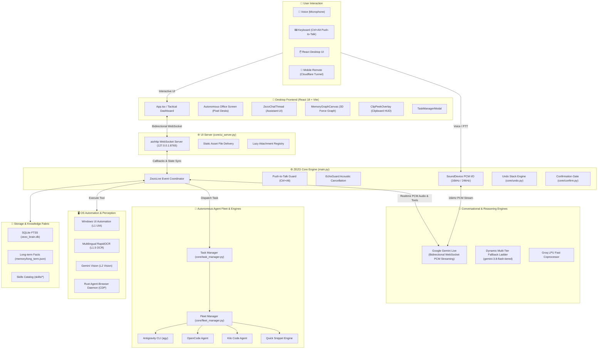

# 🏛️ ZEZO — System Architecture

> **Project:** ZEZO (Autonomous Desktop AI Operating System v2)  
> **Creator & Lead Architect:** Hamza Bukhari  
> **Target OS:** Windows 10/11 (Primary), macOS, Linux  

---

## 📖 Executive Overview

ZEZO is a modular, event-driven, locally-running autonomous desktop AI operating system. It fuses **real-time bidirectional voice conversation** with **autonomous multi-agent desktop and coding automation**.

ZEZO operates on a decoupled client-server architecture:
1. **Python Core Monolith (`main.py`):** Hosts the Google Gemini Live bidirectional WebSocket session, sounddevice audio pipeline, OS input drivers (Windows UIA/RapidOCR), action registry, and background task engine.
2. **Local UI Server (`core/ui_server.py`):** An asynchronous `aiohttp.web` WebSocket and HTTP server running locally on `127.0.0.1:8765`.
3. **Desktop Frontend (`frontend/src/`):** A modern React 18 SPA built with Vite, TypeScript, Tailwind CSS, and the ReUI component library, connected to the Python engine via persistent WebSockets.

---

## 🏗️ High-Level System Architecture

---

## 🧩 Architectural Subsystems

### 1. Conversational Voice Brain (Google Gemini Live)
- **Primary Live Voice Pipeline:** Bidirectional WebSocket stream using the `google-genai` SDK.
- **Audio Specification:** Streams 16-bit 16kHz mono PCM chunks outbound to Gemini Live; receives 24kHz PCM audio chunks inbound for real-time speaker playback.
- **Push-to-Talk (PTT):** Strictly mapped to **`Ctrl+Alt`** via global Windows asynchronous key-state inspection (`GetAsyncKeyState`). This prevents conflicts with Windows IME, code editors, and common shortcuts.
- **Acoustic Cancellation (EchoGuard):** Subtracts assistant speech energy and viseme thresholds to prevent self-triggering and audio feedback loops.
- **Zero Raw Code Utterances:** Voice responses deliver high-level 1–2 sentence executive summaries; code diffs, markdown tables, and syntax are routed to the React HUD.

### 2. Multi-Tier Model & Fallback Architecture
ZEZO implements dynamic fallback ladders to guarantee resilience against provider rate limits and transient outages:
- **Conversational Live Voice:** Google Gemini Live WebSocket connection (`GEMINI_LIVE_MODEL = "models/gemini-3.1-flash-live-preview"`).
- **Agent Code & Design Synthesis:** Antigravity CLI (`agy`) with `gemini-3.8-flash-tiered` models:
  - `gemini-3.8-flash-high`
  - `gemini-3.8-flash-medium` (Default)
  - `gemini-3.8-flash-low`
  - Tiered fallback: Claude Sonnet 4.6 / Claude Opus 4.6 Thinking / GPT-OSS 120B.
- **One-Shot REST Ladder (`core/gemini.py`):** Fast multi-rung failover (`gemini-3-flash-preview` ➔ `gemini-3.6-flash` ➔ `gemini-flash-lite-latest` ➔ `gemini-3.5-flash`).
- **Free-Tier Coprocessor:** Groq LPU (`openai/gpt-oss-20b` and `whisper-large-v3-turbo`) for sub-second text and audio processing.

### 3. Frontend & UI Server Layer
- **UI Server (`core/ui_server.py`):** Runs an `aiohttp.web` server in a dedicated background thread. Serves Vite production bundles (`frontend/dist/`) and establishes a WebSocket bridge on `ws://127.0.0.1:8765/ws`.
- **Desktop Frontend (`frontend/src/`):** React 18 single-page application built on Vite and Tailwind CSS. Employs the ReUI component system for design fidelity:
  - `AutonomousOfficeScreen.tsx`: 2D pixel desk grid, worker sprite animations, monitor telemetry, and agent soul editing.
  - `AgentDirectChatView.tsx`: 1-on-1 isolated context chat with autonomous fleet agents.
  - `MemoryGraphCanvas.tsx`: 3D Force-Directed Knowledge Graph (`3d-force-graph`) with real-time viseme reactivity and node inspector drawer.
  - `TaskManagerModal.tsx`: Background task tree viewer, subtask log streaming, and process termination.
  - `ClipPeekOverlay.tsx`: Floating clipboard monitor.
  - `ZezoChatThread.tsx`: Assistant-UI conversational thread with collapsible reasoning traces.

### 4. Autonomous Multi-Agent Fleet System
- **Fleet Manager (`core/fleet_manager.py`):** Orchestrates named specialist workers:
  - **Verve:** Senior Frontend & Studio UI Specialist (Antigravity CLI / React / Tailwind).
  - **Flux:** Frontend Specialist & Overflow Developer.
  - **Ahmad:** Full-Stack & Backend Specialist (FastAPI / PostgreSQL / SQLite / APIs).
  - **Michael:** Regional Manager & Autonomous Workflow Decomposer.
  - **Dwight:** QA, Security Auditor, and Compliance Guard.
  - **Kelly:** Social Intelligence & Deep Web Research Lead (`agent_reach`).
  - **Jim:** Clean Architecture & Refactoring Lead.
  - **Pam:** Design Tokens & Brand Architect (`extract_design_system`).
- **Isolation & Concurrency:** Each dispatched project is allocated an isolated workspace (e.g. `Desktop/<project_name>`) or Git worktree, preventing cross-project workspace clobbering.
- **Task Watchdog (`core/task_manager.py`):** Thread-safe background execution manager with concurrency limits (`MAX_CONCURRENT=2`), CPU throttling, ANSI log sanitization, and graceful process-tree termination.

### 5. Multi-Tier Perception & OS Control
ZEZO perceives and acts on the Windows desktop through a 3-tier escalated perception model:
- **L0 (OS Native):** Fast window handle enumeration (`GetForegroundWindow`, `GetWindowTextW`) in <1ms.
- **L1 (UIA Tree):** Windows UI Automation via dedicated STA COM worker thread (<15ms) for buttons, tabs, menus, and text fields.
- **L1.5 (RapidOCR):** Multilingual CPU RapidOCR (<80ms, 0 MB GPU VRAM) for rendered UI text (Figma, Canva, web canvas labels, Urdu/English strings).
- **L2 (Multimodal Vision):** Multimodal Gemini visual comprehension for spatial and icon reasoning.
- **Browser Control:** Native browser driving via Rust `agent-browser` CDP daemon, interacting with the user's live Chrome instance (tab enumeration, tab switching, and DOM interaction).

---

## 💾 State Management & Storage Architecture

| Domain | File / Store | Persistence Model | Key Details |
|--------|--------------|-------------------|-------------|
| Fast Lexical Memory | `memory/zezo_brain.db` | Persistent SQLite FTS5 | Indexed with BM25 ranking, secret redaction, and turn caching. |
| User Profile Facts | `memory/long_term.json` | Persistent JSON | Identity, preferences, active projects, relationships. |
| Skills Catalog | `skills/*/SKILL.md` | Persistent Markdown | Declarative and autonomously learned execution workflows. |
| System Configuration | `config/api_keys.json` | Persistent JSON | API keys, preferred voice, model settings (git-ignored). |
| Workspace Context | `memory/repo_context.json` | Persistent JSON | Active repository paths and working directories. |
| Session Resume Handle | RAM (`_resume_handle`) | Ephemeral (RAM only) | Re-authenticates live WebSocket session; never persisted to disk. |
| Reversible Undo Stack | `core/undo.py` | Ephemeral (RAM only) | 10-level deep thread-safe stack for file/setting rollbacks. |

---

## 🔐 Security & Safety Model

1. **Zero Cloud Relay / Local Monolith:** Audio processing runs directly between the user's machine and Google's Gemini Live API. No intermediary relay servers.
2. **UI-Issued Confirmation Tokens (`core/confirm.py`):** Privileged actions (system shutdown, application installation, WiFi toggling) require UI-generated confirmation tokens that cannot be forged by LLM tool calls.
3. **Execution Sandboxing:** Subprocesses executed by coding engines run with `creationflags=subprocess.CREATE_NO_WINDOW` and strict CPU throttling.
4. **Secret Scrubbing:** Log bus (`core/log_bus.py`) and memory indexers automatically redact API keys, session handles, and sensitive tokens.

---

## 🏁 Summary

ZEZO merges the responsiveness of **real-time 16kHz Gemini Live audio** with the execution depth of an **autonomous multi-agent coding fleet**, served cleanly over a **FastAPI/aiohttp WebSocket server** to a **React 18 / ReUI desktop frontend**.
