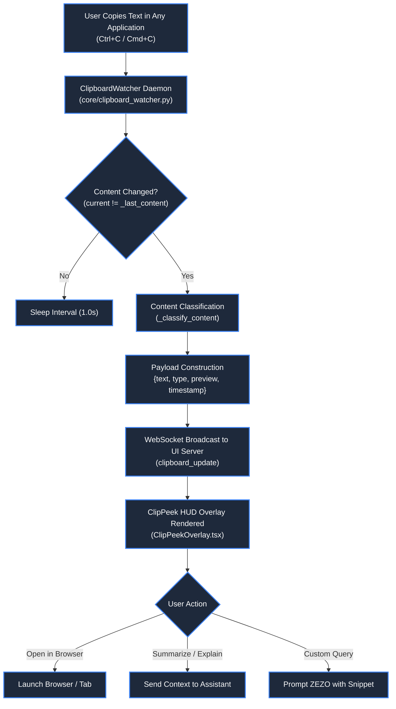

# 📋 Clipboard Watcher & ClipPeek HUD Overlay

> **Project:** ZEZO  
> **Creator & Lead Architect:** Hamza Bukhari  
> **Source Modules:** [`core/clipboard_watcher.py`](file:///d:/anitgravity/zezo%20work/jarvis-57/core/clipboard_watcher.py), [`frontend/src/components/clipboard/ClipPeekOverlay.tsx`](file:///d:/anitgravity/zezo%20work/jarvis-57/frontend/src/components/clipboard/ClipPeekOverlay.tsx)  
> **Target OS:** Windows 10/11 (Primary), macOS, Linux  

---

## 📖 Overview

The **Clipboard Watcher** subsystem runs a lightweight, background OS clipboard daemon that monitors the operating system clipboard for new entries. Whenever the user copies code, URLs, or text from any application on their computer, ZEZO detects the change, classifies the content type, and instantly projects an interactive floating HUD overlay called **ClipPeek** in the bottom-right corner of the interface.

ClipPeek provides context-aware, 1-click actions allowing the user to summarize, refactor, explain, or execute the copied content without manual pasting.



---

## ⚙️ Background Daemon Architecture

The background watcher is implemented in [`core/clipboard_watcher.py`](file:///d:/anitgravity/zezo%20work/jarvis-57/core/clipboard_watcher.py):
- **Daemon Thread:** Operates on an isolated thread (`name="ClipboardWatcher"`, `daemon=True`) with a configurable polling interval (default: `1.0s`).
- **Low Overhead:** Compares string references and immediately skips polling if the clipboard content has not changed.
- **Graceful Fallback:** If `pyperclip` is absent or the clipboard is locked by another host application, exceptions are caught cleanly without interrupting system audio or primary loops.

---

## 🏷️ Real-Time Content Classification

The watcher analyzes incoming strings and tags them with one of four primary content categories:

```python
def _classify_content(self, text: str) -> str:
    t = text.strip()
    # 1. URL detection
    if t.startswith("http://") or t.startswith("https://") or t.startswith("www."):
        return "url"
    # 2. Code snippet detection
    if any(kw in t for kw in ("def ", "class ", "import ", "function ", "const ", "let ", "{", "}", "SELECT *")) and len(t) < 1500:
        return "code"
    # 3. Long-form article detection
    if len(t) > 300:
        return "article"
    # 4. Standard plain text
    return "text"
```

| Type | Detection Criteria | Associated Quick Actions |
| :--- | :--- | :--- |
| **`url`** | Starts with `http://`, `https://`, or `www.` | *Open in Browser*, *Analyze Stack*, *Reverse Engineer* |
| **`code`** | Contains programming keywords (`def`, `class`, `function`, `const`, `{}`) | *Explain*, *Refactor*, *Find Bugs*, *Run Tool Batch* |
| **`article`** | Plain text exceeding 300 characters | *Summarize / Explain*, *Extract Key Points*, *Send to Chat* |
| **`text`** | Standard short string or shell snippet | *Send to Chat*, *Custom Query* |

---

## 🪟 Interactive Floating HUD Overlay (`ClipPeekOverlay.tsx`)

Rendered on top of the React 18 interface in the lower-right viewport corner:
- **Badge & Icon:** Displays the detected type with dedicated Lucide icons (`Globe`, `Code`, `FileText`, `Copy`).
- **Snippet Preview:** Displays a monospace, truncated preview of the captured data.
- **Contextual Action Buttons:**
  - `Open in Browser`: Opens URLs in the user's default browser or triggers an automated CDP crawl.
  - `Summarize / Explain`: Dispatches a formatted request to Gemini Live or the Assistant-UI thread.
  - `Send to Chat`: Injects the raw clipboard text into the active conversation.
- **Direct Prompt Input:** Includes an inline input field allowing users to ask arbitrary questions about the clipboard snippet (e.g. *"Convert this Python snippet to TypeScript"*).
