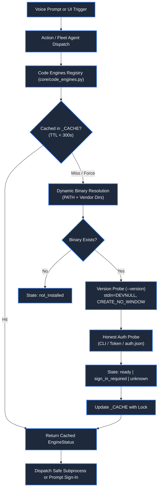

# ⚡ Code Engines Registry & Execution Subsystem

> **Project:** ZEZO  
> **Creator & Lead Architect:** Hamza Bukhari  
> **Source Modules:** [`core/code_engines.py`](file:///d:/anitgravity/zezo%20work/jarvis-57/core/code_engines.py), [`actions/code_engines_status.py`](file:///d:/anitgravity/zezo%20work/jarvis-57/actions/code_engines_status.py), [`frontend/src/components/settings/CodeEnginesSettingsTab.tsx`](file:///d:/anitgravity/zezo%20work/jarvis-57/frontend/src/components/settings/CodeEnginesSettingsTab.tsx)  
> **Target OS:** Windows 10/11 (Primary), macOS, Linux  

---

## 📖 Overview

The **Code Engines Registry** serves as ZEZO's centralized orchestration and health-verification layer for local autonomous coding CLIs. Rather than relying on rigid path assumptions or fragile shell wrappers, ZEZO implements an enterprise-grade registry that dynamically discovers, probes, and manages three primary coding engines:

1. **Antigravity CLI (`agy`)**: Google DeepMind / Antigravity agentic coding CLI.
2. **OpenCode (`opencode`)**: Terminal-based autonomous coding agent powered by open-source models.
3. **Kilo Code (`kilo`)**: Lightweight, high-velocity refactoring and QA coding engine.

The subsystem guarantees that tasks are never dispatched to missing or unauthenticated binaries, eliminating silent job failures and phantom runs.



---

## 🔍 Dynamic Binary Auto-Resolution

ZEZO resolves binary locations across both the system `PATH` and canonical vendor installation directories without requiring users to manually configure environment variables.

### Resolution Hierarchy

```python
def resolve_binary(engine_id: str) -> Optional[str]:
    # 1. Probe System PATH via shutil.which()
    for name in engine.path_names:
        found = shutil.which(name)
        if found and Path(found).is_file():
            return found

    # 2. Probe Vendor Directory Candidates
    for vdir in engine.vendor_dirs:
        for name in engine.path_names:
            candidate = vdir / name
            if candidate.is_file():
                return str(candidate)

    return None
```

### Registered Search Locations

| Engine | Canonical Binaries | Default Vendor Search Directories |
| :--- | :--- | :--- |
| **Antigravity** | `agy.exe`, `agy`, `antigravity.exe`, `antigravity` | `%LOCALAPPDATA%\agy\bin`, `~/.antigravity/bin`, `~/.agy/bin`, `%LOCALAPPDATA%\antigravity\bin`, `%APPDATA%\npm` |
| **OpenCode** | `opencode.cmd`, `opencode.exe`, `opencode` | `~/.opencode/bin`, `%APPDATA%\npm`, `%LOCALAPPDATA%\opencode\bin` |
| **Kilo Code** | `kilo.cmd`, `kilo.exe`, `kilo`, `kilocode.exe` | `~/.kilo/bin`, `%APPDATA%\npm`, `%LOCALAPPDATA%\kilo\bin` |

---

## 🛡️ Honest Authentication Probing

A common failure mode in autonomous coding tools is assuming a binary is functional simply because it is installed. ZEZO enforces **Honest Authentication Probing** via dedicated per-engine prober functions:

### 1. Antigravity CLI Probe (`_probe_antigravity_auth`)
- Checks local settings fast-path (`Path.home() / ".gemini" / "antigravity-cli" / "settings.json"` or `Path.home() / ".antigravity" / "settings.json"`) and environment API keys (`GEMINI_API_KEY`).
- Runs `agy models` with `timeout=15` (accommodating live network round-trip latency of ~7.2s), injecting `GEMINI_API_KEY` from configuration.
- Checks standard output and standard error for phrases such as `"not logged in"`, `"error getting token"`, or `"sign in"`.
- If credentials are valid and model lists return (`gemini`, `claude`, or `gpt`), flags the engine as **`ready`**.
- If unauthenticated, flags state as **`sign_in_required`** with an actionable human-readable explanation: *"Installed, but no account is signed in. The CLI exits in seconds and produces no files."*
- If the live probe experiences network limits but valid local credentials exist, falls back gracefully to `ready` rather than locking the engine out.

### 2. OpenCode Probe (`_probe_opencode_auth`)
- **Fast-path:** Checks `~/.local/share/opencode/auth.json` for existing provider API keys.
- **Fallback:** Executes `opencode auth list` with `timeout=4`.
- Validates presence of active credentials before permitting task execution.

### 3. Kilo Code Probe (`_probe_kilo_auth`)
- **Fast-path:** Checks `~/.local/share/kilo/auth.json`.
- **Fallback:** Executes `kilo auth list` to confirm connection to the Kilo Gateway.

---

## ⚡ Non-Blocking Execution & Caching Rules

In strict compliance with `AGENTS.md` Core Operating Rules:

1. **Subprocess Isolation:** All version checks, model listings, and auth probes execute with:
   - `stdin=subprocess.DEVNULL` (prevents hung processes awaiting interactive terminal input).
   - `creationflags=subprocess.CREATE_NO_WINDOW` on Windows (prevents disruptive flashing command-prompt windows).
   - Hard execution timeouts (4.0s - 5.0s max).
2. **5-Minute Cache TTL (`_CACHE`):** Probed engine states are cached in memory for 300 seconds (`CACHE_TTL = 300.0`). UI tabs and status checks read the cache instantly with 0ms disk/process latency.
3. **Thread Safety:** All reads and updates to `_CACHE` are guarded by `_CACHE_LOCK = threading.Lock()`.

---

## 🌐 REST API Endpoints & UI Integration

The frontend Settings interface ([`frontend/src/components/settings/CodeEnginesSettingsTab.tsx`](file:///d:/anitgravity/zezo%20work/jarvis-57/frontend/src/components/settings/CodeEnginesSettingsTab.tsx)) communicates directly with three backend REST endpoints exposed by [`core/ui_server.py`](file:///d:/anitgravity/zezo%20work/jarvis-57/core/ui_server.py):

### 1. `GET /api/code_engines`
Returns health status, active versions, detected binary paths, supported model lists, and the current default engine:
```json
{
  "status": "success",
  "engines": [
    {
      "id": "antigravity",
      "label": "Antigravity CLI",
      "short_code": "AG",
      "state": "ready",
      "binary_path": "C:\\Users\\User\\.antigravity\\bin\\agy.exe",
      "version": "agy 2.4.1 (windows-amd64)",
      "models": ["gemini-3.8-flash-high", "claude-sonnet-4-6"],
      "reason": "Installed and authenticated.",
      "backs_tool": "antigravity_action",
      "timestamp": 1740000000.0
    }
  ],
  "default_engine": "antigravity"
}
```

### 2. `POST /api/code_engines/probe`
Forces an immediate re-probe bypassing cache (`force=True`). Can probe a specific engine (`{"engine_id": "opencode"}`) or all engines simultaneously.

### 3. `POST /api/code_engines/default`
Persists the user's preferred default engine in `config/api_keys.json` (`{"engine_id": "antigravity"}`).

---

## 🔧 Action Tool: `code_engines_status`

Defined in [`actions/code_engines_status.py`](file:///d:/anitgravity/zezo%20work/jarvis-57/actions/code_engines_status.py):

- **Action `list`:** Inspects all engines and returns a structured summary for Gemini Live or the Assistant UI.
- **Action `check`:** Checks a specific engine and reports readiness or installation commands.
- **Voice Response:** Provides an executive 1-sentence spoken summary while rendering complete engine telemetry into the chat drawer.

---

## ⚡ Dedicated Engine Runners & Decoupled Execution

ZEZO adheres strictly to Rule 4 (One File Per Action & Clean Separation) and standardizes high-velocity background execution across all three coding engines via dedicated runner modules in `core/`:

1. **Antigravity CLI Runner (`core/antigravity_runner.py`):**
   - **Win32 WinError 206 Protection:** If prompt length exceeds 800 characters, automatically writes instructions to `repo / "GEMINI.md"` (which `agy` natively loads as agent rules) and passes a short pointer command, permanently staying within Win32's 32,767 character `CreateProcessW` limit.
   - **Zero CPU Throttling:** Executes `agy.exe` with standard Normal priority (`CREATE_NO_WINDOW`) and 100% full CPU core access (artificial Job Object core throttling purged).
   - **Stream-JSON Telemetry:** Spawns CLI with `--output-format stream-json`, parsing NDJSON events in real-time (`step_update`, tool calls, status deltas).
   - **Asymptotic Saturation Curve:** Progress increases dynamically via $\text{time\_pct} = 15.0 + 67.0 \times (1.0 - e^{-\text{elapsed}/85.0})$, eliminating artificial 65% progress freezes.
   - **Fast Deliverable Detection:** Performs direct `.is_file()` checks on key deliverable files (`DESIGN.md`, `preview.html`, `preview-dark.html`, `index.html`) every 2.0s without heavy recursive `rglob` disk locks, boosting progress to 88%–92% upon creation.
   - **Pre-Flight Scrapling Hook:** If the task prompt contains an HTTP/HTTPS URL and `site_dom.html` is absent, automatically invokes `prefetch_url_assets` from `core.url_prefetch` to pre-fetch DOM, styles, and tokens in 2–3s.

2. **OpenCode Runner (`core/opencode_runner.py`):**
   - **Win32 WinError 206 Protection:** If prompt length exceeds 800 characters, writes instructions to `repo / ".zezo_task_instructions.md"` and passes `--file .zezo_task_instructions.md`.
   - **Dedicated Worker:** Houses `run_opencode_worker`, decoupling background subprocess execution from `actions/opencode_agent.py`.
   - **Full CPU Access:** Normal priority without artificial CPU core capping or priority degradation.
   - **Asymptotic Progress Curve:** Smooth, monotonic progress reporting up to 92% with dynamic elapsed time tags (`[1m 15s]`).
   - **Fast Deliverable Detection & Scrapling Pre-fetch Hook:** Automatically extracts site assets before invocation on URL tasks and detects created files in real time.

3. **Kilo Code Runner (`core/kilo_runner.py`):**
   - **Win32 WinError 206 Protection:** If prompt length exceeds 800 characters, writes instructions to `repo / ".zezo_task_instructions.md"` and passes `--file .zezo_task_instructions.md`.
   - **Dedicated Worker:** Houses `run_kilo_worker`, decoupling background execution from `actions/kilo_agent.py`.
   - **Full CPU Access:** Normal process priority with 100% core availability.
   - **Asymptotic Telemetry & Scrapling Ingestion:** Matches Antigravity and OpenCode with identical progress curves, deliverable checks, and pre-flight asset ingestion.

---

## 🌉 Transparent CLI Execution Bridges

All three action modules (ctions/antigravity_agent.py, ctions/opencode_agent.py, ctions/kilo_agent.py) operate strictly as **pure, transparent human-like CLI bridges**:
- **Clean Action Tools:** Receive user task parameters, resolve the target workspace repo, submit background jobs to core/task_manager.py, and return immediate task IDs.
- **Dedicated Worker Delegation:** Delegate all subprocess handling, telemetry streaming, and undo snapshots to their respective runners (core/*_runner.py).
- **Zero Micromanagement:** Prompt micromanagement, archetype guessing (detect_archetype), fake prompt synthesizers, and synthetic template injection have been completely purged.
- **Natural Prompt Execution:** Spawns native binaries with natural prompts, full CPU access, CREATE_NO_WINDOW, and real-time stdout telemetry streamed to ctx.report().
- **Bridge Connectivity Probe (POST /api/engines/{engine}/test):**
  - Live latency probe verifying binary resolution and quick ping.
  - Return contract: {"success": true, "engine": str, "latency_ms": int, "binary": str}.
