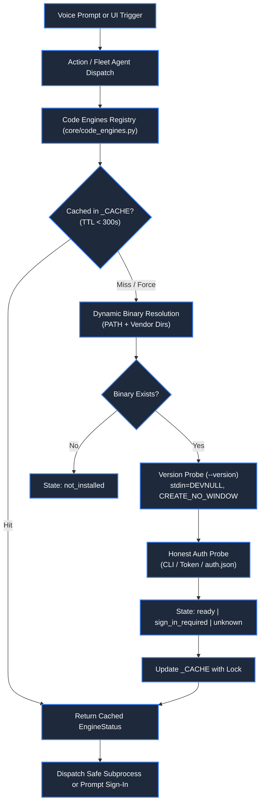

# ⚡ Code Engines Registry & Execution Subsystem

> **Project:** ZEZO  
> **Creator & Lead Architect:** Hamza Bukhari  
> **Source Modules:** [`core/code_engines.py`](file:///d:/anitgravity/zezo%20work/jarvis-57/core/code_engines.py), [`actions/code_engines_status.py`](file:///d:/anitgravity/zezo%20work/jarvis-57/actions/code_engines_status.py), [`frontend/src/components/settings/CodeEnginesSettingsTab.tsx`](file:///d:/anitgravity/zezo%20work/jarvis-57/frontend/src/components/settings/CodeEnginesSettingsTab.tsx)  
> **Target OS:** Windows 10/11 (Primary), macOS, Linux  

---

## 📖 Overview

The **Code Engines Registry** serves as ZEZO's centralized orchestration and health-verification layer for local autonomous coding CLIs. Rather than relying on rigid path assumptions or fragile shell wrappers, ZEZO implements an enterprise-grade registry that dynamically discovers, probes, and manages three primary coding engines:

1. **Antigravity CLI (`agy`)**: Google DeepMind / Antigravity agentic coding CLI.
2. **OpenCode (`opencode`)**: Terminal-based autonomous coding agent powered by open-source models.
3. **Kilo Code (`kilo`)**: Lightweight, high-velocity refactoring and QA coding engine.

The subsystem guarantees that tasks are never dispatched to missing or unauthenticated binaries, eliminating silent job failures and phantom runs.



---

## 🔍 Dynamic Binary Auto-Resolution

ZEZO resolves binary locations across both the system `PATH` and canonical vendor installation directories without requiring users to manually configure environment variables.

### Resolution Hierarchy

```python
def resolve_binary(engine_id: str) -> Optional[str]:
    # 1. Probe System PATH via shutil.which()
    for name in engine.path_names:
        found = shutil.which(name)
        if found and Path(found).is_file():
            return found

    # 2. Probe Vendor Directory Candidates
    for vdir in engine.vendor_dirs:
        for name in engine.path_names:
            candidate = vdir / name
            if candidate.is_file():
                return str(candidate)

    return None
```

### Registered Search Locations

| Engine | Canonical Binaries | Default Vendor Search Directories |
| :--- | :--- | :--- |
| **Antigravity** | `agy.exe`, `agy`, `antigravity.exe`, `antigravity` | `%LOCALAPPDATA%\agy\bin`, `~/.antigravity/bin`, `~/.agy/bin`, `%LOCALAPPDATA%\antigravity\bin`, `%APPDATA%\npm` |
| **OpenCode** | `opencode.cmd`, `opencode.exe`, `opencode` | `~/.opencode/bin`, `%APPDATA%\npm`, `%LOCALAPPDATA%\opencode\bin` |
| **Kilo Code** | `kilo.cmd`, `kilo.exe`, `kilo`, `kilocode.exe` | `~/.kilo/bin`, `%APPDATA%\npm`, `%LOCALAPPDATA%\kilo\bin` |

---

## 🛡️ Honest Authentication Probing

A common failure mode in autonomous coding tools is assuming a binary is functional simply because it is installed. ZEZO enforces **Honest Authentication Probing** via dedicated per-engine prober functions:

### 1. Antigravity CLI Probe (`_probe_antigravity_auth`)
- Runs `agy models` with `timeout=5`.
- Checks standard output and standard error for phrases such as `"not logged in"`, `"error getting token"`, or `"sign in"`.
- If credentials are valid and model lists return (`gemini`, `claude`, or `gpt`), flags the engine as **`ready`**.
- If unauthenticated, flags state as **`sign_in_required`** with an actionable human-readable explanation: *"Installed, but no account is signed in. The CLI exits in seconds and produces no files."*

### 2. OpenCode Probe (`_probe_opencode_auth`)
- **Fast-path:** Checks `~/.local/share/opencode/auth.json` for existing provider API keys.
- **Fallback:** Executes `opencode auth list` with `timeout=4`.
- Validates presence of active credentials before permitting task execution.

### 3. Kilo Code Probe (`_probe_kilo_auth`)
- **Fast-path:** Checks `~/.local/share/kilo/auth.json`.
- **Fallback:** Executes `kilo auth list` to confirm connection to the Kilo Gateway.

---

## ⚡ Non-Blocking Execution & Caching Rules

In strict compliance with `AGENTS.md` Core Operating Rules:

1. **Subprocess Isolation:** All version checks, model listings, and auth probes execute with:
   - `stdin=subprocess.DEVNULL` (prevents hung processes awaiting interactive terminal input).
   - `creationflags=subprocess.CREATE_NO_WINDOW` on Windows (prevents disruptive flashing command-prompt windows).
   - Hard execution timeouts (4.0s - 5.0s max).
2. **5-Minute Cache TTL (`_CACHE`):** Probed engine states are cached in memory for 300 seconds (`CACHE_TTL = 300.0`). UI tabs and status checks read the cache instantly with 0ms disk/process latency.
3. **Thread Safety:** All reads and updates to `_CACHE` are guarded by `_CACHE_LOCK = threading.Lock()`.

---

## 🌐 REST API Endpoints & UI Integration

The frontend Settings interface ([`frontend/src/components/settings/CodeEnginesSettingsTab.tsx`](file:///d:/anitgravity/zezo%20work/jarvis-57/frontend/src/components/settings/CodeEnginesSettingsTab.tsx)) communicates directly with three backend REST endpoints exposed by [`core/ui_server.py`](file:///d:/anitgravity/zezo%20work/jarvis-57/core/ui_server.py):

### 1. `GET /api/code_engines`
Returns health status, active versions, detected binary paths, supported model lists, and the current default engine:
```json
{
  "status": "success",
  "engines": [
    {
      "id": "antigravity",
      "label": "Antigravity CLI",
      "short_code": "AG",
      "state": "ready",
      "binary_path": "C:\\Users\\User\\.antigravity\\bin\\agy.exe",
      "version": "agy 2.4.1 (windows-amd64)",
      "models": ["gemini-3.8-flash-high", "claude-sonnet-4-6"],
      "reason": "Installed and authenticated.",
      "backs_tool": "antigravity_action",
      "timestamp": 1740000000.0
    }
  ],
  "default_engine": "antigravity"
}
```

### 2. `POST /api/code_engines/probe`
Forces an immediate re-probe bypassing cache (`force=True`). Can probe a specific engine (`{"engine_id": "opencode"}`) or all engines simultaneously.

### 3. `POST /api/code_engines/default`
Persists the user's preferred default engine in `config/api_keys.json` (`{"engine_id": "antigravity"}`).

---

## 🔧 Action Tool: `code_engines_status`

Defined in [`actions/code_engines_status.py`](file:///d:/anitgravity/zezo%20work/jarvis-57/actions/code_engines_status.py):

- **Action `list`:** Inspects all engines and returns a structured summary for Gemini Live or the Assistant UI.
- **Action `check`:** Checks a specific engine and reports readiness or installation commands.
- **Voice Response:** Provides an executive 1-sentence spoken summary while rendering complete engine telemetry into the chat drawer.

---

## ⚡ Antigravity Engine Architecture & Decoupled Execution

ZEZO's Antigravity integration uses a decoupled architecture separating Gemini tool registration from heavy background execution:

1. **Clean Action Tool (`actions/antigravity_agent.py`):**
   - Exports the official `TOOL` declaration and callable `handler` complying with Gemini function calling specs.
   - Enforces greenfield project gates (`check_greenfield_gate`) to prevent unintentional overwrites.
   - Delegates execution cleanly to `core.antigravity_runner.run_antigravity_worker`.

2. **Core Background Engine (`core/antigravity_runner.py`):**
   - **Hardware Throttling:** Creates Windows Job Objects with CPU affinity masking (`_create_throttled_job`) to prevent CLI runs from starving audio loops or GUI rendering.
   - **Pre-Flight Asset Provisioning Engine:** Automatically provisions `< 25 KB` `blueprint.html` (design tokens, CSS variables, typography) and `< 40 KB` `master-template.html` (working clone with semantic slots `<!-- SLOT:HERO_START -->`, etc.) in the target repo before CLI invocation. This eliminates 15–20 minute stalls caused by the agent trying to digest bloated 10 MB raw reference files.
   - **Dynamic Modular Prompt Synthesizer:** Detects the domain archetype (`portfolio`, `landing_page`, `dashboard`, `surgical_edit`) and synthesizes tailored prompts using modular exemplars in `core/prompts/exemplars/*.txt` via `core/prompts/prompt_synthesizer.py`.
   - **Strict Anti-Stall Guardrails:** Injects non-negotiable instructions: single-pass direct adaptation to `{target_file}`, strict prohibition of intermediate Python scripts (`BeautifulSoup`, chunkers, `inspect.py`), and style/interaction preservation.
   - **Non-Interactive Batch Directive:** Injects a critical execution directive (`CRITICAL BATCH EXECUTION DIRECTIVE: USER STATUS: CONFIRMED`) preventing CLI prompts from pausing for interactive user confirmation.
   - **Full Dispatched Prompt Telemetry (`prompt_full`):** Stores the complete synthesized prompt into payload parameters, allowing `TaskState.to_dict()` and the frontend `TaskManagerModal` to provide one-click prompt inspection and copying.
   - **Live Progress & Streaming:** Drains stdout lines in a daemon thread, streaming live task lines (`ctx.report(pct, line[:80])`) and advancing progress dynamically (30% → 45% → 60% → 80% → 95%) rather than freezing.
   - **Recursive Diffing:** Employs `_tree_snapshot(repo)` to detect newly created deliverables (e.g. `index.html`) recursively across subdirectories.
   - **Smart Preview System:** Automatically starts local HTTP servers (ports 9400-9480) or Vite dev servers upon build completion.

---

## 🌉 Transparent CLI Execution Bridges

All three engines (ntigravity_agent.py, opencode_agent.py, kilo_agent.py) operate strictly as **pure, transparent human-like CLI bridges**:
- **Zero Micromanagement**: Prompt micromanagement, archetype guessing (detect_archetype), fake prompt synthesizers, and synthetic template injection have been completely purged.
- **Natural Prompt Execution**: Spawns the native binary with natural prompts via -p, polite Windows Job Object CPU throttling, CREATE_NO_WINDOW, and real-time stdout telemetry streamed to ctx.report().
- **Bridge Connectivity Probe (POST /api/engines/{engine}/test)**:
  - Live latency probe verifying binary resolution and quick ping.
  - Return contract: {'success': true, 'engine': str, 'latency_ms': int, 'binary': str}.
