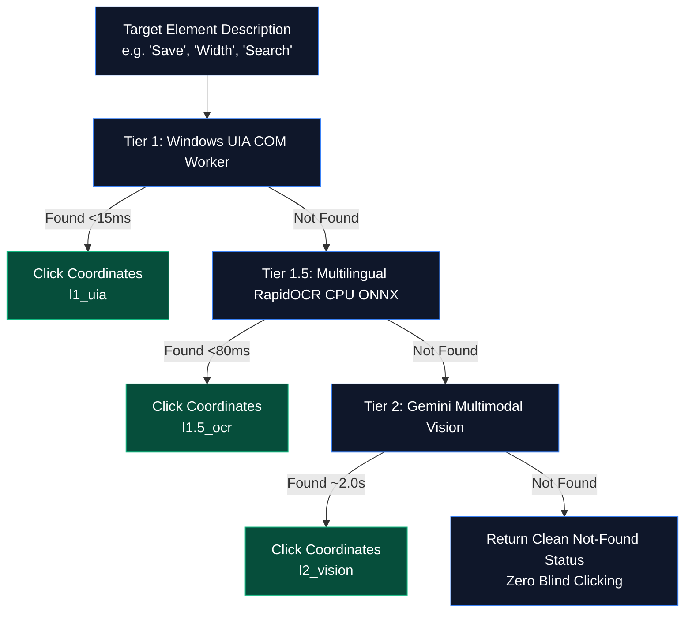

# 🖥️ ZEZO OS — Modular Computer Control Architecture

> **Project:** ZEZO  
> **Creator & Lead Architect:** Hamza Bukhari  
> **Target OS:** Windows (Primary), macOS, Linux  
> **Core Principle:** *"Observe only when necessary — Escalate perception, don't waterfall it."*

---

## 🧭 Architecture Overview

ZEZO executes computer automation through a modular driver architecture under `core/computer/` and unified action tools in `actions/computer_control.py` and `actions/computer_settings.py`. Rather than relying on slow, expensive cloud vision models for every interaction, ZEZO implements **3-Tier Escalated Perception**:

$$\text{Tier 1: Windows UIA (<15ms)} \longrightarrow \text{Tier 1.5: Multilingual RapidOCR (<80ms)} \longrightarrow \text{Tier 2: Gemini Vision (~2.0s)}$$

---

## 🏎️ 3-Tier Escalated Perception Architecture

When targeting an on-screen element or text label (`screen_click`, `click`, `double_click` with a `description` parameter), ZEZO automatically escalates through three perception tiers:



### 1. Tier 1: Windows UI Automation (L1 UIA)
- **Module:** `core/computer/windows_uia.py`
- **Latency:** **< 15ms**
- **Mechanism:** Direct COM access to the Windows UI Automation tree (`searchDepth=6`) inside an STA COM `ThreadPoolExecutor` worker with strict 0.8s timeout boundaries.
- **Scope:** Detects native Win32/WPF/Electron accessibility elements (`Button`, `Hyperlink`, `Edit`, `MenuItem`, `TabItem`, `CheckBox`, `RadioButton`, `ListItem`, `ComboBox`).
- **Browser Tab Switching:** Scans Chrome/Edge tab strips to discover live browser tabs (`get_browser_tabs`) and focus tabs by title (`switch_tab_by_title`).

### 2. Tier 1.5: Multilingual CPU ONNX RapidOCR
- **Module:** `core/computer/ocr_engine.py`
- **Latency:** **< 80ms**
- **Resource Footprint:** **0 MB GPU VRAM** (~80MB system RAM on CPU).
- **Scope:** Extracts rendered text inside web canvas elements, desktop games, or graphic editors (e.g. Figma canvas controls like "Width", "Fill", "Opacity", or web app buttons that don't expose accessibility trees).
- **Text Normalization:** Unicode normalization for Urdu/Arabic (`normalize_urdu` for tashkeel stripping and letter unification) and fuzzy Levenshtein matching (`fuzzy_threshold=0.75`).

### 3. Tier 2: Gemini Multimodal Vision Fallback
- **Module:** `actions/screen_processor.py`
- **Latency:** **~2.0s**
- **Scope:** High-level visual reasoning for non-text graphical icons (e.g. magnifying glass, gear icon, avatar picture, complex layout bounding boxes).
- **Safety:** If all three tiers fail, the tool returns a clear `Element not found` message rather than clicking blind coordinates.

---

## ⚡ Compound Atomic `batch` Actions

To avoid incurring multiple Gemini round-trip delays for multi-step desktop workflows, `actions/computer_control.py` supports the **`batch`** action (aliases: `sequence`, `macro`).

### Specification
`batch` accepts a sequential list of steps and executes them atomically within a single turn:

```json
{
  "action": "batch",
  "sequence": [
    {"action": "screen_click", "description": "Width"},
    {"action": "type", "text": "1440"},
    {"action": "press", "key": "tab"},
    {"action": "type", "text": "900"},
    {"action": "press", "key": "enter"}
  ]
}
```

### Benefits
- **Zero Roundtrip Overhead**: Executes 5–10 UI actions sequentially in ~200ms instead of waiting ~15 seconds across 5 separate model turns.
- **Fail-Fast Safety**: If any step in the sequence fails, execution halts immediately and returns the exact step error to the model.

---

## ↩️ Contextual GUI Undo

ZEZO distinguishes between **filesystem/state undo** and **active desktop application undo**:

- **Active App Context:** When the user says *"undo that"* or *"Ctrl+Z"* while working in an active desktop application (such as Figma, VS Code, Notepad, or a web browser), ZEZO dispatches native OS `Ctrl+Z` (`Cmd+Z` on macOS) via `actions/computer_settings.py::undo()`.
- **Focus Preservation:** Input actions preserve active foreground window focus using Win32 `GetForegroundWindow` and `SetForegroundWindow` wrappers.
- **Shared Undo Stack:** If the user explicitly asks to reverse an action performed by ZEZO itself (such as moving files or altering system volume), the request routes to `core/undo.py`.

---

## 🛡️ Safety, Guardrails & Anti-Loop Circuit Breaker

1. **In-Turn Circuit Breaker (`core/action_loader.py`)**: Automatically aborts repetitive hotkey loops if more than 4 identical keyboard actions occur within 10 seconds (e.g., runaway `tab` or `shift+tab` loops).
2. **Chat App Governance (`core/prompt.txt`)**: When automating chat applications (WhatsApp, Telegram, Slack), ZEZO types the message text into the input field but **strictly requires explicit verbal confirmation** ("bhejo", "send it") before pressing Enter.
3. **Safe Unicode Clipboard Typing**:
   - Detects non-ASCII text (Urdu, Arabic, Hindi, emojis, multiline code).
   - Stashes the user's prior clipboard string in memory.
   - Writes the text to the system clipboard and triggers native paste (`Ctrl+V` / `Cmd+V`).
   - Automatically restores the previous user clipboard buffer immediately after paste (`RESTORE_CLIPBOARD_AFTER_PASTE = True`).

---

## 🎛️ Driver Modules Summary (`core/computer/`)

| Module | Core Responsibility |
|---|---|
| `windows_native.py` | Win32 window enumeration, DPI awareness, bounds calibration via `DwmGetWindowAttribute`, state-preserving window restoration (`IsIconic`/`IsZoomed`). |
| `windows_uia.py` | UI Automation tree crawler (<15ms) running in STA COM thread pool, native control identification, and live browser tab switching. |
| `ocr_engine.py` | Sub-80ms CPU ONNX RapidOCR engine (0 MB VRAM) with Urdu/Arabic normalization and fuzzy coordinate matching. |
| `pyautogui_driver.py` | Mouse and keyboard hardware input driver with post-move verification and cross-platform key mapping. |
