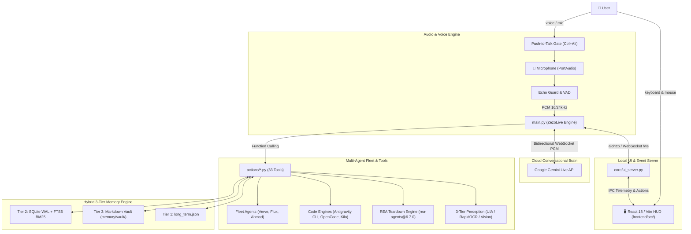
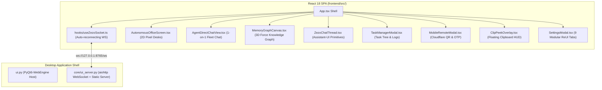
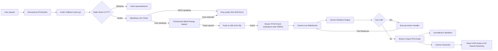
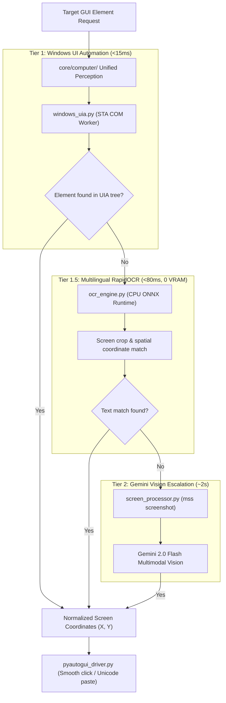
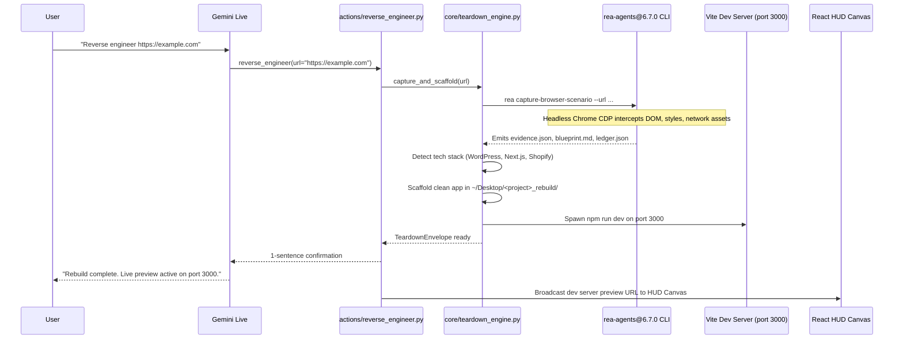
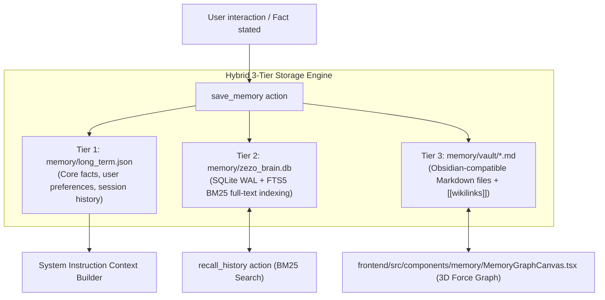
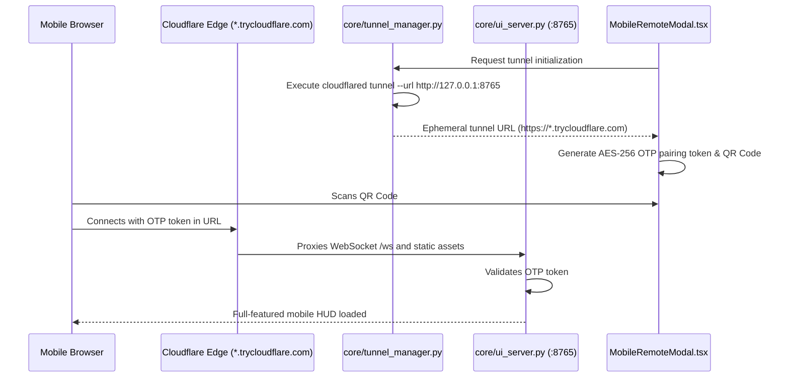
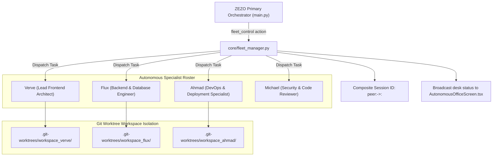

# ZEZO — System Architecture & Dataflow Diagrams

> **Creator & Lead Architect:** Hamza Bukhari  
> **Target OS:** Windows (Primary), macOS, Linux

---

## 1. High-Level System Architecture



---

## 2. Desktop HUD & React 18 Architecture



---

## 3. Real-Time Conversational Voice Pipeline



---

## 4. 3-Tier Perception & Computer Automation



---

## 5. Reverse Engineering & Website Cloner Pipeline



---

## 6. Proactive Background Task Watcher Loop

```mermaid
flowchart TD
    Start["_run_task_completion_watcher() (main.py:2940)"] --> Sleep["Wait 2 seconds"]
    Sleep --> AwakeCheck{"Session connected & awake?"}
    AwakeCheck -->|No| Sleep
    AwakeCheck -->|Yes| SpeakingCheck{"Is speaking OR speech within 3s cushion?"}
    SpeakingCheck -->|Yes (Collision Risk)| Sleep
    SpeakingCheck -->|No (Safe to Notify)| QueryTasks["core.task_manager.get_unnotified_finished_tasks()"]
    QueryTasks --> HasFinished{"Finished tasks available?"}
    HasFinished -->|No| Sleep
    HasFinished -->|Yes| LoopTasks["Iterate tasks & set task.notified = True"]
    LoopTasks --> BuildPrompt["Construct [TASK_NOTIFICATION] prompt"]
    BuildPrompt --> PostCanvas["self.ui.show_content() (Output to React HUD)"]
    PostCanvas --> VoiceNotify["session.send_client_content(1-sentence voice prompt)"]
    VoiceNotify --> Sleep
```

---

## 7. Hybrid 3-Tier Memory Architecture



---

## 8. Mobile Remote Access via Cloudflare Quick Tunnel



---

## 9. Autonomous Fleet Coordination & Workspace Isolation



---

## 10. Summary Matrix

| Diagram # | System Illustrated | Primary Modules Involved |
|-----------|--------------------|--------------------------|
| **1** | System Overview | `main.py`, `core/ui_server.py`, `frontend/src/` |
| **2** | React 18 HUD | `App.tsx`, `useZezoSocket.ts`, ReUI components |
| **3** | Voice Pipeline | `main.py`, `core/echo.py`, `core/hotkey.py` (`Ctrl+Alt`) |
| **4** | 3-Tier Perception | `windows_uia.py`, `ocr_engine.py`, `screen_processor.py` |
| **5** | REA Teardown Engine | `teardown_engine.py`, `rea-agents@6.7.0`, `reverse_engineer.py` |
| **6** | Task Completion Watcher | `main.py:2940`, `core/task_manager.py` |
| **7** | 3-Tier Memory | `long_term.json`, `sqlite_memory.py`, `vault_engine.py` |
| **8** | Cloudflare Mobile Tunnel | `tunnel_manager.py`, `MobileRemoteModal.tsx`, `cloudflared` |
| **9** | Multi-Agent Fleet | `fleet_manager.py`, `fleet_control.py`, `git_sandbox.py` |
