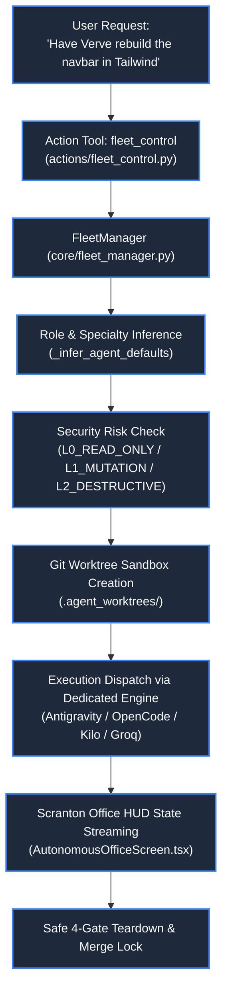
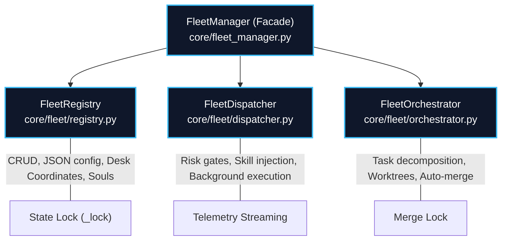
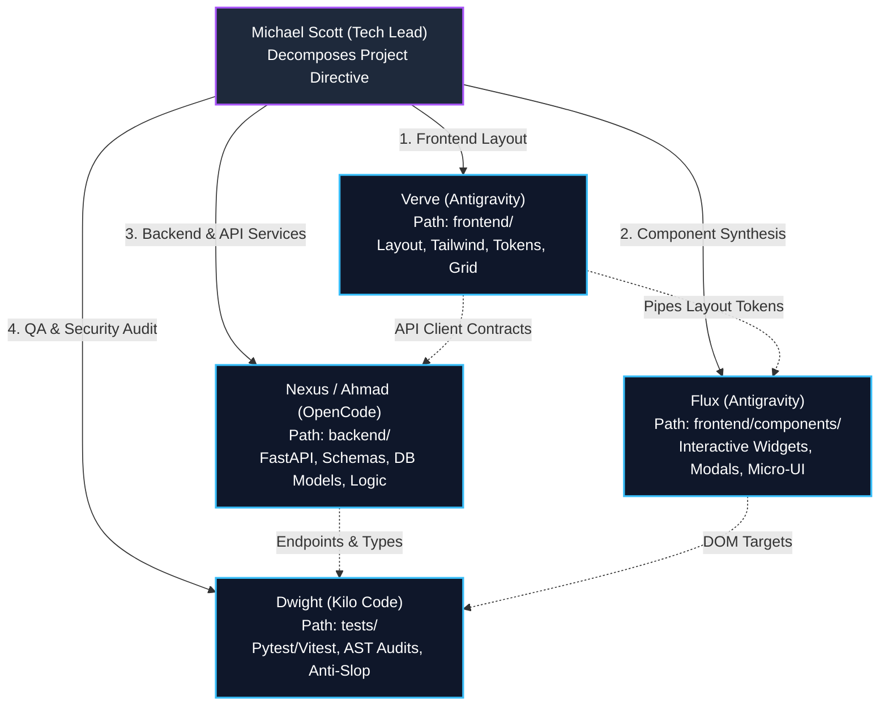

# 👥 Autonomous Fleet Management & The Scranton Office

> **Project:** ZEZO  
> **Creator & Lead Architect:** Hamza Bukhari  
> **Source Modules:** [`core/fleet_manager.py`](file:///d:/anitgravity/zezo%20work/jarvis-57/core/fleet_manager.py) (Facade), [`core/fleet/`](file:///d:/anitgravity/zezo%20work/jarvis-57/core/fleet/) (`registry.py`, `dispatcher.py`, `orchestrator.py`), [`actions/fleet_control.py`](file:///d:/anitgravity/zezo%20work/jarvis-57/actions/fleet_control.py), [`frontend/src/components/office/AutonomousOfficeScreen.tsx`](file:///d:/anitgravity/zezo%20work/jarvis-57/frontend/src/components/office/AutonomousOfficeScreen.tsx), [`frontend/src/components/office/AgentDirectChatView.tsx`](file:///d:/anitgravity/zezo%20work/jarvis-57/frontend/src/components/office/AgentDirectChatView.tsx)  
> **Configuration:** [`config/fleet_agents.json`](file:///d:/anitgravity/zezo%20work/jarvis-57/config/fleet_agents.json)  
> **Target OS:** Windows 10/11 (Primary), macOS, Linux  

---

## 📖 Overview

The **Autonomous Fleet Management System** enables ZEZO to orchestrate a distributed team of specialized, autonomous sub-agents. Inspired by classic engineering room dynamics, ZEZO represents this multi-agent fleet visually as **The Scranton Office**—an interactive 2D pixel-art virtual floor where each specialist occupies a dedicated desk coordinate, maintains local state, executes coding and research workloads, and collaborates in real time.

Fleet execution features strict **Git worktree sandboxing**, **3-tier risk gates**, **keyword-driven role inference**, and **direct 1-on-1 chat channels** powered by Assistant-UI.



---

## 🏗️ Modular Subsystem Architecture (`core/fleet/`)

To eliminate God-object bloat and prevent lock contention between heavy Git sandbox operations and live agent telemetry, the fleet subsystem is partitioned into three decoupled modules unified under a backward-compatible Facade:



1. **`core/fleet/registry.py` (`FleetRegistry`):**
   - Manages agent models (`FleetAgent`), desk allocations (`OFFICE_DESK_COORDINATES`), and configuration persistence (`config/fleet_agents.json`).
   - Guarded by its own dedicated re-entrant lock (`_lock`) ensuring thread-safe reads and writes.
2. **`core/fleet/dispatcher.py` (`FleetDispatcher`):**
   - Validates risk tiers (`L0_READ_ONLY`, `L1_MUTATION`, `L2_DESTRUCTIVE`) and circuit breaker status.
   - Dynamically injects declarative skills (`agent.allowed_skills`) and spawns background tasks via `TaskManager`.
   - **Universal Skill Prompt Engineer Integration:** Automatically intercepts coding engine dispatches (ntigravity_run, opencode_run, kilo_run) and synthesizes bespoke 5-block execution directives via Groq LPU / Gemini Flash (core/skill_prompt_engineer.py) with zero dummy fallback prompts.
   - Wraps progress callbacks with rate-limited (`>= 1.0s` or completion) `fleet_updated` deck broadcasts for UI synchronization.
3. **`core/fleet/orchestrator.py` (`FleetOrchestrator`):**
   - Handles multi-agent workflow decomposition (`decompose_and_dispatch`) and peer-to-peer delegation (`delegate_peer_task`).
   - Manages Git worktree quarantine lifecycle and merges results safely upon task completion.
4. **`core/fleet_manager.py` (Facade):**
   - Implements the Facade Pattern, composing `registry`, `dispatcher`, and `orchestrator` while exposing all historical methods, properties, and module-level helpers.
   - Guarantees 100% backward compatibility for all existing callers (`main.py`, `fleet_control.py`, `ui_server.py`).

---

## 🏢 The Scranton Office & 2D Desk Grid

In the UI ([`frontend/src/components/office/AutonomousOfficeScreen.tsx`](file:///d:/anitgravity/zezo%20work/jarvis-57/frontend/src/components/office/AutonomousOfficeScreen.tsx)), the office is mapped to a calibrated 2D grid defined in [`core/fleet_manager.py`](file:///d:/anitgravity/zezo%20work/jarvis-57/core/fleet_manager.py):

```python
OFFICE_DESK_COORDINATES: list[tuple[int, int]] = [
    (180, 160), (320, 160), (460, 160), (600, 160),
    (180, 280), (320, 280), (460, 280), (600, 280),
    (180, 400), (320, 400), (460, 400), (600, 400),
]
```

Each desk position reflects the agent's live operational status:
- **`idle`**: Agent sits quietly at desk; telemetry monitors are dim.
- **`working`**: Agent typing animation active; monitor glows with live terminal telemetry.
- **`reviewing`**: Paused for user verification or review gate.
- **`error` / `blocked`**: Visual alert state indicating failure or circuit breaker intervention.

---

## 🧑‍💻 Specialist Agent Roster

ZEZO includes an out-of-the-box roster of specialized agents defined in [`config/fleet_agents.json`](file:///d:/anitgravity/zezo%20work/jarvis-57/config/fleet_agents.json):

| Agent ID | Name | Role & Specialty | Execution Engine | Default Action Tool | Risk Tier | Desk Coordinates |
| :--- | :--- | :--- | :--- | :--- | :--- | :--- |
| **`MICHAEL`** | **Michael** | Lead Software Architect & Tech Lead (Structural planning, task breakdown) | `opencode` | `opencode_run` | `L1_MUTATION` | (180, 160) |
| **`VERVE`** | **Verve** | Senior Frontend & UI Specialist (Tailwind, animations, design tokens, `website_build`) | `antigravity` | `antigravity_run` | `L1_MUTATION` | (320, 160) |
| **`FLUX`** | **Flux** | Frontend Developer & Overflow Balancer (Component synthesis, UI fixes, `website_build`) | `antigravity` | `antigravity_run` | `L1_MUTATION` | (320, 280) |
| **`AHMAD`** | **Nexus (Ahmad)** | Senior Full-Stack & Python Backend Specialist (FastAPI, Postgres, schemas) | `opencode` | `opencode_run` | `L2_DESTRUCTIVE` | (460, 160) |
| **`DWIGHT`** | **Dwight** | Senior Refactoring & QA Specialist (Test suites, audits, complexity reduction) | `kilo` | `kilo_run` | `L1_MUTATION` | (460, 280) |
| **`PAM`** | **Pam** | Design System & Token Architect (Token extraction, palette generation) | `antigravity` | `antigravity_run` | `L0_READ_ONLY` | (460, 280) |
| **`DEVDYNAMO`**| **DevDynamo (Haider)** | Autonomous Full-Stack Engineer (End-to-end features, modern web apps) | `opencode` | `opencode_run` | `L1_MUTATION` | (180, 280) |
| **`KELLY`** | **Kelly** | Social & Deep Web Researcher (Reddit, YouTube, content extraction) | `custom` | `agent_reach` | `L0_READ_ONLY` | (600, 160) |
| **`QUANTUM`** | **Quantum** | Deep Web Researcher & Technical Scraper (Documentation, whitepapers) | `kilo` | `kilo_run` | `L1_MUTATION` | (600, 280) |
| **`RECON`** | **Recon** | Deep Intelligence & OSINT Researcher (Autonomous multi-source research) | `custom` | `agent_reach` | `L0_READ_ONLY` | (600, 400) |

---

## 🧠 Keyword-Driven Role Inference

When a user issues a high-level instruction without specifying an agent ID, ZEZO's `_infer_agent_defaults` analyzes the query keywords to automatically assign the appropriate specialist:

```python
def _infer_agent_defaults(role: str, specialty: str) -> Dict[str, Any]:
    text = f"{role} {specialty}".lower()

    # Research & Scraping → Kelly / Recon (agent_reach)
    if any(k in text for k in ("research", "web", "scrape", "transcript", "video", "youtube", "media")):
        return {"default_tool": "agent_reach", ...}

    # Frontend & Styling → Verve / Flux (antigravity_run)
    if any(k in text for k in ("frontend", "ui", "design", "css", "tailwind", "layout", "animation", "react")):
        return {"default_tool": "antigravity_run", ...}

    # QA & Refactoring → Dwight (kilo_run)
    if any(k in text for k in ("refactor", "qa", "test", "audit", "clean code", "bug hunt")):
        return {"default_tool": "kilo_run", ...}

    # Backend & Architecture → Ahmad / Nexus (opencode_run)
    return {"default_tool": "opencode_run", ...}
```

---

## 🛡️ Security Risk Tiers & Worktree Isolation

To ensure absolute codebase integrity, agents operate under strict permissions:

### 1. Risk Tiers
- **`L0_READ_ONLY`**: Agent may inspect code, search the web, analyze ASTs, and extract design tokens. File write/delete operations are permanently blocked.
- **`L1_MUTATION`**: Agent may write, edit, and create code files, but only within an isolated Git worktree.
- **`L2_DESTRUCTIVE`**: Agent may perform database migrations, system dependency installations, or file deletions. Requires explicit confirmation gates.

### 2. Git Worktree Sandbox (`core/git_sandbox.py`)
When a mutation task is dispatched:
1. ZEZO creates an isolated Git worktree under `.agent_worktrees/<task_id>/` on a dedicated branch (`agent/<clean_task_id>`).
2. The agent executes all edits, builds, and tests inside this quarantined directory.
3. Once the task succeeds (`prog == 100`), `complete_task(agent.id, task_id, merge_changes=True, worktree_id=...)` automatically runs a **4-gate safe teardown and merges changes to the main branch** under `_merge_lock`, preventing code loss.

### 3. Declarative Skill Injection
In `core/fleet_manager.py:dispatch_task`, when an agent defines skills in `agent.allowed_skills` (such as `website_build`), ZEZO automatically queries `core.skill_loader.get_skill_registry()` and injects the full declarative instructions under an `[ACTIVE SKILL: <name>]` block directly into the enriched execution prompt.

---

## 🐝 The 4-Way Scranton Fleet Swarm Pipeline (`decompose_and_dispatch`)

When a complex full-stack or multi-tiered engineering directive is received (e.g., *"Build an end-to-end AI landing page and SaaS backend with test coverage"*), ZEZO's Lead Architect **Michael** ([`core/fleet/orchestrator.py:decompose_and_dispatch`](file:///d:/anitgravity/zezo%20work/jarvis-57/core/fleet/orchestrator.py)) orchestrates the **4-Way Scranton Fleet Swarm Pipeline**.

Rather than bottlenecking execution into a single agent or writing fragile intermediate Python synthesis scripts, Michael decomposes the objective into four domain-isolated, concurrent streams:



### Specialist Roles in the 4-Way Swarm:
1. **Verve ([`actions/antigravity_agent.py`](file:///d:/anitgravity/zezo%20work/jarvis-57/actions/antigravity_agent.py) via [`core/antigravity_runner.py`](file:///d:/anitgravity/zezo%20work/jarvis-57/core/antigravity_runner.py)):**
   - **Domain:** Frontend Layout & Visual Architecture (`frontend/`).
   - **Deliverables:** Structural HTML5/React tree, responsive grid containers (`max-w-7xl`), CSS variables / dark obsidian design tokens, and smooth scroll animations.
2. **Flux ([`actions/antigravity_agent.py`](file:///d:/anitgravity/zezo%20work/jarvis-57/actions/antigravity_agent.py) via [`core/antigravity_runner.py`](file:///d:/anitgravity/zezo%20work/jarvis-57/core/antigravity_runner.py)):**
   - **Domain:** Component Synthesis & Overflow Balancing (`frontend/components/`).
   - **Deliverables:** Interactive cards, modal drawers, dynamic filters, animated SVG icons, and stateful micro-components.
3. **Nexus / Ahmad ([`actions/opencode_agent.py`](file:///d:/anitgravity/zezo%20work/jarvis-57/actions/opencode_agent.py)):**
   - **Domain:** Full-Stack & Python Backend Specialist (`backend/`).
   - **Deliverables:** RESTful FastAPI endpoints, Pydantic V2 validation models, SQLite/PostgreSQL schemas, and service logic.
4. **Dwight ([`actions/kilo_agent.py`](file:///d:/anitgravity/zezo%20work/jarvis-57/actions/kilo_agent.py)):**
   - **Domain:** Senior Refactoring, Verification & QA Specialist (`tests/`).
   - **Deliverables:** End-to-end integration test suites (`pytest`, `vitest`), AST complexity audits, anti-slop rule enforcement, and security vulnerability scans.

### Swarm Pipeline Architectural Invariants:
- **Subdirectory Domain Isolation:** Subtasks are explicitly dispatched into dedicated subdirectories (`base_path/frontend/`, `base_path/backend/`, `base_path/tests/`) under the project root. This prevents file collision races and Git worktree merge conflicts.
- **Direct-Execution Guarantee:** Forbids intermediate Python builder scripts (`build_index.py`, `generate.py`). Code is emitted directly to final target files, preventing multi-minute latency penalties.
- **Upstream Deliverable Piping:** When peer delegation occurs (`delegate_peer_task`), design tokens, extracted schemas, and candidate metadata are automatically serialized and prepended to downstream agent prompts.
- **Dynamic Capability & Skill Resolution:** Tasks dispatched without hardcoded assignments resolve dynamically via `resolve_agent_for_skill(skill_name)` and capability inspection across currently registered live agents (`fleet_manager.get_all_agents()`), with load balancing across active tasks.
- **Anti-Ghost Lifecycle:** Decommissioned agents are permanently deleted from `config/fleet_agents.json`, their worktrees torn down, and removed from `self.agents`. Memory fallback recreation of deleted agents is strictly prohibited.

---

## 💬 Direct 1-on-1 Chat Channels (`AgentDirectChatView.tsx`)

Users can click on any agent in the Scranton Office to open a dedicated, isolated conversational channel:
- **Independent Conversation Context:** Chats do not pollute the primary voice session memory.
- **Actionable Task Dispatch Bridge:** Direct chat messages to agents in `/api/fleet/chat` are classified by `_is_actionable_task()`. When a user requests code creation or web building (e.g. "Build a landing page for my crypto app"), the chat engine bridges directly to `fleet_manager.dispatch_task()`, triggers real background execution, and replies with honest live Task ID telemetry, completely eliminating single-turn chat hallucinations.
- **Assistant-UI Thread:** Full markdown rendering, code block copy buttons, and turn-by-turn reasoning pills for conceptual explanations.
- **Dynamic Model Switching:** Allows overriding the agent's default LLM on the fly (e.g., switching between Gemini 3.7 Flash and Claude Sonnet 4.6).
- **Live Soul Editing:** The side panel allows editing the agent's `prompt_prefix`, allowed tools, and capabilities directly from the UI.
