# 🧠 ZEZO — Hybrid 3-Tier Memory Engine

> **Creator & Lead Architect:** Hamza Bukhari  
> **System Component:** Persistent Multi-Tier Memory & Knowledge Graph Engine  
> **Storage Locations:** `memory/long_term.json`, `memory/zezo_brain.db`, `memory/vault/*.md`  
> **Tool Interfaces:** `save_memory`, `recall_memory`, `recall_history`  

---

## 📖 1. Overview & Architecture

ZEZO employs a **Hybrid 3-Tier Memory Engine** that harmonizes fast system-prompt priming, verbatim chronological conversation retrieval, and visual knowledge-graph associative traversal.

```mermaid
flowchart TD
    User["User Interaction & Speech"] --> Router["Memory Ingestion Router"]
    
    subgraph Tier1["Tier 1: Fast System Prompt Priming"]
        M1["memory/long_term.json<br/>(Core facts & preferences)"]
        P1["System Prompt Injector<br/>(900 chars core + 420 chars index)"]
        M1 --> P1
    end

    subgraph Tier2["Tier 2: Verbatim History & Full-Text Search"]
        Redact["Secret Token Redaction<br/>(redact_secrets regex)"]
        M2["memory/zezo_brain.db<br/>(SQLite WAL + FTS5 BM25)"]
        T2Tool["actions/recall_history.py<br/>(search / expand / recent)"]
        Redact --> M2
        M2 --> T2Tool
    end

    subgraph Tier3["Tier 3: Local Markdown Vault & Graph"]
        M3["memory/vault/*.md<br/>([[wikilinks]] bidirectional topology)"]
        Canvas["MemoryGraphCanvas.tsx<br/>(3D Force-Directed Knowledge Graph)"]
        M3 --> Canvas
    end

    Router --> M1
    Router --> Redact
    Router --> M3
```



---

## ⚡ 2. Tier 1: Core Profile & Preference Memory (`long_term.json`)

**Path:** `memory/long_term.json`  
**Engine:** `memory/memory_manager.py`  
**Role:** Injected directly into the active Gemini Live system prompt at session boot for immediate, zero-latency grounding.

### Storage Format:
```json
{
    "identity":     {"name": {"value": "Hamza Bukhari", "updated": "2026-09-17"}, ...},
    "preferences":  {"favorite_food": {"value": "pizza", "updated": "2026-09-16"}, ...},
    "projects":     {"current_project": {"value": "ZEZO OS", "updated": "2026-10-24"}, ...},
    "relationships":{"sister_name": {"value": "...", "updated": "..."}, ...},
    "wishes":       {"travel_dream": {"value": "...", "updated": "..."}, ...},
    "notes":        {"habit": {"value": "...", "updated": "..."}, ...},
    "sessions":     [{"date": "2026-10-24", "summary": "Full docs synchronization."}]
}
```

### Prompt Budget Constraints:
```python
MEMORY_MAX_CHARS = 200_000       # Runaway guard (not a feature limit)
PROMPT_CORE_CHARS = 900          # Budget for active core memory injected in prompt
PROMPT_INDEX_CHARS = 420         # Interleaved index of off-screen keys
PROMPT_MAX_PER_CATEGORY = 6      # Maximum facts per category in prompt
MAX_VALUE_LENGTH = 380           # Character limit per single stored value
```

### The Interleaved Index System:
To prevent recency bias from starving critical relationship facts in favor of daily preferences, ZEZO uses an **interleaved category index**. If facts exceed `PROMPT_CORE_CHARS`, the remaining keys are listed alphabetically and category-interleaved (`[ALSO REMEMBERED — values not shown here: ...]`). When the user references an indexed topic, the model invokes `recall_memory` to fetch the specific value on demand.

---

## 🗄️ 3. Tier 2: Verbatim History & FTS5 BM25 Engine (`zezo_brain.db`)

**Path:** `memory/zezo_brain.db`  
**Engine:** `memory/sqlite_memory.py`  
**Tool Interface:** `actions/recall_history.py` (`recall_history`)  
**Role:** Verbatim turn-by-turn conversational scroll with SQLite WAL journaling and Full-Text Search 5 (FTS5).

### Key Architectural Capabilities:
1. **Thread-Safe WAL Journaling:** SQLite configured with Write-Ahead Logging (`PRAGMA journal_mode=WAL;`) and protected by Python thread locks (`_db_lock`) for concurrent logging without blocking the live voice loop.
2. **Secret Token Redaction (`redact_secrets`):** Prior to writing any utterance, tool argument, or tool result to disk, text is scrubbed against `_SECRET_PATTERNS`:
   - Google API Keys (`AIzaSy...`, `AQ....`).
   - Tavily API Keys (`tvly-...`).
   - OpenAI and generic keys (`sk-...`).
   - GitHub Personal Access Tokens (`ghp_...`).
   - HTTP Bearer Tokens (`Bearer ...`).
   - Authorization and Header secrets (`x-goog-api-key: [REDACTED_SECRET]`).
   - Session cookies (`set-cookie: [REDACTED_SECRET]`) and passwords.
3. **Database Schema:**
   - `turns`: Turn-by-turn chronological transcript (`session_id`, `role`, `content`, `tool_name`, `tool_args`, `tool_result`, `timestamp`).
   - `facts`: Structured key-value fact assertions with category and confidence tracking.
   - `user_explicit_rules`: Standing user directives and behavioral constraints.
   - `memory_conflicts`: Contradiction resolution ledger comparing new user inputs against stored facts.
   - `session_condensations`: Summarized session rollups preserving high-level context.

### Tool Operations (`recall_history`):
- `op="search"`: Executes BM25 relevance search blended with recency decay (`recency_weight=0.35`, `recency_half_life_days=14.0`).
- `op="expand"`: Retrieves a contiguous chronological turn sequence across a `[low_id, high_id]` boundary to recover full conversational context.
- `op="recent"`: Lists past sessions within a specified relative time window (today, yesterday, last 7 days).

---

## 🕸️ 4. Tier 3: Local Markdown Vault & 3D Knowledge Graph

**Path:** `memory/vault/*.md`  
**Engine:** `memory/vault_engine.py`  
**Frontend Visualizer:** `frontend/src/components/memory/MemoryGraphCanvas.tsx`  
**Role:** Local-first, human-readable Markdown vault with `[[wikilinks]]` topology feeding the interactive 3D Force-Directed Graph.

### Vault Note Architecture:
Every note is stored as a standard `.md` file containing YAML frontmatter and bi-directional links:
```markdown
---
id: note_project_zezo
category: project
tags: [architecture, os, ai]
updated: "2026-10-24 17:00:00"
---
# ZEZO Autonomous Operating System

Lead Architect: [[Hamza Bukhari]]
Related Modules: [[SQLite Memory Engine]], [[Autonomous Office Deck]]
```

### Knowledge Graph Synthesis:
1. **Bi-Directional Wikilink Parsing:** `VaultEngine` scans all vault notes for `[[Target Note]]` patterns and compiles directed link edges.
2. **Conversation Ingestion:** Session summaries are automatically distilled into conversation nodes with intelligent turn sampling:
   - First 8 turns (`_VAULT_HEAD_TURNS = 8`): Establishes the initial task context and objectives.
   - Last 12 turns (`_VAULT_TAIL_TURNS = 12`): Captures the resolution, deliverables, and final outcomes.
3. **Interactive 3D Visualizer:** Rendered via `3d-force-graph` in the frontend HUD:
   - Color-coded categories: Profile (Purple `#a855f7`), Project (Cyan `#38bdf8`), Preference (Orange `#fb923c`), Relationship (Yellow `#facc15`), Knowledge (Emerald `#34d399`), General (Slate `#94a3b8`).
   - Interactive Node Inspector: Clicking a node slides open `MemoryInspectorDrawer.tsx` displaying note markdown, backlinks, and temporal tags.
   - Dynamic Audio Reactivity: Viseme and audio levels dynamically modulate particle flows and graph rotation.

---

## 🛡️ 5. Privacy & Storage Guarantees

- **100% Local-First:** All 3 memory tiers reside strictly on the local filesystem (`memory/`). No memory data is synced to external vector clouds.
- **Git-Ignored:** `memory/long_term.json`, `memory/zezo_brain.db`, and `memory/vault/` are listed in `.gitignore` to prevent leaking private credentials or conversation transcripts.
- **User Editing:** The user can inspect, modify, or delete any Markdown note or memory entry at any time via file explorer or the in-app Memory Explorer settings tab.
