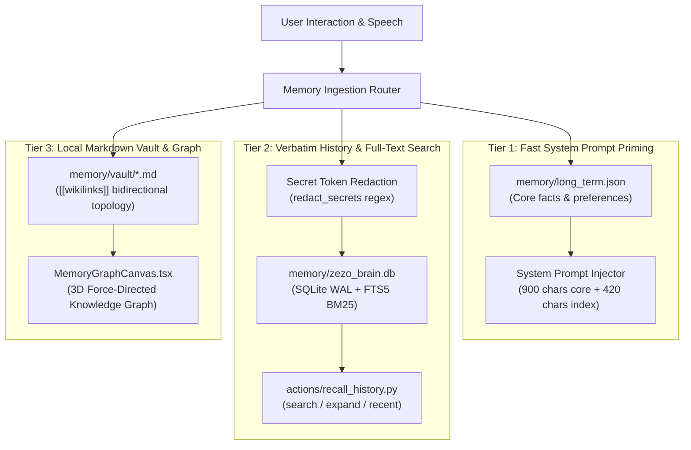

# 🧠 ZEZO — Hybrid 3-Tier Memory Engine

> **Creator & Lead Architect:** Hamza Bukhari  
> **System Component:** Persistent Multi-Tier Memory & Knowledge Graph Engine  
> **Storage Locations:** `memory/long_term.json`, `memory/zezo_brain.db`, `memory/vault/*.md`  
> **Tool Interfaces:** `save_memory`, `recall_memory`, `recall_history`  

---

## 📖 1. Overview & Architecture

ZEZO employs a **Hybrid 3-Tier Memory Engine** that harmonizes fast system-prompt priming, verbatim chronological conversation retrieval, and visual knowledge-graph associative traversal.



---

## ⚡ 2. Tier 1: Core Profile & Preference Memory (`long_term.json`)

**Path:** `memory/long_term.json`  
**Engine:** `memory/memory_manager.py`  
**Role:** Injected directly into the active Gemini Live system prompt at session boot for immediate, zero-latency grounding.

### Storage Format:
```json
{
    "identity":     {"name": {"value": "Hamza Bukhari", "updated": "2026-09-17"}, ...},
    "preferences":  {"favorite_food": {"value": "pizza", "updated": "2026-09-16"}, ...},
    "projects":     {"current_project": {"value": "ZEZO OS", "updated": "2026-10-24"}, ...},
    "relationships":{"sister_name": {"value": "...", "updated": "..."}, ...},
    "wishes":       {"travel_dream": {"value": "...", "updated": "..."}, ...},
    "notes":        {"habit": {"value": "...", "updated": "..."}, ...},
    "sessions":     [{"date": "2026-10-24", "summary": "Full docs synchronization."}]
}
```

### Prompt Budget Constraints:
```python
MEMORY_MAX_CHARS = 200_000       # Runaway guard (not a feature limit)
PROMPT_CORE_CHARS = 900          # Budget for active core memory injected in prompt
PROMPT_INDEX_CHARS = 420         # Interleaved index of off-screen keys
PROMPT_MAX_PER_CATEGORY = 6      # Maximum facts per category in prompt
MAX_VALUE_LENGTH = 380           # Character limit per single stored value
```

### The Interleaved Index System:
To prevent recency bias from starving critical relationship facts in favor of daily preferences, ZEZO uses an **interleaved category index**. If facts exceed `PROMPT_CORE_CHARS`, the remaining keys are listed alphabetically and category-interleaved (`[ALSO REMEMBERED — values not shown here: ...]`). When the user references an indexed topic, the model invokes `recall_memory` to fetch the specific value on demand.

---

## 🗄️ 3. Tier 2: Verbatim History & FTS5 BM25 Engine (`zezo_brain.db`)

**Path:** `memory/zezo_brain.db`  
**Engine:** `memory/sqlite_memory.py`  
**Tool Interface:** `actions/recall_history.py` (`recall_history`)  
**Role:** Verbatim turn-by-turn conversational scroll with SQLite WAL journaling and Full-Text Search 5 (FTS5).

### Key Architectural Capabilities:
1. **Thread-Safe WAL Journaling:** SQLite configured with Write-Ahead Logging (`PRAGMA journal_mode=WAL;`) and protected by Python thread locks (`_db_lock`) for concurrent logging without blocking the live voice loop.
2. **Secret Token Redaction (`redact_secrets`):** Prior to writing any utterance, tool argument, or tool result to disk, text is scrubbed against `_SECRET_PATTERNS`:
   - Google API Keys (`AIzaSy...`, `AQ....`).
   - Tavily API Keys (`tvly-...`).
   - OpenAI and generic keys (`sk-...`).
   - GitHub Personal Access Tokens (`ghp_...`).
   - HTTP Bearer Tokens (`Bearer ...`).
   - Authorization and Header secrets (`x-goog-api-key: [REDACTED_SECRET]`).
   - Session cookies (`set-cookie: [REDACTED_SECRET]`) and passwords.
3. **Database Schema:**
   - `turns`: Turn-by-turn chronological transcript (`session_id`, `role`, `content`, `tool_name`, `tool_args`, `tool_result`, `timestamp`).
   - `facts`: Structured key-value fact assertions with category and confidence tracking.
   - `user_explicit_rules`: Standing user directives and behavioral constraints.
   - `memory_conflicts`: Contradiction resolution ledger comparing new user inputs against stored facts.
   - `session_condensations`: Summarized session rollups preserving high-level context.

### Search Engine Note (Lexical vs. Semantic):
`sqlite_memory.py` uses SQLite FTS5 BM25 with recency decay scoring (`memory_manager._score()` also employs lexical keyword overlap). These are high-speed, local **lexical** search mechanisms with zero external dependencies and zero GPU overhead, not embedding-based semantic vector search.

### Tool Operations (`recall_history`):
- `op="search"`: Executes BM25 relevance search blended with recency decay (`recency_weight=0.35`, `recency_half_life_days=14.0`).
- `op="expand"`: Retrieves a contiguous chronological turn sequence across a `[low_id, high_id]` boundary to recover full conversational context.
- `op="recent"`: Lists past sessions within a specified relative time window (today, yesterday, last 7 days).

---

## 🕸️ 4. Tier 3: Local Markdown Vault & 3D Knowledge Graph

**Path:** `memory/vault/*.md`  
**Engine:** `memory/vault_engine.py`  
**Frontend Visualizer:** `frontend/src/components/memory/MemoryGraphCanvas.tsx`  
**Role:** Local-first, human-readable Markdown vault with `[[wikilinks]]` topology feeding the interactive 3D Force-Directed Graph.

### Vault Note Architecture:
Every note is stored as a standard `.md` file containing YAML frontmatter and bi-directional links:
```markdown
---
id: note_project_zezo
title: ZEZO Autonomous Operating System
category: project
tags: [architecture, os, ai]
updated: "2026-10-24 17:00:00"
---
# ZEZO Autonomous Operating System

Lead Architect: [[Hamza Bukhari]]
Related Modules: [[SQLite Memory Engine]], [[Autonomous Office Deck]]

---
*Note: Horizontal rules in the body are preserved safely without corrupting frontmatter.*
```

### High-Performance Incremental Caching (`vault_index.json`):
To scale effortlessly to hundreds of notes without synchronous disk I/O bottlenecks:
- VaultEngine maintains an atomic cache file: `memory/vault/vault_index.json`.
- `get_all_notes()` compares filesystem modification time (`st_mtime`) for each `.md` file against the cached entry.
- Unchanged files are served from memory in `< 3ms` instead of re-reading and re-parsing markdown files from disk.
- Cache writes use PID- and thread-isolated `.tmp` staging files with Windows `os.replace` retry loops.

### Permanent Deletion Mechanics (Anti-Resurrection Guarantee):
- When a note is deleted (`delete_note()`):
  1. **Frontmatter-First Session ID Extraction:** The note's YAML frontmatter is inspected for `session_id` or `id` before falling back to filename patterns. This guarantees that even if a note file was renamed, its session identity is reliably resolved.
  2. **SQLite Turn Purging:** Associated conversational turns in `zezo_brain.db` (`DELETE FROM turns WHERE session_id = ?`) are permanently deleted.
  3. **Unlinking & Cache Eviction:** The markdown file is deleted from disk and evicted from `vault_index.json`.
  4. This eliminates the resurrection bug where `sync_real_conversations_from_db()` would previously regenerate deleted conversation notes upon graph refresh.

### Strict Starting-Fence YAML Parsing:
- Note parsers in both Python (`vault_engine._parse_frontmatter`) and TypeScript (`splitFrontmatterAndBody`) strictly require `^---\r?\n` at file index 0.
- Markdown horizontal rules (`---`) placed anywhere in the note body are preserved verbatim and will never be mistaken for frontmatter delimiters.

### Knowledge Graph Synthesis:
1. **Bi-Directional Wikilink Parsing:** `VaultEngine` scans all vault notes for `[[Target Note]]` patterns and compiles directed link edges.
2. **Conversation Ingestion & Metadata Delivery:** Session summaries are distilled into conversation nodes with first-class `turn_count` metadata:
   - First 8 turns (`_VAULT_HEAD_TURNS = 8`): Establishes the initial task context and objectives.
   - Last 12 turns (`_VAULT_TAIL_TURNS = 12`): Captures the resolution, deliverables, and final outcomes.
   - Frontmatter stores clean user-facing tags (`tags: [conversation]`) and explicit turn count (`turn_count: 14`), eliminating internal `#3_TURNS` tag clutter.
3. **"Knowledge Galaxy" 3D Visual Experience (`MemoryGraphCanvas.tsx`):**
   - **Procedural 3D Starfield:** 1,200 particle celestial depth field (`THREE.Points`) surrounding the force graph for true cosmic exploration.
   - **Synaptic Neural Links:** Directional particle flow (`#818cf8`) traveling across celestial violet links (`rgba(120, 120, 255, 0.35)`).
   - **Cinematic Camera Glide:** Smooth camera flight (`Graph.cameraPosition`) focusing on clicked nodes with distance calculation.
   - **Reactive 3D Search Dimming:** Reactive traversal dims non-matching node spheres and `SpriteText` labels to `0.08` opacity without reloading WebGL canvas.
4. **Unified Spatial Right Drawer (`MemoryInspectorDrawer.tsx`):**
   - Viewing, editing, and creating notes are unified into the right drawer (`mode="inspect" | "create"`), replacing center popups.
   - Dynamic React key `key={drawerMode === 'create' ? 'create-mode' : (selectedNode?.id || 'empty')}` guarantees zero ghost data retention when switching modes.
   - Replaced database jargon with user-centric copy (*"Note Content"*, *"Write your thoughts here. Use [[Note Name]] to link..."*).
   - Native `window.confirm()` replaced with ReUI `ConfirmDialog` for delete workflows.

---

## 🛡️ 5. Privacy & Storage Guarantees

- **100% Local-First:** All 3 memory tiers reside strictly on the local filesystem (`memory/`). No memory data is synced to external vector clouds.
- **Git-Ignored:** `memory/long_term.json`, `memory/zezo_brain.db`, and `memory/vault/` are listed in `.gitignore` to prevent leaking private credentials or conversation transcripts.
- **User Editing:** The user can inspect, modify, or delete any Markdown note or memory entry at any time via file explorer or the in-app Memory Explorer settings tab.
