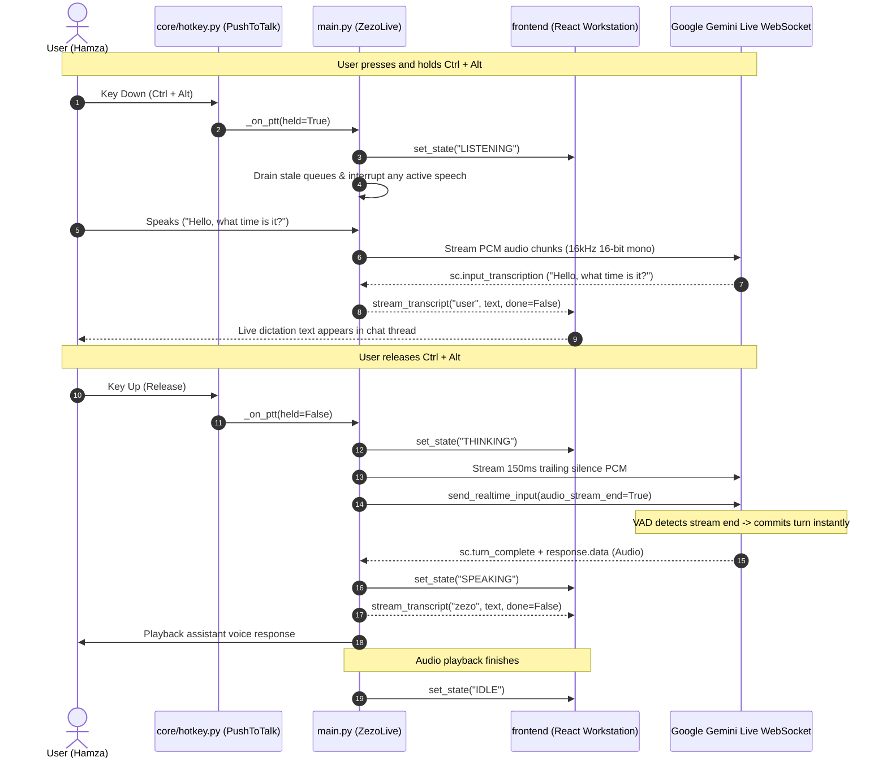

# ZEZO — Seamless Push-to-Talk Live Dictation & Instant Response Architecture

## Overview

Push-to-talk allows the user to hold a key chord to open the microphone, stream speech continuously to Google Gemini Live, see live dictation appear in the chat thread in real-time, and receive an instant spoken response on key release without any trailing hang. It is **opt-in** and can be toggled in settings.

---

## Keyboard Shortcut

- **Chord**: `Ctrl+Alt` — the single, only chord.
- **Why Ctrl+Alt**: Free in modern desktop environments (Windows, macOS, Linux), eliminates spacebar and IME conflicts, and provides comfortable thumb/pinky ergonomics.
- **`Ctrl+Space` is deliberately NOT bound**: Windows IMEs and focused text fields claim that chord, so advertising it promised a hotkey that silently did nothing. `core/hotkey.py` polls only the configured chord (`DEFAULT_CHORD`) and the Settings card reads `CTRL+ALT`.

---

## Architecture & Data Flow



---

## Implementation Details

**Files:**
- `core/hotkey.py` — `PushToTalk` class
- `main.py` — `ZezoLive` orchestrator (`_on_ptt`, `_send_realtime`, `_play_audio`, `_get_resting_state`, `_defer_playback`, `_drop_assistant_audio`, `_end_interrupted_turn`)

### 1. Platform-Specific Hook (`core/hotkey.py`)

#### Windows: Global Push-to-Talk
- Uses `ctypes.windll.user32.GetAsyncKeyState` to poll virtual-key codes (`VK_CONTROL = 0x11`, `VK_MENU = 0x12`).
- Polling rate: 30 Hz (~33ms period).
- Debounce: 60ms on press (stops accidental brush of chord), **0ms delay on release** (immediate release reporting).
- **Truly global**: Works while games, IDEs, browsers, or terminal windows have foreground focus.
- **Zero extra dependencies**: Native Win32 API.

#### macOS / Linux: Window-Scoped Fallback
- Bound via Qt key sequence shortcut.
- Reports `scope == "window"` honestly in the UI logs so the user knows window focus is required.

---

### 2. Audio Stream End Protocol & Trailing Acoustic Flush (`main.py`)

#### Problem Solved
Previously, cutting off the microphone abruptly upon key release caused two distinct failure modes:
1. Google Gemini Live's server VAD waited for prolonged silence timeouts (hangs) before finalizing the user turn.
2. Trailing syllables were clipped if the mic shut down too quickly, or background room noise leaked into the subsequent turn if a grace period was left open.

#### The Solution
1. **Trailing Flush**: On release (`held=False`), `_on_ptt` enqueues 150ms of clean silence PCM frames (`b"\x00" * 1600` at 16kHz) to gracefully close trailing phonemes without acoustic clipping.
2. **Sentinel Dispatch**: Immediately following the silence frames, an `{"audio_stream_end": True}` packet is placed into `out_queue`.
3. **Ordered Transmission in `_send_realtime`**:
   ```python
   if msg.get("audio_stream_end"):
       await self.session.send_realtime_input(audio_stream_end=True)
       continue
   ```
   Because `out_queue` is strictly FIFO, all user speech chunks and trailing silence frames are guaranteed to be transmitted *before* `audio_stream_end=True` reaches the WebSocket.
4. **Instant Server Turn Commit**: Google Gemini Live receives the explicit stream-end signal, commits the user's turn immediately, and begins streaming the response without delay.

---

### 3. Live Dictation & Assistant Output Suppression

1. **Real-time Chat Transcription**:
   - As speech chunks reach Gemini Live, server content delivers `sc.input_transcription`.
   - `main.py` dispatches `self.ui.stream_transcript("user", accumulated_in, done=False)` to the frontend.
   - User speech renders live in the chat thread like real-time dictation.
2. **Speaker Suppression During Key Hold**:
   - While the chord is down, `_play_audio` **defers** playback instead of discarding it:
     ```python
     if self._defer_playback():
         while self._defer_playback() and not self._interrupted:
             await asyncio.sleep(0.05)
     ```
   - **Defer, never discard.** The server commits your turn from its own VAD as soon as it hears the end of speech — normally *before* the key comes up (a pause mid-sentence is enough). Discarding playback here made ZEZO silently never answer.
   - Only the **remnants of an interrupted turn** are dropped (`_drop_assistant_audio()` → `_interrupted`), and `_end_interrupted_turn()` clears that flag at the server's turn boundary. It must NOT be cleared on key release and must NOT be pinned for the whole hold, or the follow-up turn's reply is thrown away too.
3. **Instant Barge-in**:
   - If the assistant is speaking and the user holds `Ctrl+Alt`, `_on_ptt(held=True)` invokes `interrupt()` immediately, stopping speaker audio, draining queues, and switching to `LISTENING`.

---

### 4. Resting State Management

| Condition | State |
|-----------|-------|
| Chord held down | `LISTENING` |
| Chord released, awaiting reply | `THINKING` |
| Assistant replying with audio | `SPEAKING` |
| Turn complete & playback finished | `IDLE` |

---

### 5. Unified Interaction Modes (UI Selector)

In the Settings UI (`General & Quick Controls`), interaction modes are organized into a single ReUI-compliant 3-Card Segmented Selector:

| Mode | Visual Tag | Behavior & Resting State | Underlying Backend Flags |
| :--- | :--- | :--- | :--- |
| **Always Listening** | `OPEN MIC` | Continuous open mic. Mic is always active; Gemini Live server VAD handles back-and-forth turns. | `wake_word_enabled: false`, `push_to_talk_enabled: false` |
| **Wake Word** | `HANDS-FREE` | Standby (`IDLE`). Saying *"Hey Zezo"* wakes mic for 15s active window, then returns to sleep. | `wake_word_enabled: true`, `push_to_talk_enabled: false` |
| **Push-To-Talk** | `CTRL+ALT` | Standby (`IDLE`). Key-held dictation via `Ctrl + Alt`. Instant reply upon release. | `wake_word_enabled: false`, `push_to_talk_enabled: true` |

---

### 6. Configuration

| Setting | Key | Default | Source |
|---------|-----|---------|--------|
| Push-to-Talk Enabled | `push_to_talk_enabled` | `False` | `config/settings.json` / `config/api_keys.json` |
| Wake Word Enabled | `wake_word_enabled` | `False` | `config/settings.json` / `config/api_keys.json` |
| Scope | Dynamic | `"global"` or `"window"` | `PushToTalk.start()` |