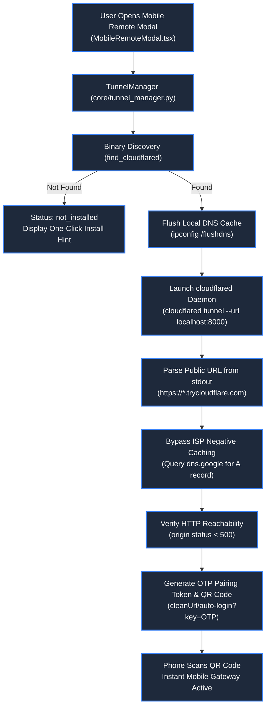

# 🌐 Remote Tunneling & Mobile Web Gateway

> **Project:** ZEZO  
> **Creator & Lead Architect:** Hamza Bukhari  
> **Source Modules:** [`core/tunnel_manager.py`](file:///d:/anitgravity/zezo%20work/jarvis-57/core/tunnel_manager.py), [`frontend/src/components/remote/MobileRemoteModal.tsx`](file:///d:/anitgravity/zezo%20work/jarvis-57/frontend/src/components/remote/MobileRemoteModal.tsx)  
> **Target OS:** Windows 10/11 (Primary), macOS, Linux  

---

## 📖 Overview

The **Remote Tunneling Subsystem** gives users zero-configuration, secure mobile access to their running ZEZO desktop instance from anywhere in the world. By running a managed, background **Cloudflare Quick Tunnel** (`cloudflared`), ZEZO securely exposes its local HTTP/WebSocket port (default: `http://localhost:8000`) over an encrypted public HTTPS endpoint (`https://<random-id>.trycloudflare.com`).

Users can scan a dynamically generated **QR Code** on their phone or tablet to pair instantaneously, without port forwarding, router configuration, or static IP setups.



---

## 🚀 Zero-Config Cloudflare Quick Tunnels

ZEZO handles all daemon management transparently in the background:
- **No Account Required:** Leverages Cloudflare's free Quick Tunnels (`trycloudflare.com`), requiring no Cloudflare credentials or domain registration.
- **Stealth Background Daemon:** Spawns `cloudflared tunnel --url http://localhost:8000` with `creationflags=subprocess.CREATE_NO_WINDOW` on Windows.
- **Pipe Draining (`_drain_task`):** Standard output is consumed asynchronously in a non-blocking loop to capture the assigned URL and prevent terminal pipe buffer backpressure.

---

## 🔍 Public DNS Verification & Cache-Busting

A major pitfall of ephemeral Cloudflare Quick Tunnels is that Cloudflare prints the tunnel URL before its authoritative DNS records have fully propagated across global resolvers. If the host machine or local router attempts to resolve the URL immediately, the resulting `NXDOMAIN` is cached locally (negative caching), causing repeated connection failures.

ZEZO completely circumvents this issue using a multi-stage verification strategy:

### 1. Local Resolver Flush
Before starting the daemon, ZEZO issues a flush to clear any stale DNS state:
```python
def _flush_dns_cache() -> None:
    if os.name == "nt":
        subprocess.run(["ipconfig", "/flushdns"], capture_output=True, creationflags=subprocess.CREATE_NO_WINDOW)
```

### 2. Direct Public DNS Resolution (`dns.google`)
Rather than trusting the local OS or ISP resolver, `_public_dns_resolves` queries Google's public DNS-over-HTTPS endpoint directly:
```python
def _public_dns_resolves(host: str) -> bool:
    req = urllib.request.Request(
        f"https://dns.google/resolve?name={host}&type=A",
        headers={"Accept": "application/dns-json"},
    )
    with urllib.request.urlopen(req, timeout=5) as r:
        data = json.loads(r.read().decode("utf-8", errors="replace"))
    answers = data.get("Answer") or []
    return any(a.get("type") == 1 for a in answers)
```

### 3. Reachability Polling
Once DNS resolves an `A` record, ZEZO validates that origin HTTP responses return cleanly (`status < 500`) before presenting the QR code to the user.

---

## 🔐 Dynamic OTP Pairing & Mobile Gateway (`MobileRemoteModal.tsx`)

Security is maintained through short-lived, dynamic One-Time Password (OTP) pairing tokens:

```
https://<subdomain>.trycloudflare.com/auto-login?key=<DYNAMIC_OTP_TOKEN>
```

1. **Token Lifecycle:** OTP keys carry a default Time-To-Live (TTL) of **10 minutes** (`REMOTE_KEY_TTL_SECONDS = 600`).
2. **Instant QR Code Rendering:** Rendered directly client-side via `qrcode.toDataURL` with crisp 220px resolution.
3. **Automatic Fallback Mode:** If Cloudflare is unavailable or disabled, the modal falls back automatically to local LAN gateway routing (`http://<LAN-IP>:8000`).
4. **Hands-Off Isolation:** `core/tunnel_manager.py` strictly does not touch audio or live voice pipeline configurations.
