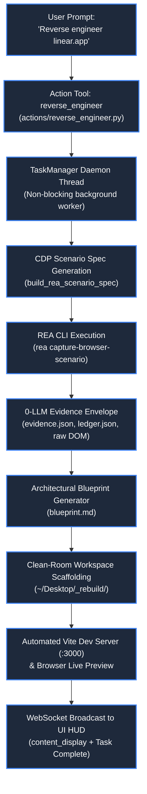

# 🔬 Reverse Engineering & REA Teardown Engine

> **Project:** ZEZO  
> **Creator & Lead Architect:** Hamza Bukhari  
> **Source Modules:** [`core/teardown_engine.py`](file:///d:/anitgravity/zezo%20work/jarvis-57/core/teardown_engine.py), [`actions/reverse_engineer.py`](file:///d:/anitgravity/zezo%20work/jarvis-57/actions/reverse_engineer.py)  
> **Target OS:** Windows 10/11 (Primary), macOS, Linux  

---

## 📖 Overview

The **REA (Reverse Engineer Anything) Teardown Engine** is ZEZO's native system for deterministic web application x-raying, architectural teardown, and clean-room implementation rebuilding. Powered by the official `rea-agents@6.7.0` CLI (`rea capture-browser-scenario`), it leverages the **Chrome DevTools Protocol (CDP)** to capture complete runtime evidence envelopes with **zero LLM API cost** and **zero synthetic mock boilerplate**.

Unlike traditional web scraping, the REA engine extracts live runtime DOM trees, computed styles, accessibility trees, network transactions (headers, request bodies, response payloads), console logs, and WebGL/shader bindings. It then synthesizes an actionable architectural blueprint and scaffolds an isolated, ready-to-run modern application on the user's Desktop.



---

## ⚙️ Core Architecture & Operational Flow

### 1. Zero-Cost CDP Headless Interception
The engine launches an installed Chromium executable (Google Chrome or Microsoft Edge) in headless mode via CDP. The scenario specification (`build_rea_scenario_spec`) configures:
- **Viewport:** 1440 × 900 @ 1x scale, dark color scheme, UTC timezone.
- **Service Workers:** Blocked to ensure direct network capture.
- **Dynamic Settle Timers:** 2,500ms for general inspection, 3,000ms for APIs/network analysis, and 4,500ms for complex CSS/canvas animations.
- **Canonical Capture Targets:** Final DOM tree, accessibility tree, storage (cookies, `localStorage`, `sessionStorage`), console output, page errors, and complete HTTP network request/response bodies and headers.

### 2. Evidence Envelope Structure
All raw capture data is encapsulated within a structured workspace under `~/Desktop/ZEZO_Teardowns/<domain>_<timestamp>/`:

| Artifact | File Name | Description |
| :--- | :--- | :--- |
| **Evidence Envelope** | `evidence.json` | Parsed runtime metadata, detected frameworks, active styling libraries, WebGL shaders, and API endpoints. |
| **Obligation Ledger** | `ledger.json` | Strict verification ledger detailing DOM hierarchy, required component boundaries, and styling contracts. |
| **Architectural Blueprint**| `blueprint.md` | Comprehensive Markdown teardown document detailing stack breakdown, API schemas, and graphics pipelines. |
| **Raw Scenario Capture** | `scenario_capture/` | Raw JSON payload output by `rea capture-browser-scenario`. |

### 3. Dynamic Tech Stack Detection
The engine inspects script signatures, DOM attributes, meta tags, and global objects to identify underlying tech stacks:
- **Modern JavaScript Frameworks:** Next.js (`__NEXT_DATA__`), React (`_reactRootContainer`), Vue/Nuxt, Svelte, Remix.
- **Enterprise & CMS Platforms:** WordPress (`wp-content`, REST API endpoints), Shopify (`cdn.shopify.com`, `Shopify` global), Laravel (`XSRF-TOKEN`, Laravel cookies).
- **Graphics & Styling Engines:** Tailwind CSS, Styled Components, Emotion, Three.js, Babylon.js, WebGL shader scripts.

---

## 🏗️ External Workspace Isolation & Dev Server Setup

To protect the core ZEZO repository and keep user projects clean, all teardowns and rebuilds are quarantined into external desktop directories:

```
~/Desktop/
├── ZEZO_Teardowns/
│   └── <domain>_<timestamp>/
│       ├── scenario.json
│       ├── evidence.json
│       ├── ledger.json
│       ├── blueprint.md
│       └── raw_output/
└── <domain>_rebuild/
    ├── package.json          # Configured with React 18, Vite 5, Tailwind CSS
    ├── index.html            # Standalone, interactive clean-room preview
    ├── vite.config.ts        # Configured for port 3000
    ├── src/
    │   ├── App.tsx           # Reconstructed primary layout
    │   └── components/       # Decomposed modular UI components
    └── styles/               # Extracted styling and CSS modules
```

### Automated Vite Dev Server Initialization
Once scaffolding completes, `core/teardown_engine.py` automatically initializes and provisions a local development server:
1. Spawns `npx vite --port 3000` inside `~/Desktop/<domain>_rebuild/`.
2. Runs in a non-blocking background process using `creationflags=subprocess.CREATE_NO_WINDOW` on Windows.
3. Automatically opens the default browser to `http://localhost:3000` for immediate verification.
4. If port 3000 is occupied, Vite's port allocation logic falls back gracefully to the next available port.

---

## 🛠️ Action Tool Reference: `reverse_engineer`

Defined in [`actions/reverse_engineer.py`](file:///d:/anitgravity/zezo%20work/jarvis-57/actions/reverse_engineer.py) and registered as a primary action tool:

```python
TOOL = {
    "name": "reverse_engineer",
    "description": (
        "Reverse engineer, inspect stack, x-ray, or analyze the architecture of any website or web application using the official "
        "REA CLI engine (`rea capture-browser-scenario`). Extracts runtime DOM snapshots, accessibility tree, "
        "network transactions, request/response bodies and headers, storage, and console logs with zero LLM API cost. "
        "MUST be used whenever the user asks to 'reverse engineer', 'inspect stack', 'x-ray', or inspect 'architecture' of any website."
    ),
    "risk": "read_only",
    "enabled": True,
    "behavior": "NON_BLOCKING",
    "scheduling": "WHEN_IDLE",
    "parameters": {
        "type": "OBJECT",
        "properties": {
            "url": {
                "type": "STRING",
                "description": "The URL of the website or web app to inspect (e.g. 'https://linear.app' or 'https://stripe.com').",
            },
            "focus": {
                "type": "STRING",
                "enum": ["full", "architecture", "apis_network", "shaders_webgl", "animations"],
                "description": "Optional focus area for inspection. Defaults to 'full'.",
            },
        },
        "required": ["url"],
    },
}
```

### Supported Focus Modes

- **`full`** *(Default)*: Complete audit capturing DOM, styling, network endpoints, graphics, and storage.
- **`architecture`**: Focuses on framework component hierarchy, routing, state models, and dependency graphs.
- **`apis_network`**: Extended network capture isolating REST/GraphQL endpoints, payload structures, headers, and authentication tokens.
- **`shaders_webgl`**: Deep inspection of canvas contexts, vertex/fragment shaders, and 3D rendering pipelines.
- **`animations`**: Extended settle window (4,500ms) with motion preference enabled to intercept CSS keyframes, spring transitions, and GSAP/Framer Motion setups.

---

## 🔒 Safety & Governance Invariants

1. **Non-Blocking Execution:** REA captures execute in a dedicated daemon worker thread managed by `TaskManager`. The WebSocket event loop and UI thread are never stalled.
2. **Deterministic Output:** Zero LLM hallucinations during the evidence gathering phase. All output in `evidence.json` reflects verified CDP runtime telemetry.
3. **Repository Preservation:** Scaffolds are strictly written to `~/Desktop/<project>_rebuild/`. No generated artifacts, npm modules, or build caches pollute the main ZEZO codebase.
4. **Credential Isolation:** Intercepted session cookies and sensitive authorization tokens in network transactions are segregated to local evidence files and omitted from telemetry logs.
