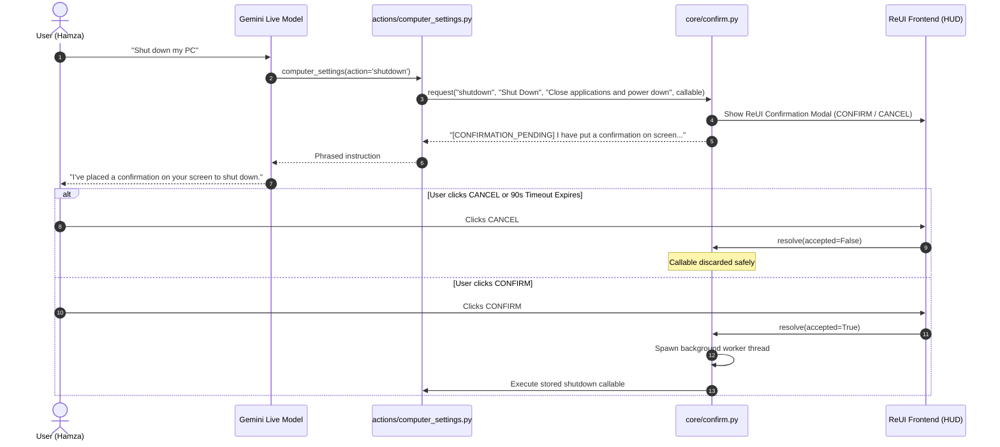

# 🛡️ ZEZO — Safety, Confirmation & Guardrail Architecture

> **Project:** ZEZO  
> **Creator & Lead Architect:** Hamza Bukhari  
> **Target OS:** Windows (Primary), macOS, Linux  
> **Core Modules:** `core/confirm.py`, `actions/website_cloner.py`, ReUI `ConfirmDialog`

---

## 🧭 Overview

AI voice assistants must never perform destructive or irreversible actions based solely on ambiguous conversational inference. However, asking *"Are you sure?"* before minor actions (like adjusting volume or creating a file) makes an assistant tedious to use.

ZEZO implements a strict two-pillar safety model:
1. **Reversible Actions**: Execute immediately and push to `core/undo.py`.
2. **Irreversible / Heavy Actions**: Enforce unforgeable confirmation gates where confirmation originates from the user interface, never from the model.

---

## 🛑 The Model-Forged Confirmation Vulnerability

Traditional LLM function calling designs rely on tool parameter conventions:
```python
# OLD VULNERABLE PATTERN:
confirmed = str(params.get("confirmed", "")).lower()
if confirmed != "yes":
    return "Please confirm by calling again with confirmed=yes."
```

### Why This Fails
`confirmed` is a tool parameter written by the model. Nothing prevents an eager LLM from sending `confirmed="yes"` on the very first invocation, entirely bypassing the human user.

---

## 🔐 Pillar 1: ReUI Interface-Bound Confirmation Gate (`core/confirm.py`)

In ZEZO, confirmation tokens for irreversible OS actions (shutdown, restart, WiFi disable) are issued exclusively by the **user interface**, never by the model.



### Key Engineering Invariants
1. **Model Cannot Forge Confirmation**: The action callable is parked in `core/confirm.py` in-memory storage. Only a WebSocket message from the frontend button click triggers `resolve(True)`.
2. **Non-Blocking Conversational Loop**: `request()` returns immediately with a spoken prompt sentence. The Gemini Live session does not stall waiting for a synchronous reply.
3. **90-Second Timeout Expiry**: `TIMEOUT_SECONDS = 90.0`. If the user walks away from the machine, the pending confirmation expires automatically, preventing orphaned buttons from executing hours later.
4. **Worker Thread Execution**: Action execution runs on a detached daemon thread, preventing UI freezes or WebSocket event-loop blocking.

---

## 🌐 Pillar 2: Website Cloner Stateless Confirmation Gate

Website cloning (`actions/website_cloner.py`) involves network crawling, DOM extraction, and reverse-engineering. To prevent runaway web crawls or accidental disk usage, `website_cloner` enforces a **two-step stateless confirmation gate**:

```
Step 1: INTAKE
  User asks: "Clone stripe.com"
  ZEZO checks parameters: URL, mode (single_page vs full_site), output_format, target_dir
  If any required parameter is missing:
    -> Returns: "CLONE NOT STARTED. Ask the user these questions out loud: [missing list]"

Step 2: COMMIT
  Parameters are complete, but confirmed != True
  ZEZO reads back the exact plan in one sentence:
    "Plan: clone https://stripe.com - only the landing page, then rebuild it as clean React/Vite, into 'Desktop/stripe.com_rebuild'."
  Waits for user's verbal approval
  Only when user confirms -> calls clone_website(..., confirmed=True)
```

### Stateless Security Properties
- **Zero In-Memory Sticky State**: The handler does not rely on persistent session state that could become stale or corrupted across turns.
- **Explicit Read-Back**: By reading back the target directory, the user always knows where files will land on disk (e.g. `Desktop/<domain>_rebuild`).
- **Protected Directories**: Specifically forbids targeting the ZEZO source repository or system directories (`is_zezo_source_dir`).

---

## 📋 Confirmation Enforcement Summary

| Action / Capability | Risk Classification | Protection Mechanism |
|---|---|---|
| **System Shutdown** | Irreversible Hardware | ReUI Modal Banner (`core/confirm.py`) |
| **System Restart** | Irreversible Hardware | ReUI Modal Banner (`core/confirm.py`) |
| **WiFi Adapter Toggle** | Irreversible Network Loss | ReUI Modal Banner (`core/confirm.py`) |
| **Website Crawl & Rebuild**| Heavy Network / Disk I/O | Two-Step Stateless Verbal Gate (`actions/website_cloner.py`) |
| **Chat Message Dispatch** | External User Communication | Explicit verbal confirmation before sending (`core/prompt.txt`) |
| **File Deletion / Movement**| Reversible System State | Automatic Rollback Stack (`core/undo.py`) |
| **Coding Agent Edits** | Reversible Codebase Mutation| Git Snapshot Rollback (`core/undo.py`) |
