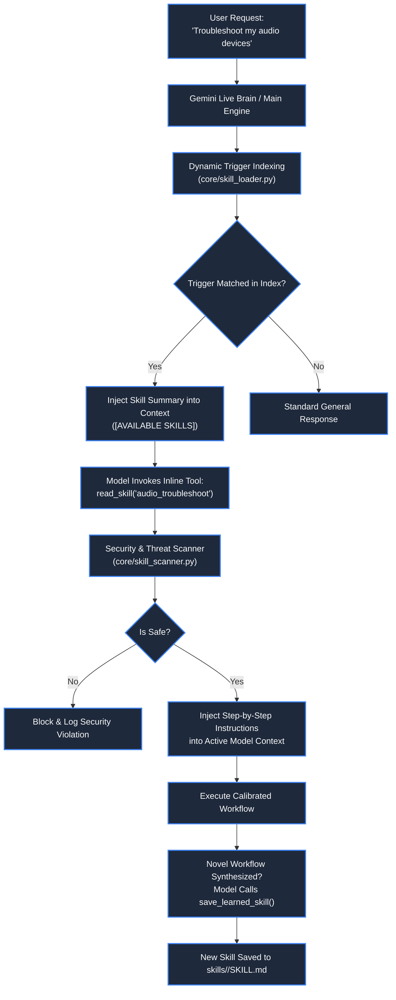

# 🧠 Declarative Skills & Self-Learning Engine

> **Project:** ZEZO  
> **Creator & Lead Architect:** Hamza Bukhari  
> **Source Modules:** [`core/skill_loader.py`](file:///d:/anitgravity/zezo%20work/jarvis-57/core/skill_loader.py), [`core/skill_scanner.py`](file:///d:/anitgravity/zezo%20work/jarvis-57/core/skill_scanner.py), [`main.py`](file:///d:/anitgravity/zezo%20work/jarvis-57/main.py), [`frontend/src/components/settings/SkillsSettingsTab.tsx`](file:///d:/anitgravity/zezo%20work/jarvis-57/frontend/src/components/settings/SkillsSettingsTab.tsx)  
> **Storage Directory:** `skills/<skill_name>/SKILL.md`  
> **Target OS:** Windows 10/11 (Primary), macOS, Linux  

---

## 📖 Overview

The **Declarative Skills System** provides ZEZO with a modular, extensible, and self-learning knowledge architecture. Inspired by the separation between **atomic executable tools** (actions that perform single operations) and **declarative procedural skills** (procedural step-by-step instructions and best practices), ZEZO packages complex multi-step workflows as portable Markdown packages (`SKILL.md`).

The engine includes **dynamic intent indexing**, an **automated multi-stage threat scanner** (blocking prompt injections, obfuscated scripts, and secret leakage), and **runtime self-learning tools** that allow ZEZO to autonomously persist novel procedures learned during execution.



---

## 📦 Declarative Package Format (`SKILL.md`)

Every skill in ZEZO resides in its own isolated directory under `skills/<skill_name>/` and is documented in a standard `SKILL.md` file featuring YAML frontmatter:

```markdown
---
name: hamza_taste
description: Master Studio UI Anti-Slop Directive & Reference-First Design Protocol for autonomous web generation and frontend agents.
domain: design
author: Hamza Bukhari
version: 2.5.0
tags:
  - Design System
  - Anti-Slop
  - Tailwind
  - ReUI
triggers:
  - "design"
  - "ui"
  - "frontend styling"
  - "build a website"
auto_activate: true
pinned: false
---

# 🎨 Hamza Taste — Studio UI Anti-Slop Directive

## Executive Rules
1. Anti-Slop is a FILTER (what to reject), while Reference HTML Templates supply 100% of the DIRECTION.
2. Never output naive generic centered cards with purple gradients.
3. Use calibrated spacing, semantic tokens, and high-contrast typography.
```

### Frontmatter Schema

- **`name`**: Short, snake_case identifier matching directory name.
- **`description`**: High-level summary describing when and why the model should activate this skill.
- **`domain`**: Functional namespace (`coding`, `design`, `research`, `system`, `media`, `orchestration`).
- **`triggers`**: List of intent-matching keywords used by `core/skill_loader.py` to index when the skill should be surfaced.
- **`auto_activate`**: Whether the skill is dynamically eligible for automatic prompt injection upon trigger match.

---

## 🛡️ Multi-Stage Security Scanner (`core/skill_scanner.py`)

To ensure that community-contributed or autonomously synthesized skills do not introduce prompt injections, privilege escalation attacks, or malware, every `SKILL.md` passes through `core/skill_scanner.py`:

### 1. Prompt Injection & Jailbreak Detection
Scans frontmatter and instruction bodies for adversarial pattern tokens:
- System instruction override directives (e.g. `ignore all previous instructions`).
- Raw ChatML role markers (`<|im_start|>system`).
- Llama system enclosure injection (`[INST] <<SYS>>`).
- Persona hijacking and jailbreak phrases (`act as DAN`, `unrestricted mode`).

### 2. Obfuscation & Malicious Execution Detection
Detects stealthy execution vectors:
- Encoded PowerShell evaluation: `iex [System.Text.Encoding]`.
- Dynamic Python evaluation: `eval(compile(...))`.
- Obfuscated inline subprocesses: `__import__('os').system`.

### 3. Secret Token Scrubbing
Runs `sqlite_memory.redact_secrets` over the entire text to scrub API keys, Bearer tokens, and private paths before storing or displaying in the UI.

---

## 🛠️ Inline Tools Reference ([main.py](file:///d:/anitgravity/zezo%20work/jarvis-57/main.py))

ZEZO exposes 3 native inline tools directly to Google Gemini Live and Assistant-UI:

### 1. `read_skill`
```json
{
  "name": "read_skill",
  "description": "Read full step-by-step guidelines and instructions for a skill listed under '[AVAILABLE SKILLS]'. Call this before executing a complex multi-step workflow.",
  "parameters": {
    "type": "OBJECT",
    "properties": {
      "skill_name": {
        "type": "STRING",
        "description": "Name of the skill to read (e.g. 'system_diagnostics', 'git_workflow')"
      }
    },
    "required": ["skill_name"]
  }
}
```

### 2. `list_skills`
```json
{
  "name": "list_skills",
  "description": "List all available skills and workflows on disk with their descriptions.",
  "parameters": {
    "type": "OBJECT",
    "properties": {}
  }
}
```

### 3. `save_learned_skill` (Self-Learning Loop)
```json
{
  "name": "save_learned_skill",
  "description": "Autonomously synthesize and persist a new skill after successfully completing a complex or novel multi-step task. This adds a permanent new capability to your skills catalog for future sessions.",
  "parameters": {
    "type": "OBJECT",
    "properties": {
      "name": {
        "type": "STRING",
        "description": "Short snake_case name for the skill (e.g. 'docker_cleanup', 'audio_troubleshoot')"
      },
      "description": {
        "type": "STRING",
        "description": "1-2 sentence summary of when to use this skill"
      },
      "instructions": {
        "type": "STRING",
        "description": "Clear step-by-step markdown instructions and best practices"
      }
    },
    "required": ["name", "description", "instructions"]
  }
}
```

---

## ⚙️ In-App Discovery & Editing (`SkillsSettingsTab.tsx`)

Inside the Settings modal (`SkillsSettingsTab.tsx`):
- **Category Filter Tabs:** Filter skills across *Coding*, *Design*, *Research*, *System*, *Media*, and *Orchestration*.
- **Live Search & Tags:** Real-time search across titles, descriptions, and tag pills.
- **In-App Markdown Editor:** Users can view, edit, or create new declarative skills with live syntax highlighting and direct disk persistence.
- **Activation Toggles:** Individual skills can be enabled or disabled instantly without restarting the server.
