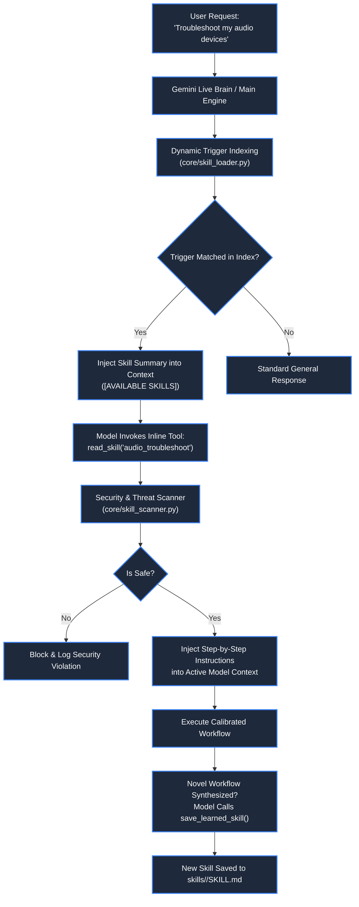

# 🧠 Declarative Skills & Self-Learning Engine

> **Project:** ZEZO  
> **Creator & Lead Architect:** Hamza Bukhari  
> **Source Modules:** [`core/skill_loader.py`](file:///d:/anitgravity/zezo%20work/jarvis-57/core/skill_loader.py), [`core/skill_scanner.py`](file:///d:/anitgravity/zezo%20work/jarvis-57/core/skill_scanner.py), [`main.py`](file:///d:/anitgravity/zezo%20work/jarvis-57/main.py), [`frontend/src/components/settings/SkillsSettingsTab.tsx`](file:///d:/anitgravity/zezo%20work/jarvis-57/frontend/src/components/settings/SkillsSettingsTab.tsx)  
> **Storage Directory:** `skills/<skill_name>/SKILL.md`  
> **Target OS:** Windows 10/11 (Primary), macOS, Linux  

---

## 📖 Overview

The **Declarative Skills System** provides ZEZO with a modular, extensible, and self-learning knowledge architecture. Inspired by the separation between **atomic executable tools** (actions that perform single operations) and **declarative procedural skills** (procedural step-by-step instructions and best practices), ZEZO packages complex multi-step workflows as portable Markdown packages (`SKILL.md`).

The engine includes **dynamic intent indexing**, an **automated multi-stage threat scanner** (blocking prompt injections, obfuscated scripts, and secret leakage), and **runtime self-learning tools** that allow ZEZO to autonomously persist novel procedures learned during execution.



---

## 📦 Declarative Package Format (`SKILL.md`)

Every skill in ZEZO resides in its own isolated directory under `skills/<skill_name>/` and is documented in a standard `SKILL.md` file featuring YAML frontmatter:

```markdown
---
name: website_build
description: Master studio protocol for creating websites, landing pages, and UI components adhering to Hamza Taste design references and anti-slop gates.
domain: ui
author: Hamza Bukhari
version: 1.0.0
triggers:
  - "build website"
  - "create landing page"
  - "make website"
  - "hero section"
  - "pricing table"
  - "web app"
auto_activate: true
---

# 🌐 Website Build — Studio Greenfield Creation Protocol

## Executive Workflow
1. **Phase 1: Intake & Clarification Gate**: Intercepts open-ended queries, prompts for the 4 architectural pillars (`scope_type`, `tech_stack`, `color_theme`, `key_sections`), and enforces a 1-sentence Commitment Read-Back confirmation before workspace allocation.
2. **Phase 2: Deterministic Catalog Resolution**: Queries `skills/website_build/references/catalog.json` across 5 scope folders (`1_landing_pages`, `2_business_sites`, `3_portfolios`, `4_dashboards`, `5_components`) indexing 20 authentic HTML templates. Eliminates pseudo-random modulo string hashing.
3. **Phase 3: Anti-Slop Directive**: Enforces 3 tiers of hard design constraints (anti-slop filter, rhythm/geometry locks, micro-interactions).
4. **Phase 4: Stack Parity**: Supports Single-File HTML and Modular React 18 + Vite architectures with clean dependency resolution.
5. **Phase 5: Smart Live Preview**: Launches ephemeral preview servers (ports 9400-9480) for HTML or background dev servers for React, permanently suppressing blank `file://` popups.
```

### Frontmatter Schema

- **`name`**: Short, snake_case identifier matching directory name.
- **`description`**: High-level summary describing when and why the model should activate this skill.
- **`domain`**: Functional namespace (`ui`, `web_dev`, `design`, `coding`, `system`, `general`).
- **`required_tools`**: List of atomic actions required by the skill (e.g. `[clone_website, browser_control, web_read_page, file_controller]`).
- **`triggers`**: List of intent-matching keywords used by `core/skill_loader.py` to index when the skill should be surfaced.
- **`auto_activate`**: Whether the skill is dynamically eligible for automatic prompt injection upon trigger match.

---

## 🏛️ The 3 Core Skills Standard

ZEZO standardizes on 3 production core skills:
1. **`website_build` (`skills/website_build/`)**: Greenfield UI creation protocol with catalog-driven references, anti-slop quality gates, live preview servers, and authoritative taste prompts in Section 2.5 (Scenario 1: Portfolio, Scenario 2: SaaS Landing Page, Scenario 3: CloudFleet Analytics Dashboard, embedding 6 negative rejection gates and 4 visual authority guards).
2. **`website_clone` (`skills/website_clone/`)**: High-fidelity offline website capture, asset localization, and reverse-engineering rebuilds via the Uncage Hybrid Engine (Path A: Python tool `clone_website`; Path B: direct CLI `node tools/uncage/bin/uncage.js`), featuring Section 4 Master System Directives (Scenario A: Single-File Raw HTML, Scenario B: Clean Modular React/Next.js Framework).
3. **`generate_design_md` (`skills/generate_design_md/`)**: Studio design token extraction and DSL `<design-context>` generator from URLs or HTML templates with WCAG accessibility contrast audits.

---

## 🛡️ Multi-Stage Security Scanner (`core/skill_scanner.py`)

To ensure that community-contributed or autonomously synthesized skills do not introduce prompt injections, privilege escalation attacks, or malware, every `SKILL.md` passes through `core/skill_scanner.py`:

### 1. Prompt Injection & Jailbreak Detection
Scans frontmatter and instruction bodies for adversarial pattern tokens:
- System instruction override directives (e.g. `ignore all previous instructions`).
- Raw ChatML role markers (`<|im_start|>system`).
- Llama system enclosure injection (`[INST] <<SYS>>`).
- Persona hijacking and jailbreak phrases (`act as DAN`, `unrestricted mode`).

### 2. Obfuscation & Malicious Execution Detection
Detects stealthy execution vectors:
- Encoded PowerShell evaluation: `iex [System.Text.Encoding]`.
- Dynamic Python evaluation: `eval(compile(...))`.
- Obfuscated inline subprocesses: `__import__('os').system`.

### 3. Secret Token Scrubbing
Runs `sqlite_memory.redact_secrets` over the entire text to scrub API keys, Bearer tokens, and private paths before storing or displaying in the UI.

---

## 🛠️ Inline Tools Reference ([main.py](file:///d:/anitgravity/zezo%20work/jarvis-57/main.py))

ZEZO exposes 3 native inline tools directly to Google Gemini Live and Assistant-UI:

### 1. `read_skill`
```json
{
  "name": "read_skill",
  "description": "Read full step-by-step guidelines and instructions for a skill listed under '[AVAILABLE SKILLS]'. Call this before executing a complex multi-step workflow.",
  "parameters": {
    "type": "OBJECT",
    "properties": {
      "skill_name": {
        "type": "STRING",
        "description": "Name of the skill to read (e.g. 'system_diagnostics', 'git_workflow')"
      }
    },
    "required": ["skill_name"]
  }
}
```

### 2. `list_skills`
```json
{
  "name": "list_skills",
  "description": "List all available skills and workflows on disk with their descriptions.",
  "parameters": {
    "type": "OBJECT",
    "properties": {}
  }
}
```

### 3. `save_learned_skill` (Self-Learning Loop)
```json
{
  "name": "save_learned_skill",
  "description": "Autonomously synthesize and persist a new skill after successfully completing a complex or novel multi-step task. This adds a permanent new capability to your skills catalog for future sessions.",
  "parameters": {
    "type": "OBJECT",
    "properties": {
      "name": {
        "type": "STRING",
        "description": "Short snake_case name for the skill (e.g. 'docker_cleanup', 'audio_troubleshoot')"
      },
      "description": {
        "type": "STRING",
        "description": "1-2 sentence summary of when to use this skill"
      },
      "instructions": {
        "type": "STRING",
        "description": "Clear step-by-step markdown instructions and best practices"
      }
    },
    "required": ["name", "description", "instructions"]
  }
}
```

---

## ⚙️ In-App Discovery & Editing (`SkillsSettingsTab.tsx`)

Inside the Settings modal (`SkillsSettingsTab.tsx`):
- **Category Filter Tabs:** Filter skills across *Coding*, *Design*, *Research*, *System*, *Media*, and *Orchestration*.
- **Live Search & Tags:** Real-time search across titles, descriptions, and tag pills.
- **In-App Markdown Editor:** Users can view, edit, or create new declarative skills with live syntax highlighting and direct disk persistence.
- **Activation Toggles:** Individual skills can be enabled or disabled instantly without restarting the server.


---

## ⚡ Dual-AI Skill Runner Subsystem (`core/skill_runner.py`)

Procedural declarative skills (`SKILL.md`) are executed by the **Dual-AI Skill Runner**:
- **Smart Tool Scoping**: Ingests `SKILL.md` via `SkillRegistry` and inspects `required_tools` and body tokens, scoping down from 30+ tools to only the 3-5 atomic tools needed for the workflow.
- **Dual-AI Execution Engine**:
  - **Primary**: High-throughput Groq LPU (`llama-3.3-70b-versatile`) performing sequential atomic tool-calling.
  - **Stateful Fallback**: Maintains a live ledger of `completed_steps = []`. If Groq encounters HTTP 429 rate limits or network drops, it immediately hands over to Gemini (`gemini-3.8-flash`) with full execution history so the remaining steps resume without repeating step 1.
- **Output Truncation & Memory Guard**: Large tool returns are truncated and summarized to a maximum of 1500 characters to safeguard the context window.
- **Task Telemetry**: Reports step-by-step progress to `TaskManager` (`task_manager.report(progress=..., message=...)`).
- **Fleet Delegation Routing**: If a skill specifies or requires autonomous fleet execution, `actions/run_skill.py` dispatches to `FleetDispatcher.dispatch_task()` while local execution runs in a non-blocking background thread.

---

## 🛠️ Universal AI Skill Prompt Engineer (core/skill_prompt_engineer.py)

For downstream autonomous coding engines (Google Antigravity CLI \gy\, OpenCode, Kilo Code, Claude Code, Cursor, Windsurf), the **Universal AI Skill Prompt Engineer** synthesizes bespoke, executable master directives on the fly:
- **Dual-AI Live Engine Orchestration**:
  1. **Primary Engine**: Groq LPU (\llama-3.3-70b-versatile\) with ultra-fast latency (~150–200ms, \	imeout=12s\, \max_tokens=2048\, \	emperature=0.2\).
  2. **Secondary Fallback**: Google Gemini 3.8 Flash (\gemini-3.8-flash\ via \core.gemini.client\) for instant failover if Groq experiences rate limits or network issues.
  3. **Strict Live AI Mandate**: Zero dummy or hardcoded prompts are permitted. Every prompt is synthesized live from scratch. If both Groq and Gemini fail, a clean \RuntimeError\ is raised rather than falling back to fake templates.
- **Enforced 5-Block Standard Schema**:
  1. \[TASK DIRECTIVE]\: Mission statement, target directory, deliverable files, and execution engine.
  2. \[DESIGN REFERENCES]\: Design DNA, token scales, typography, and reference catalog standards.
  3. \[USER REQUIREMENTS & AUTHENTIC CONTENT]\: User directives and mandatory authentic domain copy (strictly no Lorem Ipsum).
  4. \[SUBAGENTS WORKSPACE DECOMPOSITION]\: 5 to 7 parallel subagents with clear non-overlapping ownership for maximum velocity.
  5. \[CRITICAL DIRECT-EXECUTION CONSTRAINTS & ANTI-SLOP GATES]\: Direct single-pass writing, no intermediate helper scripts, anti-slop visual gates, and atomic delivery.
