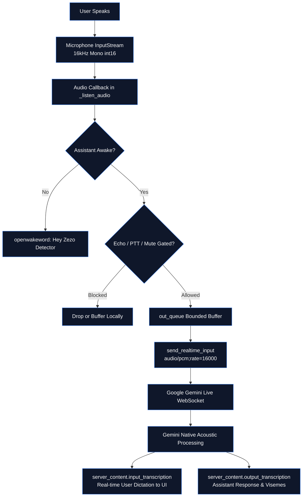

# 🎙️ ZEZO — Speech-to-Text (STT) Architecture

> **Project:** ZEZO  
> **Creator & Lead Architect:** Hamza Bukhari  
> **Target OS:** Windows (Primary), macOS, Linux  
> **Core Principle:** Conversational voice is 100% Google Gemini Live API. Secondary STT engines exist exclusively for background file transcription and offline fallback failover.

---

## 🧭 Conversational Voice: 100% Native Gemini Live

> **ZEZO does NOT use a separate local STT model for its active voice conversation.**

In the live conversation loop (`main.py`), speech recognition is performed natively by the **Google Gemini Live API**:
1. Microphone audio is captured at 16kHz 16-bit mono PCM via `sounddevice.InputStream`.
2. Audio chunks are streamed over the active WebSocket connection with explicit sample rate metadata:
   ```python
   await self.session.send_realtime_input(
       audio=types.Blob(
           data=msg["data"],
           mime_type=f"audio/pcm;rate={SEND_SAMPLE_RATE}",
       )
   )
   ```
3. Gemini Live processes raw audio directly, emitting real-time transcript events (`server_content.input_transcription` for user dictation and `server_content.output_transcription` for assistant speech).
4. No separate Whisper or Vosk instance sits in the conversational path, eliminating transcription latency bottlenecks and memory bloat.

---

## 🔄 Live Audio Transcription Pipeline



---

## 👂 Wake Word Detection (`core/wake_word.py`)

When ZEZO is in **Wake Word Mode** and currently **asleep** (`_awake == False`), audio does **not** stream to Gemini Live. Instead, it is routed strictly to a local keyword detection worker:
- **Engine**: `openwakeword` running locally on CPU.
- **Wake Phrase**: Configured to match `assistant_name` (default: *"Hey Zezo"*).
- **Execution**: Runs on a dedicated daemon thread. Audio blocks are fed non-blocking into a ring buffer.
- **Threshold**: Confidence score >= 0.5 triggers `_on_wake_detected()`, waking the assistant for a 15-second active conversational window.

---

## 📦 Secondary STT Engines (`core/stt.py`)

Secondary STT models exist within `core/stt.py` and `core/voice_fallback.py` for **non-conversational and failover workflows**:

| STT Engine | Module / Backend | Purpose & When Used |
|---|---|---|
| **Groq Whisper** | `whisper-large-v3-turbo` via Groq API | Background audio/video file transcription in `actions/file_processor.py`; secondary STT in offline voice cascade mode |
| **Local Faster-Whisper** | `faster_whisper.WhisperModel` (CPU/CUDA) | Fully offline document/media file ingestion when internet access is absent |
| **Vosk** | `vosk.Model` | Ultra-lightweight local offline backup transcriber |

### Strict Scope Boundary
- Secondary STT engines are **never called during the live Gemini conversation**.
- Heavy file transcription requests are offloaded to background threads managed by `core/task_manager.py`, ensuring the live voice loop remains completely non-blocking.
