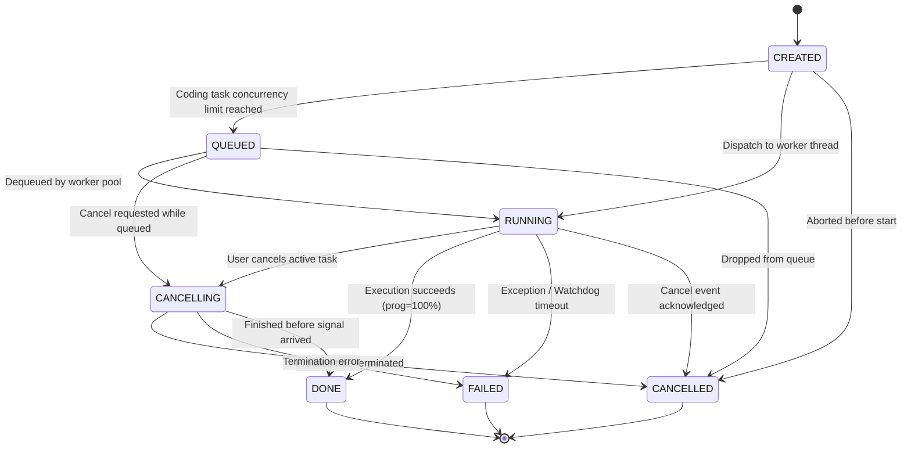

# 🔄 Task Management & Asynchronous Execution Engine

> **Project:** ZEZO  
> **Creator & Lead Architect:** Hamza Bukhari  
> **Source Modules:** [`core/task_manager.py`](file:///d:/anitgravity/zezo%20work/jarvis-57/core/task_manager.py), [`frontend/src/components/tasks/TaskManagerModal.tsx`](file:///d:/anitgravity/zezo%20work/jarvis-57/frontend/src/components/tasks/TaskManagerModal.tsx)  
> **Target OS:** Windows 10/11 (Primary), macOS, Linux  

---

## 📖 Overview

The **Task Management System** provides thread-safe, non-blocking asynchronous job orchestration for ZEZO. When long-running workloads (autonomous code generation, reverse engineering teardowns, site cloning, deep web research) are initiated via voice or UI, ZEZO returns an immediate confirmation with a short `task_id`. 

The underlying workload executes in an isolated daemon thread, emitting real-time progress, log streams, and telemetry updates over WebSockets directly to the **Task Manager Modal** in the frontend HUD.



---

## 📊 The 7-State Monotonic Task Lifecycle

To prevent race conditions, state regression, and conflicting UI updates, `core/task_manager.py` defines a strict 7-state lifecycle governed by monotonic state transitions (`VALID_STATUS_TRANSITIONS`):

| State | Enum Value | Description |
| :--- | :--- | :--- |
| **`CREATED`** | `created` | Task instantiated, parameter envelope validated, and assigned an 8-character hex ID. |
| **`QUEUED`** | `queued` | Task placed into the coding queue waiting for an active execution slot (max 2 concurrent coding tasks). |
| **`RUNNING`** | `running` | Background daemon thread active; process running, reporting log lines and progress percentage. |
| **`CANCELLING`**| `cancelling`| Cancellation initiated by user; sending termination signals to child process tree. |
| **`DONE`** | `done` | Task completed successfully. Progress automatically locked at 100%. |
| **`FAILED`** | `failed` | Task halted due to unhandled exception, syntax failure, or execution timeout. |
| **`CANCELLED`** | `cancelled` | Task cleanly aborted by user; resources released and worktree unmounted. |

---

## 🌲 Hierarchical Tasks & Recursive Cancellation

Tasks in ZEZO can spawn subtasks, forming parent-child relationship trees (`parent_id` and `group_id`):

```
Parent Task: [8f3a1b0c] Full-Stack Feature Rebuild
 ├── Subtask 1: [a19c8e22] Extract Design Tokens (Pam Beesly)
 ├── Subtask 2: [b42d1f90] Backend API Scaffolding (Nexus / Ahmad)
 └── Subtask 3: [c71e405a] Frontend Component Synthesis (Verve)
```

### 1. Recursive Cancellation Trees
When a user cancels a parent task via voice or clicking "Stop" in the UI:
```python
def cancel(self, task_id: str) -> bool:
    with self._lock:
        s = self._tasks.get(task_id)
        ...
        s.cancel_event.set()
        s.status = TaskStatus.CANCELLED
        self._terminate_pid(s.pid)

        # Recursively cancel all active child subtasks
        for child in self._tasks.values():
            if child.parent_id == task_id and child.status not in (TaskStatus.DONE, TaskStatus.FAILED, TaskStatus.CANCELLED):
                child.cancel_event.set()
                child.status = TaskStatus.CANCELLED
                child.message = "Cancelled by parent task"
                self._terminate_pid(child.pid)
```
Child processes and intermediate files are aborted simultaneously, preventing orphan zombie processes.

### 2. Unnotified Child Task Suppression
In voice-driven systems, rogue subtasks firing completion announcements can disrupt ongoing conversation. ZEZO implements strict **Unnotified Child Task Suppression**:
```python
def get_unnotified_finished_tasks(self) -> list[TaskState]:
    with self._lock:
        unnotified = []
        for s in self._tasks.values():
            if s.status in (TaskStatus.DONE, TaskStatus.FAILED, TaskStatus.CANCELLED) and not s.notified:
                # Suppress voice alerts for internal child subtasks
                if s.parent_id or (s.params and s.params.get("is_subtask")):
                    s.notified = True
                    continue
                unnotified.append(s)
        return unnotified
```
Only top-level orchestrations generate spoken voice confirmations, while granular progress remains visible in the UI.

---

## 🚦 Concurrency Limits & Safeguards

To prevent system exhaustion during multi-agent bursts, `TaskManager` enforces hardware-conscious resource fences:

1. **Coding Concurrency Fence:**
   - `MAX_CONCURRENT_CODING_TASKS = 2`: At most two heavy coding agents (OpenCode, Kilo, Antigravity) run simultaneously.
   - Subsequent coding tasks are automatically placed into `_coding_queue` and dequeued in FIFO sequence as active tasks finish.
2. **Cloning Concurrency Fence:**
   - `MAX_CONCURRENT_CLONES = 2`: Managed via `threading.Semaphore(MAX_CONCURRENT_CLONES)`.
3. **Execution Watchdog:**
   - `MAX_WALLCLOCK_SEC = 1200` (20 minutes): Tasks exceeding the hard wall-clock timeout are killed automatically by the background watchdog thread.
4. **Subprocess Termination:**
   - On Windows, process trees are cleanly killed using `taskkill /F /T /PID <pid>` to terminate child nodes (e.g. Node.js or Python child workers).
5. **Deduplication & Voice Debouncing:**
   - Identical URL research or website extraction requests are deduplicated if an identical target is already `RUNNING` or `QUEUED`.
   - Rapid double-invocations (< 8.0s) from live voice streaming are automatically debounced.

6. **Anti-Stall Execution Safeguards & Pre-Flight Provisioning:**
   - Tasks operating on large UI templates avoid 15–20 minute stalls by running pre-flight provisioning before invoking autonomous coding CLIs. The runner generates `< 25 KB` `blueprint.html` and `< 40 KB` `master-template.html` on disk and injects strict non-interactive batch directives, preventing agents from stalling in interactive wait loops or writing intermediate scraping scripts.

---

## 🖥️ Frontend Synchronization (`TaskManagerModal.tsx`)

The frontend Task Manager modal provides continuous visibility into the background execution pool:
- **WebSocket Synchronization:** Subscribes to `task_update` and `task_status` events broadcast by `core/ui_server.py`.
- **Duration & Elapsed Time:** `TaskState.to_dict()` outputs both numeric `elapsed_sec` and formatted `duration` (e.g. `"14s"`), ensuring duration timers render immediately in the task detail drawer.
- **Full Prompt Inspection (`prompt_full`):** `TaskState.to_dict()` serializes the exact prompt string dispatched to the CLI (`prompt_full`, falling back to `enriched_prompt` or `task`).
- **Dispatched Prompt Accordion & Copy:** In the task detail drawer, users can expand the "Dispatched Prompt to CLI" accordion to view the full synthesized instruction and copy it with a single click (`COPY PROMPT`).
- **HUD Card-to-Modal Direct Inspection:** Clicking any task card in the App HUD immediately opens the `TaskManagerModal` and auto-selects the task drawer via `initialTaskId`.
- **Heartbeat Log Streaming:** `TaskManager._report()` streams progress heartbeats even with identical status text when progress advances or when > 3 seconds have elapsed, preventing apparent log starvation during long-running subagent executions.
- **Filtering & Search:** Real-time search across task ID, target repo, and parameters, with status tabs (`ALL`, `RUNNING`, `QUEUED`, `DONE`, `FAILED`).
- **Telemetry Drawer & Failure Callout:** Detailed log viewer with auto-scroll, ANSI escape stripping, CPU/time metrics, and direct copy buttons. In failure states, displays a prominent red Failure Callout Banner highlighting `selectedTask.error` so errors are immediately clear without manual log tracing.
- **Progress Sanitization & Liveness Animation:** Task progress values are strictly rounded/clamped (`Math.round(progress || 0)%`) and animated with active shimmer/pulse effects during running states.
