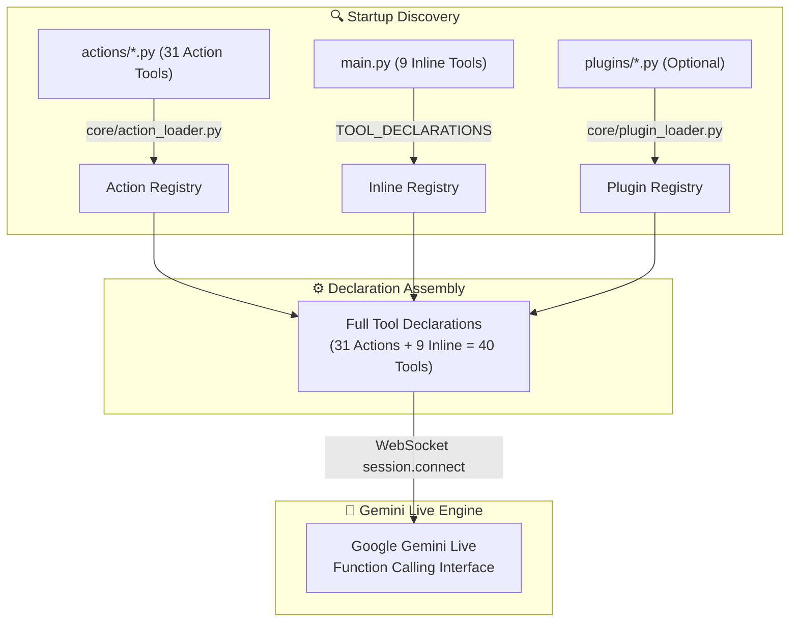
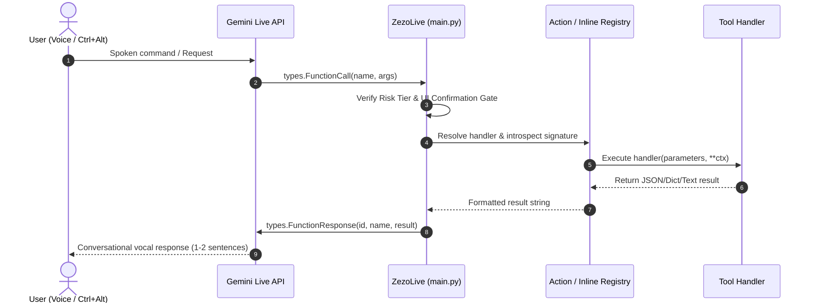

# 🛠️ ZEZO — Tool & Function Calling System

> **Project:** ZEZO (Autonomous Desktop AI Operating System)  
> **Creator & Lead Architect:** Hamza Bukhari  
> **Target OS:** Windows 10/11 (Primary), macOS, Linux  

---

## 📖 Overview

ZEZO implements an extensible, highly robust **dynamic tool & function calling architecture**. Tools are discovered at startup across action modules and inline session hooks, validated against rigorous schemas and security risk tiers, and dynamically bound to Google Gemini Live's WebSocket tool declarations.

Every tool adheres to a standardized schema: an exported `TOOL` dictionary containing its unique identifier `name`, descriptive semantic routing instructions `description`, parameter schema `parameters`, execution callable `handler`, security `risk` tier, and concurrency metadata (`behavior`, `scheduling`).

---

## 🛡️ Tool Discovery & Registration Pipeline

ZEZO categorizes tools into two primary execution models:

### 1. Built-in Action Modules (`actions/*.py`)
- **Loader:** `core/action_loader.py` — `discover_actions()`
- **Mechanism:** Scans the `actions/` directory at startup for `.py` modules exposing a module-level `TOOL` dictionary. Modules are validated for signature introspection, parameter schemas, and mandatory risk tiers. Faulty modules are isolated and logged without terminating the runtime.
- **Supporting Modules:** `actions/screen_processor.py` (provides capture/OCR/vision helpers) and `actions/proactive.py` (background proactive prompt engine).

### 2. Inline Session Tools (`main.py`)
- Defined directly in `TOOL_DECLARATIONS` inside `main.py`.
- Inline tools require direct access to active session state: WebSocket audio streams, camera video view, long-term memory SQLite/JSON transactions, skills catalog persistence, and runtime shutdown signals.

### 3. Dynamic Drop-in Plugins (`plugins/*.py`)
- **Loader:** `core/plugin_loader.py` — `discover_plugins()`
- Scans `plugins/` for custom user scripts exposing a `PLUGIN` dictionary.

---

## 🔒 Security Risk Tiers

Every tool explicitly declares a security classification tier under `TOOL['risk']`. This governs execution sandboxing, confirmation gating, and agent permission boundaries:

| Risk Tier | Definition | Examples |
|-----------|------------|----------|
| `read_only` | Pure querying, parsing, hardware telemetry, or data extraction without altering any local or remote state. | `system_status`, `code_engines_status`, `recall_memory`, `ast_tool`, `task_status`, `web_search` |
| `local_mutation` | Modifies local OS state, files, active desktop windows, reminders, volume, or fleet roster. | `computer_control`, `open_app`, `file_controller`, `manage_monitor`, `fleet_control`, `reminder` |
| `external_mutation` | Transmits outbound data over external networks or third-party communications (e.g., messaging apps). | `send_message`, `agent_reach` |
| `code_execution` | Executes terminal commands, shell scripts, or autonomous multi-file coding synthesis engines. | `quick_snippet`, `antigravity_run`, `opencode_run`, `kilo_run`, `clone_website` |
| `privileged_os` | High-impact system commands (reboot, network adapter toggles, full assistant shutdown). Guarded by UI confirmation tokens. | `shutdown_zezo` |

---

## 📋 Complete Tool Inventory

ZEZO features **40 tools** (31 active action tools + 9 inline tools).

### 1. Coding & Autonomous Multi-Agent Engines

| Tool Name | Origin File | Risk Tier | Behavior | Purpose & Description | Parameters |
|-----------|-------------|-----------|----------|-----------------------|------------|
| `antigravity_run` | `actions/antigravity_agent.py` | `code_execution` | `NON_BLOCKING` | Full autonomous multi-file web app & design synthesis agent via official Antigravity CLI (`agy`). Delegates execution to `core/antigravity_runner.py` with non-interactive batch execution directives, dynamic stdout progress streaming (30% -> 95%), Windows Job Object throttling, recursive snapshot diffing, and stack-aware preview routing. | `task` (req), `project_path`, `model` |
| `opencode_run` | `actions/opencode_agent.py` | `code_execution` | `NON_BLOCKING` | Full autonomous implementation, multi-file code generation, and test suite synthesis engine. | `task` (req), `model`, `project_path` |
| `kilo_run` | `actions/kilo_agent.py` | `code_execution` | `NON_BLOCKING` | Ultra-fast refactoring and multi-file code editing agent (model resolved via `kilo/` prefix aliases). | `task` (req), `model`, `project_path` |
| `quick_snippet` | `actions/quick_snippet.py` | `code_execution` | `BLOCKING` | Fast 1-second inline code snippet generator, single-file editor, code explainer, and silent background terminal/CLI command execution tool. | `action` (req: 'write'\|'edit'\|'explain'\|'run'\|'command'\|'build'\|'auto'), `command`, `description`, `language`, `output_path`, `file_path`, `code`, `args`, `timeout` |
| `code_engines_status` | `actions/code_engines_status.py` | `read_only` | `BLOCKING` | Read-only health inspector for local coding engines (Antigravity CLI, OpenCode, Kilo Code). Reports installation status, authentication, and readiness. | `action` ('list'\|'check'), `engine` ('antigravity'\|'opencode'\|'kilo'), `force` (bool) |
| `ast_tool` | `actions/ast_tool.py` | `read_only` | `BLOCKING` | Structural Python code parser and AST analyzer. Inspects functions, classes, arguments, and calculates cyclomatic complexity hotspots. | `path`, `op` ('inspect'\|'functions'\|'classes'\|'complexity'), `content` |
| `extract_design_system` | `actions/design_extractor.py` | `read_only` | `BLOCKING` | On-demand deterministic design token extractor for HTML files and URLs to generate standalone `DESIGN.md` specifications. | `file_path`, `output_path`, `action`, `force` |
| `fleet_control` | `actions/fleet_control.py` | `local_mutation` | `BLOCKING` | Orchestrates the autonomous multi-agent fleet (Verve, Flux, Ahmad, Michael, Dwight, Kelly, etc.). Supports task dispatch with 5-pillar greenfield intake/commitment gate, entity content forwarding, workspace folder binding (`path`), hiring, firing, role updates, and workflow decomposition. | `action` (req: 'dispatch'\|'hire'\|'fire'\|'update'\|'edit'\|'list_agents'\|'get_status'\|'peer_chat'\|'decompose_workflow'), `agent_id`, `from_agent`, `to_agent`, `task`, `path`, `scope_type`, `entity_content`, `tech_stack`, `color_theme`, `key_sections`, `confirmed`, `upstream_deliverables`, `name`, `role`, `default_tool`, `allowed_tools`, `model_id`, `specialty` |
| `task_status` | `actions/task_status.py` | `read_only` | `BLOCKING` | Queries live background task progress, inspects streaming logs, or cancels running background tasks. | `action` ('status'\|'cancel'), `task_id` |

### 2. Web Intelligence, Reverse Engineering & Browser Automation

| Tool Name | Origin File | Risk Tier | Behavior | Purpose & Description | Parameters |
|-----------|-------------|-----------|----------|-----------------------|------------|
| `browser_control` | `actions/browser_control.py` | `local_mutation` | `BLOCKING` | High-speed native browser automation over CDP/UIA. Drives desktop Chrome: live tab enumeration, title switching, scrolling, click resolution, and accessibility navigation. | `action`, `url`, `query`, `engine`, `selector`, `text`, `direction`, `amount`, `key`, `target`, `urls`, `path`, `headed`, `annotate`, `desktop_only`, `fields` |
| `reverse_engineer` | `actions/reverse_engineer.py` | `read_only` | `NON_BLOCKING` | Native REA (Reverse Engineer Anything) CLI integration. Inspects website DOM, accessibility tree, network headers/bodies, WebGL/shaders, and storage with zero LLM API cost. | `url` (req), `focus` ('full'\|'architecture'\|'apis_network'\|'shaders_webgl'\|'animations') |
| `clone_website` | `actions/website_cloner.py` | `code_execution` | `NON_BLOCKING` | Offline website cloning: deep crawl with asset integrity check, standalone HTML capture, and optional rebuild. Governed by a strict 2-step confirmation gate. | `url`, `mode` ('single_page'\|'full_site'), `output_format`, `target_dir`, `confirmed` (bool), `main_pages_only` (bool) |
| `web_read_page` | `actions/web_reader.py` | `read_only` | `NON_BLOCKING` | Deep web scraping and clean markdown text extraction via Scrapling (Fetcher/StealthyFetcher) with fallback to BeautifulSoup. | `url` (req), `stealth` (bool), `max_chars` (int) |
| `web_search` | `actions/web_search.py` | `read_only` | `BLOCKING` | Ultra-fast 3-tier search engine (Tavily AI <500ms ➔ Gemini Grounded ➔ DDG) with Groq LPU text synthesis. | `query` (req), `mode` ('search'\|'news'\|'research'\|'price'\|'compare'), `items` (int), `aspect` |
| `agent_reach` | `actions/agent_reach.py` | `external_mutation` | `NON_BLOCKING` | Multi-platform intelligence, Whisper transcription, and social discussions (Instagram Reels, TikTok, YouTube, Reddit, GitHub, X, Stack Overflow, Hacker News, RSS). | `target` (req), `platform` (req: 'auto'\|'multi'\|'instagram'\|'tiktok'\|'youtube'\|'reddit'\|'github'\|'twitter'\|'stackoverflow'\|'hackernews'\|'rss'), `output_file` |
| `youtube_video` | `actions/youtube_video.py` | `local_mutation` | `BLOCKING` | Search, open, play, pause, and control YouTube video playback directly in the user's browser. | `action` ('play'\|'pause'\|'resume'\|'stop'\|'next'\|'prev'\|'mute'\|'unmute'), `query`, `save`, `region`, `url` |
| `flight_finder` | `actions/flight_finder.py` | `read_only` | `BLOCKING` | Queries live flight schedules, prices, cabin classes, and availability across routes. | `origin` (req), `destination` (req), `date` (req), `return_date`, `passengers`, `cabin`, `save` |

### 3. OS Automation, Desktop Control & Media

| Tool Name | Origin File | Risk Tier | Behavior | Purpose & Description | Parameters |
|-----------|-------------|-----------|----------|-----------------------|------------|
| `computer_control` | `actions/computer_control.py` | `local_mutation` | `BLOCKING` | Comprehensive OS input automation: mouse clicks, drags, hotkeys, Unicode typing, compound batch macros, window maximize/minimize, safe window close, and 3-tier escalated perception (L1 UIA ➔ L1.5 RapidOCR ➔ L2 Vision). | `action` (req), `sequence`, `text`, `x`, `y`, `x1`, `y1`, `x2`, `y2`, `width`, `height`, `keys`, `key`, `direction`, `amount`, `seconds`, `title`, `monitor_index`, `description`, `type`, `field`, `clear_first`, `path` |
| `computer_settings` | `actions/computer_settings.py` | `local_mutation` | `BLOCKING` | Adjusts OS settings: system volume, display brightness, WiFi toggles, battery status, and GUI undo shortcuts. | `action` (req), `description`, `value` |
| `open_app` | `actions/open_app.py` | `local_mutation` | `BLOCKING` | Launches applications with focus guards, resolves Chrome profiles (`profile='Hamza'`), switches main UI views (`home_view` vs `office_view`), checks software install status, and executes silent winget installations. | `app_name`, `path`, `profile`, `action` ('open'\|'close'\|'check'\|'install') |
| `desktop_control` | `actions/desktop.py` | `local_mutation` | `BLOCKING` | Desktop workspace organization, cleanup, categorization, and shortcut management. | `action` (req), `path`, `url`, `mode`, `task` |
| `file_controller` | `actions/file_controller.py` | `local_mutation` | `BLOCKING` | Local filesystem controller: create, write, read, move, copy, rename, delete files and folders. | `action` (req), `path`, `destination`, `new_name`, `content`, `name`, `extension`, `count` |
| `file_processor` | `actions/file_processor.py` | `read_only` | `NON_BLOCKING` | Reads (`action='read'`), summarizes, analyzes documents, converts images, and resolves lazy file attachments dropped into the UI. | `file_path`, `action`, `instruction`, `format`, `width`, `height`, `scale`, `quality`, `start`, `end`, `timestamp`, `column`, `value`, `condition`, `ascending`, `save`, `destination` |
| `manage_monitor` | `actions/background_monitor.py` | `local_mutation` | `BLOCKING` | Configures continuous background surveillance and tracking topics. | `action` (req: 'add'\|'remove'\|'list'\|'clear'), `topic` |
| `system_status` | `actions/system_monitor.py` | `read_only` | `BLOCKING` | Gathers real-time OS hardware telemetry: CPU load, RAM usage, GPU memory, core temperatures, and system uptime. | None |
| `reminder` | `actions/reminder.py` | `local_mutation` | `BLOCKING` | Schedules system alarms, timers, and scheduled notifications. | `action` ('set'\|'list'\|'clear'\|'dismiss'), `minutes`, `date`, `time`, `message` |
| `weather_report` | `actions/weather_report.py` | `read_only` | `BLOCKING` | Retrieves current meteorological conditions and weather forecasts for any city. | `city` (req) |
| `game_updater` | `actions/game_updater.py` | `read_only` | `BLOCKING` | Checks Steam and Epic Games patch notes and schedules background updates. | `action`, `platform`, `game_name`, `app_id`, `hour`, `minute`, `shutdown_when_done` |
| `send_message` | `actions/send_message.py` | `external_mutation` | `BLOCKING` | Dispatches WhatsApp and Telegram messages with strict search and confirmation governance. | `receiver` (req), `message_text`, `platform` (req: 'WhatsApp'\|'Telegram'), `action` ('search'\|'send') |

### 4. Inline Session Tools (`main.py`)

| Tool Name | Defined In | Risk Tier | Behavior | Purpose & Description | Parameters |
|-----------|------------|-----------|----------|-----------------------|------------|
| `screen_process` | `main.py` | `read_only` | `BLOCKING` | Captures display or webcam, performs RapidOCR text extraction and Gemini multimodal visual inspection. | `angle` ('screen'\|'camera'), `text` (req) |
| `close_camera` | `main.py` | `local_mutation` | `BLOCKING` | Closes active webcam preview display. | None |
| `shutdown_zezo` | `main.py` | `privileged_os` | `BLOCKING` | Shuts down the ZEZO application gracefully. Guarded by confirmation. | None |
| `save_memory` | `main.py` | `local_mutation` | `BLOCKING` | Silently persists important personal facts about the user to SQLite/JSON long-term memory. | `category` (req), `key` (req), `value` (req) |
| `recall_memory` | `main.py` | `read_only` | `BLOCKING` | Looks up stored user facts or performs full-text lexical search across historical conversations. | `query` |
| `undo` | `main.py` | `local_mutation` | `BLOCKING` | Reverses the last reversible action performed by ZEZO (files moved/written, settings toggled). | `action` ('undo'\|'list') |
| `read_skill` | `main.py` | `read_only` | `BLOCKING` | Reads full step-by-step instructions and markdown best practices for an available declarative skill on disk. | `skill_name` (req) |
| `list_skills` | `main.py` | `read_only` | `BLOCKING` | Lists all available skills and workflows with their summary descriptions. | None |
| `save_learned_skill` | `main.py` | `local_mutation` | `BLOCKING` | Autonomously synthesizes and saves a new skill into the persistent skills catalog after completing complex workflows. | `name` (req), `description` (req), `instructions` (req) |

---

## 🔄 Function Calling Execution Lifecycle

The interaction between Google Gemini Live and ZEZO's tool execution engine proceeds in 6 discrete stages:

1. **Model Generates Function Call:** Gemini evaluates the prompt, `{capabilities}` list, and conversation context, emitting a `FunctionCall`.
2. **Main Loop Interception:** `ZezoLive._execute_tool()` extracts tool identifier and argument dictionaries.
3. **Safety & Confirmation Gate:** For irreversible or `privileged_os` actions, a UI-issued token confirmation banner is presented.
4. **Signature Introspection:** `core/action_loader.py` dynamically injects declared context arguments (`player`, `speak`, `session_memory`, `context`).
5. **Non-Blocking / Threaded Execution:** Heavy operations run asynchronously via `asyncio.to_thread` or the background `TaskManager`.
6. **Result Streaming & Brevity Return:** `FunctionResponse` is returned to Gemini Live. The model speaks a concise 1–2 sentence conversational summary.

---

## 🗑️ Purged / Deprecated Tools

The following legacy tools were removed from the codebase and are **no longer supported**:
- `actions/code_helper.py` ➔ Replaced by `actions/quick_snippet.py` (ultra-fast 1s snippets and terminal commands).
- `actions/dev_agent.py` ➔ Replaced by the autonomous fleet orchestrator (`actions/fleet_control.py`) and AST analyzer (`actions/ast_tool.py`).
- `shutdown_jarvis` ➔ Renamed to `shutdown_zezo` (`main.py`).

*Note on Residual References:* Legacy mentions of `code_helper` and `dev_agent` remain in tool docstrings and descriptions across several files (`actions/kilo_agent.py`, `actions/opencode_agent.py`, `core/fleet_manager.py`, `core/governance.py`, `core/llm_client.py`, `core/task_manager.py`) for backward-compatible fallback routing guidance.
