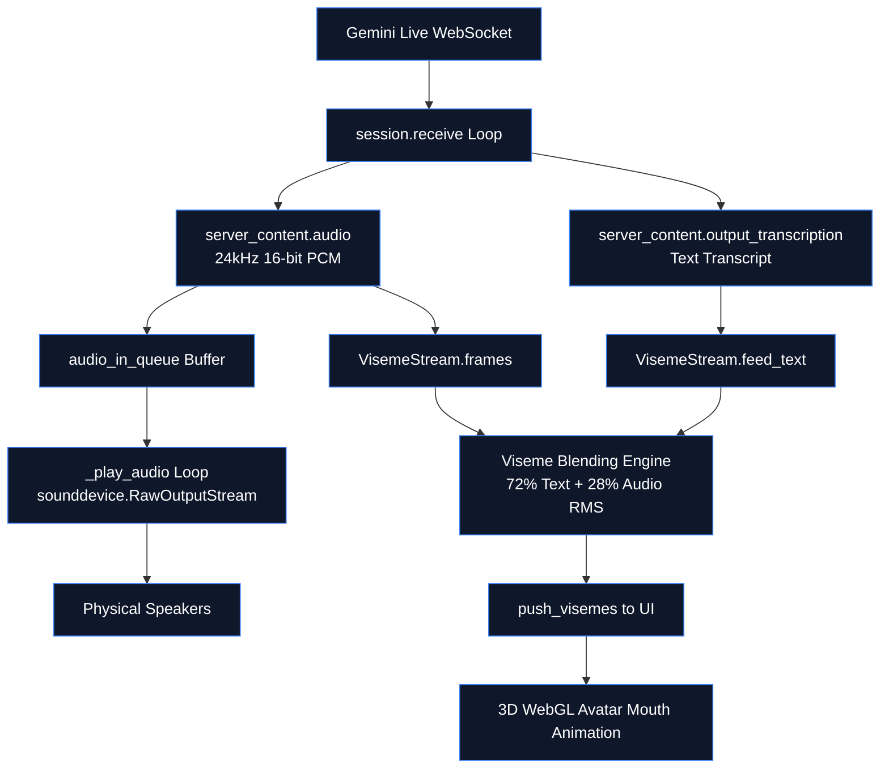

# 🔊 ZEZO — Text-to-Speech (TTS) Architecture

> **Project:** ZEZO  
> **Creator & Lead Architect:** Hamza Bukhari  
> **Target OS:** Windows (Primary), macOS, Linux  
> **Core Principle:** Conversational voice synthesis is 100% native Google Gemini Live API audio streaming. Secondary TTS engines are reserved for offline cascade failover and custom voice cloning.

---

## 🧭 Conversational Voice: 100% Native Gemini Live Audio

> **ZEZO does NOT use a separate TTS model for active conversational speech.**

The Gemini Live model is a **native multimodal audio model**. When initialized with `response_modalities=["AUDIO"]`, Gemini generates raw audio directly as its primary output modality:
- **Audio Output**: 24kHz 16-bit mono PCM audio streamed directly via WebSocket `server_content.model_turn.parts[].inline_data.data`.
- **Text Transcript**: Emitted concurrently via `server_content.output_transcription.text` for UI chat logs and avatar mouth viseme generation.
- **Zero TTS Latency**: Bypasses the traditional multi-stage latency penalty of generating text tokens first and passing them to an external TTS synthesis engine.

---

## 🎭 Native Gemini Live Voice Profiles

Configured via `memory/config_manager.py` (`voice_name`) and ReUI Settings Hub (`Persona`):

| Voice Name | Timbre & Personality Profile | Recommended Use Case |
|---|---|---|
| **`Charon`** (Default) | Technical, crisp, confident, authoritative | Coding, system ops, executive briefings |
| **`Puck`** | Expressive, energetic, bright, conversational | Creative brainstorming, light banter |
| **`Kore`** | Warm, calming, soothing, clear | Narrative explanation, patient tutoring |
| **`Fenrir`** | Deep, executive, commanding presence | Operations management, security audits |
| **`Aoede`** | Highly adaptive, expressive, natural warmth | Daily assistant duties, conversational tasks |

### Dynamic Voice Switching
When the user switches voices in the Settings modal:
1. `SettingsModal.tsx` dispatches `save_customise_settings` over WebSocket.
2. `main.py` saves `voice_name` to `config/api_keys.json`.
3. Triggers `request_reconnect(keep_context=False, reason="new voice")`.
4. Rebuilds the Gemini session with the updated `types.PrebuiltVoiceConfig(voice_name=...)`. `keep_context=False` ensures the server-side voice state is cleanly re-instantiated.

---

## 🔄 Live Audio Playback & Viseme Synchronization

---

## 📦 Secondary TTS Engines (`core/tts.py` & `core/voice_fallback.py`)

Secondary TTS engines are maintained for **offline cascade failover** and **previewing custom voices**:

| TTS Engine | Source / Provider | Characteristics & Use Cases |
|---|---|---|
| **Kokoro TTS** | Local ONNX / PyTorch | High-quality 82M parameter local neural TTS with 0 cloud latency |
| **Edge-TTS** | Microsoft Edge Cloud TTS | High-fidelity multilingual cloud voice synthesis with zero API cost |
| **ElevenLabs** | ElevenLabs REST API | Ultra-premium studio voice cloning (requires `elevenlabs_api_key`) |

Secondary TTS engines are never engaged in the primary conversational path unless Gemini Live encounters connection loss or quota limits and fails over to `VoiceFallback`.
