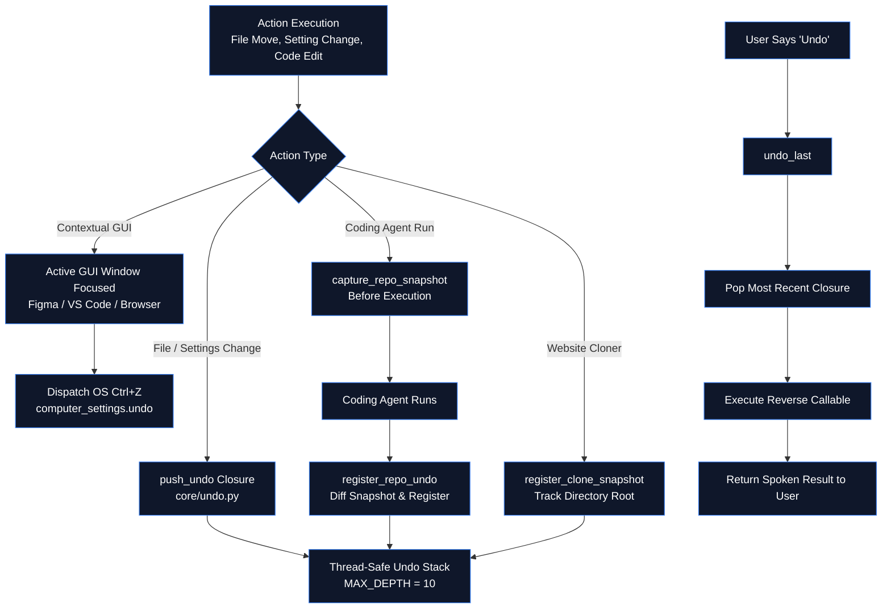

# ↩️ ZEZO — Undo & State Recovery Architecture

> **Project:** ZEZO  
> **Creator & Lead Architect:** Hamza Bukhari  
> **Target OS:** Windows (Primary), macOS, Linux  
> **Core Module:** `core/undo.py`

---

## 🧭 Overview

Voice assistants can misunderstand commands. When an accidental action occurs, apologizing does not restore moved files or reset modified display brightness.

Rather than asking *"Are you sure?"* before every single command (which destroys natural conversational flow), ZEZO adopts an **"Act Immediately, Make Reversible"** design:
1. Reversible actions execute immediately and push a reversal closure onto the undo stack.
2. If the user says *"undo"*, *"undo that"*, or *"reverse"*, ZEZO pops the stack and executes the closure.
3. Confirmation gates (`core/confirm.py`) are strictly reserved for genuinely irreversible actions (shutdown, restart, WiFi toggle).

---

## 🏗️ Architecture & Stack Mechanics



---

## 🎛️ Dual-Layer Undo Architecture

### 1. Contextual GUI Undo (Active Desktop Apps)
When working in desktop applications like Figma, Notepad, VS Code, or a web browser:
- If the user says *"undo that"* or *"Ctrl+Z"*, ZEZO checks active window context.
- Dispatches native OS keyboard shortcuts via `actions/computer_settings.py::undo()`:
  - **Windows / Linux**: `pyautogui.hotkey("ctrl", "z")`
  - **macOS**: `pyautogui.hotkey("command", "z")`
- Ensures on-screen canvas edits or document typing can be instantly reverted without interfering with background system state.

### 2. State & Filesystem Undo (`core/undo.py`)
For system settings, file alterations, and agent modifications, actions register a zero-argument callable via `push_undo()`:

```python
from core.undo import push_undo

old_volume = volume_get()
volume_set(new_volume)
push_undo(f"volume → {new_volume}%", lambda: volume_set(old_volume))
```

- **Stack Capacity**: `MAX_DEPTH = 10` entries (FIFO; oldest dropped when exceeded).
- **Popped Before Execution**: The entry is popped *before* running so a failing undo cannot get stuck in an infinite retry loop.
- **Thread Safety**: All stack mutations are guarded by `threading.Lock()`.

---

## 💻 Autonomous Coding Agent & Repo-Level Undo

Autonomous coding agents (Antigravity CLI, OpenCode, Kilo Code) can modify dozens of files across a repository. To protect user projects, `core/undo.py` provides repository snapshotting:

1. **`capture_repo_snapshot(repo_path)`**:
   - Takes a fast in-memory snapshot of relative file paths and byte contents across the project prior to running an agent task.
   - Automatically ignores `.git`, `node_modules`, `.venv`, `dist`, `build`, and files > 2MB (25MB total memory cap).
2. **`register_repo_undo(repo_path, snapshot, tool_label)`**:
   - Compares the post-execution project state against the pre-execution snapshot.
   - Detects created, modified, and deleted files.
   - Registers a compound rollback closure that deletes newly created files, restores modified files, and recreates deleted files.
   - Pushes an undo entry: `f"{tool_label} changes in {repo_name}"`.

---

## 🌐 Website Cloner Directory Rollback

When `actions/website_cloner.py` crawls and reverse-engineers a website into a desktop directory, it registers an undo handler via `register_clone_snapshot(clone_dir)`:
- If the user says *"undo website clone"*, the generated project directory is cleanly unlinked and removed without touching other workspace folders.

---

## 📋 Undo Capabilities Matrix

| Category | Reversible Actions | Undo Mechanism |
|---|---|---|
| **Active GUI Apps** | Canvas edits, text typing in Figma / VS Code / Browser | Native OS `Ctrl+Z` / `Cmd+Z` |
| **Filesystem** | File move, rename, copy, write, delete, desktop organization | Inverse filesystem operation closure |
| **System Settings** | Volume adjustments, display brightness, dark mode toggle | Previous setting restoration closure |
| **Coding Agents** | Multi-file code generation (Antigravity, OpenCode, Kilo) | Full repo-level file snapshot diff & rollback |
| **Website Cloner** | Scaffolding cloned web projects | Directory deletion rollback |
| **Desktop Cleanup** | `organize_desktop` multi-file batch movement | Journaled restoration of all moved files |

### Irreversible Operations (Confirmation Gate Required)
Operations that **cannot** be undone are guarded by `core/confirm.py`:
- System Shutdown / Restart
- WiFi Network Adapter Disconnect
