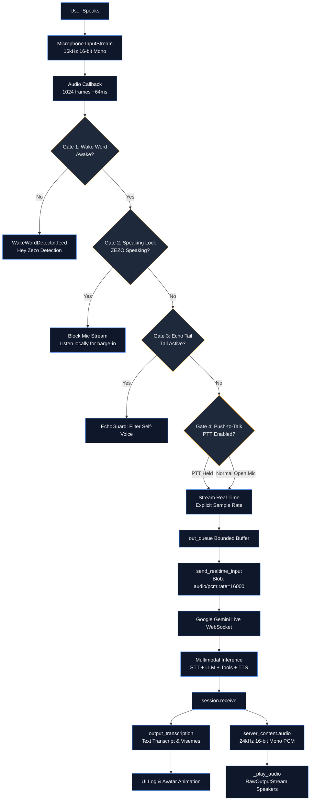

# 🎙️ ZEZO — Voice Pipeline Architecture

> **Project:** ZEZO  
> **Creator & Lead Architect:** Hamza Bukhari  
> **Target OS:** Windows (Primary), macOS, Linux  
> **Core Engineering Rule (AGENTS.md Rule 6):** Audio and voice pipeline code is finely calibrated and hardware-dependent. Google Gemini Live API bidirectional WebSocket PCM streaming is the sole active conversational voice brain. Secondary STT/TTS engines are strictly for offline failover and background/telemetry tasks.

---

## 🧭 Architecture Overview

ZEZO's active conversational voice pipeline runs **100% via the Google Gemini Live API** (`main.py` bidirectional WebSockets PCM audio streaming loops `_listen_audio`, `_receive_audio`, and `_play_audio`). There is **no separate STT or TTS model running in the conversational loop**:

- **Microphone Capture**: Raw 16kHz 16-bit mono PCM is streamed directly to Gemini Live over WebSocket in real time.
- **Speech-to-Text & Reasoning**: Gemini Live's unified multimodal model transcribes, reasons, and invokes tools natively within the stream.
- **Text-to-Speech**: Gemini Live synthesizes 24kHz PCM audio natively alongside text transcripts, streamed directly into `_play_audio()`.
- **Secondary STT / TTS**: `core/stt.py`, `core/tts.py`, and `core/voice_fallback.py` (Whisper, Kokoro, Edge-TTS, Vosk) are strictly reserved for offline failover, background workers, and telemetry tasks—never for the active conversation.

---

## ⚙️ Pipeline Modes

ZEZO supports two voice pipeline architectures:

### UI Initialization Contract

The pipeline and assistant settings controls are defined in the frontend ES module. The module must parse completely before `socket.connect()` runs; otherwise the browser cannot register `saveCustomiseSettings`, `togglePipelineMode`, `applyPreset`, or `savePipelineSettings`. Keep the WebSocket connection call after all UI handler declarations, and syntax-check the complete module after editing it.

### 1. Gemini Live (Active Conversational Brain — Default)

**Mode**: `pipeline_mode = "live"`

All audio processing occurs within a single Google Gemini Live bidirectional WebSocket session:
- **STT**: Google native acoustic speech recognition (real-time streaming)
- **LLM**: Gemini 2.0 / 3.x Flash native reasoning and function-calling
- **TTS**: Gemini native synthetic neural voice (`Puck`, `Charon`, `Fenrir`, `Kore`, `Aoede`)
- **Barge-in**: User can interrupt mid-response via live mic energy gating or Push-to-Talk
- **Tool-calling**: Zero-latency native function invocation with inline client content roundtrips
- **End-to-End Latency**: ~200–500ms

**Best for**: Real-time fluid conversations, instant tool execution, natural interruption.

### 2. Cascade Mode (Offline Fallback & Custom Engines)

**Mode**: `pipeline_mode = "cascade"`

Decoupled pipeline where each stage runs locally or on custom endpoints (used when offline or explicitly enabled):

| Stage | Options | Source |
|---|---|---|
| **STT** | `local_whisper`, `groq_whisper`, `vosk` | Config key `stt_engine` |
| **LLM** | `groq`, `gemini`, `ollama` | Config key `llm_engine` |
| **TTS** | `kokoro`, `edge_tts`, `elevenlabs` | Config key `tts_engine` |
| **Voice** | Engine-specific | Config key `tts_voice` |

**Engine runthrough**:
1. User speech → `transcribe_utterance(engine=stt_engine)`
2. Text → `llm_generate(engine=llm_engine)` → response
3. Response → `make_tts(engine=tts_engine, voice=tts_voice)` → audio

**Presets** (UI one-click):
- **Gemini Live**: Live mode (fastest, best conversational quality)
- **Cloud Fast**: `groq_whisper` + `groq` + `edge_tts` (good quality, low cost)
- **Balanced**: `groq_whisper` + `groq` + `kokoro` (local TTS, cloud inference)
- **Fully Offline**: `local_whisper` + `ollama` + `kokoro` (0 cloud, local LLM)

### 3. Voice Fallback Failover & Error Surfacing

**Mode**: `voice_fallback = "auto" | "off"` (Config key `voice_fallback`)

Controlled via the UI toggles in Settings:
- **`auto` (Default)**: If the Gemini Live WebSocket connection drops, encounters a network timeout, or hits quota limits, ZEZO immediately fails over to the local/cascade voice loop (`VoiceFallback`) without dropping user interaction.
- **`off`**: Automatic failover is strictly disabled. Instead of falling back to offline engines, the exact connection, authentication, or model error is rendered directly to the HUD (`ERR: Live connection failed: ...`), and the user is informed with a prompt to toggle Fallback ON if offline voice is desired.
- **Direct Groq Key Entry**: The Voice Pipeline modal includes an inline Groq API key configuration card that saves directly to local `config/api_keys.json` and dynamically refreshes telemetry warnings without modal swapping.

---

## 🔄 Complete Voice Interaction Flow (Gemini Live)



---

## 🔍 Detailed Transition Mechanics

### Transition 1: User Speaks → Microphone Callback
**File:** `main.py` (`_listen_audio`)

The `sounddevice.InputStream` is opened with a non-blocking PortAudio callback:
```python
sd.InputStream(
    samplerate=16000,
    channels=1,
    dtype="int16",
    blocksize=1024,
    device=mic_dev,
    callback=callback,
)
```
The callback fires whenever ~64ms of audio is captured on a dedicated PortAudio audio worker thread.

### Transition 2: Microphone Audio Gating
The callback enforces four sequential gates:
1. **Wake Word Gate**: While asleep (`_awake == False`), audio is routed strictly to the local `openwakeword` detector. No audio is streamed externally.
2. **Speaking Lock**: While ZEZO is speaking (`_is_speaking == True`), mic frames are blocked from external streaming to prevent self-interruption, but monitored locally for user barge-in.
3. **Echo Tail Guard**: After ZEZO finishes speaking, a ~260ms window (`_out_latency + _TAIL_MARGIN`) checks `EchoGuard.is_user_speech` to drop residual room echo of the assistant's own voice.
4. **Push-to-Talk Gate**: When PTT is enabled, audio streams only while the `Ctrl+Alt` chord is actively held.

### Transition 3: Audio Streaming & Explicit Sample Rate Rule
**File:** `main.py` (`_send_realtime`, `_listen_audio`)  
**Core Rule (AGENTS.md Rule 6):** When streaming PCM mic chunks to Gemini Live, always include the explicit sample rate. Never send bare `audio/pcm`:

```python
# main.py line 2010
await self.session.send_realtime_input(
    audio=types.Blob(
        data=msg["data"],
        mime_type=f"audio/pcm;rate={SEND_SAMPLE_RATE}",
    )
)
```

### Transition 4: Push-to-Talk Real-Time Streaming & 0.5s Delayed Turn Commit
**Commit:** `fd7fcfa` update  
**File:** `main.py` (`_on_ptt`, `_listen_audio`)

- **Real-Time Streaming**: Rather than bulk-buffering audio locally in memory, audio chunks are streamed in real time through `out_queue` while `Ctrl+Alt` is held.
- **50ms Brush-Protection Debounce**: If the hotkey was released less than 50ms ago, subsequent accidental brush taps are ignored to prevent cutting off mid-sentence speech.
- **0.5s Delayed Turn Commit**: Upon releasing `Ctrl+Alt`, an asynchronous daemon thread sleeps for 0.5s before enqueuing `{"audio_stream_end": True}`:
  ```python
  def _delayed_stream_end():
      import time as _t
      _t.sleep(0.5)
      if self._loop and self._loop.is_running():
          self._loop.call_soon_threadsafe(
              self._enqueue_out_audio,
              {"audio_stream_end": True}
          )
  threading.Thread(target=_delayed_stream_end, daemon=True).start()
  ```
  This 0.5-second buffer prevents premature server VAD turn completion during brief natural pauses at the end of speech.

### Transition 5: Gemini Live Response Handling & Visemes
**File:** `main.py` (`_receive_audio`)

Gemini Live produces both text and audio concurrently:
- `sc.output_transcription.text`: Model's spoken words transcribed.
- `server_content.model_turn.parts[].inline_data.data`: Raw 24kHz PCM audio bytes.
- Transcripts feed into `VisemeStream.feed_text()`, which blends 72% text-determined mouth shapes with 28% audio envelope energy for high-fidelity avatar mouth animation.

### Transition 6: Audio Playback & Cursor Tracking
**File:** `main.py` (`_play_audio`)

Playback utilizes `sounddevice.RawOutputStream`:
```python
sd.RawOutputStream(
    samplerate=24000,
    channels=1,
    dtype="int16",
    blocksize=0,
    device=output_dev,
)
```
The audio cursor (`_play_cursor`) tracks exact hardware playback timing to coordinate viseme rendering with speaker output.

---

## 🛡️ Audio Hardware Disconnect & Resilience Strategy

Per **AGENTS.md Rule 6**, ZEZO must **never crash the live session on hardware errors**:
- **Microphone Fallback (`_listen_audio`)**: If the saved microphone is missing, unplugged, or permission-denied, ZEZO attempts to resolve the system default. If no working input device exists:
  ```python
  if _mic_stream is None:
      print("[Zezo] ⚠️ No working microphone found or permission denied — running in silent/text mode (UI, Text, and Remote ready).")
      self.ui.write_log("SYS: Microphone unavailable — running in text/remote mode.")
      while True:
          await asyncio.sleep(2.0)
  ```
- **Speaker Fallback (`_play_audio`)**: If the output endpoint cannot be opened, ZEZO prints an alert, logs to the HUD, and continues operating in visual/text mode without throwing an unhandled exception.
- **TaskGroup Integrity**: By keeping the worker tasks alive in a non-crashing sleep loop, the session `TaskGroup` remains active, allowing text chat, remote gateway controls, and tools to operate unimpeded.

---

## ⏱️ Timing Constants Reference

| Constant | Value | Purpose |
|---|---|---|
| `SEND_SAMPLE_RATE` | 16000 Hz | Microphone PCM sample rate |
| `RECEIVE_SAMPLE_RATE` | 24000 Hz | Speaker output PCM sample rate |
| `CHUNK_SIZE` | 1024 frames | Audio frames per PortAudio callback (~64ms) |
| `_VIS_HOP` | 480 | Viseme frame step (20ms at 24kHz) |
| `_VIS_WIN` | 1024 | Viseme analysis window (~43ms) |
| `_TAIL_MARGIN` | 0.06s | Echo tail margin beyond measured output latency |
| `WAKE_SLEEP_TIMEOUT` | 120.0s | Auto-sleep timeout after silence |
| `PTT_COMMIT_DELAY` | 0.5s | Turn commit delay upon hotkey release |
| `PTT_DEBOUNCE` | 50ms | Brush-protection debounce threshold |

---

## 🔄 Offline Voice Fallback Loop (`core/voice_fallback.py`)

When offline or when Gemini Live quota limits are reached, the secondary cascade loop executes:
1. **Continuous Full-Duplex Mic**: `sd.InputStream` runs on a dedicated thread with `UtteranceSegmenter` (180ms VAD pause, 600.0 RMS energy gate).
2. **3-Layer Intent Routing**:
   - **Layer 1: Fast Deterministic Matcher (0ms LLM)**: Exact regex matches for app launches, volume, media control (`core/fast_intent.py`).
   - **Layer 2: Laya Intent Router**: Secondary intent classification with confidence thresholding >= 0.75 (`core/laya_router.py`).
   - **Layer 3: Groq LLM & Streaming TTS**: Token streaming to Kokoro/Edge-TTS.
3. **Instant Barge-In**: User speech detection triggers `sd.stop()` in <20ms, incrementing `_generation_id` and draining in-flight audio queues.
