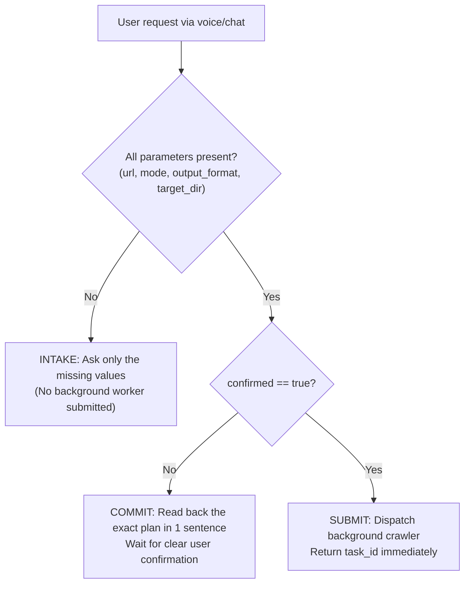
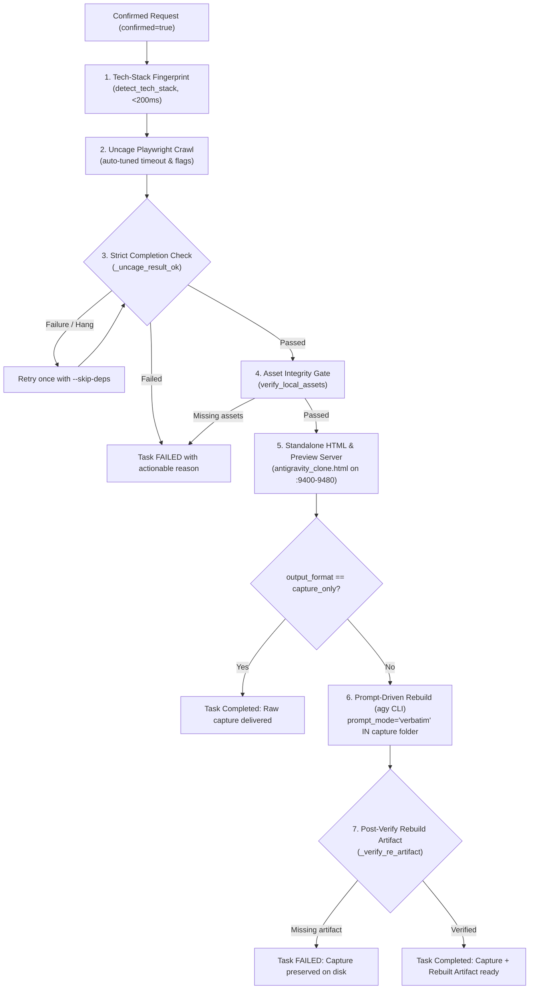

# 🌐 Website Cloner & Reverse Engineering Pipeline (v6)

> **Creator & Lead Architect:** Hamza Bukhari  
> **Action Module:** `actions/website_cloner.py` (`clone_website` tool)  
> **Capture Engine:** `tools/uncage/bin/uncage.js` (bundled Playwright extractor — zero external path dependency)  
> **Coding Engine (Rebuild):** `actions/antigravity_agent.py` → local Antigravity CLI (`agy`)  
> **Workspace Routing:** `core/repo_context.py` (`get_unique_clone_dir`, `register_rebuild`)  
> **Parallel Teardown Engine:** `actions/reverse_engineer.py` (documented in [`docs/REVERSE_ENGINEERING.md`](docs/REVERSE_ENGINEERING.md))  

---

## 📖 1. Overview & Architectural Principles

`clone_website` creates an exact offline capture of a website's static frontend, then optionally rebuilds that capture into a clean, modern, and editable deliverable in the user's requested tech stack.

### Critical Distinction Between Cloner & Teardown Engines:
- **Website Cloner (`clone_website`):** Offline DOM snapshotting, stylesheet/script localization, and prompt-driven reverse-engineering into `rebuilt.html` or `rebuilt_app/`. Used when the user requests an "offline copy", "HTML clone", or "download website".
- **REA Teardown Engine (`reverse_engineer`):** Headless Chrome CDP scenario interception via `rea-agents@6.7.0` producing 0-LLM evidence envelopes (`evidence.json`, `blueprint.md`) in `~/Desktop/ZEZO_Teardowns/`. Used when the user asks for a "scaffold", "teardown", "stack inspection", or "deep reverse engineering". See [`docs/REVERSE_ENGINEERING.md`](docs/REVERSE_ENGINEERING.md).

---

## 🔒 2. Two-Step Stateless Confirmation Gate

The clone operation never executes on the initial tool invocation. It enforces a strict, stateless two-step gate to ensure voice and intent accuracy before triggering heavy browser crawlers.



### Gate Implementation Invariants:
1. **Stateless by Design:** The confirmation gate stores zero state in memory between calls. Because ZEZO resolves active sessions per utterance, stateful flags would be wiped between turns. The gate reads only the arguments provided to the current tool invocation.
2. **Read-Back Fidelity:** The read-back names the real, resolved destination directory on disk (e.g., `Desktop/<domain>_clone`) rather than a relative path, ensuring the user understands where files will land.
3. **Triggering Submission:** Only when `confirmed=true` is passed alongside all parameters does the tool submit a task to the `TaskManager`.

---

## ⚙️ 3. Pipeline Execution Stages



### Stage 1: Tech-Stack Fingerprint (`detect_tech_stack`)
Lightweight HTTP HEAD/GET probe (<200 ms) inspecting response headers and early HTML chunk to detect frameworks (Next.js, React, WordPress, Shopify, Wix, Squarespace, Framer, Webflow). This provides informational context and informs the rebuild prompt clause.

### Stage 2: Uncage Playwright Crawl (`run_uncage_exporter`)
- Subprocess execution using bundled Node.js script `tools/uncage/bin/uncage.js`.
- Automatically adjusts scope flags:
  - `single_page`: 1 page, max depth 1.
  - `full_site`: up to 25 pages, max depth 2.
  - `--no-purge`: Always set to preserve dynamic CSS classes evaluated at runtime.
  - `--timeout`: Explicit per-page navigation budget (30,000 ms single page / 45,000 ms crawl).
  - Degraded retry: If a crawl stalls on deep JS bundle scanning, retries once with `--skip-deps`.

### Stage 3: Strict Completion Check (`_uncage_result_ok`)
Success requires all four criteria to be satisfied:
1. Subprocess exit code `0`.
2. `asset-map.json` exists (written only after extraction is 100% complete).
3. `index.html` exists and is an assembled page (not a raw interim capture).
4. No surviving `captured-raw*.html` files remain in the root directory.

### Stage 4: Asset Integrity Gate (`verify_local_assets`)
Validates that every local asset reference pointing to `assets/` exists on disk. Skips external URLs, `data:`, `mailto:`, and anchor links. Prevents shipping broken or unstyled pages.

### Stage 5: Standalone Preview Server
- Produces `antigravity_clone.html` as a faithful, offline-compatible mirror of `index.html`.
- Spawns an ephemeral `ThreadingHTTPServer` on the first available port in the range `9400–9480`.
- Automatically launches the system browser for instant preview.

---

## 🏗️ 4. v6 Prompt-Driven Reverse Engineering Rules

When `output_format` is not `capture_only`, ZEZO triggers the reverse-engineering rebuild phase:

### Rule 1: The Raw Capture Folder is Never Modified
- The coding engine operates directly inside the capture folder (`Desktop/<domain>_clone/`).
- The original `index.html`, `assets/`, `asset-map.json`, and `antigravity_clone.html` remain completely untouched.

### Rule 2: Single-File Rebuilds Land in `rebuilt.html`
- When `output_format="raw_html"`, the rebuilt output is written to `rebuilt.html` inside the capture directory.
- This ensures relative asset paths (`assets/...`) resolve seamlessly on the same preview server.

### Rule 3: Project Rebuilds Land in `rebuilt_app/`
- When rebuilding into complex project frameworks (e.g. `react`, `nextjs`, `php`, or custom stacks), all generated project files land inside a dedicated `rebuilt_app/` subdirectory.
- This prevents overwriting Uncage's root `package.json` and `README.md`.

### Rule 4: `prompt_mode="verbatim"`
- Bypasses the default 6,000-character prompt cap.
- Prevents the coding engine from injecting generic architectural blueprints or conflicting boilerplate.
- The caller owns the entire system directive, tailoring the instruction precisely to the detected source markup and target stack.

### Rule 5: Authoritative Post-Verification (`_verify_re_artifact`)
- Completion is determined by inspecting the filesystem for required deliverables (`RE_ARTIFACT_SPECS`), never by trusting the LLM's conversational claim.
- If the artifact fails verification, the task reports failure but preserves the capture folder so the user can dispatch a specialist fleet agent (`fleet_control(action='dispatch', path=...)`).

---

## 📦 5. Tool Declaration Reference

```python
TOOL = {
    "name": "clone_website",
    "description": (
        "ONLY use this tool when the user explicitly asks to 'clone this website', 'save an offline copy', "
        "'download HTML/CSS copy of this site', or 'mirror this site'. "
        "DO NOT use for 'rebuild', 'scaffold', 'teardown', or 'reverse engineer' requests — those MUST dispatch reverse_engineer instead."
    ),
    "parameters": {
        "type": "OBJECT",
        "properties": {
            "url": {
                "type": "STRING",
                "description": "The full HTTP/HTTPS URL of the website to capture."
            },
            "mode": {
                "type": "STRING",
                "enum": ["single_page", "full_site"],
                "description": "Capture scope. Defaults to single_page unless full mirror is explicitly requested."
            },
            "output_format": {
                "type": "STRING",
                "description": "Deliverable format: 'raw_html' (default single file), 'react', 'nextjs', 'php', 'capture_only', or any user-named stack."
            },
            "target_dir": {
                "type": "STRING",
                "description": "Target folder on disk. Defaults to ~/Desktop/<domain>_clone."
            },
            "confirmed": {
                "type": "BOOLEAN",
                "description": "Set to true ONLY after ZEZO has read back the plan and the user explicitly approved."
            },
            "main_pages_only": {
                "type": "BOOLEAN",
                "description": "For full_site crawls, limits capture to sitemap priority >= 0.5."
            }
        },
        "required": ["url"],
    },
    "handler": clone_website_action,
}
```
