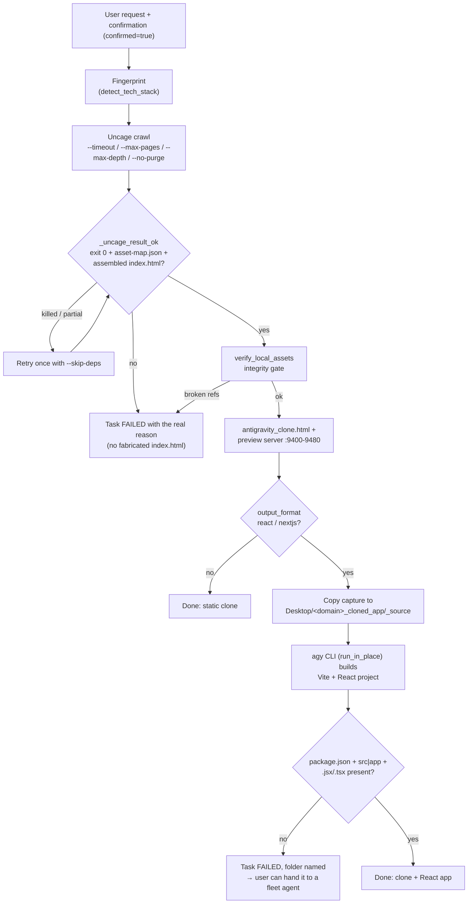

# 🌐 Website Cloner & Capture Pipeline (v5)

> **Action:** `actions/website_cloner.py` (`clone_website`)
> **Engine:** `tools/uncage/bin/uncage.js` (bundled — zero external path dependency)
> **Coding engine (React rebuild):** `actions/antigravity_agent.py` → local `agy` CLI
> **Workspace routing:** `core/repo_context.py` (`get_unique_clone_dir`, `get_unique_rebuild_dir`)
> **Undo integration:** `core/undo.py` (`register_clone_snapshot`)

---

## 📖 Overview

`clone_website` produces an offline copy of a site's static frontend, then optionally rebuilds
that copy as a real React project. The pipeline:

1. **Tech-stack fingerprint** (`detect_tech_stack`, <200 ms, informational only — it no longer picks the engine).
2. **Uncage crawl** (`run_uncage_exporter`) — Stealth Playwright extraction of the rendered DOM,
   stylesheets, fonts and media, plus `asset-map.json`. Flags are auto-tuned from the requested scope.
3. **Strict completion check** (`_uncage_result_ok`) — a run counts as success only when the
   assembler actually finished (see below).
4. **Asset integrity gate** (`verify_local_assets`) — every reference that resolves into `assets/`
   must exist on disk, otherwise the task fails instead of shipping an unstyled page.
5. **Standalone HTML** — `antigravity_clone.html`, byte-faithful to the captured `index.html`.
6. **Ephemeral preview** — local HTTP server (ports 9400-9480) opened in the default browser.
7. **Optional React/Next rebuild** — ZEZO's own coding engine turns the capture into a Vite + React
   project in a sibling folder. Only runs when `output_format` is `react` or `nextjs`.



---

## 🛠️ TOOL declaration

```python
TOOL = {
    "name": "clone_website",
    "parameters": {
        "type": "OBJECT",
        "properties": {
            "url": {"type": "STRING"},
            "mode": {"type": "STRING", "enum": ["single_page", "full_site"]},
            "output_format": {"type": "STRING", "enum": ["static", "clean_html", "react", "nextjs"]},
            "target_dir": {"type": "STRING"},
            "confirmed": {"type": "BOOLEAN"},
            "main_pages_only": {"type": "BOOLEAN"},
        },
        "required": ["url"],
    },
    "handler": clone_website_action,
}
```

`mode`, `output_format` and `target_dir` are **intentionally undocumented defaults**: the schema tells
the model to omit any of them the user did not state, and the handler then asks for exactly those.

---

## 🔒 Two-step confirmation gate (`clone_website_action`)

The clone never starts on the first call.

| State | Condition | Behaviour |
|---|---|---|
| 1. Intake | one of `mode` / `output_format` / `target_dir` missing | returns questions for the missing values only; no task submitted |
| 2. Commit | all three present, `confirmed` not `true` | returns a one-sentence read-back (URL, page scope, format, folder); no task submitted |
| 3. Submit | all three present + `confirmed=true` | submits the background worker |

A present parameter means "the user said this"; absent means "still unknown". The read-back is also
the last defence against a misheard URL or folder in a voice-first product.

**The gate is stateless on purpose.** `main.py` never sets a `session_id`, so `core/action_loader`
always resolves the session as `"global"`, and `main.py` resets `"global"` on every user utterance and
every turn-complete — a stored "already asked" flag would be wiped before it could be read. Do not
make this stateful.

---

## ⚙️ Pipeline components

### 1. Uncage crawl with auto-tuned flags (`run_uncage_exporter`)

| Flag | Rule |
|---|---|
| `-o`, `--max-pages`, `--max-depth` | from `mode` (1 page / up to 25 pages, depth 2) |
| `--timeout` | always explicit: 30 000 ms single page, 45 000 ms crawl (Uncage's **per-page navigation** budget) |
| `--no-purge` | always (fidelity first: PurgeCSS can drop classes applied only at runtime) |
| `--priority-only` | only for `full_site` when the user asks for the main pages only (sitemap priority ≥ 0.5) |
| `--skip-deps` | **degraded retry only**, after a wall-clock kill — skips the unbounded JS module dependency scan that is the usual cause of a hang |
| `--ignore-robots`, `--safe-mode`, `--no-headless`, `--keep-analytics` | **never auto-set** |

Two different timeouts exist and must not be conflated: ZEZO's wall-clock budget
(`crawl_timeout_budget`: 150 s single page, `min(600, max(180, 60 + pages*40))` for a crawl, staying
under `TaskManager.MAX_WALLCLOCK_SEC = 1200`) and Uncage's own per-page `--timeout`. A Python reader
thread plus `queue.Queue` evaluates the deadline while waiting, so a **silently stalled** child is
killed too — the old `readline()` loop could only check the clock after a line arrived.

### 2. Strict completion check (`_uncage_result_ok`)

Success requires all four: exit code 0, `asset-map.json` present (the extractor's last write — proof
extraction finished), an `index.html` that is not a `captured-raw*` snapshot (proof compile finished),
and no surviving `captured-raw*.html` (proof the assembler cleanup ran). Each miss returns a message
naming what was missing.

There is deliberately **no fallback that promotes a raw capture to `index.html`**: that path is what
previously reported a half-extracted bundle as a successful clone while every `/assets/...` reference
404'd.

### 3. Asset integrity gate (`verify_local_assets`)

Counts only references that normalise into `assets/` (Uncage's namespace), skipping absolute URLs,
`data:`, `mailto:`, `javascript:`, `#` and anything with a query/fragment — so a missing
`/favicon.ico` or `robots.txt` can never fail a good clone. A miss raises: task FAILED, no preview
opened. Not applied to the HTTrack `full_site` branch.

### 4. Standalone HTML and preview

`antigravity_clone.html` is a verbatim copy of the captured `index.html`
(`_faithful_cleanup`) — the point of a clone is fidelity, not a rewrite. The preview server is an
ephemeral `ThreadingHTTPServer` on the first free port in 9400-9480.

### 5. ZEZO-native React/Next rebuild (`_run_react_rebuild`)

- Runs **after** the static clone has been delivered, so a failed rebuild can never cost the capture.
- `get_unique_rebuild_dir(domain)` → `Desktop/<domain>_cloned_app`; the capture is copied to
  `_cloned_app/_source` so the engine can read it inside its own `--add-dir` sandbox.
- The engine is called in place — `antigravity_action({... "project_path": app_dir, "run_in_place": True,
  "task_ctx": ctx, "skip_design": True, "skip_preview": True})` — so the build reports into the clone's
  own task card instead of spawning a second task. `skip_design` keeps a Hamza Taste blueprint from
  being injected over the captured design; `skip_preview` suppresses the engine's `file://` preview,
  which renders blank for a Vite source tree.
- **Never a fleet dispatch:** both routes reach the same `_run_worker` → `agy.exe`, so the fleet would
  only add attribution, a second task card and office-deck animation to byte-identical codegen.
- **Post-verify is authoritative, not the engine's own claim:** `package.json`, a `src/` or `app/`
  folder, and at least one `.jsx`/`.tsx` file must exist, otherwise the task fails with the folder
  named so the user can hand it to an agent (`fleet_control(action='dispatch', path=...)`).

### 6. Real deliverables

A completed clone folder contains `index.html`, `assets/`, `asset-map.json`, `package.json`,
`README.md`, `antigravity_clone.html` and `.gitignore` — Uncage's output plus ZEZO's additions. It is
**not** "strictly index.html and assets/". React rebuilds add a sibling `_cloned_app/` folder.
