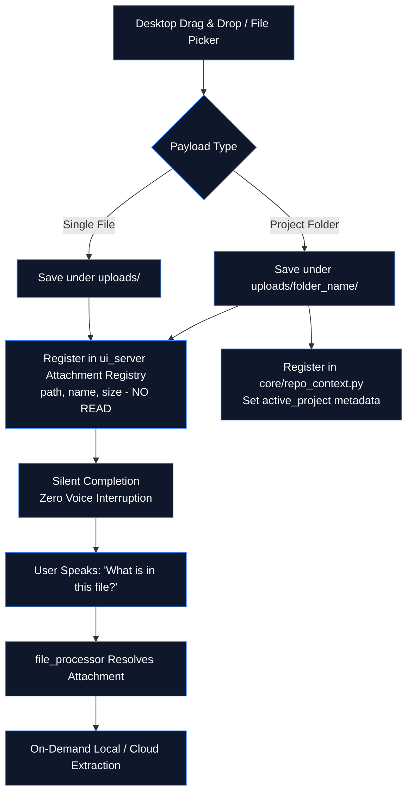

# 📁 Workspace Ingestion & Multi-Format Payload Engine

> **Project:** ZEZO  
> **Creator & Lead Architect:** Hamza Bukhari  
> **UI Component:** `frontend/src/` Dropzone & Payload Ingestion  
> **Server Ingestion:** `core/ui_server.py` (`_upload_handler` + attachment registry)  
> **Workspace Context:** `core/repo_context.py` (`register_rebuild`, `remember_repo`, `forget_repo`)  
> **Desktop Path Resolver:** `actions/open_app.py` (`_fuzzy_match_desktop`)  
> **Extraction Engine:** `actions/file_processor.py` (`_resolve_attachment`)  

---

## 🧭 Architecture Overview

The **Workspace Ingestion Engine** allows users to drag-and-drop files (PDFs, DOCX, Code, Audio, Video) or entire multi-file project directories (HTML/CSS/JS, React, Python) directly into the ZEZO interface.

### The "Attach, Don't Read" Principle
Dropping or uploading a file registers it by **path only** — no premature text extraction, no synthetic Gemini Live turn, and no spoken audio interruption. The voice loop remains completely uninterrupted. ZEZO stays silent until the user explicitly asks about the file (e.g., *"summarize this PDF"* or *"refactor the uploaded component"*), at which point `file_processor` reads the attachment on demand in a non-blocking background task.



---

## 🔍 Desktop Workspace Resolution (`_fuzzy_match_desktop`)

When opening an application, project directory, or generated build deliverable on the desktop, absolute paths may differ slightly from user colloquial speech (e.g., user asks to *"open my Stripe clone"* while the directory on disk was saved as `stripe.com_rebuild`).

### Implementation: `actions/open_app.py::_fuzzy_match_desktop(raw_p)`
1. **Desktop Inspection**: Inspects `Path.home() / "Desktop"` when a relative or absolute path does not exist directly on disk.
2. **Tokenization & Stopwords**: Strips generic stopwords (`clone`, `rebuild`, `frontend`, `site`, `website`, `com`, `net`, `dev`, `app`) and tokenizes directory names.
3. **Score & Recency Ranking**: Matches token overlaps and normalized string boundaries, sorting by match score and latest modification timestamp (`st_mtime`).
4. **Automatic Entrypoint Discovery**: If a matched directory contains an `index.html`, `_fuzzy_match_desktop` automatically returns the path to `index.html`, enabling instant OS launch via Windows `os.startfile`.

---

## 🛠️ Active Rebuild Workspace Registration (`register_rebuild`)

When website cloner or scaffolding agents generate a new project build (e.g. under `~/Desktop/<domain>_rebuild/`), `core/repo_context.py` registers the directory as the primary active workspace:

```python
# core/repo_context.py
def register_rebuild(rebuild_path: str | Path, entrypoint: str = "index.html") -> Path:
    """Register and persist a newly rebuilt project directory as the active workspace.
    
    Saves active_project and active_file into memory/repo_context.json.
    Synchronizes with the runtime memory manager.
    """
```

### Key Engineering Guarantees
- **Persistent Context**: Saves `active_project`, `active_file`, and `last_active_repo` into `memory/repo_context.json`.
- **Automatic Coding Engine Targeting**: Autonomous agents (`antigravity_run`, `opencode_run`, `kilo_run`) automatically target the newly registered workspace folder without requiring the user to re-specify paths.
- **Self-Directory Protection**: `is_zezo_source_dir` strictly prevents the ZEZO source repository itself from being overwritten or registered as a throwaway rebuild folder.

---

## 📦 Supported File Formats & Extraction Ladder (On-Demand)

Files are attached silently with `engine: "attached"`. Extraction engines execute **only when the user requests an inspection**:

| File Format | Extensions | Extraction Ladder (Local First) | Output |
|---|---|---|---|
| **Code & Text** | `.txt`, `.py`, `.js`, `.json`, `.md`, `.html`, `.css`, `.tsx` | Direct disk read (UTF-8 / Latin-1) | Raw source code |
| **Documents** | `.docx`, `.xlsx`, `.pptx`, `.epub` | Local (`python-docx`, `openpyxl`, `python-pptx`) | Structured plain text |
| **PDF (Text Layer)** | `.pdf` | Local `pdfplumber` (Fast, 0 cloud cost) | Extracted text |
| **PDF (Scanned)** | `.pdf` | Gemini Files API REST upload (>2MB resumable) | Multimodal markdown |
| **Images** | `.png`, `.jpg`, `.jpeg`, `.webp` | Gemini Multimodal Vision ladder | Detailed visual description / OCR |
| **Audio** | `.mp3`, `.wav`, `.m4a`, `.ogg`, `.flac` | Groq Whisper (`whisper-large-v3-turbo`) | Fast timestamped transcript |
| **Video** | `.mp4`, `.mov`, `.mkv`, `.webm` | `ffmpeg` audio strip → Groq Whisper | Synchronized audio transcript |
| **Project Trees** | Directory archives | Recursive directory walker (≤5,000 files) | Hierarchical file tree |

---

## ⚙️ Ingestion Protocol & Safety Rules

1. **Lazy Read Invariant:** Attaching is decoupled from reading. A drop action must never block the voice WebSocket or inject unsolicited turns into Gemini Live.
2. **Single-Drop Event Propagation:** Handled exclusively by the `#dropzone-box` event listener with `e.stopPropagation()` to prevent duplicate upload requests.
3. **Bounded Memory Capping:** Directory scans are capped at 5,000 files; attachment history keeps the 50 most recent uploads.
4. **On-Demand Background Tasking:** Reading large files (>10MB) or multi-file repositories dispatches through `core/task_manager.py`, returning a task ID immediately so the assistant remains responsive.
