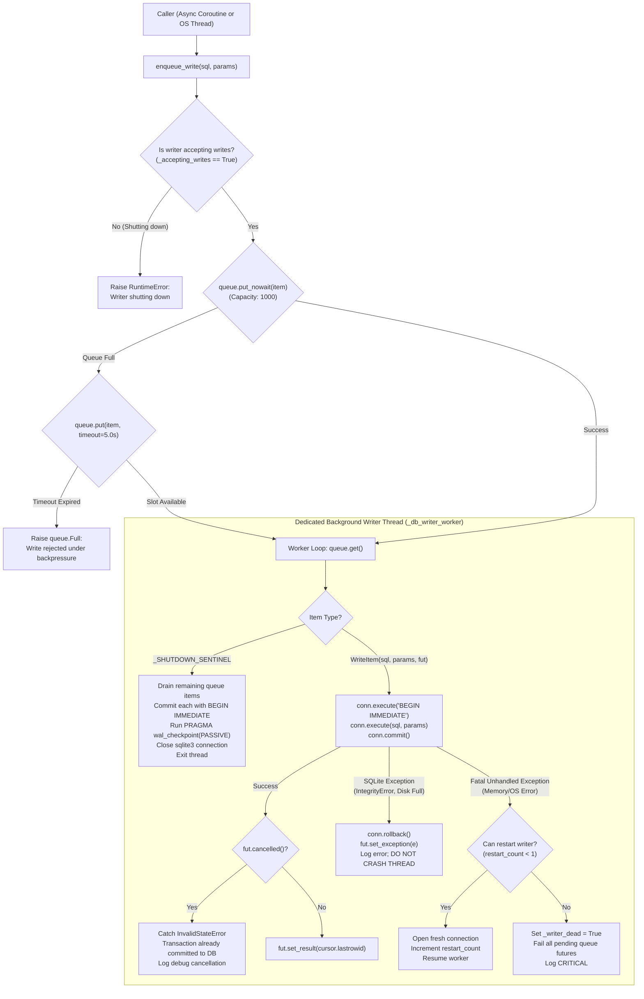
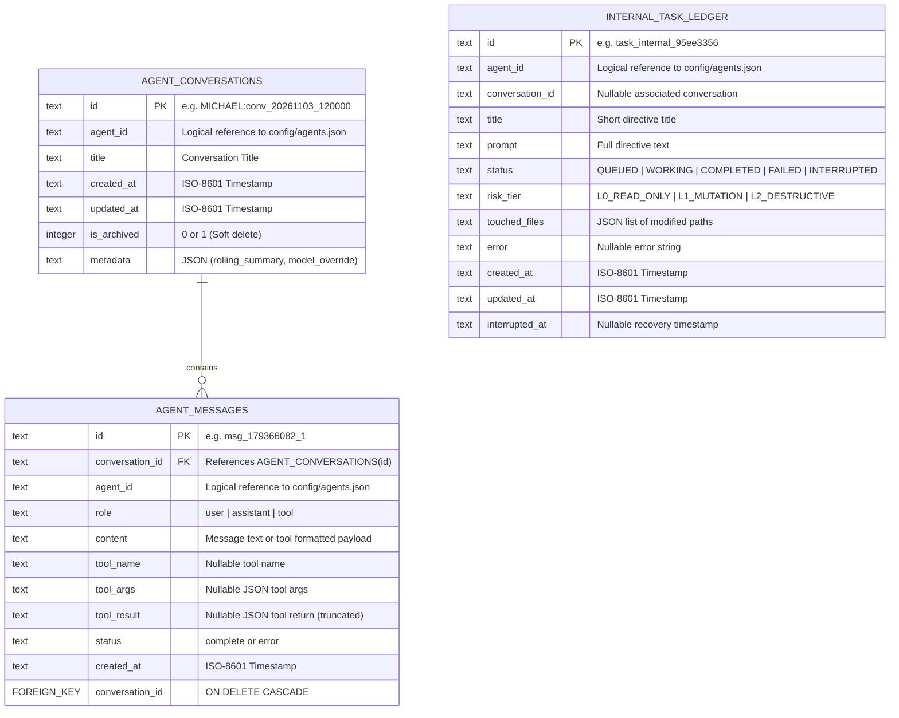

# 🏗️ Phase 1 Implementation Blueprint: Internal Agent Runtime Foundation

> **Project:** ZEZO Autonomous Desktop AI Operating System  
> **Creator & Lead Architect:** Hamza Bukhari  
> **Document Type:** Step-by-Step Engineering Blueprint (Phase 1 Revision 5 — Hardened Technical Specification)  
> **Target Platform:** Windows 10/11 (Primary), macOS, Linux (Future)  
> **Baseline References:** [`ZEZO_ARCHITECTURE_REDESIGN_PROPOSAL.md`](file:///c:/Users/Hamza%20Bukhari/Documents/antigravity/jarvis-57/Proposal/New%20Architecture%20Redesign/ZEZO_ARCHITECTURE_REDESIGN_PROPOSAL.md), [`ADR_Section23_Decisions.md`](file:///c:/Users/Hamza%20Bukhari/Documents/antigravity/jarvis-57/Proposal/New%20Architecture%20Redesign/ADR_Section23_Decisions.md)  
> **Operational Mode:** Architectural Blueprint Only. Zero Code Changes Executed.  
> **Revision History:** R1 (Initial) → R2 (ADR Aligned) → R3 (Production Hardened) → R4 (Final Technical Revision) → **R5 (Hardened: Read Confidentiality, Enforceable Boundary, Token Strategy, Task Side Effects & DB Resilience)**

---

## 📌 Ground Truth Baseline: Verified Codebase Facts

All claims below were verified by direct source inspection on the live repository at `2026-11-03`.

### [Verified Fact] Tool Execution Paths — Five Independent Dispatch Vectors

The following five distinct tool execution paths exist in ZEZO. Currently, **none** enforce agent-level tool permissions:

| # | Execution Path | Location | Permissions Check | Path Validation |
|:--|:--|:--|:--|:--|
| 1 | `_run_tool_dispatch()` → inline handler map | [`main.py:2094-2101`](file:///c:/Users/Hamza%20Bukhari/Documents/antigravity/jarvis-57/main.py#L2094-L2101) | ❌ None | ❌ None |
| 2 | `_dispatch_action_registry()` → `ActionRegistry.run()` | [`main.py:2103-2116`](file:///c:/Users/Hamza%20Bukhari/Documents/antigravity/jarvis-57/main.py#L2103-L2116) | ❌ `run()` checks `rec.enabled` only — not agent identity | ❌ None |
| 3 | `_plugin_registry.run()` | [`main.py:2125-2130`](file:///c:/Users/Hamza%20Bukhari/Documents/antigravity/jarvis-57/main.py#L2125-L2130) | ❌ None | ❌ None |
| 4 | `core/confirm.py` deferred execution via `_do_execute_confirmed()` | [`main.py:2198-2203`](file:///c:/Users/Hamza%20Bukhari/Documents/antigravity/jarvis-57/main.py#L2198-L2203) | ❌ Re-dispatches via `_run_tool_dispatch` without agent context | ❌ None |
| 5 | MCP tool dispatch via dynamically generated `_mcp_dispatch_handler()` | [`core/action_loader.py:542-547`](file:///c:/Users/Hamza%20Bukhari/Documents/antigravity/jarvis-57/core/action_loader.py#L542-L547) | ❌ Runs through `ActionRegistry.run()` | ❌ None |

**Inline tools** (dispatched at path #1) are: `screen_process`, `close_camera`, `read_skill`, `list_skills`, `save_learned_skill`, `shutdown_zezo`.

### [Verified Fact] Existing Path Handling and Security Gaps

- `actions/file_controller.py` defines `_FORBIDDEN_ROOTS` (lines 103–108) and `_is_safe_path()` (line 110) which blocks writes to `C:\Windows`, `C:\Program Files`, `C:\ProgramData` using `Path.resolve()`. This is a system-level write denylist, not a workspace jail.
- `core/governance.py:_check_path_safety()` (line 173) uses `os.path.normpath` against forbidden system directories.
- **Neither** resolves Windows symlinks, junctions, or NTFS reparse points. Neither enforces workspace containment for custom agents.
- `actions/file_processor.py` has **zero** path validation — calls `resolve_path()` from `core/file_reader.py` which performs fuzzy-matching and user shorthand expansion but no security boundary enforcement. An agent calling `file_processor` can currently read any file readable by the Windows user process.

### [Verified Fact] Existing Risk Taxonomy & Governance Choke Point

- `core/governance.py` defines a 5-tier `ToolRisk` enum: `READ_ONLY`, `LOCAL_MUTATION`, `EXTERNAL_MUTATION`, `CODE_EXECUTION`, `PRIVILEGED_OS`.
- Each action TOOL dict declares `risk` at the module level. `ActionRegistry._validate()` enforces that `risk` exists and matches the valid set.
- **Governance evaluates every tool call** in `main.py:_execute_tool()` at line 2183 before dispatch. However, governance operates on the **tool name and arguments** — it has no knowledge of which **agent** is requesting the tool, so agent-specific permission enforcement does not exist.

### [Verified Fact] SQLite Concurrency Architecture

- `memory/sqlite_memory.py` uses `_db_lock = threading.Lock()` (line 43) as a global mutex.
- Write operations (e.g., `log_turn`, `record_learn`, `delete_fact`) spawn **transient daemon threads** (line 287: `threading.Thread(target=_insert, daemon=True).start()`), each acquiring `_db_lock` and opening a new `sqlite3.Connection`.
- Read operations acquire the same lock synchronously.
- There is **no dedicated writer thread**, **no queue**, and **no connection reuse**.
- WAL mode is set per-connection via `PRAGMA journal_mode = WAL;` (line 112), but is re-negotiated on every connection open.

### [Verified Fact] Dependencies and Token Counting Infrastructure

- **No `agents` table in SQLite.** `memory/zezo_brain.db` contains: `facts`, `turns`, `turns_fts`, `user_explicit_rules`, `memory_conflicts`, `session_condensations`, `deleted_fact_tombstones`.
- **Agent configuration lives in `config/agents.json`** — loaded and watched by [`core/agents/registry.py`](file:///c:/Users/Hamza%20Bukhari/Documents/antigravity/jarvis-57/core/agents/registry.py).
- **Multi-provider infrastructure exists:** `core/llm_client.py` (Ollama, OpenAI-compatible, Groq), `core/gemini.py` (Gemini Live/REST).
- **Confirmation gate:** `core/confirm.py` provides an in-memory token-based confirmation bound to the desktop UI HUD and live speech recognition.
- **`tiktoken` availability:** `tiktoken` is installed in the active developer Python environment, but **is NOT listed in `requirements.txt`**. Relying on it in production requires formally adding `tiktoken>=0.7,<1` to `requirements.txt` as a Phase 1 prerequisite.
- **Gemini SDK `count_tokens`:** Native server-side token counting is available via `client.models.count_tokens()` (verified in `google-genai` SDK).

---

## A. Executive Summary

### 1. Phase 1 Objective

Phase 1 establishes a robust, single-agent internal runtime foundation for ZEZO. It proves that **one custom agent** can be:

1. Created and configured with secure least-privilege defaults (`L0_READ_ONLY`, curated read tools).
2. Managed through persistent configurations without dual-source drift (`config/agents.json` authoritative).
3. Engaged in multi-turn conversational dialogue with dynamic, provider-agnostic tool calling.
4. Bound to persistent independent chat conversations stored in SQLite (`agent_conversations` and `agent_messages`).
5. Buffered through a thread-safe, non-blocking single-writer SQLite architecture (`queue.Queue` with backpressure, transaction rollback, and WAL mode).
6. Protected by a defense-in-depth Windows path security strategy enforcing read confidentiality and write containment with clearly documented residual risks.
7. Reconciled cleanly upon application crash/restart, offering an explicit restart action that reruns the original prompt from scratch rather than falsely claiming mid-step resumption, with explicit accounting for duplicate tool side effects.

All external coding engines (OpenCode, Kilo, Antigravity CLI worktrees) and multi-agent peer orchestration remain **strictly quarantined** until this internal runtime foundation passes all three verification layers.

---

## B. Deep-Dive Resolution of Five Core Architectural Concerns

### 1. Windows Path Security: Read Confidentiality & Defense-in-Depth Strategy

#### 1.1 Read Confidentiality Threat Model: Why Read-Only Is NOT Zero Risk

> [!WARNING]
> **Read-only access without path containment is an acute security vulnerability.**  
> Assuming `L0_READ_ONLY` presents "zero risk" ignores the catastrophic impact of unauthorized data exfiltration and credential disclosure.

If a custom agent with read-only tools (e.g. `file_processor`) is not constrained to an explicit workspace jail, an attacker or injected prompt can read:
1. `config/api_keys.json` — Extracting Gemini, Groq, OpenRouter, and Tavily API keys.
2. `.env` and environment configuration files containing database passwords and secret tokens.
3. Windows user profile credentials: `C:\Users\<user>\.ssh\id_rsa`, `C:\Users\<user>\.aws\credentials`, `C:\Users\<user>\.git-credentials`.
4. Browser profiles and session data: `C:\Users\<user>\AppData\Local\Google\Chrome\User Data\...`.
5. Proprietary source code and documents outside the active project directory.

#### 1.2 Filesystem Vectors on Windows: Traversal, Junctions, Symlinks, and TOCTOU

| Attack Vector | Read Impact | Write Impact | PathJail Mitigation | Residual Risk |
|:--|:--|:--|:--|:--|
| **Path Traversal** (`..\..\config\api_keys.json`) | Exposes sensitive application secrets | Overwrites external system files | `os.path.realpath()` resolves traversals; containment check verifies target is under workspace root | None. Fully prevented. |
| **NTFS Junction** (`workspace\link` → `C:\Users\AppData`) | Reading `workspace\link\secrets.json` leaks host data | Writing corrupts external user files | `os.path.realpath()` traverses the junction to its actual target *before* the containment check | Symlinks created by administrator or external processes during execution window. |
| **Symlink File Swap** (`workspace\log.txt` → `id_rsa`) | Reading `log.txt` returns user SSH private key | Overwrites target file | `os.path.realpath()` resolves target file to its canonical location; fails containment check | TOCTOU race window. |
| **Case-Insensitive Bypass** (`C:\WORKSPACE` vs `c:\workspace`) | Bypasses naive string prefix checks | Bypasses naive string prefix checks | `os.path.normcase()` normalizes drive letters and casing | None. Fully prevented. |
| **TOCTOU Race** (Path checked as normal file, replaced with symlink before `open()`) | Handler reads sensitive target file via redirected handle | Handler writes to sensitive target file | Minimized window (resolve immediately prior to invocation), multi-layer defense | **Residual Risk:** Unprivileged userspace code on Windows cannot eliminate TOCTOU without OS-level sandboxing (AppContainer/Sandbox). |

#### 1.3 Security Checks Required Before Every File Access

Every file-bearing tool (`file_processor`, `file_controller`, etc.) MUST submit its path parameters to `PathJail.secure_resolve_path()` **before opening any file handle for reading or writing**.

```python
# core/path_jail.py
import os
from pathlib import Path

class SecurityAccessDenied(PermissionError):
    """Raised when a file operation targets a path outside the workspace jail."""
    pass

def secure_resolve_path(
    target_path: str | Path,
    workspace_root: str | Path,
    allow_nonexistent: bool = False,
) -> Path:
    """
    Defense-in-depth Windows path resolution enforcing strict workspace containment.
    
    Security Checks Applied:
      1. Workspace validation: Workspace root must exist and canonicalize cleanly.
      2. Reparse point resolution: Resolves all symlinks, NTFS junctions, and mount points
         to their canonical target on disk using os.path.realpath().
      3. NTFS case normalization: Uses os.path.normcase() to prevent casing bypasses.
      4. Strict boundary containment: Verifies that the resolved canonical target path
         is equal to or a subpath of the canonical workspace root.
      5. Non-existent file safety (writes): Canonicalizes nearest existing ancestor directory
         to ensure file creation cannot occur through a junctioned parent.
    """
    if not target_path or not str(target_path).strip():
        raise SecurityAccessDenied("Target path cannot be empty.")

    # 1. Canonicalize workspace root (must be an existing directory)
    try:
        ws_real = Path(os.path.realpath(str(workspace_root))).resolve(strict=True)
        if not ws_real.is_dir():
            raise SecurityAccessDenied(f"Workspace root is not a directory: {ws_real}")
    except Exception as e:
        raise SecurityAccessDenied(f"Invalid workspace root '{workspace_root}': {e}")

    # 2. Convert target to absolute relative to workspace root if relative
    raw_target = Path(target_path)
    if not raw_target.is_absolute():
        raw_target = ws_real / raw_target

    # 3. Canonicalize target by fully resolving symlinks, junctions, and traversals
    try:
        target_real = Path(os.path.realpath(str(raw_target)))
        if not allow_nonexistent:
            if not target_real.exists():
                raise FileNotFoundError(f"Path does not exist: {target_real}")
    except FileNotFoundError:
        if not allow_nonexistent:
            raise
        # For new files: resolve and validate the nearest existing parent directory
        parent_real = Path(os.path.realpath(str(raw_target.parent)))
        if not parent_real.exists():
            raise SecurityAccessDenied(
                f"Parent directory does not exist: {raw_target.parent}"
            )
        parent_norm = os.path.normcase(str(parent_real))
        ws_norm = os.path.normcase(str(ws_real))
        if not (parent_norm == ws_norm or parent_norm.startswith(ws_norm + os.sep)):
            raise SecurityAccessDenied(
                f"Parent directory escapes workspace jail:\n"
                f"  Target: {raw_target}\n"
                f"  Resolved Parent: {parent_real}\n"
                f"  Workspace Root: {ws_real}"
            )
        target_real = parent_real / raw_target.name
    except Exception as e:
        raise SecurityAccessDenied(f"Path resolution failed: {e}")

    # 4. Enforce strict containment check using normalized casing
    ws_norm = os.path.normcase(str(ws_real))
    target_norm = os.path.normcase(str(target_real))

    if not (target_norm == ws_norm or target_norm.startswith(ws_norm + os.sep)):
        raise SecurityAccessDenied(
            f"Access Denied: Path escapes workspace boundary!\n"
            f"  Target (resolved):   {target_real}\n"
            f"  Workspace jail root: {ws_real}"
        )

    return target_real
```

#### 1.4 Honest Assessment of Residual Risks

| Residual Risk | Impact | Realistic Assessment | Why It Cannot Be Eliminated in Phase 1 |
|:--|:--|:--|:--|
| **TOCTOU Read Race** | Attacker swaps a validated file to a junction before `open()` is called by the action | **Medium** (requires concurrent malicious process executing as the same Windows user) | Userspace Python on Windows cannot atomically lock path resolution across third-party Python file libraries without OS AppContainer sandboxing. |
| **Host Process Authority** | If an agent bypasses ToolExecutor, it inherits full privileges of the ZEZO user process | **High** if bypass occurs; **Low** if ToolExecutor choke point holds | Python runs as a single runtime process; Phase 1 relies on architectural isolation rather than OS user separation. |
| **Alternate Data Streams (ADS)** (`file.txt:secret`) | May conceal metadata or secondary streams | **Low** (standard file reads do not target ADS) | Fully blocking NTFS ADS requires low-level Win32 file attribute inspection before open. |

---

### 2. ToolExecutor: Enforceable Security Boundary & Identity Protection

#### 2.1 Complete Dispatch Audit: Five Insecure Existing Paths

Currently, tool dispatch in `main.py` is fragmented across multiple entry points:
1. `_run_tool_dispatch()` directly calls inline tools (`screen_process`, `shutdown_zezo`, `skills`).
2. `_dispatch_action_registry()` calls `ActionRegistry.run()` without agent scoping.
3. `_plugin_registry.run()` executes plugins directly.
4. `core/confirm.py:_do_execute_confirmed()` re-dispatches approved calls without retaining agent identity.
5. Dynamically generated MCP dispatch handlers call `ActionRegistry.run()` directly.

#### 2.2 Technical Enforcement Architecture: No Bypass Possible

Python does not provide memory-level private variables or method sealing. Therefore, technical enforcement must be achieved through **strict architectural decoupling, injection boundaries, and unforgeable caller contexts**:

```mermaid
flowchart TD
    subgraph AgentBoundary["AgentRuntime Execution Context"]
        AGENT["AgentRuntime Instance\n(Holds self._agent_id from profile)"]
        NO_REG["❌ NO ActionRegistry Reference"]
        NO_MOD["❌ NO actions.* Direct Imports"]
        TOOL_CALL["Tool Call Initiated"]
        AGENT --> TOOL_CALL
    end

    TOOL_CALL -->|Calls execute()| TE["ToolExecutor.execute(\n  tool_name,\n  params,\n  caller_context=CALLER_AGENT,\n  agent_id=self._agent_id,\n  workspace=self._workspace\n)"]

    subgraph SecurityBoundary["ToolExecutor Security Boundary"]
        TE --> V_CTX{"1. Validate Context &\nAgent Identity"}
        V_CTX -- "caller_context == AGENT and agent_id is None" --> ERR_FORGE["❌ SecurityAccessDenied:\nForged Anonymous Identity"]
        V_CTX -- "agent_id != authenticated_id" --> ERR_SPOOF["❌ SecurityAccessDenied:\nAgent Identity Spoofing"]
        V_CTX -- "Valid Agent Identity" --> V_TOOL{"2. Is tool in\nagent.allowed_tools?"}
        
        V_TOOL -- "Not in whitelist" --> ERR_AUTH["❌ SecurityAccessDenied:\nTool Not Assigned to Agent"]
        V_TOOL -- "Whitelisted" --> V_PATH{"3. Does tool accept\nfile or directory path?"}
        
        V_PATH -- "Yes" --> JAIL["PathJail.secure_resolve_path()\n(Read & Write containment)"]
        JAIL -- "Escapes workspace" --> ERR_JAIL["❌ SecurityAccessDenied:\nWorkspace Escape Attempt"]
        JAIL -- "Contained" --> V_RISK{"4. Tool Risk Tier\nClearance"}
        V_PATH -- "No" --> V_RISK
        
        V_RISK -- "L2_DESTRUCTIVE" --> CONFIRM["core.confirm.request()\n(UI + Voice Approval Gate)"]
        CONFIRM -- "Approved" --> DISPATCH["Internal Handler Dispatch\n(Action / MCP / Plugin)"]
        CONFIRM -- "Rejected" --> ERR_REJ["❌ UserRejectedAction"]
        V_RISK -- "L0_READ / L1_MUTATION" --> DISPATCH
    end

    subgraph MainSessionBoundary["Main ZEZO Voice Session (main.py)"]
        VOICE["Gemini Live Voice Loop"] -->|caller_context=CALLER_MAIN_SESSION,\nagent_id=None| TE
        V_CTX -- "caller_context == MAIN_SESSION\n(Restricted to main.py caller)" --> SKIP_AGENT["Pass Main Session Tools\n(Governed by core/governance.py)"]
        SKIP_AGENT --> V_PATH
    end
```

#### 2.3 Protection Against Identity Forgery (`agent_id=None`)

In naive implementations, an agent might pass `agent_id=None` to impersonate the main session and gain full privileges. In Phase 1:
1. `caller_context` is an explicit typed enum: `CallerContext.AGENT` vs `CallerContext.MAIN_SESSION`.
2. `AgentRuntime` hardcodes `caller_context=CallerContext.AGENT` and passes its immutable `self._agent_id`.
3. `ToolExecutor` validates:
   ```python
   if caller_context == CallerContext.AGENT:
       if not agent_id or not isinstance(agent_id, str):
           raise SecurityAccessDenied("Agent execution requires a valid, non-null agent_id.")
       if agent_id not in self._registry.get_registered_agent_ids():
           raise SecurityAccessDenied(f"Unknown or unauthenticated agent_id: {agent_id}")
   elif caller_context == CallerContext.MAIN_SESSION:
       # Only callers with verified internal main session token can claim MAIN_SESSION
       if caller_token != self._main_session_secret:
           raise SecurityAccessDenied("Unauthorized claim of MAIN_SESSION privileges.")
   ```

#### 2.4 Bypass Inventory and Mitigations

| Bypass Attempt | Attack Description | Concrete Mitigation |
|:--|:--|:--|
| **Anonymous Self-Promotion** | Agent passes `agent_id=None` or empty string to get main session bypass | `ToolExecutor` requires `CallerContext.AGENT`; rejects null/empty `agent_id` with `SecurityAccessDenied`. |
| **Agent Identity Spoofing** | Agent passes `agent_id="ZEZO_ADMIN"` | `agent_id` is passed by `AgentRuntime` from its loaded profile, never read from LLM response or user chat payload. |
| **Direct Handler Import** | Agent attempts code execution to import `actions.file_processor` | `AgentRuntime` executes in Phase 1 with `L0_READ_ONLY` tools; has no Python `eval()`, `exec()`, or terminal/code execution tools. |
| **Direct `ActionRegistry.run()`** | Code bypasses `ToolExecutor` and calls `ActionRegistry.run()` | `AgentRuntime` receives only a `ToolExecutor` reference via dependency injection; has no reference to `ActionRegistry`. |
| **MCP Tool Circumvention** | Dynamic `mcp_*` tools run through a backdoor | MCP tools are registered as actions and routed through `ToolExecutor.execute()`. They must be explicitly listed in `agent.allowed_tools`. |
| **Deferred Confirm Hijack** | `confirm.py` callback re-executes without agent context | `confirm.py` request payload stores `agent_id` and `caller_context`. On confirmation, re-dispatch passes the original security context. |

#### 2.5 Verification Tests: Actual Execution Path Verification

Testing must execute actual Python invocation paths, not merely grep source code strings:

```python
# tests/test_tool_choke_point.py (Phase 1 Step 4)
import pytest
from core.tool_executor import ToolExecutor, CallerContext, SecurityAccessDenied

def test_agent_cannot_forge_main_session():
    """Verify an agent caller cannot claim main session privileges."""
    executor = ToolExecutor(...)
    with pytest.raises(SecurityAccessDenied, match="Unauthorized claim"):
        executor.execute("computer_control", {}, caller_context=CallerContext.MAIN_SESSION, caller_token="fake_token")

def test_agent_cannot_pass_none_agent_id():
    """Verify an agent cannot bypass checks by passing agent_id=None."""
    executor = ToolExecutor(...)
    with pytest.raises(SecurityAccessDenied, match="requires a valid, non-null agent_id"):
        executor.execute("file_processor", {}, caller_context=CallerContext.AGENT, agent_id=None)

def test_unauthorized_tool_execution_blocked():
    """Verify tool not in allowed_tools is blocked before handler invocation."""
    executor = ToolExecutor(...)
    # Agent test_agent has allowed_tools=["web_search"]
    with pytest.raises(SecurityAccessDenied, match="not authorized"):
        executor.execute("file_controller", {"command": "delete"}, caller_context=CallerContext.AGENT, agent_id="test_agent")

def test_mcp_tool_gated_by_allowed_tools():
    """Verify dynamic MCP tools are subject to the same agent whitelist."""
    executor = ToolExecutor(...)
    with pytest.raises(SecurityAccessDenied):
        executor.execute("mcp_server_custom_tool", {}, caller_context=CallerContext.AGENT, agent_id="test_agent")

def test_runtime_invokes_only_tool_executor(mocker):
    """Spy on ActionRegistry and verify AgentRuntime routes 100% of tool calls through ToolExecutor."""
    spy_registry = mocker.spy(ActionRegistry, "run")
    spy_executor = mocker.spy(ToolExecutor, "execute")
    # Run a full agent turn that triggers a tool call
    runtime.step(...)
    assert spy_executor.call_count == 1
    assert spy_registry.call_count == 0  # ActionRegistry.run must NOT be called directly by runtime
```

---

### 3. Provider Token Counting: Exact Native vs. Conservative Proxy Strategies

#### 3.1 Native Token Counting vs. Approximate Proxy Estimation

| Provider | Mechanism | Classification | Accuracy | Safety Margin Applied |
|:--|:--|:--|:--|:--: |
| **Gemini REST API** | `client.models.count_tokens(model=m, contents=c)` | **Native Server-Side** | Exact (100%) | 0% |
| **Gemini Live Stream** | Usage metadata `prompt_token_count` on turn completion | **Native Server-Side** | Exact (100%) | 0% |
| **Groq (Llama 3.3/4)** | `tiktoken` (`cl100k_base` / `o200k_base`) | **Proxy Estimate** | Approximation (Variable) | **20%** |
| **Ollama / Local LLM** | `tiktoken` proxy or `/api/show` tokenizer metadata | **Proxy Estimate** | Approximation (Variable) | **20%** |
| **Heuristic Fallback** | `len(text) // 4` (character division) | **Heuristic Fallback** | Rough Heuristic (±25%) | **25%** |

#### 3.2 Packaging and Dependency Ground Truth: `tiktoken`

- **Verified Fact:** `tiktoken` is currently present in the developer Python virtual environment, but is **NOT declared in `requirements.txt`**.
- **Phase 1 Prerequisite:** `requirements.txt` MUST be updated to include `tiktoken>=0.7,<1` before packaging or shipping.
- **Graceful Import Fallback:** If `tiktoken` fails to import in any environment, the system must not crash; it logs a warning and degrades to the 25%-buffered character heuristic.

#### 3.3 Conservative Token Budgeting Protocol

Because proxy estimation (using OpenAI BPE for Meta Llama models) exhibits variance due to vocabulary differences (128k vs 100k) and punctuation/whitespace tokenization differences, **a mandatory 20% safety buffer is deducted from all proxy-counted budgets**:

$$\text{Effective Budget} = \text{Nominal Budget} \times (1.0 - \text{Safety Buffer})$$

| Model Target | Provider | Nominal History Budget | Safety Buffer | Effective Token Budget | Tool Output Ceiling |
|:--|:--|:--:|:--:|:--:|:--:|
| `gemini-2.5-flash` | Gemini | 12,000 tokens | 0% (Native) | **12,000 tokens** | 4,000 tokens |
| `llama-3.3-70b-versatile` | Groq | 8,000 tokens | 20% (Proxy) | **6,400 tokens** | 2,400 tokens |
| `llama-3.1-8b-instant` | Groq | 6,000 tokens | 20% (Proxy) | **4,800 tokens** | 1,800 tokens |
| Local Ollama Model | Ollama | 2,500 tokens | 20% (Proxy) | **2,000 tokens** | 800 tokens |
| Any Model (Fallback) | Any | Variable | 25% (Heuristic) | $\text{Nominal} \times 0.75$ | $\text{Ceiling} \times 0.75$ |

#### 3.4 Verification Criteria for Token Management

```python
# tests/test_context_budget.py (Phase 1 Step 6)
def test_gemini_native_token_counting():
    """Verify Gemini uses exact client.models.count_tokens without safety deduction."""
    budget = ContextBudget(model="gemini-2.5-flash", provider="gemini")
    count = budget.count_tokens("Hello world system prompt")
    assert count > 0
    assert budget.get_effective_budget() == 12000  # Full budget

def test_groq_proxy_token_counting_with_safety_buffer():
    """Verify Groq applies 20% safety margin to nominal budget."""
    budget = ContextBudget(model="llama-3.3-70b-versatile", provider="groq")
    assert budget.get_effective_budget() == 6400  # 8000 * 0.80

def test_token_counting_self_consistency():
    """Verify proxy token counter is deterministic for repeated identical inputs."""
    budget = ContextBudget(model="llama-3.3-70b-versatile", provider="groq")
    sample_text = "Detailed code block with symbols: def test(): return [x for x in range(10)]"
    assert budget.count_tokens(sample_text) == budget.count_tokens(sample_text)

def test_tool_output_truncation_under_ceiling():
    """Verify tool output exceeding ceiling is truncated with clear notification."""
    budget = ContextBudget(model="llama-3.3-70b-versatile", provider="groq")
    oversized_output = "data " * 5000
    truncated = budget.truncate_tool_output(oversized_output)
    assert len(truncated) < len(oversized_output)
    assert "[Output truncated" in truncated
```

---

### 4. SQLite Single-Writer Queue: Concurrency, Failures, and Shutdown Resilience

#### 4.1 Exhaustive Edge-Case Specifications

The SQLite single-writer subsystem (`memory/sqlite_memory.py`) must guarantee ACID integrity under high concurrency, thread crashes, and cancellation races:



#### 4.2 Behavior Matrix for Edge Scenarios

| Edge Scenario | Immediate Behavior | Transaction Outcome | Caller Experience |
|:--|:--|:--|:--|
| **Queue Full (1,000 pending writes)** | Synchronous caller blocks for up to 5.0s. If queue does not drain, raises `queue.Full`. | No transaction opened. | Immediate exception indicating backpressure overload. |
| **Write Fails (Constraint / Syntax / Disk Full)** | Writer catches `sqlite3.Error`, immediately calls `conn.rollback()`. | Transaction cleanly rolled back. Zero partial corruption. | Caller's `Future` resolves with the exact `sqlite3.Error` via `fut.set_exception(e)`. Writer continues to next item. |
| **Caller Cancels `asyncio.Future`** | Caller abandons coroutine. Writer executes write and calls `fut.set_result()`, which raises `asyncio.InvalidStateError`. | Transaction commits successfully. Data is safely persisted in DB. | Writer catches `InvalidStateError` silently. No crash. |
| **Writer Thread Dies Unexpectedly** | Top-level worker exception handler catches error. Attempts one clean reconnection restart. | Pending transaction rolled back. | If restart fails, `_writer_dead` flag is set. All queued items have futures failed with `RuntimeError("Database writer thread terminated")`. |
| **Application Shutdown Called (`shutdown()`)** | Sets `_accepting_writes = False`. Enqueues `_SHUTDOWN_SENTINEL` (with 10.0s blocking timeout). | Drains all enqueued writes before exiting. Runs `PRAGMA wal_checkpoint(PASSIVE)`. | Ongoing writes complete. New writes rejected immediately with `RuntimeError`. Clean thread join within 5.0s. |

---

### 5. Task Recovery vs. Re-execution: Idempotency and Side-Effect Analysis

#### 5.1 The Distinction Between Recovery and Resumption

> [!IMPORTANT]
> **Process resumption across application restarts is technically impossible.**  
> When ZEZO terminates (crash, power loss, or exit), child OS processes are destroyed by Windows Job Object limits (`JOB_OBJECT_LIMIT_KILL_ON_JOB_CLOSE`), anonymous memory buffers are wiped, and live sockets are severed.

- **Recovery (Database State Reconciled):** On application startup, ZEZO inspects `internal_task_ledger`. Any task marked `WORKING` is transitioned to `INTERRUPTED` with an `interrupted_at` timestamp. The UI surfaces an orange `[INTERRUPTED]` badge with an explicit `[Restart Task]` button.
- **Restart (Re-execution from Scratch):** Clicking `[Restart Task]` does **NOT** resume mid-step execution. It creates a brand-new task execution run starting from the original prompt directive.

#### 5.2 Side-Effect Analysis: Why Read-Only Tools Are NOT Idempotent

Previous blueprints incorrectly claimed that `L0_READ_ONLY` tasks are "inherently idempotent". In reality, even read-only operations have observable external side effects:

| Read Tool | External / System Side Effects on Re-execution | Idempotent? |
|:--|:--|:--: |
| `web_search` | Consumes Tavily/DuckDuckGo API rate limits; incurs financial quota costs; results change over time as external web content changes. | ❌ No |
| `web_read_page` | Dispatches outbound HTTP GET requests; may trigger target site anti-bot rate limits or IP bans; target page content may have changed. | ❌ No |
| `file_processor` | Reading files is read-idempotent, but execution logs, telemetry turns, and tool results are appended to SQLite, creating duplicate rows in `agent_messages`. | ❌ No |
| `recall_history` | Queries SQLite memory; increments session read counters and telemetry metrics. | ❌ No |
| `list_skills` | Read-only inspection of disk directory; fully idempotent on disk, but records audit event. | ⚠️ Quasi |

#### 5.3 Mandatory User Confirmation Before Restarting Tasks

Because re-executing an interrupted task repeats external API calls, consumes rate limits, and may produce different results based on changed external data, **automatic restart on application startup is strictly prohibited**.

1. Interrupted tasks are marked `INTERRUPTED` in SQLite and displayed passively in the task list.
2. The user must explicitly click `[Restart Task]`.
3. The UI presents a modal warning:
   > *"Restarting this task will rerun the original prompt from the beginning. Any previous web searches, API calls, and conversation steps will be repeated. Do you wish to proceed?"*
4. Upon explicit user confirmation, a clean new task run begins.

---

## C. Database Design (SQLite Schema & Operational Models)

All operational dynamic state is stored in `memory/zezo_brain.db`. Existing tables (`facts`, `turns`, `turns_fts`, `user_explicit_rules`, `memory_conflicts`, `session_condensations`, `deleted_fact_tombstones`) remain **100% untouched**.



### Schema DDL (`init_agent_runtime_db()` in `memory/sqlite_memory.py`):

```sql
-- 1. Persistent Agent Conversations
CREATE TABLE IF NOT EXISTS agent_conversations (
    id TEXT PRIMARY KEY,
    agent_id TEXT NOT NULL,
    title TEXT NOT NULL,
    created_at TEXT NOT NULL,
    updated_at TEXT NOT NULL,
    is_archived INTEGER NOT NULL DEFAULT 0,
    metadata TEXT
);
CREATE INDEX IF NOT EXISTS idx_agent_conv_lookup ON agent_conversations(agent_id, is_archived, updated_at DESC);

-- 2. Persistent Conversation Messages
CREATE TABLE IF NOT EXISTS agent_messages (
    id TEXT PRIMARY KEY,
    conversation_id TEXT NOT NULL,
    agent_id TEXT NOT NULL,
    role TEXT NOT NULL,
    content TEXT NOT NULL,
    tool_name TEXT,
    tool_args TEXT,
    tool_result TEXT,
    status TEXT,
    created_at TEXT NOT NULL,
    FOREIGN KEY(conversation_id) REFERENCES agent_conversations(id) ON DELETE CASCADE
);
CREATE INDEX IF NOT EXISTS idx_agent_msg_conv_order ON agent_messages(conversation_id, created_at ASC);
CREATE INDEX IF NOT EXISTS idx_agent_msg_agent ON agent_messages(agent_id);

-- 3. Internal Task Ledger (Phase 1 Internal Tasks)
CREATE TABLE IF NOT EXISTS internal_task_ledger (
    id TEXT PRIMARY KEY,
    agent_id TEXT NOT NULL,
    conversation_id TEXT,
    title TEXT NOT NULL,
    prompt TEXT NOT NULL,
    status TEXT NOT NULL,
    risk_tier TEXT NOT NULL,
    touched_files TEXT,
    error TEXT,
    created_at TEXT NOT NULL,
    updated_at TEXT NOT NULL,
    interrupted_at TEXT
);
CREATE INDEX IF NOT EXISTS idx_task_ledger_reconcile ON internal_task_ledger(status);
```

---

## D. Component-Level Implementation Plan

| Component | Responsibility | Exact File Path | Status | Dependencies |
| :--- | :--- | :--- | :--- | :--- |
| **PathJail** | Windows path resolution, reparse point traversal, read confidentiality & write containment. | `core/path_jail.py` | New Component | `os`, `pathlib` |
| **ToolExecutor** | Authenticated agent choke point, caller context validation, PathJail invocation, and confirmation gates. | `core/tool_executor.py` | New Component | `core.path_jail`, `core.action_loader`, `core.confirm` |
| **SQLite Single-Writer** | Bounded queue, dedicated writer thread, transaction rollback, and graceful shutdown. | `memory/sqlite_memory.py` | Existing (Refactor) | `sqlite3`, `queue`, `threading`, `asyncio` |
| **ContextBudget** | Provider-native token counting (Gemini) and buffered proxy counting (Groq/Ollama). | `core/agents/context_budget.py` | New Component | `tiktoken`, `google.genai` |
| **ProviderAdapter** | Normalized LLM execution across Gemini, Groq, and Ollama providers. | `core/agents/provider_adapter.py` | New Component | `core.gemini`, `core.llm_client` |
| **AgentRuntime** | Multi-turn conversation loop, injected ToolExecutor calling, and state synchronization. | `core/agents/runtime.py` | New Component | `ToolExecutor`, `ProviderAdapter`, `ContextBudget` |
| **AgentRegistry** | Authoritative `config/agents.json` store with least-privilege defaults. | `core/agents/registry.py` | Existing (Update) | `config/agents.json` |
| **TaskReconciliation** | Startup crash reconciliation of `WORKING` tasks to `INTERRUPTED` state. | `core/task_manager.py` | Existing (Update) | `memory.sqlite_memory` |
| **UI REST API** | Endpoints for conversation CRUD, message history, and direct agent dispatch. | `core/ui_server.py` | Existing (Update) | `AgentRuntime`, `AgentRegistry` |
| **Frontend Chat** | SQLite conversation thread synchronization and tool chip rendering. | `frontend/src/components/office/AgentDirectChatView.tsx` | Existing (Update) | `frontend/src/lib/api.ts` |

---

## E. Gated Implementation Sequence

> [!IMPORTANT]
> **Every step requires explicit owner approval before proceeding to the next.** If any test fails, implementation stops at that step until the failure is resolved.

```mermaid
flowchart TD
    S0["Prerequisite: Add tiktoken to requirements.txt"] --> S1["Step 1: PathJail (Read & Write Jail)"]
    S1 --> G1{"Gate 1:\nTests pass?\nOwner approves?"}
    G1 -- "Yes" --> S2["Step 2: SQLite Single-Writer Queue"]
    G1 -- "No" --> FIX1["Fix Step 1"]
    FIX1 --> G1

    S2 --> G2{"Gate 2:\nTests pass?\nOwner approves?"}
    G2 -- "Yes" --> S3["Step 3: Schema DDL & Migrations"]
    G2 -- "No" --> FIX2["Fix Step 2"]
    FIX2 --> G2

    S3 --> G3{"Gate 3:\nTests pass?\nOwner approves?"}
    G3 -- "Yes" --> S4["Step 4: ToolExecutor Choke Point"]
    G3 -- "No" --> FIX3["Fix Step 3"]
    FIX3 --> G3

    S4 --> G4{"Gate 4:\nTests pass?\nOwner approves?"}
    G4 -- "Yes" --> S5["Step 5: Agent Defaults & Registry"]
    G4 -- "No" --> FIX4["Fix Step 4"]
    FIX4 --> G4

    S5 --> G5{"Gate 5:\nTests pass?\nOwner approves?"}
    G5 -- "Yes" --> S6["Step 6: Context Token Budget"]
    G5 -- "No" --> FIX5["Fix Step 5"]
    FIX5 --> G5

    S6 --> G6{"Gate 6:\nTests pass?\nOwner approves?"}
    G6 -- "Yes" --> S7["Step 7: Provider Adapter"]
    G6 -- "No" --> FIX6["Fix Step 6"]
    FIX6 --> G6

    S7 --> G7{"Gate 7:\nTests pass?\nOwner approves?"}
    G7 -- "Yes" --> S8["Step 8: AgentRuntime"]
    G7 -- "No" --> FIX7["Fix Step 7"]
    FIX7 --> G7

    S8 --> G8{"Gate 8:\nTests pass?\nOwner approves?"}
    G8 -- "Yes" --> S9["Step 9: UI Server Endpoints"]
    G8 -- "No" --> FIX8["Fix Step 8"]
    FIX8 --> G8

    S9 --> G9{"Gate 9:\nTests pass?\nOwner approves?"}
    G9 -- "Yes" --> S10["Step 10: Task Reconciliation"]
    G9 -- "No" --> FIX9["Fix Step 9"]
    FIX9 --> G9

    S10 --> G10{"Gate 10:\nTests pass?\nOwner approves?"}
    G10 -- "Yes" --> S11["Step 11: Frontend Chat Integration"]
    G10 -- "No" --> FIX10["Fix Step 10"]
    FIX10 --> G10

    S11 --> G11{"Gate 11:\nFull E2E pass?\nOwner approves?"}
    G11 -- "Yes" --> DONE["Phase 1 Complete"]
    G11 -- "No" --> FIX11["Fix Step 11"]
    FIX11 --> G11
```



### Step Details

| Step | Component | File(s) | Mandatory Tests | Gate Criteria |
|:--|:--|:--|:--|:--|
| 0 | Prerequisite | `requirements.txt` | Verify `tiktoken>=0.7,<1` in file | Clean pip install check |
| 1 | PathJail | `core/path_jail.py` | `tests/test_path_jail.py` — 8 test cases (including read traversal to `config/api_keys.json` and junction read) | All 8 pass on Windows |
| 2 | SQLite Single-Writer | `memory/sqlite_memory.py` | `tests/test_sqlite_concurrency.py` — 20 threads × 100 rows, rollback verification, shutdown drain | Zero lost rows, zero deadlocks |
| 3 | Schema DDL | `memory/sqlite_memory.py` | Verify tables created, FK constraints active, `PRAGMA foreign_keys` returns 1 | Schema matches Section C |
| 4 | ToolExecutor | `core/tool_executor.py` | `tests/test_tool_choke_point.py` — 7 execution path test cases (forged context, null agent_id, MCP gating, spy verification) | All 7 pass |
| 5 | Agent Defaults | `core/agents/registry.py` | Verify new agent gets `L0_READ_ONLY` and curated read tools | `save_agent_profile({...})` returns read-only agent |
| 6 | Context Budget | `core/agents/context_budget.py` | `tests/test_context_budget.py` — 6 test cases (exact Gemini count, buffered Groq count, self-consistency, truncation) | All 6 pass |
| 7 | Provider Adapter | `core/agents/provider_adapter.py` | Verify Gemini, Groq, Ollama dispatch routes correctly | Mocked provider calls return expected format |
| 8 | AgentRuntime | `core/agents/runtime.py` | Integration test: 3-turn conversation with tool call | Messages persisted in SQLite, tool results truncated |
| 9 | UI Server | `core/ui_server.py` | REST endpoint tests: conversation CRUD, chat dispatch | HTTP 200 responses with correct JSON |
| 10 | Task Reconciliation | `core/task_manager.py` | `tests/test_task_recovery.py` — insert WORKING, reconcile, verify INTERRUPTED; verify restart confirmation prompt | Status becomes INTERRUPTED; prompt required |
| 11 | Frontend | `AgentDirectChatView.tsx` | `npx tsc -b` passes, manual verification of chat load | No TypeScript errors, conversation loads from SQLite |

---

## F. Testing Strategy (3-Layer Verification Plan)

### Layer 1: Static Verification
- Run `python -m py_compile` across all touched Python files.
- Run `cd frontend; npx tsc -b` to confirm zero frontend compilation errors.

### Layer 2: Targeted Functional & Concurrency Tests

Each test file corresponds to a specific implementation step:

1. **`tests/test_path_jail.py`:** 8 test cases covering read traversal, read junction escape, write traversal, symlink resolution, case variation, null-byte rejection, valid new file creation, and non-existent parent escape.
2. **`tests/test_tool_choke_point.py`:** 7 execution-path test cases covering unauthorized tool block, authorized tool pass, disabled tool block, path escape block, agent context forgery rejection, null `agent_id` rejection, and mock spy verification proving zero direct `ActionRegistry.run()` calls from `AgentRuntime`.
3. **`tests/test_sqlite_concurrency.py`:** 20 concurrent writer threads × 100 rows, transaction rollback on constraint violation, HTTP cancellation race (`InvalidStateError`), writer restart on unexpected exception, and shutdown flush verification.
4. **`tests/test_context_budget.py`:** Exact Gemini counting, buffered Groq proxy counting, token counting self-consistency, heuristic fallback, tool output truncation, and history trimming.
5. **`tests/test_task_recovery.py`:** Insert task with `WORKING` status, run startup reconciliation, verify `INTERRUPTED` state, and verify user confirmation requirement before restart.

### Layer 3: End-to-End Regression Verification
- Verify ZEZO main voice loops (`main.py`), Gemini Live audio connection, and all existing action tools remain fully operational.
- Verify no audio/voice pipeline files were touched (Core Rule 6 compliance).

---

## G. Acceptance Criteria (Mandatory Before Phase 1 Completion)

1. **Custom Agent Creation:** A custom agent can be created via the UI or API and receives least-privilege defaults (`L0_READ_ONLY`, curated read tools only).
2. **Read Confidentiality & Path Security:** Any attempt by an agent to read or write files outside the active workspace raises `SecurityAccessDenied` across traversal, junction, and symlink vectors. Residual TOCTOU risk is documented and accepted.
3. **Tool Choke Point:** Zero custom agent tool execution paths bypass `ToolExecutor`. Calling tools without authorization or with forged `agent_id` raises `SecurityAccessDenied`. Dynamic execution tests verify `AgentRuntime` routes 100% of calls through `ToolExecutor`.
4. **Conservative Token Budgets:** Context budgets are enforced using provider-native token counting (Gemini) or conservatively buffered proxy counting (Groq/Ollama, 20% safety buffer). Tool outputs exceeding model ceilings are truncated before SQLite storage.
5. **Persistent Multi-Turn History:** Refreshing the browser or restarting ZEZO reloads full conversation turns from SQLite `agent_conversations` and `agent_messages`.
6. **ACID SQLite Single-Writer:** The single-writer queue handles rapid sequential chat turns and concurrency without throwing `database is locked`, rolling back failed transactions cleanly without thread crashes.
7. **Task Crash Reconciliation:** Any internal task interrupted by an application termination reloads on startup with an `INTERRUPTED` status badge and requires explicit user confirmation before clean re-execution, with transparent acknowledgment of repeated side effects.
8. **Gated Implementation:** Each step has a written implementation report and owner approval before the next step begins.

---

## H. Out of Scope (Strictly Prohibited in Phase 1)

The following capabilities are **explicitly postponed to Phase 2 and Phase 3**:
- ❌ External coding engines (`antigravity_runner`, `opencode_runner`, `kilo_runner` CLI worktree execution).
- ❌ Multi-agent supervised handoffs or peer agent chat delegation.
- ❌ ACP (Agent Client Protocol) implementations.
- ❌ Major desktop UI rewrites or theme alterations.
- ❌ Docker container sandboxing or OS-level process isolation.
- ❌ Complete TOCTOU elimination (requires OS-level AppContainer/Sandbox).
- ❌ Refactoring `main.py` voice session dispatch architecture.

---

## I. Final Risk Assessment

| Risk | Severity | Likelihood | Mitigation | Status |
|:--|:--|:--|:--|:--|
| **TOCTOU race in PathJail** | Medium | Low | Three-layer defense; agents default to `L0_READ_ONLY`; path resolved immediately prior to invocation | Documented residual risk |
| **`tiktoken` proxy variance for Groq/Ollama** | Low | High | Mandatory 20% safety buffer deducted from nominal budgets | Mitigated by design |
| **Missing `tiktoken` in production distribution** | Medium | Medium | Added to `requirements.txt` in Step 0; heuristic fallback in place | Prerequisite identified |
| **SQLite writer thread crash on fatal error** | High | Low | Worker wrapped in top-level handler; one restart attempt; fails futures cleanly if dead | Mitigated |
| **Read exfiltration via file tools** | High | Low | `PathJail.secure_resolve_path()` enforced on all file read tools before open | Protected by PathJail |
| **Identity spoofing (`agent_id=None`)** | High | Low | `CallerContext` enum check; non-null authenticated `agent_id` required for all agent calls | Protected by ToolExecutor |
| **Interrupted task side effects on restart** | Medium | Medium | Restart requires explicit user confirmation explaining duplicated API calls and quota costs | Transparently gated |

---

**Blueprint readiness: ✅ Production Hardened. Ready for Step 0 and Step 1 implementation upon explicit authorization.**

Awaiting explicit authorization from Hamza Bukhari to begin Step 0/1.
