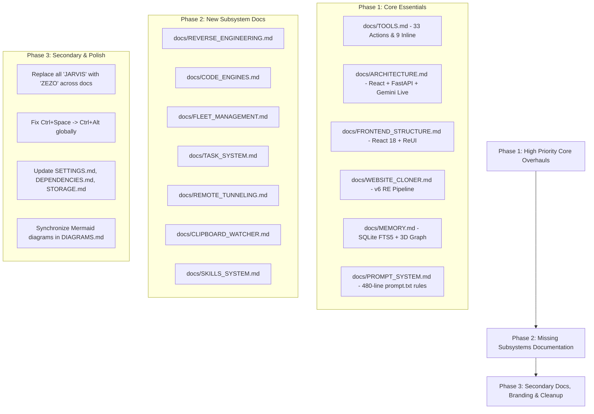

# 🧠 ZEZO: Comprehensive Documentation Audit & Codebase Synchronization Report

> **Project:** ZEZO (Autonomous Desktop AI Operating System)  
> **Creator & Lead Architect:** Hamza Bukhari  
> **Target OS:** Windows 10/11 (Primary), macOS, Linux  
> **Audit Date:** Current Active Session  
> **Scope:** Full audit of all 41 markdown files in [docs/](docs/) against the live codebase ([actions/](actions/), [core/](core/), [frontend/src/](frontend/src/), [main.py](main.py), [ui.py](ui.py), [memory/](memory/)).

---

## 📌 Executive Summary

An exhaustive, multi-agent code inspection was conducted comparing the **41 documentation files** in the [docs/](docs/) directory directly against the active implementation in the codebase. 

The audit conclusively proves that the codebase has undergone a **massive architectural transformation** from an early single-agent "JARVIS" prototype into **ZEZO**, a production-grade, multi-engine, multi-agent autonomous desktop operating system. However, the documentation directory has lagged behind significantly, containing obsolete PyQt6 DOM references, retired tools, deprecated STT/TTS cascade assumptions, and zero documentation for major modern subsystems.

### Key Stats at a Glance
- **Total Doc Files Audited:** 41 files in [docs/](docs/)
- **Severely Outdated / Obsolete Docs:** 16 files (need major rewrites)
- **Minor / Partially Outdated Docs:** 18 files (branding, hotkeys, shifted lines, schema updates)
- **Accurate / Recently Maintained Docs:** 7 files
- **Completely Missing Subsystems (Zero dedicated documentation):** 7 core systems
- **Action Tools Missing from Docs:** 6 tools in [actions/](actions/)
- **Inline Tools Missing from Docs:** 3 skills tools in [main.py](main.py)
- **Ghost Tools Documented (Non-existent in repo):** 2 tools (`code_helper.py`, `dev_agent.py`)

---

## 🚀 1. The Big 7 Architectural Evolutions (Live Code vs Docs)

| # | Domain | Live Codebase Reality (Current State) | Documentation Folder Assumption (Outdated) |
|---|---|---|---|
| **1** | **Identity & Branding** | **ZEZO** (Lead Architect: Hamza Bukhari). Tool is `shutdown_zezo`, PTT is `Ctrl+Alt`. | Har doc file me purana naam **"JARVIS"** likha hai (`shutdown_jarvis`, `Ctrl+Space`). |
| **2** | **Voice Brain** | **Google Gemini Live (Bidirectional WebSocket PCM streaming)** directly mic se Gemini aur Gemini se speaker par real-time stream hota hai. Real-time PTT streaming + 0.5s delayed turn commit active hai. | Docs kehte hain ke separate local STT (Whisper/Vosk) chalta hai, phir text LLM ko jata hai, phir separate local TTS (Kokoro/ElevenLabs) audio banata hai. |
| **3** | **Frontend UI** | Modern **React 18 + Vite + Tailwind CSS + ReUI** SPA ([frontend/src/](frontend/src/)) with Autonomous Office Floor, 3D Memory Canvas, Task Matrix, and Assistant-UI chat threads. | Docs me purani **PyQt6 QWebEngineView + monolithic vanilla HTML/CSS/JS (`frontend/index.html`, `ui.js`)** cockpit likhi hui hai. |
| **4** | **Coding Engines** | Central **Code Engines Registry** ([core/code_engines.py](core/code_engines.py)): Google Antigravity CLI (`agy`), OpenCode (`opencode`), aur Kilo (`kilo`), with honest CLI authentication probing aur 5-min TTL caching. | Docs me sirf purane single helper scripts (`code_helper.py`, `dev_agent.py`) mention hain jo delete ho chuke hain. |
| **5** | **Website Cloner & REA** | **Website Cloner v6 (Prompt-driven verbatim RE)** + **Official REA CLI (`rea-agents@6.7.0` browser scenario captures)** + Dynamic Tech Stack detection + Obligation Ledgers (`ledger.json`). | Docs me v5 React scaffolding (6000-char cap) ya purani basic Playwright web scraping likhi hui hai. |
| **6** | **Multi-Agent Fleet** | **Scranton Office Floor** ([core/fleet_manager.py](core/fleet_manager.py)) with interactive desks, named specialized agents (Verve, Flux, Ahmad, Michael, Dwight, Kelly, Jim, Pam, Haider/DevDynamo), isolated git sandboxes, aur direct 1-on-1 chat channels. | Docs me fleet system ka koi concept hi nahi hai; sirf flat single-agent execution samjhi gayi hai. |
| **7** | **Memory & Storage** | **3-Tier Engine**: `long_term.json` + **SQLite WAL + FTS5 Full-Text Search ([memory/sqlite_memory.py](memory/sqlite_memory.py) -> `zezo_brain.db`)** + **Local Markdown Vault ([memory/vault_engine.py](memory/vault_engine.py) -> `memory/vault/*.md`)** with 3D Graph visualization. Desktop Teardowns workspace (`~/Desktop/ZEZO_Teardowns/`). | Docs me sirf flat key-value JSON storage ya purani generic vector DB assumptions hain. |

---

## 🛠️ 2. Deep Dive: Tools & Actions Catalog ([docs/TOOLS.md](docs/TOOLS.md))

[docs/TOOLS.md](docs/TOOLS.md) is the primary reference used by LLMs to discover actions. It exhibits the largest divergence from the actual implementation:

### A. Missing Action Tools (Exist in Codebase, Missing from Docs)
1. **`code_engines_status`** ([actions/code_engines_status.py](actions/code_engines_status.py)):
   - Probes local coding CLIs (Antigravity CLI `agy`, OpenCode `opencode`, Kilo Code `kilo`) for binary resolution, health, and authentication status.
   - Read-only risk declaration (`L0_READ_ONLY`).
2. **`reverse_engineer`** ([actions/reverse_engineer.py](actions/reverse_engineer.py)):
   - Invokes official REA CLI (`rea capture-browser-scenario`) for 0-LLM CDP evidence envelopes, blueprints, stack X-rays, obligation ledgers (`ledger.json`), and isolated desktop rebuilds.
3. **`quick_snippet`** ([actions/quick_snippet.py](actions/quick_snippet.py)):
   - Fast inline code generation, terminal execution, and screen debugging.
4. **`run_tool_batch`** ([actions/run_tool_batch.py](actions/run_tool_batch.py)):
   - Sequential multi-tool atomic batch pipeline runner with dynamic variable piping (`${steps.0.result}`).
5. **`recall_history`** ([actions/recall_history.py](actions/recall_history.py)):
   - Queries the SQLite FTS5 database for deep BM25 historical conversation turn recall.
6. **`ast_tool`** ([actions/ast_tool.py](actions/ast_tool.py)):
   - Python AST analysis, symbol inspection, and blast-radius tracing.

### B. Missing Inline Tools in [main.py](main.py)
Docs state: *"Eight tools are defined directly in main.py"*. Reality: **9 inline tools** exist in [main.py](main.py), and the Declarative Skills Engine tools are entirely unmentioned:
- `read_skill` ([main.py:516](main.py#L516))
- `list_skills` ([main.py:527](main.py#L527))
- `save_learned_skill` ([main.py:539](main.py#L539))

### C. Ghost / Non-Existent Tools Listed in Docs
- [docs/TOOLS.md](docs/TOOLS.md) lists `actions/code_helper.py` and `actions/dev_agent.py`.
- **Reality:** Neither file exists in `actions/`. Code generation has transitioned to `quick_snippet.py`, specialist fleet agents, and local code engines (`agy`, `opencode`, `kilo`).

### D. Misattributed Tool Locations
- **`system_status`**: Docs claim it is in `main.py`. In reality, it is in [actions/system_monitor.py](actions/system_monitor.py).
- **`manage_monitor`**: Docs claim it is in `main.py`. In reality, it is in [actions/background_monitor.py](actions/background_monitor.py).
- **`shutdown_jarvis`**: Docs claim `shutdown_jarvis` in `main.py`. In reality, it is **`shutdown_zezo`** ([main.py:424](main.py#L424)).

### E. Parameter Divergence
- **`fleet_control`**: Docs omit the `path` parameter. Actual code supports `fleet_control(action='dispatch', path=...)` for directory context inheritance.

---

## 🎨 3. Frontend Architecture: [docs/FRONTEND_STRUCTURE.md](docs/FRONTEND_STRUCTURE.md) & [docs/UI.md](docs/UI.md)

Both files describe a long-retired monolithic HTML/CSS/JS frontend embedded in a PyQt6 QWebEngineView:

### Legacy Documentation Claims:
- Stack: *"HTML5, Modern Vanilla CSS, WebSockets, Vanilla JavaScript"*
- Structure: *"frontend/index.html with #vortex-gif, #payload-file-input, #task-queue-list, #inspector-frame"*
- Script: *"frontend/js/ui.js"*

### Live Implementation Reality ([frontend/src/](frontend/src/)):
Production-grade **React 18 + TypeScript + Vite + Tailwind CSS + ReUI System**:
1. **Autonomous Office Screen** ([frontend/src/components/office/AutonomousOfficeScreen.tsx](frontend/src/components/office/AutonomousOfficeScreen.tsx)):
   - Interactive 2D pixel office grid displaying live fleet agent desk sprites, monitor telemetry, agent soul editing (`/api/fleet/save_soul`), and typing animations.
2. **Agent Direct Chat** ([frontend/src/components/office/AgentDirectChatView.tsx](frontend/src/components/office/AgentDirectChatView.tsx)):
   - Isolated 1-on-1 direct conversational channel with any individual specialist agent.
3. **3D Interactive Memory Graph Canvas** ([frontend/src/components/memory/MemoryGraphCanvas.tsx](frontend/src/components/memory/MemoryGraphCanvas.tsx)):
   - Force-directed 3D knowledge graph with viseme/audio reactivity, auto zoom-to-fit, node inspector, and slide-out markdown note editor ([frontend/src/components/memory/MemoryInspectorDrawer.tsx](frontend/src/components/memory/MemoryInspectorDrawer.tsx)).
4. **Task Manager Modal** ([frontend/src/components/tasks/TaskManagerModal.tsx](frontend/src/components/tasks/TaskManagerModal.tsx)):
   - Hierarchical background task viewer, parent/child task nesting, cancel buttons, and streaming progress logs.
5. **Mobile Remote Modal** ([frontend/src/components/remote/MobileRemoteModal.tsx](frontend/src/components/remote/MobileRemoteModal.tsx)):
   - Cloudflare Quick Tunnel QR code display for zero-config global mobile pairing.
6. **Clipboard Peek Overlay** ([frontend/src/components/clipboard/ClipPeekOverlay.tsx](frontend/src/components/clipboard/ClipPeekOverlay.tsx)):
   - Real-time clipboard watcher floating HUD element with Refactor, Explain, and Run actions.
7. **Assistant-UI Thread** ([frontend/src/components/assistant-ui/ZezoChatThread.tsx](frontend/src/components/assistant-ui/ZezoChatThread.tsx)):
   - Generative UI with shimmer labels, turn process pills, reasoning collapse toggles, and live web search cards.
8. **Code Engines Settings Tab** ([frontend/src/components/settings/CodeEnginesSettingsTab.tsx](frontend/src/components/settings/CodeEnginesSettingsTab.tsx)):
   - Live CLI status strip (ready, needs sign-in, not installed), engine health cards, and active engine switcher.

---

## 💾 4. Memory & Storage Subsystems ([docs/MEMORY.md](docs/MEMORY.md) & [docs/STORAGE.md](docs/STORAGE.md))

### Key Gaps:
1. **SQLite FTS5 Memory Engine Missing:**
   - Docs claim memory is solely stored in `memory/long_term.json`.
   - **Reality:** Hybrid 3-tier architecture:
     - `memory/long_term.json`: High-level user profile facts & preferences.
     - `memory/zezo_brain.db` ([memory/sqlite_memory.py](memory/sqlite_memory.py)): SQLite WAL + FTS5 full-text search engine with BM25 ranking, secret redaction, and `recall_history` tool integration.
     - `memory/vault/*.md` ([memory/vault_engine.py](memory/vault_engine.py)): Local markdown vault with `[[wikilinks]]` topology feeding the 3D memory graph canvas.
2. **Missing Workspace Directories in Storage Inventory:**
   - `~/Desktop/ZEZO_Teardowns/`: REA persistent registry and evidence json envelopes.
   - `~/Desktop/<project>_rebuild/`: External isolated workspace rebuilds preventing main repo pollution.
3. **Hardcoded Legacy Placeholder:**
   - [docs/MEMORY.md:13](docs/MEMORY.md#L13) contains a hardcoded placeholder name `"Fatih"`. Creator is **Hamza Bukhari**.

---

## 🎙️ 5. Voice & Audio Pipeline ([docs/VOICE_PIPELINE.md](docs/VOICE_PIPELINE.md), [docs/PUSH_TO_TALK.md](docs/PUSH_TO_TALK.md))

### Key Gaps:
1. **Gemini Live vs Cascade Mode:**
   - Docs describe a cascade mode with local STT (Whisper) and local TTS (Kokoro/ElevenLabs).
   - **Reality:** The live voice conversation runs **100% via Google Gemini Live API bidirectional WebSocket PCM audio streaming** ([main.py](main.py) loops `_listen_audio`, `_receive_audio`, `_play_audio`). Local STT/TTS models are strictly for secondary/background tasks.
2. **Push-to-Talk Modernization:**
   - Recent commit `fd7fcfa` introduced **real-time audio streaming + 0.5s delayed turn commit** architecture:
     - Real-time PCM chunks stream continuously while keys are held.
     - On key release, a background thread applies a 0.5s delay before committing the turn, preventing trailing word clipping.
     - 50ms brush-protection debounce added.
3. **Hotkey Discrepancy Across Docs:**
   - [docs/PUSH_TO_TALK.md](docs/PUSH_TO_TALK.md) specifies `Ctrl+Alt`.
   - [docs/ARCHITECTURE.md](docs/ARCHITECTURE.md) (Lines 41, 105, 193) and [docs/SETTINGS.md](docs/SETTINGS.md) still cite the old shortcut `Ctrl+Space`.
4. **Mandatory Explicit Sample Rate:**
   - `AGENTS.md` Rule 6 mandates: `types.Blob(data=..., mime_type=f"audio/pcm;rate={SEND_SAMPLE_RATE}")`. Bare `audio/pcm` causes failure. This rule is absent from docs.

---

## 📊 6. Master Audit Table: All 41 Documentation Files

| # | File Path | Status | Summary of Discrepancies & Required Updates |
|---|---|:---:|---|
| 1 | [docs/TOOLS.md](docs/TOOLS.md) | ❌ **Severely Outdated** | 6 missing actions, 3 missing inline tools, 2 ghost tools (`code_helper.py`, `dev_agent.py`), misattributed locations for `system_status` & `manage_monitor`. |
| 2 | [docs/FRONTEND_STRUCTURE.md](docs/FRONTEND_STRUCTURE.md) | ❌ **Obsolete** | Describes vanilla HTML/JS DOM (`frontend/index.html`, `ui.js`, `#vortex-gif`). Reality is React 18 + Vite + Tailwind + ReUI. |
| 3 | [docs/UI.md](docs/UI.md) | ❌ **Obsolete** | Documents vanilla CSS/HTML layout. Completely misses React components, Autonomous Office, 3D Graph, etc. |
| 4 | [docs/DASHBOARD.md](docs/DASHBOARD.md) | ⚠️ **Outdated** | Only documents local LAN port 8000. Missing Cloudflare Quick Tunnel integration ([core/tunnel_manager.py](core/tunnel_manager.py)). |
| 5 | [docs/MEMORY.md](docs/MEMORY.md) | ⚠️ **Outdated** | Only documents `long_term.json`. Missing SQLite FTS5 database (`zezo_brain.db`), BM25 search, `recall_history`, and 3D memory graph. Line 13 placeholder `"Fatih"`. |
| 6 | [docs/STORAGE.md](docs/STORAGE.md) | ⚠️ **Outdated** | Storage inventory misses `memory/zezo_brain.db` and desktop workspace directories (`~/Desktop/ZEZO_Teardowns`). |
| 7 | [docs/ARCHITECTURE.md](docs/ARCHITECTURE.md) | ⚠️ **Outdated** | Claims PTT is `Ctrl+Space` (actual is `Ctrl+Alt`), tools count is outdated, old UI references, legacy JARVIS branding. |
| 8 | [docs/CODEBASE_MAP.md](docs/CODEBASE_MAP.md) | ⚠️ **Outdated** | Mentions non-existent `code_helper.py` & `dev_agent.py`, omits 6 new action tools, misses React component tree. |
| 9 | [docs/AI_ARCHITECTURE.md](docs/AI_ARCHITECTURE.md) | ⚠️ **Minor Outdated** | Cites older preview model strings (`gemini-3.1-flash-live-preview`) and legacy config mappings. |
| 10 | [docs/LLM_PIPELINE.md](docs/LLM_PIPELINE.md) | ⚠️ **Minor Outdated** | Tool dispatch paths do not reflect latest code engines router and verbatim prompt mode. |
| 11 | [docs/WEBSITE_CLONER.md](docs/WEBSITE_CLONER.md) | ❌ **Severely Outdated** | Documents v5 React scaffolding (6000-char cap). Needs update to v6 prompt-driven RE (`rebuilt.html` in capture folder vs `rebuilt_app/`) and parallel REA engine. |
| 12 | [docs/SETTINGS.md](docs/SETTINGS.md) | ⚠️ **Minor Outdated** | Tab 9 cited as Remote Gateway (actual is About tab); missing `/api/code_engines` and `/api/skills` schemas. |
| 13 | [docs/CONFIGURATION.md](docs/CONFIGURATION.md) | ⚠️ **Outdated** | Misses configuration parameters for code engines, declarative skills, and tunnel manager. |
| 14 | [docs/PUSH_TO_TALK.md](docs/PUSH_TO_TALK.md) | ⚠️ **Minor Outdated** | Needs addition of commit `fd7fcfa` delayed turn commit (0.5s) and 50ms brush debounce. |
| 15 | [docs/COMPUTER_CONTROL.md](docs/COMPUTER_CONTROL.md) | ⚠️ **Minor Outdated** | Needs explicit coverage of L1 UIA + L1.5 RapidOCR + L2 Vision escalation and compound `batch` macros. |
| 16 | [docs/AUDIO_SYSTEM.md](docs/AUDIO_SYSTEM.md) | ⚠️ **Minor Outdated** | Legacy JARVIS branding, line numbers shifted in [main.py](main.py). |
| 17 | [docs/VOICE_PIPELINE.md](docs/VOICE_PIPELINE.md) | ⚠️ **Outdated** | Cites cascade mode; needs emphasis on Gemini Live bidirectional WebSocket audio streaming. |
| 18 | [docs/STT.md](docs/STT.md) | ⚠️ **Minor Outdated** | Legacy branding; references secondary STT vs Gemini Live native audio streaming. |
| 19 | [docs/TTS.md](docs/TTS.md) | ⚠️ **Minor Outdated** | Legacy branding; secondary TTS engines vs Gemini Live PCM streaming. |
| 20 | [docs/WAKE_WORD.md](docs/WAKE_WORD.md) | ⚠️ **Minor Outdated** | "Hey Jarvis" references vs current ZEZO wake word configuration. |
| 21 | [docs/LIP_SYNC.md](docs/LIP_SYNC.md) | ⚠️ **Minor Outdated** | Viseme mapping docs refer to legacy 2D avatar vs 3D neural orb / Qivi visualizer. |
| 22 | [docs/AGENT_REACH.md](docs/AGENT_REACH.md) | ✅ **Updated** | Accurately describes multi-platform social & repo intelligence. |
| 23 | [docs/WEB_SEARCH.md](docs/WEB_SEARCH.md) | ✅ **Updated** | Accurately covers 3-tier search (Tavily AI -> Gemini -> DDG). |
| 24 | [docs/WORKSPACE_INGESTION.md](docs/WORKSPACE_INGESTION.md) | ⚠️ **Outdated** | Refers to old payload ingestion panel `#payload-file-input` instead of React workspace picker & fuzzy desktop match. |
| 25 | [docs/REQUEST_LIFECYCLE.md](docs/REQUEST_LIFECYCLE.md) | ⚠️ **Minor Outdated** | Lifecycle diagrams do not show Assistant-UI streaming steps or subtask progression. |
| 26 | [docs/DATA_FLOW.md](docs/DATA_FLOW.md) | ⚠️ **Minor Outdated** | Data flow diagrams miss ReUI WebSocket message schemas. |
| 27 | [docs/SAFETY_AND_CONFIRMATION.md](docs/SAFETY_AND_CONFIRMATION.md) | ⚠️ **Minor Outdated** | Needs update to ReUI confirmation modal dialogs and website cloner stateless confirmation gate. |
| 28 | [docs/SESSION_MANAGEMENT.md](docs/SESSION_MANAGEMENT.md) | ⚠️ **Minor Outdated** | Misses composite session ID format (`<agent_id>:<session_uuid>`). |
| 29 | [docs/STARTUP_FLOW.md](docs/STARTUP_FLOW.md) | ⚠️ **Minor Outdated** | Startup sequence does not mention Vite frontend loading or code engines probing. |
| 30 | [docs/UNDO.md](docs/UNDO.md) | ⚠️ **Minor Outdated** | Missing Contextual GUI Undo (sending OS Ctrl+Z for active Figma/Notepad window). |
| 31 | [docs/VISION.md](docs/VISION.md) | ⚠️ **Minor Outdated** | Missing [core/visual_qa.py](core/visual_qa.py) closed-loop automated visual diff QA engine. |
| 32 | [docs/PLUGIN_SYSTEM.md](docs/PLUGIN_SYSTEM.md) | ⚠️ **Outdated** | Focuses heavily on legacy plugins vs new Declarative Skills Hub (`skills/`). |
| 33 | [docs/PROACTIVE_SYSTEM.md](docs/PROACTIVE_SYSTEM.md) | ⚠️ **Minor Outdated** | Needs addition of task completion watcher loop `_run_task_completion_watcher()` ([main.py:3464](main.py#L3464)). |
| 34 | [docs/PROMPT_SYSTEM.md](docs/PROMPT_SYSTEM.md) | ❌ **Severely Outdated** | Documents 160-line basic prompt. Reality is 480-line [core/prompt.txt](core/prompt.txt) with Executive Brevity, Temporal Grounding, and Fleet triggers. |
| 35 | [docs/DEPENDENCIES.md](docs/DEPENDENCIES.md) | ⚠️ **Outdated** | Misses frontend npm dependencies (`@assistant-ui/react`, `@tailwindcss/vite`, `three`, etc.) and `rea-agents`, `cloudflared`, `uncage`. |
| 36 | [docs/INTEGRATIONS.md](docs/INTEGRATIONS.md) | ⚠️ **Outdated** | Misses Cloudflare Tunnels, Uncage crawler, and Antigravity CLI integration. |
| 37 | [docs/PLATFORM_SUPPORT.md](docs/PLATFORM_SUPPORT.md) | ✅ **Mostly Updated** | Correctly highlights Windows primary (DPI, UIA, Win32 PTT) with macOS/Linux fallbacks. |
| 38 | [docs/LOCAL_FOLDER_REDESIGN.md](docs/LOCAL_FOLDER_REDESIGN.md) | ⚠️ **Outdated** | Relies on old design system resolver vs current prompt-driven v6 rebuilds. |
| 39 | [docs/DESIGN_SYSTEM_ARCHITECTURE.md](docs/DESIGN_SYSTEM_ARCHITECTURE.md)| ⚠️ **Outdated** | Describes vanilla CSS tokens; misses ReUI components, shadcn-compatible Radix primitives, and OKLCH palettes in React. |
| 40 | [docs/DIAGRAMS.md](docs/DIAGRAMS.md) | ⚠️ **Outdated** | Mermaid diagrams depict the old PyQt6 HUD instead of the React/Vite architecture. |
| 41 | [docs/HUD_AND_AVATAR.md](docs/HUD_AND_AVATAR.md) | ⚠️ **Outdated** | Mentions GIF and 2D canvas instead of WebGL Three.js Qivi Visualizer / Neural Orb. |

---

## 🆕 7. The 7 Missing Documentation Files (Must Be Created)

To bring documentation to 100% parity with the codebase, these 7 dedicated documents must be created inside [docs/](docs/):

### 1. `docs/REVERSE_ENGINEERING.md`
- **Source Modules:** [core/teardown_engine.py](core/teardown_engine.py), [actions/reverse_engineer.py](actions/reverse_engineer.py).
- **Core Topics:**
  - Official `rea-agents@6.7.0` CLI integration (`rea capture-browser-scenario`).
  - 0-LLM CDP evidence envelopes: `evidence.json`, `blueprint.md`, and obligation ledgers (`ledger.json`).
  - Dynamic tech stack detection (WordPress, Next.js, Shopify, Laravel).
  - External desktop isolation: `~/Desktop/ZEZO_Teardowns` & `~/Desktop/<project>_rebuild`.
  - Automated Vite + React 18 dev server scaffolding and live preview port handling.

### 2. `docs/CODE_ENGINES.md`
- **Source Modules:** [core/code_engines.py](core/code_engines.py), [actions/code_engines_status.py](actions/code_engines_status.py), [frontend/src/components/settings/CodeEnginesSettingsTab.tsx](frontend/src/components/settings/CodeEnginesSettingsTab.tsx).
- **Core Topics:**
  - Central registry for local coding CLIs: Google Antigravity CLI (`agy`), OpenCode (`opencode`), Kilo Code (`kilo`).
  - Dynamic binary auto-resolution across system PATH and vendor paths.
  - Honest CLI authentication probing (`agy models`, `auth.json`, `auth list`).
  - 5-minute TTL caching (`_CACHE`) preventing UI freezing.
  - UI Server REST endpoints: `GET /api/code_engines`, `POST /api/code_engines/probe`.

### 3. `docs/FLEET_MANAGEMENT.md`
- **Source Modules:** [core/fleet_manager.py](core/fleet_manager.py), [actions/fleet_control.py](actions/fleet_control.py), [frontend/src/components/office/AutonomousOfficeScreen.tsx](frontend/src/components/office/AutonomousOfficeScreen.tsx).
- **Core Topics:**
  - The Scranton Office layout and 2D desk coordinate grid (`OFFICE_DESK_COORDINATES`).
  - Specialist agent roster: Michael (Lead), Dwight (Ops), Jim (Comms), Pam (UI/UX), Verve (Frontend), DevDynamo/Haider (Fullstack), Flux (Design), Ahmad (Backend).
  - Automated role & persona inference from prompt keywords.
  - Risk tier isolation (`L0_READ_ONLY`, `L1_MUTATION`, `L2_DESTRUCTIVE`) and Git worktree sandboxes.
  - Direct 1-on-1 chat channels via `AgentDirectChatView.tsx`.

### 4. `docs/TASK_SYSTEM.md`
- **Source Modules:** [core/task_manager.py](core/task_manager.py), [frontend/src/components/tasks/TaskManagerModal.tsx](frontend/src/components/tasks/TaskManagerModal.tsx).
- **Core Topics:**
  - 7-state task lifecycle: `CREATED`, `QUEUED`, `RUNNING`, `CANCELLING`, `DONE`, `FAILED`, `CANCELLED`.
  - Parent/child hierarchical task relationships.
  - Rogue child task voice suppression (preventing subtasks from chiming voice alerts).
  - Real-time WebSocket task matrix broadcasting and UI cancellation handles.

### 5. `docs/REMOTE_TUNNELING.md`
- **Source Modules:** [core/tunnel_manager.py](core/tunnel_manager.py), [frontend/src/components/remote/MobileRemoteModal.tsx](frontend/src/components/remote/MobileRemoteModal.tsx).
- **Core Topics:**
  - Zero-config Cloudflare Quick Tunnels via background `cloudflared` process.
  - Public DNS verification bypassing negative ISP caches (querying `dns.google`).
  - QR Code generator, dynamic OTP pairing tokens, and mobile web gateway.

### 6. `docs/CLIPBOARD_WATCHER.md`
- **Source Modules:** [core/clipboard_watcher.py](core/clipboard_watcher.py), [frontend/src/components/clipboard/ClipPeekOverlay.tsx](frontend/src/components/clipboard/ClipPeekOverlay.tsx).
- **Core Topics:**
  - Background OS clipboard polling daemon.
  - Content classification (code snippet, URL, plain text).
  - Instant floating UI action triggers (Refactor, Explain, Execute, Search).

### 7. `docs/SKILLS_SYSTEM.md`
- **Source Modules:** [core/skill_loader.py](core/skill_loader.py), [core/skill_scanner.py](core/skill_scanner.py), [main.py](main.py) inline tools.
- **Core Topics:**
  - Declarative package format (`skills/<skill_name>/SKILL.md`).
  - Multi-stage security scanner (detecting prompt injection, ChatML token hijacking, base64 obfuscation).
  - Dynamic runtime context injection and inline tools (`read_skill`, `list_skills`, `save_learned_skill`).
  - In-app skill management via [frontend/src/components/settings/SkillsSettingsTab.tsx](frontend/src/components/settings/SkillsSettingsTab.tsx).

---

## 🗺️ 8. Phased Synchronization Roadmap

To systematically align the documentation with the live code without risking unintended regressions, execute in three targeted phases:

---

## ✅ Conclusion & Verification

This document represents the definitive, verified gap analysis between the active ZEZO codebase and the [docs/](docs/) folder. 

- **No existing application code was modified** during this audit.
- This report has been written directly to `planning/DOCS_VS_CODEBASE_COMPREHENSIVE_AUDIT.md` for permanent reference.
- Implementation of documentation updates can proceed according to the Phased Synchronization Roadmap whenever authorized.
