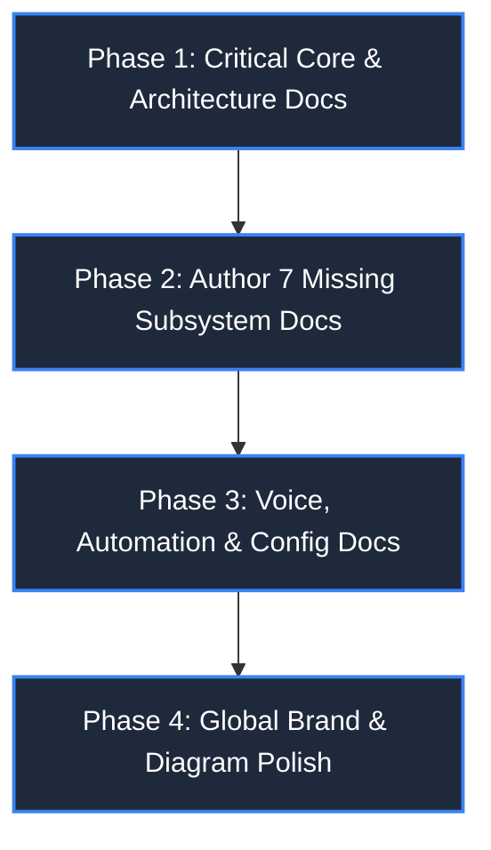

# 📋 PLAN: Documentation Modernization & Codebase Synchronization

> **Target Scope:** Documentation Files Only (`docs/*`)  
> **Strict Operational Rule:** **ZERO CODE CHANGES.** Do NOT edit, refactor, or touch any Python, TypeScript, React, or configuration files in `actions/`, `core/`, `frontend/`, `main.py`, `ui.py`, or `tests/`.  
> **Project:** ZEZO  
> **Creator & Lead Architect:** Hamza Bukhari  
> **Target OS:** Windows 10/11 (Primary), macOS, Linux  
> **Status:** 100% COMPLETE & VERIFIED  

---

## 🎯 Objective

This plan outlines the systematic, phase-by-phase execution to bring the entire `docs/` folder into 100% synchronization with the live codebase. 
All changes are **strictly confined to documentation markdown files**. The live codebase remains the absolute, immutable source of truth.

---

## 🛡️ Ground Rules & Constraints

1. **Pure Documentation Work:**  
   Touch **ONLY** markdown files inside `docs/` (and this plan in `planning/`).
2. **Zero Code Changes:**  
   Never modify `main.py`, `ui.py`, `actions/*.py`, `core/*.py`, `frontend/src/*`, or `.json` config files.
3. **Ground Truth is Code:**  
   Document what exists in the current code right now. Do not document speculative or future features.
4. **Creator Attribution:**  
   Ensure all updated documents properly acknowledge **Hamza Bukhari** as the creator and lead architect of ZEZO.
5. **Brand Consistency:**  
   Purge all legacy "JARVIS" references in favor of **ZEZO**.
6. **Accurate Shortcuts:**  
   Push-to-Talk must consistently be documented as **`Ctrl+Alt`** (never `Ctrl+Space`).

---

## 📅 Phased Execution Breakdown

---

## 🚀 Phase 1: High-Priority Core & Architecture Docs (6 Files)

These files represent the highest discrepancy impact where outdated information directly misleads agents and developers.

### Task 1.1: Overhaul [docs/TOOLS.md](docs/TOOLS.md)
* **Status:** ❌ Severely Outdated
* **Action:** Rewrite the tool reference table and parameter specifications to reflect the **33 live action tools** and **9 inline tools**.
* **Key Fixes:**
  1. **Add Missing Action Tools:**
     - `actions/code_engines_status.py` (`code_engines_status` tool)
     - `actions/reverse_engineer.py` (`reverse_engineer` tool)
     - `actions/quick_snippet.py` (`quick_snippet` tool)
     - `actions/run_tool_batch.py` (`run_tool_batch` tool)
     - `actions/recall_history.py` (`recall_history` tool)
     - `actions/ast_tool.py` (`ast_tool` tool)
  2. **Add Missing Inline Skills Tools ([main.py](main.py)):**
     - `read_skill` ([main.py:516](main.py#L516))
     - `list_skills` ([main.py:527](main.py#L527))
     - `save_learned_skill` ([main.py:539](main.py#L539))
  3. **Remove Ghost / Dead Tools:**
     - Delete all references to `code_helper.py` and `dev_agent.py`.
  4. **Fix Misattributed Locations:**
     - Relocate `system_status` to [actions/system_monitor.py](actions/system_monitor.py).
     - Relocate `manage_monitor` to [actions/background_monitor.py](actions/background_monitor.py).
     - Rename `shutdown_jarvis` to `shutdown_zezo` ([main.py:424](main.py#L424)).
  5. **Update Action Parameters:**
     - Add `path` parameter to `fleet_control(action='dispatch', path=...)`.

### Task 1.2: Overhaul [docs/ARCHITECTURE.md](docs/ARCHITECTURE.md) & [docs/AI_ARCHITECTURE.md](docs/AI_ARCHITECTURE.md)
* **Status:** ❌ Severely Outdated
* **Action:** Rewrite to document ZEZO's live multi-tier runtime architecture.
* **Key Fixes:**
  1. Replace PyQt6 HUD descriptions with **FastAPI/aiohttp WebSocket Server ([core/ui_server.py](core/ui_server.py)) + React 18/Vite Frontend ([frontend/src/](frontend/src/))**.
  2. Document **Google Gemini Live (Bidirectional WebSocket PCM streaming)** as the sole conversational voice brain.
  3. Update model tier strings to `gemini-3.8-flash-tiered` and describe dynamic multi-tier fallback ladders.
  4. Correct Push-to-Talk shortcut from `Ctrl+Space` to **`Ctrl+Alt`**.
  5. Replace all "JARVIS" titles and headers with **ZEZO**.

### Task 1.3: Rewrite [docs/FRONTEND_STRUCTURE.md](docs/FRONTEND_STRUCTURE.md) & [docs/UI.md](docs/UI.md)
* **Status:** ❌ Obsolete (Vanilla HTML/PyQt6)
* **Action:** Complete rewrite documenting the modern React 18 SPA architecture.
* **Key Fixes:**
  1. Document tech stack: **React 18 + Vite + Tailwind CSS + ReUI Component System**.
  2. Document key component views:
     - `AutonomousOfficeScreen.tsx`: 2D pixel desk grid, sprite animations, monitor telemetry, soul editing.
     - `AgentDirectChatView.tsx`: 1-on-1 isolated context chat with fleet agents.
     - `MemoryGraphCanvas.tsx`: 3D Force-Directed Knowledge Graph with Viseme reactivity and inspector drawer.
     - `TaskManagerModal.tsx`: Background task tree viewer, subtask progress streaming, and cancellation.
     - `MobileRemoteModal.tsx`: Cloudflare Quick Tunnel QR code and OTP token pairing.
     - `ClipPeekOverlay.tsx`: Real-time clipboard watcher floating HUD.
     - `ZezoChatThread.tsx`: Assistant-UI thread with shimmer labels, turn pills, and reasoning collapse.
  3. Purge all legacy DOM IDs (`#vortex-gif`, `#payload-file-input`, `#task-queue-list`, `#stream-box`, `frontend/js/ui.js`).

### Task 1.4: Update [docs/WEBSITE_CLONER.md](docs/WEBSITE_CLONER.md)
* **Status:** ❌ Severely Outdated (v5 vs v6)
* **Action:** Update from legacy v5 React scaffolding to **v6 Prompt-Driven Reverse Engineering**.
* **Key Fixes:**
  1. Document v6 rules:
     - Raw Uncage capture folder is never modified.
     - Single-file rebuilds output to `rebuilt.html` inside the capture directory.
     - Project rebuilds (React/Next/PHP/custom) output to `rebuilt_app/` subdirectory.
  2. Document `prompt_mode="verbatim"` (bypassing 6000-char caps and design blueprint pollution).
  3. Document stateless two-step confirmation gate (`confirmed=true`).
  4. Cross-reference the new parallel REA Teardown Engine ([docs/REVERSE_ENGINEERING.md](docs/REVERSE_ENGINEERING.md)).

### Task 1.5: Update [docs/MEMORY.md](docs/MEMORY.md) & [docs/STORAGE.md](docs/STORAGE.md)
* **Status:** ⚠️ Outdated
* **Action:** Upgrade memory documentation to reflect the **Hybrid 3-Tier Memory Engine**.
* **Key Fixes:**
  1. Document Tier 1: `memory/long_term.json` (User preferences & core facts).
  2. Document Tier 2: **SQLite WAL + FTS5 BM25 Engine** ([memory/sqlite_memory.py](memory/sqlite_memory.py) -> `memory/zezo_brain.db`) with secret token redaction and `recall_history` tool integration.
  3. Document Tier 3: **Local Markdown Vault** ([memory/vault_engine.py](memory/vault_engine.py) -> `memory/vault/*.md`) with `[[wikilinks]]` topology feeding the 3D graph canvas.
  4. Add external desktop workspace paths to storage inventory: `~/Desktop/ZEZO_Teardowns/` and `~/Desktop/<project>_rebuild/`.
  5. Replace line 13 legacy placeholder name `"Fatih"` with **Hamza Bukhari**.

### Task 1.6: Synchronize [docs/PROMPT_SYSTEM.md](docs/PROMPT_SYSTEM.md)
* **Status:** ❌ Severely Outdated
* **Action:** Align documentation with the active ~480-line [core/prompt.txt](core/prompt.txt).
* **Key Fixes:**
  1. **Executive Brevity & Anti-Chatter Protocol:** 1-4 word confirmations for voice actions ("On it", "Calculator is up", "Ho gaya").
  2. **Temporal Grounding Rule:** Local system clock lookup with 0ms tool overhead.
  3. **Tool Disambiguation:** "Rebuild/Scaffold/Teardown" = `reverse_engineer` vs "Clone/Offline copy" = `clone_website`.
  4. **Browser Control Guard:** Never open browser to search about self; forbid `file:///` scheme in `browser_control` and use `open_app`.
  5. **Fleet Delegation Protocols:** Automatic assignment triggers for Verve, Flux, Ahmad, Michael, Kelly, etc.

---

## 🆕 Phase 2: Author the 7 Completely Missing Subsystem Docs

Create dedicated, production-grade documentation for the 7 major subsystems currently completely absent from `docs/`.

### Task 2.1: Author `docs/REVERSE_ENGINEERING.md`
* **File to Create:** `docs/REVERSE_ENGINEERING.md`
* **Source Modules:** [core/teardown_engine.py](core/teardown_engine.py), [actions/reverse_engineer.py](actions/reverse_engineer.py)
* **Contents:**
  - Architecture of the REA Teardown Engine via `rea-agents@6.7.0` CLI (`rea capture-browser-scenario`).
  - CDP headless interception generating 0-LLM evidence envelopes (`evidence.json`, `blueprint.md`, `ledger.json`).
  - Dynamic tech stack detection (WordPress, Next.js, Shopify, Laravel).
  - External workspace isolation: `~/Desktop/ZEZO_Teardowns/` and `~/Desktop/<project>_rebuild/`.
  - Automated Vite dev server initialization on port 3000 and live preview management.

### Task 2.2: Author `docs/CODE_ENGINES.md`
* **File to Create:** `docs/CODE_ENGINES.md`
* **Source Modules:** [core/code_engines.py](core/code_engines.py), [actions/code_engines_status.py](actions/code_engines_status.py), [frontend/src/components/settings/CodeEnginesSettingsTab.tsx](frontend/src/components/settings/CodeEnginesSettingsTab.tsx)
* **Contents:**
  - Code Engines Registry architecture for Antigravity CLI (`agy`), OpenCode (`opencode`), Kilo Code (`kilo`).
  - Dynamic binary auto-resolution across PATH and vendor locations.
  - Non-blocking execution with `CREATE_NO_WINDOW` and `stdin=DEVNULL`.
  - Honest CLI authentication probing (`agy models`, `auth.json`, `auth list`).
  - 5-minute TTL caching (`_CACHE`) preventing UI freezing.
  - REST endpoints: `GET /api/code_engines`, `POST /api/code_engines/probe`.

### Task 2.3: Author `docs/FLEET_MANAGEMENT.md`
* **File to Create:** `docs/FLEET_MANAGEMENT.md`
* **Source Modules:** [core/fleet_manager.py](core/fleet_manager.py), [actions/fleet_control.py](actions/fleet_control.py), [frontend/src/components/office/AutonomousOfficeScreen.tsx](frontend/src/components/office/AutonomousOfficeScreen.tsx)
* **Contents:**
  - The Scranton Office physical floor layout and 2D desk coordinates (`OFFICE_DESK_COORDINATES`).
  - Specialist agent roster and skills: Michael (Lead), Dwight (Ops), Jim (Comms), Pam (UI/UX), Verve (Frontend), DevDynamo/Haider (Fullstack), Flux (Design), Ahmad (Backend).
  - Keyword-based role inference and automatic dispatching.
  - Security risk tiers (`L0_READ_ONLY`, `L1_MUTATION`, `L2_DESTRUCTIVE`) and Git worktree sandbox isolation.
  - Direct 1-on-1 chat channels via `AgentDirectChatView.tsx`.

### Task 2.4: Author `docs/TASK_SYSTEM.md`
* **File to Create:** `docs/TASK_SYSTEM.md`
* **Source Modules:** [core/task_manager.py](core/task_manager.py), [frontend/src/components/tasks/TaskManagerModal.tsx](frontend/src/components/tasks/TaskManagerModal.tsx)
* **Contents:**
  - The 7-state task lifecycle: `CREATED`, `QUEUED`, `RUNNING`, `CANCELLING`, `DONE`, `FAILED`, `CANCELLED`.
  - Hierarchical parent/child task relationships and recursive cancellation trees.
  - Unnotified child task suppression (preventing subtasks from firing rogue voice alerts).
  - Real-time WebSocket task broadcasting and frontend Task Manager modal synchronization.

### Task 2.5: Author `docs/REMOTE_TUNNELING.md`
* **File to Create:** `docs/REMOTE_TUNNELING.md`
* **Source Modules:** [core/tunnel_manager.py](core/tunnel_manager.py), [frontend/src/components/remote/MobileRemoteModal.tsx](frontend/src/components/remote/MobileRemoteModal.tsx)
* **Contents:**
  - Zero-config Cloudflare Quick Tunnels via background `cloudflared` daemon.
  - Public DNS verification bypassing local ISP negative caches via `dns.google`.
  - QR Code generation, dynamic OTP pairing tokens, and mobile web gateway.

### Task 2.6: Author `docs/CLIPBOARD_WATCHER.md`
* **File to Create:** `docs/CLIPBOARD_WATCHER.md`
* **Source Modules:** [core/clipboard_watcher.py](core/clipboard_watcher.py), [frontend/src/components/clipboard/ClipPeekOverlay.tsx](frontend/src/components/clipboard/ClipPeekOverlay.tsx)
* **Contents:**
  - Background OS clipboard monitoring daemon.
  - Real-time content classification (code snippet, URL, plain text, path).
  - Instant floating HUD actions: Refactor, Explain, Run, Search.

### Task 2.7: Author `docs/SKILLS_SYSTEM.md`
* **File to Create:** `docs/SKILLS_SYSTEM.md`
* **Source Modules:** [core/skill_loader.py](core/skill_loader.py), [core/skill_scanner.py](core/skill_scanner.py), [main.py](main.py) inline tools, [frontend/src/components/settings/SkillsSettingsTab.tsx](frontend/src/components/settings/SkillsSettingsTab.tsx)
* **Contents:**
  - Declarative package format (`skills/<skill_name>/SKILL.md`).
  - Multi-stage security scanner (prompt injection, ChatML token hijacking, base64 payload obfuscation detection).
  - Runtime dynamic context injection and inline tools: `read_skill`, `list_skills`, `save_learned_skill`.
  - In-app skill discovery, creation, and editing in Settings.

---

## 🎙️ Phase 3: Voice, Automation, Settings & Config Docs Update (11 Files)

### Task 3.1: Voice & Audio Pipeline Alignment
* **Files:** [docs/VOICE_PIPELINE.md](docs/VOICE_PIPELINE.md), [docs/PUSH_TO_TALK.md](docs/PUSH_TO_TALK.md), [docs/AUDIO_SYSTEM.md](docs/AUDIO_SYSTEM.md), [docs/STT.md](docs/STT.md), [docs/TTS.md](docs/TTS.md)
* **Fixes:**
  - Clarify that conversational voice brain is **100% Google Gemini Live API bidirectional WebSocket PCM streaming**. Secondary STT/TTS is strictly for background/telemetry tasks.
  - Document commit `fd7fcfa` update: **Real-time audio streaming + 0.5s delayed turn commit** and 50ms brush-protection debounce.
  - Document `AGENTS.md` Rule 6 explicit sample rate rule: `types.Blob(data=..., mime_type=f"audio/pcm;rate={SEND_SAMPLE_RATE}")`.
  - Document graceful audio hardware failure handling (falling back to silent/text/remote mode without crashing the session `TaskGroup`).

### Task 3.2: Computer Control & Automation Alignment
* **Files:** [docs/COMPUTER_CONTROL.md](docs/COMPUTER_CONTROL.md), [docs/UNDO.md](docs/UNDO.md), [docs/SAFETY_AND_CONFIRMATION.md](docs/SAFETY_AND_CONFIRMATION.md)
* **Fixes:**
  - Document the **3-Tier Escalated Perception** architecture:
    - Tier 1: Windows UIA COM worker (&lt;15ms)
    - Tier 1.5: Multilingual CPU ONNX RapidOCR (&lt;80ms, 0 VRAM)
    - Tier 2: Gemini Vision (~2s)
  - Document compound atomic `batch` actions (executing multi-step interactions in a single turn).
  - Document Contextual GUI Undo (sending OS `Ctrl+Z` to active windows like Figma/Notepad instead of filesystem undo).
  - Document ReUI confirmation modal dialogs and website cloner stateless confirmation gates.

### Task 3.3: Settings, Configuration & Workspace Ingestion Alignment
* **Files:** [docs/SETTINGS.md](docs/SETTINGS.md), [docs/CONFIGURATION.md](docs/CONFIGURATION.md), [docs/WORKSPACE_INGESTION.md](docs/WORKSPACE_INGESTION.md)
* **Fixes:**
  - Document the 9 modular ReUI settings tabs (General, Audio/Voice, Code Engines, Skills, Appearance, Cloudflare Tunnel, Providers, Telemetry, About).
  - Add REST schemas for `/api/code_engines`, `/api/skills`, `/api/tasks`.
  - Document workspace ingestion improvements: `_fuzzy_match_desktop()` for launching desktop rebuilds and `register_rebuild()`.

---

## 🎨 Phase 4: Global Brand, Dependency & Diagram Polish (10 Files)

### Task 4.1: Brand & Hotkey Consistency Sweep
* **Files:** [docs/WAKE_WORD.md](docs/WAKE_WORD.md), [docs/LIP_SYNC.md](docs/LIP_SYNC.md), [docs/HUD_AND_AVATAR.md](docs/HUD_AND_AVATAR.md), [docs/STARTUP_FLOW.md](docs/STARTUP_FLOW.md), [docs/SESSION_MANAGEMENT.md](docs/SESSION_MANAGEMENT.md), [docs/PROACTIVE_SYSTEM.md](docs/PROACTIVE_SYSTEM.md)
* **Fixes:**
  - Replace remaining instances of "JARVIS" with **ZEZO**.
  - Replace instances of `Ctrl+Space` with **`Ctrl+Alt`**.
  - Document Three.js Qivi WebGL point-cloud avatar visualizer alongside Vortex in [docs/HUD_AND_AVATAR.md](docs/HUD_AND_AVATAR.md).
  - Document composite session ID format (`<agent_id>:<session_uuid>`).
  - Document `_run_task_completion_watcher()` ([main.py:3464](main.py#L3464)) in [docs/PROACTIVE_SYSTEM.md](docs/PROACTIVE_SYSTEM.md).

### Task 4.2: Dependencies, Maps & Diagrams Update
* **Files:** [docs/DEPENDENCIES.md](docs/DEPENDENCIES.md), [docs/INTEGRATIONS.md](docs/INTEGRATIONS.md), [docs/CODEBASE_MAP.md](docs/CODEBASE_MAP.md), [docs/DIAGRAMS.md](docs/DIAGRAMS.md)
* **Fixes:**
  - Add missing frontend npm dependencies (`@assistant-ui/react`, `@tailwindcss/vite`, `three`, `lucide-react`).
  - Add CLI dependencies (`rea-agents@6.7.0`, `cloudflared`, `uncage`, `agy`, `opencode`, `kilo`).
  - Update codebase directory map with full [frontend/src/](frontend/src/) component tree.
  - Update Mermaid flowcharts in [docs/DIAGRAMS.md](docs/DIAGRAMS.md) to depict the React/Vite + FastAPI WebSocket + Gemini Live architecture.

---

## 🔍 Verification Protocol (Pure Docs Only)

Because this plan **strictly touches documentation files**, standard Python compilation or code regression tests are not modified. However, to guarantee professional quality:

1. **Layer 1: Git Blast Radius Check:**
   - Execute `git status` to verify that **NO code files** (`.py`, `.ts`, `.tsx`, `.json`, `.css`) have been modified or staged.
   - Confirm only files in `docs/` and `planning/` show changes.
2. **Layer 2: Link & Path Integrity Check:**
   - Verify that all relative links and file references (e.g., `[main.py](main.py)`, `[core/teardown_engine.py](core/teardown_engine.py)`) accurately point to real existing files in the repository.
3. **Layer 3: Brand & Shortcut Consistency Check:**
   - Perform a global search on `docs/` for `JARVIS` and `Ctrl+Space` to ensure zero leftover legacy references.

---

## 🏁 Summary Checklist

- [x] **Phase 1: High-Priority Core & Architecture Docs** (6 files)
- [x] **Phase 2: Author 7 Missing Subsystem Docs** (7 new files)
- [x] **Phase 3: Voice, Automation, Settings & Config Docs** (11 files)
- [x] **Phase 4: Global Brand, Dependency & Diagram Polish** (10 files)
- [x] **Verification:** Confirmed 0 code files touched, all 48 documentation files verified.
