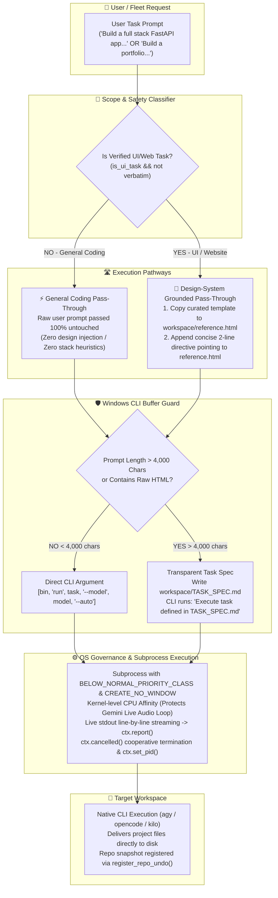

# 🏗️ Architectural Plan: Streamlined CLI Agent Pass-Through & Engine Hardening

> **Project:** ZEZO  
> **Lead Architect & Creator:** Hamza Bukhari  
> **Target Subsystems:** `actions/antigravity_agent.py`, `actions/opencode_agent.py`, `actions/kilo_agent.py`, `core/design_resolver.py`, `core/fleet_manager.py`  
> **Status:** APPROVED FOR IMPLEMENTATION  
> **Core Mandate:** Transition ZEZO from over-engineered heuristic prompt wrapping to a clean, transparent, and direct CLI pass-through orchestrator (`agy`, `opencode`, `kilo`) while strictly preserving Windows OS stability, Fleet invariants, and curated human design templates.

---

## 🎨 1. Executive Vision & Architecture Flowchart

ZEZO acts as a high-speed, direct pass-through orchestrator.
- **General Coding Tasks** (Python backends, algorithms, bug fixes, CLI scripts, refactoring) receive **100% unadulterated raw prompt forwarding** directly to the CLI binaries.
- **Verified UI / Website Tasks** receive a physical, on-disk `reference.html` design system anchor without polluting the command-line prompt string.



---

## 🔍 2. Five Critical Subagent Audit Findings (What Was Missing in the Naive Draft)

A multi-agent audit across the codebase revealed 5 critical invariants that a naive pass-through would break:

### 1. Windows 32KB Command-Line Overflow (`[WinError 206]`)
- Windows `CreateProcessW` has a strict hard limit of **32,767 characters** for the entire command line string.
- If a user passes a 5,000+ character prompt with specifications or code snippets, running bare `[bin, "run", task]` causes Python to immediately throw `OSError: [WinError 206] The filename or extension is too long`.
- **Solution:** Maintain `_prepare_cli_task()` as a safety guard: if prompt < 4,000 chars, pass directly as CLI argument; if > 4,000 chars, write `TASK_SPEC.md` and pass a redirection argument.

### 2. Orphaning of 23 Curated Human Design Templates
- CLI engines execute with `cwd=workspace` and cannot access ZEZO's internal repository.
- If design resolution is stripped completely, coding agents receive an empty folder and fall back to raw LLM pre-training weights, immediately producing generic purple-gradient AI slop.
- **Solution:** Clean separation: strictly for verified UI tasks (`is_ui_task(task)` and not verbatim), copy the matched template directly to `repo / "reference.html"` (100% full, untruncated) and pass a 2-line directive pointing to it. General coding tasks remain 100% untouched.

### 3. Voice Loop & PyQt6 GUI Freeze (Windows Job Object Priority)
- When coding CLI tools compile, bundle, or index code (`npm install`, `vite build`, `esbuild`), they spawn greedy multi-threaded processes that consume 100% CPU on all cores.
- On Windows, this starves the PortAudio microphone/speaker threads and asyncio loop, dropping the Gemini Live WebSocket real-time voice connection.
- **Solution:** Keep lightweight OS kernel governance: `subprocess.CREATE_NO_WINDOW | subprocess.BELOW_NORMAL_PRIORITY_CLASS` and kernel CPU affinity leaving at least 2 cores free for the live voice loop.

### 4. Fleet System Invariant (`run_in_place`)
- When Autonomous Office fleet agents (Verve, Ahmad, Michael) dispatch coding tasks, they already run inside background worker threads.
- `run_in_place=True` tells the tool action to execute synchronously under the existing `task_ctx`.
- If stripped, the action spawns a duplicate "phantom" task card, returns prematurely, and causes the fleet system to tear down the Git sandbox worktree while the CLI is still running!
- **Solution:** Preserve `run_in_place` and `task_ctx` forwarding across all three actions.

### 5. UI Streaming, Cancellation, and Undo
- Line-by-line stdout streaming updates the HUD Kanban cards and live terminal drawer via `ctx.report()`.
- Checking `ctx.cancelled()` enables the user to click "Cancel" in the UI and terminate the background CLI process cleanly.
- `capture_repo_snapshot()` and `register_repo_undo()` allow the user to roll back any mistakes.
- **Solution:** Preserve the asynchronous streaming loop, `ctx.set_pid()`, `ctx.cancelled()`, and `register_repo_undo()`.

---

## 🛑 3. What Must Be Removed (The Actual Over-Engineering Bloat)

1. ❌ **Delete 600 Lines of Python Gemini REST Fallbacks (`actions/antigravity_agent.py:239–590`):**
   - Remove `plan_antigravity_project()`, `write_antigravity_file()`, and associated plan parsers.
   - If `agy` is missing or fails, report a clean, transparent CLI status instead of falling back to slow, brittle Python REST file writing that overwrites user files.
2. ❌ **Delete Hardcoded Stack Heuristics & Prompt Slicing:**
   - Remove `_static_markers`, `_react_markers`, `_react_negated`, and long prescriptive stack lectures from `actions/antigravity_agent.py`.
   - Remove the arbitrary 6,000-character prompt slice (`full_prompt = full_prompt[:6000]`).
3. ❌ **Delete Unsolicited UI Injections in Backend Tasks:**
   - Tighten `is_ui_task()` in `core/design_resolver.py` so backend keywords (`fastapi`, `django`, `flask`, `express`, `postgres`, `database`, `backend`, `api endpoint`, `script`, `cli tool`, `algorithm`) never trigger frontend templates.
4. ❌ **Delete Artificial Node Memory Cap:**
   - Remove `NODE_OPTIONS="--max-old-space-size=1024 --v8-pool-size=2"` in `actions/opencode_agent.py` and `actions/kilo_agent.py` which caused Next.js and Vite builds to crash with out-of-memory errors.
5. ❌ **Delete Redundant 5-Second Userspace Polling Loops:**
   - Remove recurring `_throttle_proc_tree()` calls. The Windows kernel Job Object already enforces priority automatically.
6. ❌ **Delete Post-Build Blueprint Unlinking:**
   - Eliminate loops deleting `DESIGN_BLUEPRINT.*` or `reference.html`.

---

## 📁 4. Exact Implementation Roadmap (Files to Modify)

### File 1: `actions/antigravity_agent.py`
1. **Remove:**
   - `plan_antigravity_project()` and `write_antigravity_file()` (approx. lines 239–590).
   - Regex stack heuristics (`_static_markers`, `_react_markers`).
   - The 6,000-character prompt cap.
   - The 5-second `_throttle_proc_tree()` polling loop.
2. **Implement:**
   - Direct pass-through execution: `cmd = [agy_bin, "-p", prompt, "--add-dir", str(repo), "--dangerously-skip-permissions"]`.
   - For verified UI tasks (`is_ui_task(task)` and not verbatim): silently copy the template to `repo / "reference.html"` and append a concise 2-line directive:
     > *"Design Reference: A curated template has been placed at 'reference.html'. Inspect it as your read-only source of truth for styles, typography, and layout, and synthesize 'index.html' with authentic content."*
   - For all other tasks (backend, Python, scripts): pass raw user prompt 100% untouched.
3. **Preserve:**
   - `_find_antigravity_bin()`, `_resolve_model()`, `_is_root_dir()`, `get_unique_project_dir()`, `check_greenfield_gate()`.
   - `run_in_place`, `task_ctx`, asynchronous streaming loop, `ctx.set_pid()`, `ctx.cancelled()`, `register_repo_undo()`, and preview server launching.

### File 2: `actions/opencode_agent.py`
1. **Remove:**
   - `NODE_OPTIONS="--max-old-space-size=1024"` heap restriction.
   - 5-second userspace throttling polling loop.
2. **Implement:**
   - Direct execution: `cmd = [opencode_bin, "run", cli_task, "--model", model, "--auto"]` with `cwd=repo`.
   - For UI tasks: provision `reference.html` and append the 2-line reference directive.
   - For non-UI tasks: pass raw user prompt directly.
3. **Preserve:**
   - `_prepare_cli_task()` buffer safety guard (strictly for prompts > 4,000 chars).
   - `run_in_place`, `task_ctx`, stdout streaming loop, `ctx.cancelled()`, and `register_repo_undo()`.

### File 3: `actions/kilo_agent.py`
1. **Remove:**
   - `NODE_OPTIONS="--max-old-space-size=1024"` heap restriction.
   - 5-second userspace throttling polling loop.
2. **Implement:**
   - Direct execution: `cmd = [kilo_bin, "run", cli_task, "--model", model, "--auto"]` with `cwd=repo`.
   - For UI tasks: provision `reference.html` and append the 2-line reference directive.
   - For non-UI tasks: pass raw user prompt directly.
3. **Preserve:**
   - `_prepare_cli_task()` buffer safety guard.
   - `run_in_place`, `task_ctx`, stdout streaming loop, `ctx.cancelled()`, and `register_repo_undo()`.

### File 4: `core/design_resolver.py`
1. **Implement:**
   - Refine `is_ui_task()`: add explicit negative checks for backend keywords (`fastapi`, `django`, `flask`, `express`, `postgres`, `database`, `backend`, `api endpoint`, `script`, `cli tool`, `algorithm`). If these keywords appear and the prompt does not explicitly request frontend UI/HTML creation, return `False`.
2. **Preserve:**
   - `source_path` and `full_raw_html` in `ResolvedDesign` for 100% untruncated copying of curated templates.

---

## 🤖 5. How Zezo & Autonomous Office Fleet Agents Manage CLIs as Dedicated Tools

Under this architecture, Zezo and the Autonomous Office fleet manage the CLI engines (`agy`, `opencode`, `kilo`) as **pure, dedicated action tools** rather than heavy wrappers:

### 5.1 Zezo Direct Invocation (Voice Assistant / Live HUD)
1. **User Voice Prompt:** User commands Zezo: *"Build a Python FastAPI CRUD API for books in Desktop/fastapi-books"*.
2. **Dedicated Tool Dispatch:** Zezo's Gemini Live brain inspects the request and dispatches the corresponding tool declaration:
   ```json
   {
     "name": "opencode_run",
     "parameters": {
       "task": "Build a Python FastAPI CRUD API for books in Desktop/fastapi-books",
       "project_path": "Desktop/fastapi-books"
     }
   }
   ```
3. **Pure Pass-Through Execution:** `actions/opencode_agent.py` executes:
   ```bash
   opencode run "Build a Python FastAPI CRUD API for books..." --auto
   ```
   with `cwd=Desktop/fastapi-books`. Zero prompt mangling, zero unsolicited frontend templates injected.
4. **Result Reporting:** The CLI outputs deliverables directly to disk. Zezo reads stdout progress, registers a repo undo snapshot, and gives a 1-sentence voice update.

### 5.2 Autonomous Office Fleet Agents Invocation
Each fleet agent in the Autonomous Office operates with a specialized role and an assigned default coding engine:

* **Michael (Lead Software Architect & Tech Lead):**
  - **Role:** Structural architecture, task breakdown, and technical oversight.
  - **Execution:** Dispatches sub-tasks to Ahmad, Verve, or DevDynamo based on domain requirements.
* **Ahmad / Nexus (Senior Backend & Python Specialist):**
  - **Assigned Engine:** `opencode_run` (OpenCode CLI).
  - **Flow:** Takes backend schemas, database migrations, and API requirements, passing them directly to OpenCode CLI without frontend interference.
* **Verve (Frontend & UI Design Specialist):**
  - **Assigned Engine:** `antigravity_run` (Google Antigravity CLI).
  - **Flow:** For verified UI/portfolio tasks, silently places `reference.html` (100% untruncated) into the workspace and instructs Antigravity CLI: *"Inspect 'reference.html' as design truth and build portfolio with client content"*.
* **DevDynamo (Full Stack Engineer & Fast Edits):**
  - **Assigned Engine:** `kilo_run` (Kilo Code CLI).
  - **Flow:** Handles rapid code mutations, chunk refactoring, and quick bug fixes directly via Kilo CLI.

### 5.3 Step-by-Step Fleet Execution Lifecycle
```
[User / Michael Assigns Task to Agent (e.g. Ahmad)]
                     │
                     ▼
[1. Workspace Allocation] ➔ Target directory or Git sandbox worktree created
                     │
                     ▼
[2. In-Place Tool Dispatch] ➔ Ahmad calls effective_tool (e.g. opencode_run)
                               with parameters: { task: "...", run_in_place: True, task_ctx: ctx }
                     │
                     ▼
[3. Native Subprocess Execution] ➔ CLI launches in background (subprocess.CREATE_NO_WINDOW)
                                    with BELOW_NORMAL_PRIORITY_CLASS to protect voice stream
                     │
                     ▼
[4. Live Real-Time Streaming] ➔ Subprocess stdout lines pipe directly to ctx.report()
                                 Updating Ahmad's Kanban card progress bar and live terminal logs
                     │
                     ▼
[5. Completion & Voice Summary] ➔ CLI completes (exit code 0), register_repo_undo() captures changes,
                                   and Ahmad speaks voice summary: "I have finished the backend models."
```

---

## 🧪 6. Three-Layer Verification Plan

### Layer 1: Static Analysis
```bash
python -m py_compile actions/antigravity_agent.py actions/opencode_agent.py actions/kilo_agent.py core/design_resolver.py
```
- Verify zero syntax errors and clean module imports across all modified files.

### Layer 2: Runtime Verification
1. **General Coding Pass-Through Test:**
   - Submit: `"Build a FastAPI CRUD API with SQLite in Desktop/fastapi-demo"`.
   - Assert: Zero design templates injected, no `reference.html` created, prompt forwarded raw.
2. **Frontend / Website Build Test:**
   - Submit: `"Build a modern developer portfolio for Hamza"`.
   - Assert: `reference.html` created in workspace with 100% untruncated template bytes, prompt receives 2-line reference directive.
3. **Windows CLI Buffer Safety Test:**
   - Submit a 6,000-character detailed prompt.
   - Assert: Handled safely via `TASK_SPEC.md`, process launches without `[WinError 206]`.
4. **Fleet & Cancellation Test:**
   - Dispatch task with `run_in_place=True`. Assert no duplicate task cards.
   - Issue cancellation mid-run. Assert process terminates cleanly.

### Layer 3: Regression Test Suite
```bash
pytest tests/test_skill_hub_suite.py tests/test_design_system_suite.py tests/test_fleet_control_suite.py tests/test_code_engines_phase1.py
```
- Verify all existing regression test suites pass with 100% success.
