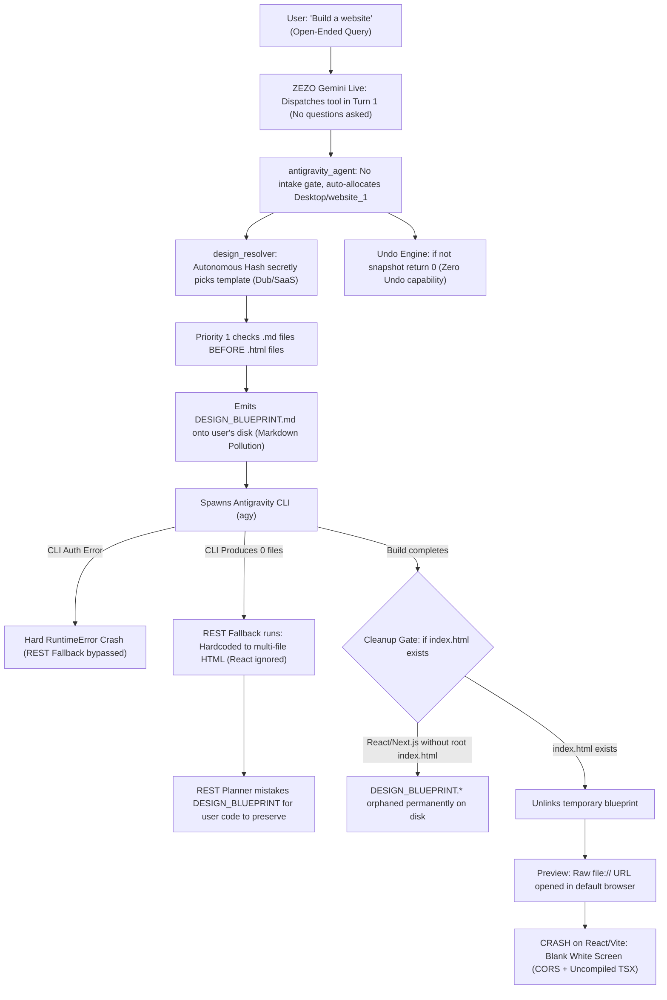
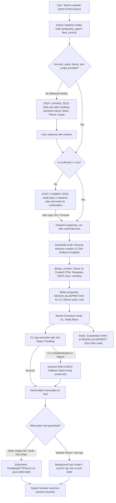

# 🌐 Greenfield Website Creation Pipeline: Comprehensive Architectural Audit & Issues Report

> **Project:** ZEZO  
> **Creator & Lead Architect:** Hamza Bukhari  
> **Target Subsystem:** Greenfield Web Generation & Autonomous Design System (Hamza Taste 3.0)  
> **Key Modules Investigated:** `actions/antigravity_agent.py`, `core/design_resolver.py`, `core/design_extractor.py`, `core/prompt.txt`, `skills/hamza_taste/`, `core/undo.py`, `actions/fleet_control.py`  
> **Scope:** Issues Diagnosis & Architectural Audit Only (Zero Code Modifications)

---

## Executive Summary

An exhaustive multi-agent architectural audit was performed on ZEZO's **Greenfield Website Creation Pipeline**—the system responsible for building new websites, landing pages, and web apps from scratch (distinct from `clone_website`).

While the website cloning subsystem benefits from a rigorous, stateless two-step confirmation gate and ephemeral HTTP preview servers, the Greenfield creation pipeline suffers from **six foundational architectural flaws**:
1. **Zero Intake & Clarification Gate:** The system dispatches heavy code builds immediately on open-ended queries without asking clarifying questions (tech stack, color theme, key sections, confirmation).
2. **Intermediate Markdown Contamination (`design.md` / `DESIGN_BLUEPRINT.md`):** Template resolution prioritizes legacy `.md` files over raw HTML, emits unnecessary `DESIGN_BLUEPRINT.md` files onto disk, and fails to clean them up.
3. **Tech Stack Blindspots & REST Fallback Divergence:** Silent default to multi-file HTML/CSS, while the Gemini REST fallback completely ignores user requests for React/Vite or Single-File HTML.
4. **The Blank White Screen Bug (Preview Failure):** Greenfield preview unconditionally opens raw `file://` URIs, causing React/Vite applications to crash due to browser CORS, uncompiled TSX, and root-relative path resolution.
5. **Greenfield Undo Non-Functionality (`core/undo.py:173`):** Newly created empty workspaces produce empty snapshot dictionaries (`{}`), causing the undo engine to exit immediately without registering an undo action.
6. **Auth Hard-Crash & Blueprint Leak Fallback Trap:** CLI authentication errors crash the task without falling back to Gemini REST; when fallback does occur after a CLI failure, the abandoned `DESIGN_BLUEPRINT.html` is mistaken for user code to preserve.

---

## 🔄 Visual Architecture: BEFORE vs. AFTER Pipeline Comparison

### ❌ BEFORE: Current Flawed Pipeline (Silent Assumptions, Leaks & Failures)



---

### ✅ AFTER: Target Fixed Pipeline (Clarification Gate, Pure HTML & Smart Preview)



---

## 🚨 Issue 1: Missing Intake & Clarification Flow (Questions Na Poochna)

### 1.1 Symptoms
When a user provides an open-ended request like:
- *"I want to build a website"*
- *"Make a landing page for me"*
- *"Build a portfolio"*

The system does **not** ask any clarifying questions regarding:
- **Tech Stack Preference:** (Single-file self-contained HTML vs. Modular React/Vite vs. Multi-file HTML/CSS/JS)
- **Color Theme / Aesthetic:** (Dark obsidian glassmorphism, clean light minimal, luxury gold, or brand colors)
- **Key Sections / Scope:** (Hero, Features, Pricing, Testimonials, Contact)
- **User Confirmation:** No read-back of the plan or directory before triggering heavy execution.

Instead, the agent immediately announces: *"Building your website now..."* and begins generation.

### 1.2 Comparison with `clone_website`

| Dimension | `clone_website` (`actions/website_cloner.py`) | Greenfield Creation (`antigravity_agent.py` / `fleet_control.py`) |
| :--- | :--- | :--- |
| **Tool Declaration Schema** | Explicitly declares `url`, `mode`, `output_format`, `target_dir`, and `confirmed`. Enforces negative constraints: *"Set ONLY if user explicitly stated... Otherwise OMIT it — ZEZO will ask."* | Only declares generic `task`, `project_path`, and `model`. No stack, theme, sections, or confirmation parameters exist in the schema. |
| **Intake Gate (Python Code)** | **Stateless Python Gate:** If required arguments are missing, execution halts immediately and returns: `"CLONE NOT STARTED. Ask the user these questions out loud...: - scope... - output... - folder..."` | **None:** Evaluates `is_brand_new`, auto-allocates `Desktop/website_1`, auto-selects design, and submits background worker immediately. |
| **Commit Gate (Python Code)** | **Confirmation Enforcement:** If `not confirmed`, halts execution and instructs LLM to read back the plan and wait for a clear "Yes". | **None:** No `confirmed` parameter exists in schema or action handler. |
| **Stateless Safety** | Self-contained within the tool invocation, immune to session memory wipes across turns. | Relies solely on LLM prompt instructions, which are consistently bypassed. |

### 1.3 Root Causes in the Codebase
1. **Absence of Action-Level Python Interception:**  
   In `actions/antigravity_agent.py` line 980 and `actions/fleet_control.py` line 70, there is zero parameter inspection. The moment the tool is called, `tm.submit("antigravity_agent", _run_worker, ...)` runs.
2. **Missing Schema Parameters in Tool Declarations:**  
   The function declaration for `antigravity_run` lacks `tech_stack`, `color_theme`, and `confirmed` properties. Gemini Live assumes all necessary information is present in `task` on turn 1.
3. **Internal Contradictions in `core/prompt.txt`:**
   - While line 239 defines `PRE-FLIGHT PROJECT CLARIFICATION GUARD`, lines 252 and 255 provide few-shot examples demonstrating immediate dispatch without questions:  
     `"Build landing page" -> fleet_control(action='dispatch', agent_id='FLUX', task='Build clean landing page')`
   - Line 58 states: *"When a request is ambiguous, take the most reasonable reading and act rather than asking."*
   - Line 176 mandates: *"The acknowledgement sentence and the tool call belong to the same turn."*  
   The LLM prioritizes tool execution over multi-turn conversation.
4. **Autonomous Guesswork Engine:**  
   `core/design_resolver.py` Priority 5 computes a string hash on the prompt to silently pick a reference template (e.g., Dub or SaaS), completely hiding the decision from the user.

---

## 🚨 Issue 2: `design.md` & `DESIGN_BLUEPRINT.md` Creation (Direct HTML Bypass)

### 2.1 Symptoms
- Users observe `.md` files (such as `DESIGN_BLUEPRINT.md` or `design.md`) being written into workspace directories.
- In some scenarios, token specifications from Markdown are used instead of injecting authentic raw HTML templates.
- Markdown blueprint files frequently survive in the project folder after the build finishes.

### 2.2 Root Causes in the Codebase

#### A. Priority 1 Order in `core/design_resolver.py` (Lines 240–250)
```python
# Priority 1: Explicit Reference Match in task
for p in available_md:
    if _is_explicit_match(p.stem):
        matched_md = p
        break

if not matched_md:
    for p in available_html:
        if _is_explicit_match(p.stem):
            matched_html = p
            break
```
- **The Defect:** The engine scans `available_md` (from `skills/hamza_taste/references/design md/`) **before** scanning `available_html`.
- If a match is found in `.md`, it attempts to look up a corresponding `.html` file.
- If the design only exists as a spec (e.g. `127-DESIGN.md`), or if filename normalization fails to find the HTML, `matched_html` remains `None`.
- `_load_or_extract_reference()` then returns `source_type="reference_cached"` with `raw_html=""` and `design_spec=<markdown>`.

#### B. Generation of `DESIGN_BLUEPRINT.md` in Workspace (`actions/antigravity_agent.py:476–488`)
```python
design_blueprint_name = ""
if resolved_design and resolved_design.is_active():
    try:
        if resolved_design.raw_html:
            (repo / "DESIGN_BLUEPRINT.html").write_text(resolved_design.raw_html, encoding="utf-8")
            design_blueprint_name = "DESIGN_BLUEPRINT.html"
        else:
            spec_text = f"{resolved_design.design_spec}\n\n{resolved_design.anti_slop_rules}".strip()
            if spec_text:
                (repo / "DESIGN_BLUEPRINT.md").write_text(spec_text, encoding="utf-8")
                design_blueprint_name = "DESIGN_BLUEPRINT.md"
    except Exception:
        design_blueprint_name = ""
```
- When `raw_html` is empty, the agent writes `DESIGN_BLUEPRINT.md` directly into the user's project workspace.

#### C. Flawed Blueprint Cleanup Condition (Lines 825 & 919)
```python
# Cleanup temporary design blueprint if the build generated real files
if (repo / "index.html").exists():
    try:
        for bp_name in ("DESIGN_BLUEPRINT.html", "DESIGN_BLUEPRINT.md"):
            bp = repo / bp_name
            if bp.exists():
                bp.unlink()
    except Exception:
        pass
```
- **The Defect:** Cleanup is strictly gated on `if (repo / "index.html").exists():`.
- If the project is React or Next.js (where files land in `src/` or `app/` without a root `index.html`), `index.html` does not exist in root.
- If the build errors out or is cancelled, line 825 is never reached.
- There is no `finally:` guarantee. Consequently, `DESIGN_BLUEPRINT.md` and `DESIGN_BLUEPRINT.html` remain permanently orphaned in the user's workspace.

### 2.3 The Correct Direct HTML Passing Mechanism
1. **Reverse Priority:** `core/design_resolver.py` must match `available_html` first. All 13 gold-standard Hamza Taste templates exist as production HTML files in `skills/hamza_taste/references/html/`.
2. **Eliminate Intermediate `.md` Creation:** Greenfield website creation should never write `DESIGN_BLUEPRINT.md`. If a reference is spec-only, the spec text should be passed directly in the prompt directive without touching the disk.
3. **Guaranteed `finally:` Cleanup:** Any temporary `DESIGN_BLUEPRINT.html` placed on disk for Windows CLI inspection must be unconditionally unlinked in a `finally:` block regardless of whether `index.html` exists.

---

## ⚠️ Issue 3: Tech Stack Blindspots & REST Fallback Divergence

### 3.1 Silent Default to Vanilla HTML/CSS
In `actions/antigravity_agent.py` lines 507–606:
- If the user does not explicitly specify `"react"` or `"single html"`, the agent defaults into the `else:` branch: multi-file vanilla static site (`index.html`, `style.css`, `js/app.js`).
- The user is never offered a choice between modern component stacks (React/Tailwind) and standalone single-file deliverables.

### 3.2 Complete Stack Divergence in Gemini REST Fallback
If the native Antigravity CLI (`agy`) is not installed, unauthenticated, or fails to produce files, execution cascades to `plan_antigravity_project()` (lines 239–317):
- `plan_antigravity_project` **completely ignores** `is_static_html` and `is_react_or_next`.
- Rule 2 of the planning prompt is hardcoded: *"List 'index.html' FIRST, followed by 'css/style.css'..."*
- In `write_antigravity_file()` (lines 386–390), specialized code generation only exists for `index.html` and `style.css`.
- **Impact:** If a user explicitly requested a React/Vite application and the CLI fails, the Gemini REST fallback silently builds a vanilla HTML/CSS site instead.

### 3.3 Zero Dependency Installation for React Projects
When the Antigravity CLI scaffolds a React/Vite project (`package.json`, `src/App.tsx`, `vite.config.ts`), `actions/antigravity_agent.py` never triggers `npm install`. The project is left in an uninstalled, unrunnable state.

---

## ⚠️ Issue 4: The Blank White Screen Bug (Preview Failure)

### 4.1 Root Cause in `actions/antigravity_agent.py` (Lines 839–844 & 944–948)
```python
if not payload.get("skip_preview") and (repo / "index.html").exists():
    try:
        target_url = (repo / "index.html").resolve().as_uri()
        webbrowser.open(target_url)
```
- Greenfield websites are opened via the `file://` scheme (`file:///C:/Users/.../Desktop/project/index.html`).
- In contrast to `actions/website_cloner.py` (which spawns an ephemeral `ThreadingHTTPServer` on ports 9400–9480), `antigravity_agent.py` has no local HTTP server integration.

### 4.2 Catastrophic Failure on React / Vite Builds
Vite projects generate an `index.html` containing:
```html
<script type="module" src="/src/main.tsx"></script>
```
When opened directly in a browser via `file://`:
1. **CORS Block:** Modern browsers block local ES module loading (`type="module"`) over `file://` for security reasons.
2. **Root Path 404:** The root-relative path `/src/main.tsx` attempts to load from the drive root (`file:///C:/src/main.tsx`), failing with 404.
3. **Uncompiled JSX:** The browser cannot parse raw TypeScript/JSX syntax.
4. **User Experience:** The user is greeted with a **completely blank white screen** and a console flooded with errors.

---

## ⚠️ Issue 5: Greenfield Undo Non-Functionality (`core/undo.py:173`)

### 5.1 Root Cause Analysis
In `actions/antigravity_agent.py`:
```python
snapshot = capture_repo_snapshot(repo)  # line 445
...
changed_count = register_repo_undo(repo, snapshot, "Antigravity Agent")  # line 816, 930
```
- For a greenfield website, `repo` is a newly created, empty directory on the Desktop.
- `capture_repo_snapshot(repo)` returns an empty dictionary: `{}`.
- In `core/undo.py` line 173:
```python
def register_repo_undo(repo_path: str | Path, snapshot: dict[str, bytes], tool_label: str = "Coding agent") -> int:
    root = Path(repo_path).resolve()
    if not root.exists() or not root.is_dir() or not snapshot:
        return 0
```
- **The Bug:** `if not snapshot: return 0` exits immediately!
- Because `snapshot == {}`, `register_repo_undo` aborts without pushing an action to the undo stack (`_stack`).
- **Impact:** **Zero undo capability for all greenfield projects.** If a user commands *"undo website"*, ZEZO cannot revert or delete the project.
- Additionally, line 817 (`if changed_count > 0: remember("active_file", ...)`) is skipped, failing to record project context.

---

## ⚠️ Issue 6: Auth Hard-Crash & Blueprint Contamination Fallback Trap

### 6.1 Hard Crash on Auth Error (`actions/antigravity_agent.py:761`)
```python
cli_output = "\n".join(stdout_lines)
if "not logged into Antigravity" in cli_output:
    raise RuntimeError("Antigravity CLI is not signed in. Run 'agy auth login' to authenticate.")
```
- Raising an unhandled `RuntimeError` immediately terminates the worker thread.
- The execution **never reaches the Gemini REST fallback** (line 864). The fallback only triggers if the CLI produces zero files gracefully, not if it raises an exception.

### 6.2 The Blueprint Contamination Trap (Lines 246–275)
1. The CLI path writes `DESIGN_BLUEPRINT.html` into the workspace.
2. If the CLI exits without generating deliverables, execution cascades to `plan_antigravity_project()`.
3. In line 246, `plan_antigravity_project` scans `project_dir.rglob("*")` for existing files:
   - It does **not** exclude `DESIGN_BLUEPRINT.html`.
4. Gemini REST assumes `DESIGN_BLUEPRINT.html` is an authentic existing user project file and injects:
   `CRITICAL PRESERVATION DIRECTIVE: If the target directory already contains existing files... DO NOT discard or break existing hero sections...`
5. **Impact:** The fallback agent spends its token budget attempting to "preserve" the temporary reference template instead of building the user's requested application.

---

## 📊 Summary of Identified Deficiencies

| ID | Component / File | Specific Defect | Severity | Impact on User Experience |
| :---: | :--- | :--- | :---: | :--- |
| **1** | `actions/antigravity_agent.py`<br/>`actions/fleet_control.py` | Missing intake parameters and confirmation gate | **HIGH** | Open-ended queries trigger immediate builds without asking for tech stack, color theme, or scope. |
| **2** | `core/design_resolver.py:240`<br/>`actions/antigravity_agent.py:481` | `.md` files prioritized over `.html`; `DESIGN_BLUEPRINT.md` emitted | **MEDIUM** | Intermediate markdown specs pollute the workspace instead of directly leveraging 13 raw HTML templates. |
| **3** | `actions/antigravity_agent.py:825` | Blueprint cleanup gated strictly on `index.html` existence | **MEDIUM** | Blueprint files are permanently orphaned in React/Next.js projects and failed builds. |
| **4** | `actions/antigravity_agent.py:841` | Preview opened via raw `file://` instead of HTTP server | **HIGH** | React/Vite projects open as a completely blank white screen due to CORS and uncompiled TSX. |
| **5** | `core/undo.py:173` | `if not snapshot: return 0` rejects empty initial states | **HIGH** | Greenfield website builds have zero undo capability. |
| **6** | `actions/antigravity_agent.py:239` | Gemini REST fallback hardcodes multi-file HTML/CSS | **HIGH** | Explicit requests for React or Single-File HTML are ignored if the CLI fails. |
| **7** | `actions/antigravity_agent.py:761` | Hard `RuntimeError` on unauthenticated CLI | **HIGH** | Bypasses Gemini REST fallback, causing immediate task failure. |
| **8** | `actions/antigravity_agent.py:246` | REST fallback does not filter `DESIGN_BLUEPRINT.*` | **MEDIUM** | Fallback mistakes failed CLI's blueprint for real user code to preserve. |

---

## 🛠️ Recommended Architectural Remediation Blueprint

### Step 1: Implement a Stateless 2-Step Gate for Greenfield Builds
- Upgrade `antigravity_run` and `fleet_control` tool declarations with optional parameters: `tech_stack` (`single_file_html`, `modular_html_css_js`, `react_vite`, `nextjs`), `color_theme`, and `confirmed`.
- In `antigravity_action()`, if the request is an open-ended greenfield build and parameters are missing, halt execution and return clarifying questions.
- Once parameters are supplied, require `confirmed=True` before submitting the task.

### Step 2: Pure Direct HTML Template Resolution
- In `core/design_resolver.py`, search `available_html` **first**. Only inspect `.md` as a secondary fallback.
- In `actions/antigravity_agent.py`, write **only** `DESIGN_BLUEPRINT.html`. Never write `DESIGN_BLUEPRINT.md`.
- Move blueprint unlinking into a `finally:` block so temporary files are removed regardless of build outcome.

### Step 3: Local HTTP Preview Server for Greenfield Builds
- Integrate the ephemeral `ThreadingHTTPServer` from `actions/website_cloner.py` into `antigravity_agent.py`.
- For React/Vite projects, run `npm install` and start `npx vite --port 3000` (similar to `core/teardown_engine.py`) instead of opening `file://`.

### Step 4: Fix Greenfield Undo Registration
- In `core/undo.py`, allow registration when `snapshot == {}` if the directory was newly created, tracking folder creation as a reversible event.

### Step 5: Stack Parity in Gemini REST Fallback
- Update `plan_antigravity_project` and `write_antigravity_file` to respect `is_static_html` and `is_react_or_next`.
- Filter out `DESIGN_BLUEPRINT.*` in line 246 so temporary blueprints are never mistaken for existing code.

---

## 🚀 Detailed Phased Fix Plan

Below is the concrete, step-by-step implementation plan designed to address every identified defect without causing regressions in existing cloner, reverse-engineering, or fleet systems.

```
                    PHASED FIX IMPLEMENTATION ROADMAP
 ┌────────────────────────────────────────────────────────────────────────┐
 │ Phase 1: Intake & 2-Step Confirmation Gate (Schema + Handler + Prompt) │
 └───────────────────────────────────┬────────────────────────────────────┘
                                     │
 ┌───────────────────────────────────▼────────────────────────────────────┐
 │ Phase 2: Direct Raw HTML Resolution & Guaranteed Cleanup               │
 └───────────────────────────────────┬────────────────────────────────────┘
                                     │
 ┌───────────────────────────────────▼────────────────────────────────────┐
 │ Phase 3: Gemini REST Fallback Stack Parity & Graceful Auth Recovery   │
 └───────────────────────────────────┬────────────────────────────────────┘
                                     │
 ┌───────────────────────────────────▼────────────────────────────────────┐
 │ Phase 4: Preview Engine & React Dev Server Launch                      │
 └───────────────────────────────────┬────────────────────────────────────┘
                                     │
 ┌───────────────────────────────────▼────────────────────────────────────┐
 │ Phase 5: Greenfield Undo Registration (`core/undo.py`)                 │
 └───────────────────────────────────┬────────────────────────────────────┘
                                     │
 ┌───────────────────────────────────▼────────────────────────────────────┐
 │ Phase 6: 3-Layer Mandatory Verification & Documentation Sync           │
 └────────────────────────────────────────────────────────────────────────┘
```

---

### Phase 1: Stateless 2-Step Clarification Gate (Intake & Confirmation)

**Objective:** Prevent premature, silent execution on broad requests (*"build a website"*, *"make a landing page"*) by prompting the user for key decisions, just like `clone_website`.

#### 1.1 The 4 Core Intake Pillars & Question Structure

To ensure zero ambiguity without overwhelming the user in voice conversations, the intake gate organizes requirements into **4 essential pillars**:

| Pillar | Question Focus | Core Options Presented to User |
| :--- | :--- | :--- |
| **1. Scope & Deliverable Type (`scope_type`)** | *Kya banana hai?* | • **Single High-Converting Landing Page**<br/>• **Full Multi-Page Website**<br/>• **Specific Section / Component** (Hero Section, Pricing Table, Navbar, Dashboard Card) |
| **2. Tech Stack (`tech_stack`)** | *Kis format me banana hai?* | • **Single-File HTML** (Fastest, zero install, standalone index.html)<br/>• **Modular React + Tailwind (Vite)** (Modern components under `src/components/`) |
| **3. Design Theme (`color_theme`)** | *Look & feel kaisa ho?* | • **Dark Obsidian Glassmorphism** (Hamza Taste SaaS/AI Vibe)<br/>• **Clean Light Minimal / Editorial** (Agency / Portfolio / Docs)<br/>• **Luxury Glowing Frame** (Premium / Automotive / Jewelry)<br/>• **Custom Brand Colors** |
| **4. Key Sections & Purpose (`key_sections`)** | *Kaunse sections lazmi hon?* | • Hero, Features Grid, Social Proof / Stats, Pricing Cards, FAQ, Contact / CTA |

---

#### 1.2 Tool Schema Upgrade (`actions/antigravity_agent.py` & `actions/fleet_control.py`)
Add explicit parameters with negative constraints to the `TOOL` declaration:
- `scope_type` (string, enum: `["landing_page", "full_website", "hero_section", "component"]`):
  > *"Scope of the web build. Set ONLY if user stated (e.g. 'landing page', 'full website', 'hero section', 'pricing card'). Otherwise OMIT it — ZEZO will ask."*
- `tech_stack` (string, enum: `["single_file_html", "modular_html_css_js", "react_vite", "nextjs"]`):
  > *"Tech stack for new website creation. Set this ONLY if user explicitly stated a stack. Otherwise OMIT it — ZEZO will ask the user. Never invent a default yourself."*
- `color_theme` (string, enum: `["dark_obsidian", "clean_minimal", "luxury_gold", "cyber_matrix", "custom"]`):
  > *"Visual design theme / aesthetic. Set this ONLY if stated. Otherwise OMIT it — ZEZO will ask."*
- `key_sections` (string):
  > *"Comma-separated key sections (e.g. 'hero, features, pricing, contact')."*
- `confirmed` (boolean):
  > *"Set to true ONLY after the user explicitly hears the plan and confirms ('yes', 'proceed', 'build it'). Omit or false on initial request."*

---

#### 1.3 Conversational Voice Scripts & Dialogue Flows

The Python intake handler will formulate responses using these conversational voice patterns:

##### Scenario A: Completely Open-Ended Request
*User:* *"Ek website bana do"* / *"I want to build a website"*

> **ZEZO (Turn 1):**  
> *"Zaroor sir! Build shuru karne se pehle mujhe 3 quick cheezein confirm kar dein:*  
> *1. **Scope:** Single landing page banana hai, full multi-page website, ya koi specific component jaise hero section?*  
> *2. **Tech Stack:** Lightweight Single-file HTML chahiye ya modular React + Tailwind project?*  
> *3. **Theme:** Hamza Taste ka Dark Obsidian Glassmorphism chalega ya Clean Light Minimal?"*

##### Scenario B: Smart Adaptive Intake (Scope Known, Stack/Theme Missing)
*User:* *"Mere real estate business ke liye landing page bana do"*  
*(Scope = 'landing_page' is already known, Domain = Real Estate)*

> **ZEZO (Turn 1):**  
> *"Real estate landing page ke liye sir: Kya aap modular React + Tailwind chahte hain ya fast single-file HTML? Aur theme modern dark glass rahe ya clean luxury white/gold?"*  
> *(Notice: Scope question was intelligently skipped!)*

##### Scenario C: Targeted Component Request
*User:* *"Mujhe sirf ek luxury hero section bana ke do"*  
*(Scope = 'hero_section')*

> **ZEZO (Turn 1):**  
> *"Luxury hero section ke liye sir: Kya yeh standalone single-file HTML me chahiye ya React component? Aur glowing dark frame aesthetic chalega?"*

---

#### 1.4 Step 2: Commitment Read-Back (The Confirmation Gate)

Once the user answers the clarifying questions, ZEZO does **NOT** immediately dispatch the crawler/coder. It performs a **strict 1-sentence read-back commitment**:

> **ZEZO (Turn 2):**  
> *"Perfect sir! Plan yeh hai: Desktop par `real-estate-landing` folder me **Single-File HTML** landing page banegi, **Dark Obsidian theme**, with **Hero, Property Grid, aur Contact Form**. Kya main proceed karoon?"*

- **User says:** *"Haan" / "Proceed" / "Yes" / "Theek hai"*
- **ZEZO dispatches:** `antigravity_run(task="...", scope_type="landing_page", tech_stack="single_file_html", color_theme="dark_obsidian", confirmed=True)`
- **ZEZO Voice Feedback:** *"Building your landing page now, sir..."*

---

#### 1.5 Python-Level Intake Gate Implementation Logic (`antigravity_agent.py::antigravity_action`)
Mirror the proven gate pattern from `actions/website_cloner.py`:
1. **Detect Open-Ended Greenfield Builds:**
   - Check if `is_brand_new` is true (no explicit existing path) AND the task description is broad/vague (e.g. `< 60` chars or contains generic tokens without explicit stack/features).
2. **Step 1 — Intake Gate (Missing Decisions):**
   - If `scope_type`, `tech_stack`, or `color_theme` are omitted and not deducible from the prompt:
     Halt immediately and return the Scenario A/B voice prompt text.
3. **Step 2 — Confirmation Gate (`confirmed != True`):**
   - Once all parameters are resolved, if `confirmed is not True`:
     Halt immediately and return the Commitment Read-Back text.
4. **Bypass for Fully Detailed Prompts:**
   - If the user already provided comprehensive specifications in their initial prompt (e.g. *"Build a React Vite landing page with dark theme for a dental clinic"*), skip the intake gate and proceed directly to execution.

#### 1.6 Prompt Alignment (`core/prompt.txt`)
- Under `[CODING DELEGATION — AUTONOMOUS FLEET ORCHESTRATOR]`:
  - Update few-shot examples so open-ended prompts show asking clarification rather than blind dispatch:
    - `"Build a portfolio website"` ➔ *"Ask: Would you prefer a lightweight single-file HTML site or a modular React project, and what visual theme do you like?"*
  - Explicitly exempt new Greenfield project intake from the *"act rather than asking"* and *"acknowledgement in same turn"* rules.

---

### Phase 2: Direct Raw HTML Resolution & Guaranteed Cleanup

**Objective:** Completely eliminate intermediate `.md` files (`design.md`, `DESIGN_BLUEPRINT.md`) and ensure 100% direct use of the 13 curated HTML reference templates.

#### 2.1 Reverse Priority 1 Lookup in `core/design_resolver.py`
In lines 240–250:
- **Current Defect:** Searches `available_md` first, which can match a spec-only file (like `127-DESIGN.md`) and leave `raw_html` empty.
- **Fix:** Search `available_html` **first**. Only fall back to `available_md` if zero HTML templates match:
  ```python
  # Priority 1: Match raw HTML reference templates FIRST
  for p in available_html:
      if _is_explicit_match(p.stem):
          matched_html = p
          break

  if not matched_html:
      for p in available_md:
          if _is_explicit_match(p.stem):
              matched_md = p
              break
  ```

#### 2.2 Eliminate `DESIGN_BLUEPRINT.md` on Disk (`actions/antigravity_agent.py`)
In lines 476–488:
- **Current Defect:** If `raw_html` is empty, it writes `(repo / "DESIGN_BLUEPRINT.md").write_text(...)` to disk.
- **Fix:**
  - If `resolved_design.raw_html` exists: write `DESIGN_BLUEPRINT.html` to disk for the CLI agent to inspect.
  - If `raw_html` is empty: **do not write any file to disk**. Instead, append the `design_spec` text directly into the CLI prompt directive string.
  - `DESIGN_BLUEPRINT.md` must **never** be created on disk.

#### 2.3 Guaranteed Cleanup in `finally:` Block (`actions/antigravity_agent.py`)
- **Current Defect:** Lines 825 & 919 gate cleanup on `if (repo / "index.html").exists():`. React/Next.js projects and failed builds orphan blueprint files on disk.
- **Fix:**
  Wrap worker execution in a `try...finally:` block:
  ```python
  try:
      # Worker build execution...
  finally:
      for bp_name in ("DESIGN_BLUEPRINT.html", "DESIGN_BLUEPRINT.md"):
          bp_file = repo / bp_name
          if bp_file.exists():
              try:
                  bp_file.unlink(missing_ok=True)
              except Exception as e:
                  logger.debug("Failed cleaning up %s: %s", bp_name, e)
  ```

#### 2.4 Exclude Blueprint Files from Existing-Files Scan (`plan_antigravity_project`)
In line 246 of `actions/antigravity_agent.py`:
- Explicitly exclude `DESIGN_BLUEPRINT.*` when scanning `project_dir.rglob("*")`.
- Prevents the fallback REST planner from mistaking a failed CLI run's blueprint for real user code to preserve.

---

### Phase 3: Gemini REST Fallback Stack Parity & Graceful Auth Recovery

**Objective:** Guarantee that if native CLI (`agy`) fails or is unauthenticated, the fallback produces the user's requested stack instead of hardcoding vanilla HTML/CSS.

#### 3.1 Graceful Auth Error Handling (`actions/antigravity_agent.py:761`)
- **Current Defect:** `if "not logged into Antigravity" in cli_output: raise RuntimeError(...)` kills the worker thread.
- **Fix:** Instead of raising an unhandled `RuntimeError`, log a warning and fall through to the Gemini REST generation path (`plan_antigravity_project` and `write_antigravity_file`).

#### 3.2 Stack Parity in `plan_antigravity_project`
- Accept `is_static_html` and `is_react_or_next` flags into `plan_antigravity_project()`.
- If `is_static_html`: enforce planning exactly one file: `index.html`.
- If `is_react_or_next`: plan modular structure (`package.json`, `vite.config.ts`, `index.html`, `src/App.tsx`, `src/components/Navbar.tsx`, `src/components/Hero.tsx`, `src/index.css`).
- If neither: plan default multi-file HTML/CSS/JS.

#### 3.3 Stack Parity in `write_antigravity_file`
- Add specialized generation prompts for `package.json`, `App.tsx`, and component files under `src/components/`, ensuring valid JSX, Tailwind classes, and Lucide icons.

---

### Phase 4: Preview Server Upgrade & React Dev Server Launch

**Objective:** Eliminate the blank white screen bug by ensuring deliverables are previewed correctly according to their tech stack.

#### 4.1 Ephemeral HTTP Preview for Static Sites
- In `actions/antigravity_agent.py`, replace direct `webbrowser.open(file://...)` with the ephemeral `ThreadingHTTPServer` from `actions/website_cloner.py` (range 9400–9480).
- Resolves root-relative asset paths (`/assets/...`, `/style.css`) and avoids local browser file restrictions.

#### 4.2 Automated Dev Server for React / Vite Projects
When deliverables include `package.json` and `vite.config.ts`:
1. Suppress raw `file://` opening (prevent blank white screen).
2. Execute background `npm install` with `creationflags=CREATE_NO_WINDOW`.
3. Launch `npx vite --port 3000` (or the next available port) in the background.
4. Open the browser to `http://localhost:3000`.

---

### Phase 5: Greenfield Undo Registration (`core/undo.py`)

**Objective:** Enable 1-click rollback/undo for newly created websites.

#### 5.1 Fix `core/undo.py:173`
- **Current Defect:**
  ```python
  if not root.exists() or not root.is_dir() or not snapshot:
      return 0
  ```
  Empty snapshots (`snapshot == {}`) cause the function to exit without registering an undo entry.
- **Fix:**
  Allow registration when `snapshot == {}` if `root` is a newly created project directory:
  ```python
  # If snapshot is empty, this is a greenfield creation.
  # The undo action will delete the newly created files/folder.
  if not snapshot:
      _stack.append({
          "repo_path": str(root),
          "tool": tool_label,
          "is_greenfield": True,
          "created_files": list(capture_repo_snapshot(root).keys()),
          "timestamp": time.time(),
      })
      return len(_stack[-1]["created_files"])
  ```
- In `apply_undo()`, if `is_greenfield` is true, cleanly remove the created files and prune the empty folder.

---

### Phase 6: 3-Layer Mandatory Verification Plan

In accordance with **AGENTS.md Core Operating Rule 7**, any subsequent implementation must be strictly verified across all three layers:

#### Layer 1: Static Verification
- Run `python -m py_compile actions/antigravity_agent.py core/design_resolver.py core/undo.py actions/fleet_control.py`.
- Verify zero syntax errors, missing imports, or type annotation breaks.

#### Layer 2: Runtime Verification
- **Test 1 (Intake Gate):** Invoke `antigravity_action` with `{"task": "Build a website for me"}`. Verify it halts and returns the clarification questions without creating a directory or submitting a worker.
- **Test 2 (Commit Gate):** Invoke with `{"task": "Build website", "tech_stack": "single_file_html", "color_theme": "dark_obsidian"}` without `confirmed`. Verify it halts and asks for user confirmation.
- **Test 3 (HTML Priority):** Verify `resolve_design("saas website")` returns `source_type="reference_raw_html"` with non-empty `raw_html` and that **zero `.md` files** are created in the workspace.
- **Test 4 (Cleanup):** Verify that upon build completion (or simulated failure), `DESIGN_BLUEPRINT.html` is 100% removed from the workspace.
- **Test 5 (Undo):** Run a greenfield build, verify `register_repo_undo()` returns `> 0`, and verify `apply_undo()` cleanly removes the generated project.

#### Layer 3: Regression Suite
- Run existing test suites:
  ```bash
  pytest tests/test_website_cloner_suite.py tests/test_design_system_suite.py tests/test_code_engines_phase1.py
  ```
- Ensure zero regression in website cloning, REA reverse-engineering, or code engines health probing.

---

## 👥 Deep Audit: Fleet Agent Architecture & Newly Discovered Issues

Following an in-depth investigation into `core/fleet_manager.py`, `config/fleet_agents.json`, `core/code_engines.py`, `core/skill_loader.py`, and `frontend/src/components/office/`, a second set of critical architectural defects and bugs was identified.

### 🚨 Issue 7: Engine vs. Tool Semantic Conflation (Category Error)

#### Symptoms & Root Cause
In `config/fleet_agents.json` and `core/fleet_manager.py`:
- `VERVE` has `default_tool: "antigravity_run"` and `allowed_tools: ["antigravity_run", ...]`.
- `AHMAD` has `default_tool: "opencode_run"` and `allowed_tools: ["opencode_run", ...]`.
- `DWIGHT` has `default_tool: "kilo_run"` and `allowed_tools: ["kilo_run", ...]`.

1. **The Category Error:**  
   `antigravity_run`, `opencode_run`, and `kilo_run` are **CLI Execution Engines / Runtimes** (wrapping `agy.exe`, `opencode.cmd`, and `kilo.exe`). They are NOT tools that the agent itself invokes.
2. **The `allowed_tools` Illusion:**  
   Listing `antigravity_run` inside Verve's `allowed_tools` is an illusion. When `fleet_manager.dispatch_task` runs, `allowed_tools` is **never passed to the subprocess**. The external `agy.exe` process has zero connection to ZEZO's Python `ActionRegistry` and cannot invoke `antigravity_run` or any other ZEZO action.
3. **Dead `engine: ""` Field:**  
   In `config/fleet_agents.json`, every agent has `"engine": ""` (empty string) because a previous migration to `core/code_engines.py` was left half-finished.
4. **Frontend/Backend Naming Inversion:**  
   `frontend/src/components/office/AutonomousOfficeScreen.tsx` renames `default_tool` to `engine` in React state, while the backend treats it as a tool name.

---

### 🚨 Issue 8: Direct Agent Chat Hallucination (Zero Files Written)

#### Symptoms & Root Cause
When a user chats directly with an agent in the Autonomous Office (`AgentDirectChatView.tsx` -> `POST /api/fleet/chat`):
1. **Pure Single-Turn Text Completion:**  
   `_fleet_chat_handler` in `core/ui_server.py` routes directly to `gemini.text()` or `llm_router.generate_text()`.
2. **Zero Tool Access & Zero Subprocesses:**  
   The chat endpoint has **no access to action tools**, **spawns no background tasks**, and **executes no CLI engines**.
3. **Conversational Hallucination:**  
   If the user asks Verve: *"Build a website for me"*, Verve replies: *"Sure! I'm creating a modern Vite + React website for you now with Tailwind CSS..."* and outputs markdown code blocks.  
   **Reality:** **ZERO files, ZERO directories, and ZERO commands are executed on disk.** The user is misled into believing work is happening.
4. **Bypasses All Clarification & Intake Gates:** Direct chat does not validate parameters, ask clarifying questions, or require confirmation.

---

### 🚨 Issue 9: Dead `allowed_skills` Metadata

#### Symptoms & Root Cause
- In `config/fleet_agents.json`, agents are configured with skills:
  - Verve: `"allowed_skills": ["hamza_taste", "multi_agent_collaboration", "make_plan"]`
- **The Defect:** In `core/fleet_manager.py:dispatch_task` (line 650):
  ```python
  enriched_prompt = f"[{agent.name} • {agent.role}]\n{agent.prompt_prefix}\n\nTask: {prompt}"
  ```
  `core/fleet_manager.py` **never imports `core/skill_loader.py`**, never queries `SkillRegistry`, and **never injects the text of `allowed_skills` into the prompt**.
- `skills/hamza_taste/SKILL.md` is only used as a regex string extraction target by `core/design_resolver.py`.
- **Impact:** `allowed_skills` is completely dead configuration metadata in the backend.

---

### 🚨 Issue 10: Catastrophic Worktree Code Discard & ID Mismatch

#### Symptoms & Root Cause
In `core/fleet_manager.py` lines 630–640 and 785–798:
1. **Worktree ID Mismatch:**  
   Line 630 generates a local `task_id = uuid.uuid4().hex[:8]` and creates the worktree named `f"{agent.id.lower()}_{task_id}"` (e.g. `ahmad_4f8a12bc`).  
   Line 832 calls `tm.submit(...)`, generating a completely **different UUID** (`submitted_id`).  
   On completion, line 786 calls `self.complete_task(agent.id, submitted_id)`. `complete_task` attempts to merge and teardown `submitted_id`, which does not exist!
2. **Catastrophic Code Discard:**  
   In `complete_task(agent_id, task_id, merge_changes=False)`:
   - `merge_changes` defaults to `False`.
   - Line 798 calls `git_sandbox.safe_teardown(...)`.
   - `safe_teardown` executes `git worktree remove --force` on the branch.
   - **Impact:** **All code generated by an agent inside a worktree is permanently deleted and never merged into the project workspace.**

---

### 🚨 Issue 11: Configuration Inconsistencies & Ghost Tools in `config/fleet_agents.json`

1. **Michael's Ghost Tool `"groq"`:**  
   Michael's `default_tool` is set to `"groq"`. There is **no `actions/groq.py` file** in the repository. Dispatches to Michael silently fall back to `quick_snippet` or `opencode_run`.
2. **String `"None"` vs Python `None` Bug:**  
   FLUX, AHMAD, PAM, QUANTUM, DEVDYNAMO, DATAEINSTEIN, and RECON have `"worktree": "None"` (the string `"None"` instead of JSON `null`). Python evaluates `bool("None") == True`, causing `complete_task` to attempt deleting `.agent_worktrees/None`.
3. **Office Desk Coordinate Collision:**  
   Both **FLUX** and **PAM** are set to `(desk_x: 320, desk_y: 280)`. Both agent sprites sit on top of each other at the exact same desk in the Scranton Office UI.
4. **Pam Parameter Mismatch in `dispatch_task`:**  
   Pam's tool `extract_design_system` expects parameter `file_path` or `path` to be a URL or reference name. `fleet_manager.py:711` sets `"path": target_dir` (local folder), causing Pam to search for URLs on the local disk and fail.

---

## 📊 Complete Deficiencies Master Table

| ID | Component | Defect | Severity | Impact |
| :---: | :--- | :--- | :---: | :--- |
| **1** | `actions/antigravity_agent.py` | Missing intake parameters and confirmation gate | **HIGH** | Open-ended queries trigger immediate builds without asking stack/theme/scope. |
| **2** | `core/design_resolver.py` | Priority 1 checks `.md` before `.html`; writes `DESIGN_BLUEPRINT.md` | **MEDIUM** | Emits intermediate `.md` files instead of passing raw HTML templates directly. |
| **3** | `actions/antigravity_agent.py` | Blueprint cleanup strictly gated on `index.html` existence | **MEDIUM** | Blueprint files orphaned in React/Next.js projects and failed builds. |
| **4** | `actions/antigravity_agent.py` | Raw `file://` scheme used for preview | **HIGH** | React/Vite projects crash with blank white screen (CORS + TSX). |
| **5** | `core/undo.py:173` | `if not snapshot: return 0` rejects empty initial states | **HIGH** | Greenfield website builds have zero undo capability. |
| **6** | `actions/antigravity_agent.py` | Gemini REST fallback hardcodes multi-file HTML/CSS | **HIGH** | Explicit requests for React or Single-File HTML are ignored if CLI fails. |
| **7** | `actions/antigravity_agent.py` | Hard `RuntimeError` on unauthenticated CLI | **HIGH** | Bypasses REST fallback, causing immediate crash. |
| **8** | `fleet_agents.json`<br/>`fleet_manager.py` | Engine vs Tool conflation (`antigravity_run` in `allowed_tools`) | **HIGH** | Conceptual category error; `engine: ""` is dead; agent cannot call its own runner. |
| **9** | `/api/fleet/chat`<br/>`AgentDirectChatView` | Direct chat is pure text completion; zero tools/CLI | **CRITICAL** | Verve hallucinates building websites in direct chat, but writes zero files. |
| **10** | `core/fleet_manager.py:650` | `allowed_skills` never injected into prompts | **HIGH** | Skills like `hamza_taste` are dead metadata for fleet agents. |
| **11** | `core/fleet_manager.py:785` | Worktree changes discarded without merging; ID mismatch | **CRITICAL** | Destructive worktree tasks delete all agent deliverables. |
| **12** | `config/fleet_agents.json:9` | Ghost tool `"groq"` on Michael | **MEDIUM** | `actions/groq.py` does not exist; silent fallback occurs. |
| **13** | `config/fleet_agents.json` | String `"None"` for worktrees; desk collision at (320, 280) | **LOW** | Phantom folder teardowns; Flux and Pam overlap on desk floor. |
| **14** | `fleet_manager.py:711` | Pam parameter mismatch (`path: target_dir` overrides URL) | **HIGH** | Design extraction fails on live URLs when dispatched through fleet. |

---

## 🛠️ Phased Fix Plan: Fleet Architecture, Skills & Engine Disentanglement

```
           EXTENDED FLEET & SKILLS FIX ROADMAP
 ┌──────────────────────────────────────────────────────────────┐
 │ Phase 7: Disentangle Engines vs. Tools & Schema Cleanup      │
 └──────────────────────────────┬───────────────────────────────┘
                                │
 ┌──────────────────────────────▼───────────────────────────────┐
 │ Phase 8: Declarative `skills/website_build` & Skill Injection│
 └──────────────────────────────┬───────────────────────────────┘
                                │
 ┌──────────────────────────────▼───────────────────────────────┐
 │ Phase 9: Direct Agent Chat Execution Bridge                  │
 └──────────────────────────────┬───────────────────────────────┘
                                │
 ┌──────────────────────────────▼───────────────────────────────┐
 │ Phase 10: Worktree Merge & Teardown Lifecycle Fix            │
 └──────────────────────────────────────────────────────────────┘
```

---

### Phase 7: Disentangle Engines vs. Tools & Config Normalization

**Objective:** Separate execution environments from invokable action tools and clean up `config/fleet_agents.json`.

#### 7.1 Normalize Agent Schema in `config/fleet_agents.json`
1. **Populate `engine` as the Execution Runtime:**
   - For `VERVE` and `FLUX`: `"engine": "antigravity"` (maps to `core/code_engines.py`).
   - For `AHMAD`: `"engine": "opencode"`.
   - For `DWIGHT`: `"engine": "kilo"`.
   - For `MICHAEL`: `"engine": "opencode"` (replace non-existent `"groq"`).
2. **Purge CLI Runners from `allowed_tools`:**
   - Remove `"antigravity_run"`, `"opencode_run"`, `"kilo_run"`, and `"groq"` from `allowed_tools`.
   - `allowed_tools` must contain strictly invokable capabilities: `["browser_control", "file_processor", "file_controller", "extract_design_system", "web_search", "task_status"]`.
3. **Fix Schema Field Types:**
   - Replace string `"worktree": "None"` and `"active_worktree": "None"` with JSON `null`.
4. **Fix Desk Coordinate Collision:**
   - Move `PAM` to `(desk_x: 460, desk_y: 280)` to separate her from `FLUX` at `(320, 280)`.

#### 7.2 Backend Dispatch Decoupling (`core/fleet_manager.py`)
- In `FleetAgent`: Rename `default_tool` to `engine` (or maintain backward-compatible alias).
- In `dispatch_task`: Resolve the binary runner through `core/code_engines.py::resolve_binary(agent.engine)`.

---

### Phase 8: Declarative `skills/website_build` & Runtime Skill Injection

**Objective:** Transform website creation from hardcoded Python regexes into a declarative procedural skill that any agent can read and execute, replacing redundant skills.

#### 8.1 Removal of `hamza_taste` from Agent Skills & Replacement with `website_build`
- **In `config/fleet_agents.json`:**
  - Remove `"hamza_taste"` from `allowed_skills` for `VERVE` and `FLUX`.
  - Add `"website_build"` as the single, authoritative master skill for web creation:
    ```json
    "VERVE": {
      "allowed_skills": [
        "website_build",
        "make_plan",
        "multi_agent_collaboration"
      ]
    }
    ```
  - **Why this is done:** `website_build` encapsulates the complete Hamza Taste design philosophy, reference templates, and anti-slop rules. Retaining `hamza_taste` as a separate checkbox causes duplicate prompt injection, directive collisions, and user confusion in the Autonomous Office UI.
  - The curated HTML templates (`skills/hamza_taste/references/html/`) remain intact as the permanent design asset library.

---

#### 8.2 Exact Structure & Contents of `skills/website_build/SKILL.md`

The newly authored `skills/website_build/SKILL.md` will contain the following declarative blueprint:

```markdown
---
name: website_build
description: "Master studio protocol for creating websites, landing pages, and UI components adhering to Hamza Taste design references and anti-slop gates."
domain: ui
author: "Hamza Bukhari"
version: "1.0.0"
triggers: ["build website", "create landing page", "make website", "hero section", "pricing table", "web app"]
auto_activate: true
---

# 🌐 Master Studio Website Creation Protocol (`website_build`)

> **Lead Architect & Creator:** Hamza Bukhari  
> **Core Principle:** Anti-Slop is a **FILTER** (what to reject), while **Reference HTML Templates** supply 100% of the **DIRECTION** (colors, typography, components, and layout).

---

## 📋 1. PHASE 1: INTAKE & CLARIFICATION PROTOCOL (THE 4 PILLARS)

Before generating any code, verify that the following 4 core decisions are resolved:

1. **Scope & Type (`scope_type`):**
   - Single High-Converting Landing Page
   - Full Multi-Page Website
   - Specific Component / Section (Hero Section, Pricing Table, Navbar, Dashboard Card)
2. **Tech Stack (`tech_stack`):**
   - Single-File Self-Contained HTML5 (zero dependencies, pure inline CSS/JS, fastest standalone deliverable)
   - Modular React 18 + Tailwind CSS (Vite architecture, typed components under `src/components/`)
3. **Design Theme (`color_theme`):**
   - Dark Obsidian Glassmorphism (SaaS / AI / Tech vibe)
   - Clean Light Minimal / Editorial (Agency / Portfolio / Docs)
   - Luxury Glowing Frame (Automotive / Premium / Jewelry)
   - Custom Brand Colors
4. **Key Sections (`key_sections`):**
   - Hero, Features Grid, Social Proof / Stats, Pricing Cards, FAQ, Contact / CTA

### Commitment Read-Back Gate:
Read back the exact plan in 1 concise sentence:
*"Plan: Build a [scope_type] using [tech_stack] with [color_theme] aesthetic into Desktop/[folder_name]. Should I proceed?"*
Only begin code generation once the user explicitly confirms ("yes", "proceed", "build it").

---

## 🎨 2. PHASE 2: DESIGN FOUNDATION (HAMZA TASTE REFERENCE INTEGRATION)

Do NOT invent or hallucinate design tokens. Adopt visual foundations directly from the active reference in `skills/hamza_taste/references/html/`:

- **SaaS / B2B Platform:** `saas.html` (Plus Jakarta Sans, subtle borders, high-density feature grid).
- **High-Converting Marketing / Real Estate:** `dub.html` (Pill CTAs, link preview cards, stat counters).
- **Autonomous AI & Robotics:** `autonomus.html` (Pitch black void `#050505`, glowing cyan/zinc badges, terminal nodes).
- **Admin Dashboard & Metrics:** `Standalone Ecosystem.html` (Multi-panel layout, metric cards, data tables).
- **Editorial / Creative Portfolio:** `Crazy UI landing page.html` (Warm cream `#ececee`, editorial serif, dynamic asymmetry).
- **Luxury / Spatial HUD:** `aura frame.html` (Spatial luxury frame, white accents, ultra-fine 1px borders).
- **Minimal Documentation & Fintech:** `nami landing page.html` (Clean monochrome, neutral zinc).

---

## 🛑 3. PHASE 3: NON-NEGOTIABLE ANTI-SLOP DIRECTIVES

### 🔴 Tier 1: Absolute Hard Gates
1. ❌ **NO Cliché AI Purple/Indigo Gradients:** Strictly forbid `bg-gradient-to-r from-purple-600 to-indigo-600`, neon purple hero text, or floating ambient blobs.
2. ❌ **NO Unstyled Native Controls:** Default browser scrollbars, form inputs, checkboxes, and select dropdowns are strictly forbidden. Every input must have a custom dark/light styled surface with 1px border highlight.
3. ❌ **NO Fake Buzzwords / Fake Metric Copy:** Never use cringe copy like *"0.00001ms Latency"* or *"Loved by 10M Fortune 500 CEOs"*. Use realistic, authentic product copy.
4. ❌ **NO Plain 90s RGB Primaries:** Pure `#ff0000`, `#00ff00`, `#0000ff` are banned.
5. ❌ **NO Fragile Layouts:** Absolute positioning for structural layout is banned. All layouts MUST use CSS Grid or Flexbox with centered `max-w-7xl` (`1280px` or `1440px`) containers.

### 🟡 Tier 2: Rhythm & Geometry Locks
1. **4px/8px Modular Rhythm:** Spacing, padding, and margins must follow strict 4px/8px increments (`p-4`, `p-6`, `p-8`, `gap-4`).
2. **Consistent Radius Hierarchy:** Buttons `8px`, Cards `14px-16px`, Modals `16px-20px`, Badges `9999px` (pill).
3. **True Glassmorphism:** Layered depth: `background: rgba(24, 24, 27, 0.75); backdrop-filter: blur(16px); border: 1px solid rgba(255, 255, 255, 0.08);`. No drop shadows.

### 🟢 Tier 3: Delivery & Interaction Gate
1. **Micro-Interactions:** Active scale (`active:scale-95`), 150ms ease-out transitions, hover brightness boost.
2. **High-Contrast Typography Scale:** Primary headers in high-contrast (`#fafafa`), secondary body in zinc (`#a1a1aa`), meta in mono (`#71717a`).

---

## 💻 4. PHASE 4: CODE GENERATION & COMPONENT SYNTHESIS

### Branch A: Single-File HTML Stack
1. Generate EXACTLY ONE self-contained `index.html` in workspace root.
2. Place all styles inside `<style>` and all JavaScript inside `<script>`.
3. Zero external build steps, no package.json, no bundlers.

### Branch B: Modular React 18 + Tailwind Stack
1. Decompose into modular components under `src/components/` (Navbar, Hero, Features, Pricing, Footer).
2. Provide valid `package.json`, `vite.config.ts`, `tailwind.config.js`, and `tsconfig.json`.
3. Convert all attributes to valid JSX (`class` -> `className`, `for` -> `htmlFor`).

---

## 🚀 5. PHASE 5: VERIFICATION & LIVE PREVIEW

1. Never launch React/Vite projects via `file://`.
2. For React projects: execute background `npm install` and launch `npx vite --port 3000`.
3. For Static HTML: launch ephemeral preview server on ports `9400–9480`.
```

---

#### 8.3 Inject `allowed_skills` in `fleet_manager.py:dispatch_task`
In `core/fleet_manager.py`:
- Import `get_skill_registry` from `core.skill_loader`.
- For each skill in `agent.allowed_skills`:
  Resolve its `SKILL.md` content and append it to `enriched_prompt`:
  ```python
  skills_context = ""
  registry = get_skill_registry()
  for sk in agent.allowed_skills:
      skill_obj = registry.get_skill(sk)
      if skill_obj and skill_obj.instructions:
          skills_context += f"\n\n[ACTIVE SKILL: {skill_obj.name}]\n{skill_obj.instructions}\n"

  enriched_prompt = f"[{agent.name} • {agent.role}]\n{agent.prompt_prefix}{skills_context}\n\nTask: {prompt}"
  ```

---

### Phase 9: Direct Agent Chat Execution Bridge

**Objective:** Eliminate conversational hallucinations in direct agent chat (`AgentDirectChatView.tsx`) when users ask agents to build or mutate code.

#### 9.1 Task Intent Detection in `_fleet_chat_handler` (`core/ui_server.py`)
In `core/ui_server.py::_fleet_chat_handler`:
1. Inspect the incoming message for actionable task verbs (`"build"`, `"create"`, `"fix"`, `"write"`, `"redesign"`, `"make"`).
2. If the user asks an agent to execute a task:
   - Instead of returning plain hallucinatory text, trigger `fleet_manager.dispatch_task(agent_id, prompt)` in the background.
   - Reply conversationally with the real Task ID:
     `"Starting the build for you now in background! You can follow real-time progress on my desk monitor (Task ID: <id>)."`
3. If the user is having a conceptual/factual chat:
   - Proceed with standard persona conversational text.

---

### Phase 10: Worktree Merge & Teardown Lifecycle Fix

**Objective:** Guarantee that agent work in isolated worktrees is never lost.

#### 10.1 Align Worktree ID with Task Submission
In `core/fleet_manager.py`:
- Store the generated `worktree_name = f"{agent.id.lower()}_{task_id}"` directly in `worker_params` and link it to `submitted_id`.

#### 10.2 Auto-Merge on Successful Completion
In `_worker_fn` (lines 785–798):
- If the task completed successfully (`prog == 100` and no exception):
  Call `complete_task(agent.id, submitted_id, merge_changes=True)`.
- `git_sandbox.merge_worktree(...)` merges the worktree branch into `main` before `safe_teardown` deletes the worktree.

#### 10.3 Fix Pam Parameter Mapping in `fleet_manager.py:711`
In `core/fleet_manager.py:711`:
- If `effective_tool == "extract_design_system"`:
  Set `"target_file": extracted_target` and `"file_path": extracted_target` so URLs and design names reach `actions/design_extractor.py` correctly.

---

### 🚨 Issue 12: Pseudo-Random Template Guesswork & Uncategorized Design Assets

#### Symptoms & Root Cause
Zezo frequently picks the wrong design theme or template randomly (e.g. giving a corporate law firm an aggressive AI cyberpunk void theme, or a developer portfolio a SaaS Dub link page).

1. **The Literal Modulo Hash (`core/design_resolver.py:375`):**
   ```python
   # Line 375 in design_resolver.py:
   task_hash = sum(ord(c) for c in task_clean)
   chosen_stem = diverse_candidates[task_hash % len(diverse_candidates)]
   ```
   If a prompt does not match the 11 static keyword tuples in `_SEMANTIC_ROUTES`, the engine executes an integer modulo string hash on the user's sentence. This is literally **pseudo-random mathematical guesswork**.
2. **Flat Folder Dumping:**  
   HTML templates were dumped into a flat directory without structural metadata, scope tags, or theme tags.
3. **New Unintegrated Design Assets:**  
   New production designs added under `References/new Designs/` (`Business websites`, `dashboard`, `herosection and short designs`, `portfolio`, `website and landing pages`) are unindexed, contain 0-byte corrupt files (e.g. `Opsdeck Admin Kit.html`), and are not yet wired to `design_resolver.py`.

---

### Phase 11: Design Asset Restructuring, 2D Taxonomy & Deterministic `catalog.json` Registry

**Objective:** Completely eliminate pseudo-random template selection by organizing `References/new Designs` into a 2-Dimensional Taxonomy, indexed by a machine-readable `catalog.json` queried deterministically from the user's intake answers.

```
       DETERMINISTIC DESIGN RESOLUTION PIPELINE
 ┌────────────────────────────────────────────────────────┐
 │ 1. USER INTAKE (Phase 1 Gate)                          │
 │    Answers: Scope (Business), Theme (Luxury Light)     │
 └───────────────────────────┬────────────────────────────┘
                             │
 ┌───────────────────────────▼────────────────────────────┐
 │ 2. DETERMINISTIC CATALOG QUERY (`references/catalog.json`)│
 │    Filter: scope == 'business_site'                    │
 │            AND theme == 'luxury_light'                 │
 │            AND domain IN tags                          │
 └───────────────────────────┬────────────────────────────┘
                             │
 ┌───────────────────────────▼────────────────────────────┐
 │ 3. EXACT TEMPLATE RESOLVED: 'racquet club.html'        │
 │    (Zero Modulo Hash, Zero Randomness)                 │
 └───────────────────────────┬────────────────────────────┘
                             │
 ┌───────────────────────────▼────────────────────────────┐
 │ 4. READ-BACK COMMITMENT (Phase 1 Step 2)               │
 │    "Using Racquet Club luxury theme for your club..."  │
 └────────────────────────────────────────────────────────┘
```

#### 11.1 The 2-Dimensional Categorization & Directory Layout
Reorganize all templates into 5 standardized functional scopes under `skills/website_build/references/`:

1. **`1_landing_pages/` (Single-Page High-Converting Sites):**
   - `ai landing page.html` (AI / High-Tech)
   - `dub.html` (Marketing / Conversion / Links)
   - `solvine.html` (Modern B2B SaaS)
   - `Crazy UI landing page.html` (Bold Creative & Agency)
   - `clerk clone.html` (Developer Infrastructure / Auth)
   - `Cut-Paper Collective Site.html` (Creative & Design Studio)
   - `Sticker Landing.html` (Playful Web3 / Consumer)

2. **`2_business_sites/` (Multi-Section Corporate, Service & Lifestyle):**
   - `frewall.html` (Enterprise, Security & Tech)
   - `racquet club.html` (Luxury, Sports, Club, Hospitality)
   - `arclune.html` (Creative Agency & Studio)

3. **`3_portfolios/` (Personal, Developer & Creative Showcases):**
   - `Hairline Grid Portfolio.html` (Minimal Developer & Engineer)
   - `Scrapbook Resume.html` (Editorial, Designer & Resume)

4. **`4_dashboards/` (Admin Panels, Consoles & Web OS):**
   - `orbit admin.html` (Modern Analytics & Metrics)
   - `Standalone Ecosystem.html` (Dense Infrastructure Console)
   - `froma os .html` (Desktop Window OS Environment)

5. **`5_components/` (Isolated UI Blocks & Sections):**
   - `aura frame.html` (Spatial Luxury Glowing Frame)
   - `autonomus.html` (AI Terminal & Agent Node Card)
   - `nexus.html` (Obsidian Cyber HUD Card)
   - `skeumorphic spatial component.html` (Spatial 3D Glass Elevation)
   - `image gen.html` (Media Canvas & Prompt Bar)

#### 11.2 Author Deterministic Registry (`skills/website_build/references/catalog.json`)
Create a structured index mapping every template with rich semantic metadata:
```json
{
  "version": "1.0.0",
  "templates": [
    {
      "id": "racquet_club",
      "name": "Racquet Club Luxury",
      "relative_path": "2_business_sites/racquet club.html",
      "scope": "business_site",
      "theme": "luxury_light",
      "tags": ["club", "sports", "tennis", "luxury", "hospitality", "hotel", "fitness", "lifestyle"],
      "bg_mode": "light_warm",
      "primary_color": "#1b2a1e"
    },
    {
      "id": "autonomus",
      "name": "Autonomus Void",
      "relative_path": "5_components/autonomus.html",
      "scope": "component",
      "theme": "dark_obsidian",
      "tags": ["ai", "robotics", "bot", "assistant", "agent", "terminal", "dark"],
      "bg_mode": "dark_void",
      "primary_color": "#06b6d4"
    },
    {
      "id": "solvine",
      "name": "Solvine Modern SaaS",
      "relative_path": "1_landing_pages/solvine.html",
      "scope": "landing_page",
      "theme": "dark_obsidian",
      "tags": ["saas", "software", "cloud", "api", "b2b", "developer", "platform"],
      "bg_mode": "dark_obsidian",
      "primary_color": "#3b82f6"
    },
    {
      "id": "hairline_grid",
      "name": "Hairline Grid Portfolio",
      "relative_path": "3_portfolios/Hairline Grid Portfolio.html",
      "scope": "portfolio",
      "theme": "clean_minimal",
      "tags": ["portfolio", "developer", "engineer", "designer", "resume", "minimal"],
      "bg_mode": "light_mono",
      "primary_color": "#09090b"
    }
  ]
}
```

#### 11.3 Upgrade `core/design_resolver.py` to Catalog Tag Matcher
1. **Delete Modulo Hash:**  
   Completely remove line 375 (`task_hash = sum(ord(c) for c in task_clean) % len(candidates)`).
2. **Deterministic Matcher:**
   Implement `resolve_from_catalog(scope, theme, task_text)`:
   - Filter `catalog.json` templates by `scope` (landing page, business site, portfolio, dashboard, component).
   - Filter by `theme` (dark obsidian, luxury light, clean minimal).
   - Score remaining candidates by matching `tags` against words in `task_text`.
   - Return the candidate with the highest relevance score.
3. **Transparent Announcement:**
   In Phase 1 Step 2 (Commitment Read-Back), Zezo explicitly names the resolved template:
   *"Plan: Build a [scope] using the authentic '[template_name]' theme for Desktop/[slug]. Should I proceed?"*

#### 11.4 Asset Hygiene & Pruning
- Permanently delete corrupt 0-byte files:
  - `References/new Designs/dashboard/Opsdeck Admin Kit.html` (0 bytes)
  - `References/new Designs/portfolio/Scrapbook Resume.txt` (0 bytes)
- Remove duplicate raw capture files (`index-raw.html`, `rebuilt.html` from old test clones).


