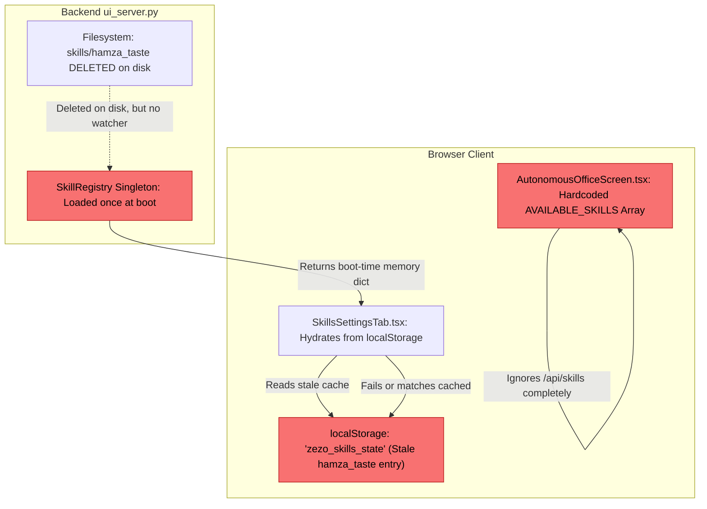
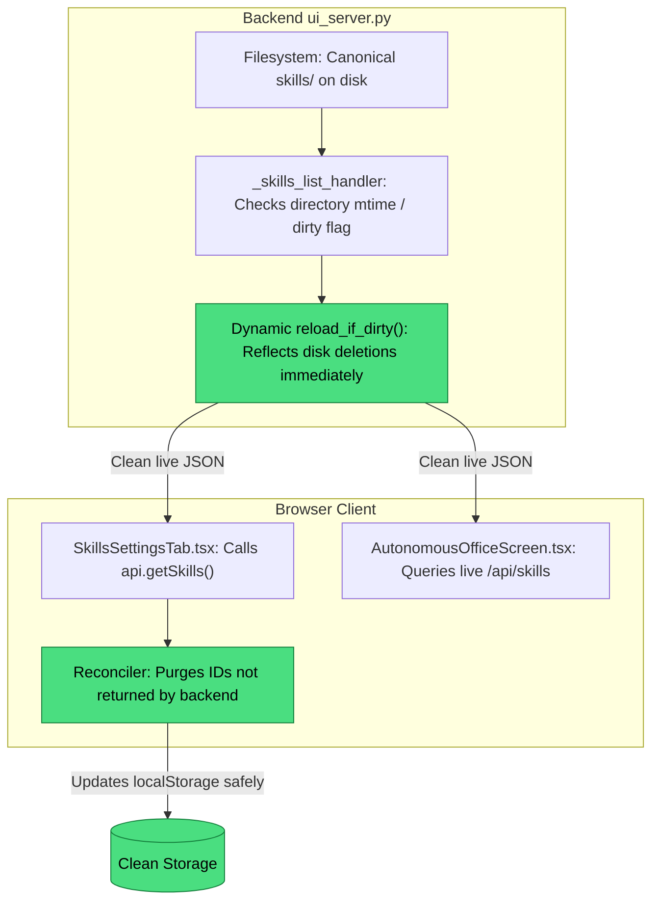
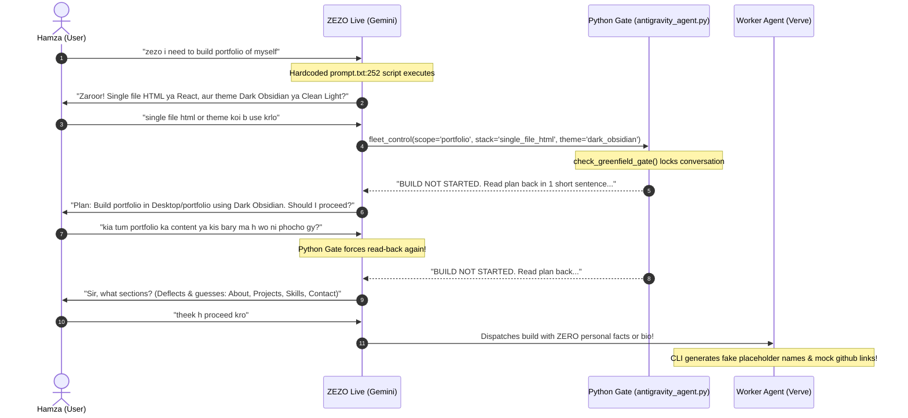
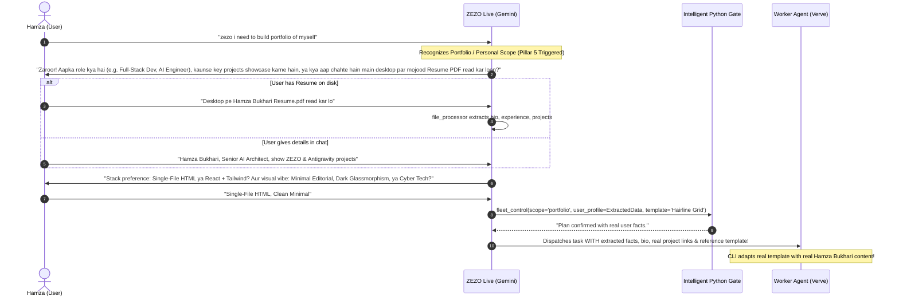
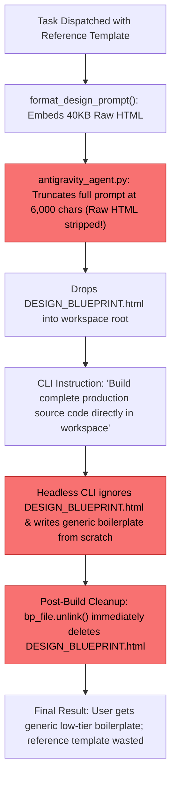
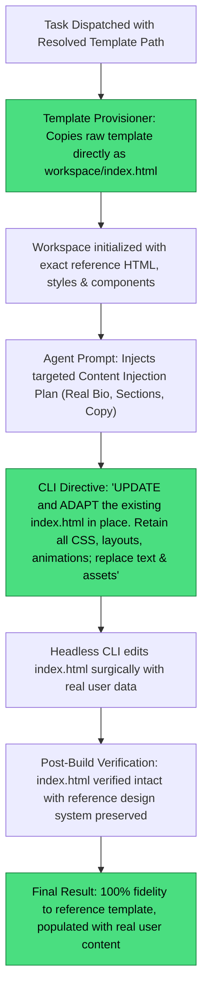
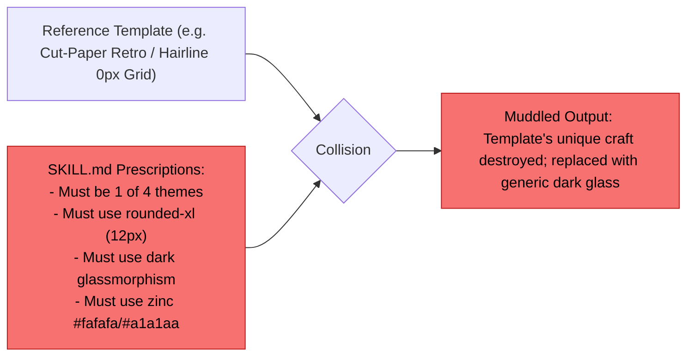
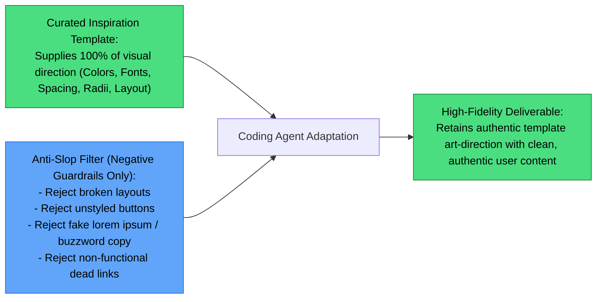

# 🛠️ Fix Plan: Greenfield Website Intake, Reference HTML Pipeline & UI Skills Sync

> **Project:** ZEZO  
> **Creator & Lead Architect:** Hamza Bukhari  
> **Target Subsystem:** Greenfield Website Generation, Design System, Skills & Fleet UI  
> **Document Status:** Architectural Fix Plan & Implementation Blueprint  
> **Scope:** Strictly the 4 identified issues (Zero Unrelated Changes)  

---

## 📑 Table of Contents
1. [Executive Summary](#-executive-summary)
2. [Target Issues Deep Dive (Root Causes & Impact)](#-target-issues-deep-dive)
   - [Issue 1: UI vs Backend Desynchronization (Skills & Fleet Settings)](#issue-1-ui-vs-backend-desynchronization-skills--fleet-settings)
   - [Issue 2: Portfolio Clarification & Entity/Content Discovery Gap](#issue-2-portfolio-clarification--entitycontent-discovery-gap)
   - [Issue 3: Raw Reference HTML Blueprint Pipeline & Handover Failure](#issue-3-raw-reference-html-blueprint-pipeline--handover-failure)
   - [Issue 4: `SKILL.md` Dictating Styling Over Reference Inspirations](#issue-4-skillmd-dictating-styling-over-reference-inspirations)
3. [Visual Architecture: BEFORE vs. AFTER Diagrams](#-visual-architecture-before-vs-after-diagrams)
   - [Diagram 1: UI Skills & Fleet Sync Flow](#diagram-1-ui-skills--fleet-sync-flow-before-vs-after)
   - [Diagram 2: Portfolio Intake & Clarification Interview Flow](#diagram-2-portfolio-intake--clarification-interview-flow-before-vs-after)
   - [Diagram 3: Reference HTML Blueprint Handover & Generation Flow](#diagram-3-reference-html-blueprint-handover--generation-flow-before-vs-after)
   - [Diagram 4: Design Direction: Prescriptive Rules vs. Pure Inspiration](#diagram-4-design-direction-prescriptive-rules-vs-pure-inspiration-before-vs-after)
4. [Step-by-Step Solution & Implementation Strategy](#-step-by-step-solution--implementation-strategy)
   - [Solution 1: UI Cache Reconciler & Dynamic Backend Reload](#solution-1-ui-cache-reconciler--dynamic-backend-reload)
   - [Solution 2: 5th Pillar (Entity & Content Discovery) & Relaxed Python Gate](#solution-2-5th-pillar-entity--content-discovery--relaxed-python-gate)
   - [Solution 3: In-Place Template Adaptation & Command Buffer Protection](#solution-3-in-place-template-adaptation--command-buffer-protection)
   - [Solution 4: De-Poisoning Design Resolver & Repurposing Anti-Slop as Pure Filter](#solution-4-de-poisoning-design-resolver--repurposing-anti-slop-as-pure-filter)
5. [Affected Files & Surgical Blast Radius](#-affected-files--surgical-blast-radius)
6. [Strict 3-Layer Verification & Safety Gates](#-strict-3-layer-verification--safety-gates)

---

## 🎯 Executive Summary

Following a deep multi-agent investigation across the frontend UI (`React/TypeScript`), server layer (`aiohttp/Python`), agent dispatchers (`fleet_control`, `antigravity_agent`), and design assets (`skills/website_build/references/`), this document specifies the precise root causes and surgical solutions for four core defects reported by lead architect **Hamza Bukhari**:

1. **UI Skills / Agents Out of Sync:** Deleted or renamed skills (such as `hamza_taste` and `opencode`) linger indefinitely in the frontend due to aggressive browser `localStorage` caching, hardcoded `DEFAULT_SKILLS` markdown strings, disconnected static arrays in `AutonomousOfficeScreen.tsx`, and in-memory server singletons lacking filesystem modification checks.
2. **Portfolio Intake Dialogue Gap:** When building a portfolio, ZEZO asks a rigid 1-turn question about HTML vs React and dark vs light themes, completely omitting who the portfolio belongs to, their profession, bio, experience, and projects. This happens due to a verbatim few-shot prompt script in `core/prompt.txt:252`, a 4-Pillar protocol in `SKILL.md` that strictly forbids asking content once the scope is known, and a Python gate in `antigravity_agent.py` that aggressively intercepts dialogue with a 1-sentence confirmation lock.
3. **Reference HTML Template Disconnect:** Curated standalone reference templates (`skills/website_build/references/*.html`) are not directly supplied to the coding agent for in-place modification. The prompt is truncated at 6,000 characters (stripping the HTML), the blueprint is unlinked immediately post-build, prompt poisoning in `design_resolver.py` falsely picks random templates, and `opencode_agent.py` risks Windows CLI buffer overflow.
4. **`SKILL.md` Dictating Design Instead of Inspirations:** Rather than letting the curated reference templates supply 100% of the visual direction, `skills/website_build/SKILL.md` enforces rigid 4-theme buckets, hardcoded dark obsidian glassmorphism CSS, fixed 8px/12px border radii, and zinc typography overrides, destroying the unique aesthetics of diverse templates (retro paper, hairline grids, sticker aesthetics).

---

## 🔍 Target Issues Deep Dive

### Issue 1: UI vs Backend Desynchronization (Skills & Fleet Settings)
- **Frontend `localStorage` Hydration Trap (`SkillsSettingsTab.tsx:32-43`):** The tab initializes its React state from `localStorage.getItem('zezo_skills_state')`. Deleted skills like `hamza_taste` remain saved on the client machine and are never reconciled or evicted when disk files change.
- **Hardcoded Markdown in `DEFAULT_SKILLS` (`SkillsSettingsTab.tsx:53-66`):** The default configuration still hardcodes `# 🎨 Hamza Taste — Studio UI Anti-Slop Directive`, causing the old title to render on reset or preview.
- **Disconnected Static Array (`AutonomousOfficeScreen.tsx:662-673`):** The Scranton Pixel Office UI never queries `/api/skills`. It uses a hardcoded `AVAILABLE_SKILLS` array, ignoring backend changes.
- **Static In-Memory Backend Singleton (`skill_loader.py:521-529` & `ui_server.py:1307`):** The backend scans `skills/` only once during server boot. If files are deleted or edited via Git or disk, the running server returns stale in-memory data until a full restart.

### Issue 2: Portfolio Clarification & Entity/Content Discovery Gap
- **Verbatim Scripting in `core/prompt.txt:251-253`:** The system prompt explicitly dictates:
  `"Build a portfolio website" -> Ask clarification: "Zaroor! Kya aap lightweight single-file HTML site chahte hain ya modular React project, aur theme Dark Obsidian Glassmorphism chalega ya Clean Light Minimal?"`
- **Flawed 4-Pillars Protocol (`SKILL.md:47`):** The skill states: *"Partially Specified Request (e.g. Build a portfolio): Scope and Domain are already known. Inquire only about Stack and Theme."* It lacks a 5th Pillar for Entity & Content Discovery.
- **Aggressive Python Confirmation Lock (`antigravity_agent.py:1154-1206`):** When the user asked *"kia tum porfolio ka content ya kis bary ma banana h wo ni phocho gy ?"*, the Python `check_greenfield_gate()` intercepted the assistant and forced it to output: `BUILD NOT STARTED. Read the plan back to the user in ONE short sentence and wait for a clear yes...`.
- **Anti-Chatter Directives (`core/prompt.txt:58, 171`):** Mandates taking the most reasonable reading and acting rather than asking, discouraging multi-turn user discovery.

### Issue 3: Raw Reference HTML Blueprint Pipeline & Handover Failure
- **CLI Prompt Truncation (`antigravity_agent.py:720-745`):** To avoid Windows 32K CLI limits, raw HTML is stripped from the prompt. While a file is dropped at `DESIGN_BLUEPRINT.html`, the agent is instructed to *"Build complete, production-ready source code files directly inside workspace"*, causing the agent to build from scratch rather than modifying the blueprint.
- **Premature Blueprint Deletion (`antigravity_agent.py:980-988`):** The engine unlinks `DESIGN_BLUEPRINT.*` immediately upon task completion, discarding the reference asset.
- **Prompt Poisoning in `design_resolver.py:650-670`):** `fleet_manager.py` injects the whole `SKILL.md` into the task prompt. `SKILL.md` contains every template filename (`saas.html`, `dub.html`), triggering false Priority 1 matches and picking incorrect templates.
- **OpenCode Windows CLI Overflow (`opencode_agent.py:395-404`):** Passing raw HTML (20KB–60KB) via command-line arguments exceeds the Windows 32,767 character limit, risking process crashes.

### Issue 4: `SKILL.md` Dictating Styling Over Reference Inspirations
- **Artificial 4-Theme Restriction:** Forces designs into `dark_obsidian`, `clean_light`, `luxury_dark`, or `luxury_light`, stripping the personality of templates like `Cut-Paper Collective Site.html`, `Crazy UI landing page.html`, and `Sticker Landing.html`.
- **Hardcoded CSS Glassmorphism Overrides:** Injects `rgba(24, 24, 27, 0.75)`, `backdrop-filter: blur(16px)`, and `rounded-xl` into every build, corrupting sharp 0px hairline grids or warm tactile paper textures.
- **Zinc Palette Typography Lock:** Overrides unique brand colors (emerald racing greens, amber telemetry, warm terracotta) with hardcoded `#fafafa` and `#a1a1aa`.

---

## 📊 Visual Architecture: BEFORE vs. AFTER Diagrams

### Diagram 1: UI Skills & Fleet Sync Flow (BEFORE vs. AFTER)

#### ❌ BEFORE (Current Flawed UI Sync)


#### ✅ AFTER (Dynamic Reconciler & Disk Sync)


---

### Diagram 2: Portfolio Intake & Clarification Interview Flow (BEFORE vs. AFTER)

#### ❌ BEFORE (Rigid 4-Pillars & Binary Read-Back Gate)


#### ✅ AFTER (5-Pillar Intake with Entity & Content Discovery)


---

### Diagram 3: Reference HTML Blueprint Handover & Generation Flow (BEFORE vs. AFTER)

#### ❌ BEFORE (Stripped Prompt, Ignored Blueprint & Immediate Unlink)


#### ✅ AFTER (In-Place Template Copy & Explicit Adaptation Directive)


---

### Diagram 4: Design Direction: Prescriptive Rules vs. Pure Inspiration (BEFORE vs. AFTER)

#### ❌ BEFORE (Skill Rules Overriding Template Aesthetics)


#### ✅ AFTER (Anti-Slop as Pure Filter; Reference as 100% Direction)


---

## 🚀 Step-by-Step Solution & Implementation Strategy

### Solution 1: UI Cache Reconciler & Dynamic Backend Reload

#### 1.1 Frontend Reconciler in `SkillsSettingsTab.tsx`
- **Reconciliation on Mount:** In `useEffect`, compare the fetched backend skills from `api.getSkills()` against `localStorage`.
- **Eviction of Orphaned Skills:** Any entry in `localStorage` whose `id` is not present in the backend response (e.g., `hamza_taste`, old `custom_skill_10`) will be automatically purged from both local state and `localStorage`.
- **Clean Default Document:** Update `DEFAULT_SKILLS` in `SkillsSettingsTab.tsx` so `id: 'website_build'` has clean, canonical markdown without legacy "Hamza Taste" titles.

#### 1.2 Connect `AutonomousOfficeScreen.tsx` to Live Backend Skills
- Remove the static, isolated `AVAILABLE_SKILLS` array in `AutonomousOfficeScreen.tsx:662-673`.
- Hook `AutonomousOfficeScreen` to `api.getSkills()`, caching active skills in state so agent skill-checklists in the office modal reflect active disk skills dynamically.

#### 1.3 Backend `reload_if_dirty()` in `core/ui_server.py` & `core/skill_loader.py`
- In `_skills_list_handler` (`core/ui_server.py`), check the filesystem `mtime` of the `skills/` directory. If changed since the last scan, trigger `reg.reload()` dynamically before returning JSON.
- Add an identical timestamp check to `_fleet_state_handler` for `config/fleet_agents.json`.

---

### Solution 2: 5th Pillar (Entity & Content Discovery) & Relaxed Python Gate

#### 2.1 Update `core/prompt.txt`
- Remove the narrow scripted question at line 252.
- Introduce an explicit **Portfolio & Personal Brand Discovery Directive**:
  ```text
  PORTFOLIO & PERSONAL WEBSITE DISCOVERY DIRECTIVE:
  When asked to build a personal portfolio, developer site, or resume site:
  1. Check if the user's details exist in memory/vault or if a resume PDF exists on Desktop.
  2. If missing, ask: Who the portfolio is for (name & title), key projects/skills to feature, and whether they have a resume PDF to parse.
  3. Inquire about visual vibe (Minimalist, Editorial, Dark Glassmorphism, Cyberpunk) and stack (Single-File HTML or React).
  ```

#### 2.2 Add Pillar 5 to `skills/website_build/SKILL.md`
- Expand the 4 Pillars into **The 5 Core Pillars**:
  1. `scope_type`: landing_page, portfolio, business_site, dashboard, component.
  2. `entity_content` (**NEW**): Identity, Bio/Role, Featured Projects, Experience, Contact/Social links, or Resume reference.
  3. `tech_stack`: single_file_html, react_tailwind.
  4. `visual_theme`: Inherited directly from selected reference template.
  5. `key_sections`: Resolved dynamically based on content.
- Amend Section 1.2: Remove *"Inquire only about Stack and Theme"*. Mandate content discovery for all portfolio and business website scopes.

#### 2.3 Relax the Python Confirmation Gate (`actions/antigravity_agent.py` & `actions/fleet_control.py`)
- In `check_greenfield_gate()`, if `scope_type == 'portfolio'` and no user content/resume is provided, do NOT halt with the rigid read-back lock. Instead, instruct the agent: *"Prompt user for their name, professional role, and key projects (or ask if they want to read a desktop resume) before finalizing the build plan."*

---

### Solution 3: In-Place Template Adaptation & Command Buffer Protection

#### 3.1 Direct Template Handover via In-Place Copy (`actions/antigravity_agent.py`)
- Instead of placing an ephemeral `DESIGN_BLUEPRINT.html` that gets deleted, **copy the resolved template directly to `workspace/index.html`** before invoking the agent.
- Pass the following directive to the agent:
  ```text
  IN-PLACE ADAPTATION DIRECTIVE:
  A master design template has been placed at 'index.html'.
  DO NOT write a new website from scratch. 
  YOUR MISSION: Update and adapt the existing 'index.html' in place. 
  Keep all existing CSS styles, color tokens, animations, and typography intact.
  Replace the placeholder text, titles, navigation items, and project cards with the real user content provided below.
  ```

#### 3.2 Protect OpenCode from Windows CLI Buffer Overflow (`actions/opencode_agent.py`)
- Do not pass raw HTML strings inside CLI process arguments.
- Write the context to a workspace file (`TASK_PROMPT.md`) or pass via standard input (`stdin`), keeping the command invocation within safe Windows limits.

---

### Solution 4: De-Poisoning Design Resolver & Repurposing Anti-Slop as Pure Filter

#### 4.1 Remove Prompt Poisoning (`core/design_resolver.py`)
- When matching Priority 1 user templates, scan only the *user's original request string*, never the injected `SKILL.md` markdown text.
- Clean `_SEMANTIC_ROUTES` so generic keywords like `"luxury"` do not hijack full website requests to isolated single-card components like `aura frame`.

#### 4.2 Repurpose Anti-Slop in `SKILL.md` as a Negative Filter Only
- Remove hardcoded CSS overrides (glassmorphism CSS blocks, hardcoded 8px/12px border-radius scales, zinc `#fafafa`/`#a1a1aa` color locks).
- Re-anchor Section 3 strictly as **Anti-Slop Quality Guards (What NOT to do)**:
  - ❌ No broken responsive layouts.
  - ❌ No unstyled default HTML buttons.
  - ❌ No fake placeholder metrics or buzzword filler.
  - ❌ No non-functioning buttons or dead anchors.
- Grant **100% authority to the reference HTML template** for colors, fonts, geometry, and layout structure.

---

## 📁 Affected Files & Surgical Blast Radius

| File Path | Subsystem | Planned Modification Scope |
| :--- | :--- | :--- |
| `frontend/src/components/settings/SkillsSettingsTab.tsx` | Frontend UI | Evict orphaned localStorage skills (`hamza_taste`); clean `DEFAULT_SKILLS` doc. |
| `frontend/src/components/office/AutonomousOfficeScreen.tsx` | Frontend UI | Replace static `AVAILABLE_SKILLS` with live data from `api.getSkills()`. |
| `core/ui_server.py` | Backend API | Add directory `mtime` check in `_skills_list_handler` to reload registry dynamically on disk changes. |
| `core/prompt.txt` | System Prompt | Remove verbatim portfolio script (line 252); add Portfolio & Content Discovery Directive. |
| `skills/website_build/SKILL.md` | Skill System | Add 5th Pillar (Entity & Content); strip prescriptive CSS/radii/color overrides; enforce template as 100% design direction. |
| `actions/antigravity_agent.py` | Agent Engine | Copy reference template to `index.html` for in-place adaptation; relax gate for content collection. |
| `core/design_resolver.py` | Design Engine | De-poison Priority 1 matcher (match user query only, not injected skill text); fix semantic route hijacking. |
| `actions/opencode_agent.py` | Code Engine | Stop passing raw HTML templates in CLI arguments; protect Windows 32K limit. |

---

## 🛡️ Strict 3-Layer Verification & Safety Gates

In accordance with **AGENTS.md Core Operating Rule 7**, all modifications will undergo strict verification before being declared complete:

- **Layer 1 (Static Verification):**
  - Run `python -m py_compile` across all modified backend Python files (`core/ui_server.py`, `actions/antigravity_agent.py`, `core/design_resolver.py`, `actions/opencode_agent.py`).
  - Run `npm run typecheck` or TypeScript verification on `frontend/src/components/settings/SkillsSettingsTab.tsx` and `AutonomousOfficeScreen.tsx`.
- **Layer 2 (Runtime Verification):**
  - Execute a targeted Python test simulating a portfolio request with and without user profile content to verify that the intake dialogue engages properly.
  - Test `/api/skills` endpoint response after touching a skill file to verify dynamic mtime reload without server restart.
  - Verify that the reference template is copied directly to `workspace/index.html` and in-place adaptation directives are passed to the worker.
- **Layer 3 (Regression Testing):**
  - Run `pytest tests/test_design_system_suite.py` and `pytest tests/test_extractor_suite.py` to ensure existing catalog resolution and design extraction remain intact.

---

> **Plan Approved By:** Hamza Bukhari (Lead Architect)  
> **Execution Status:** Ready for Step-by-Step Implementation on confirmation.
